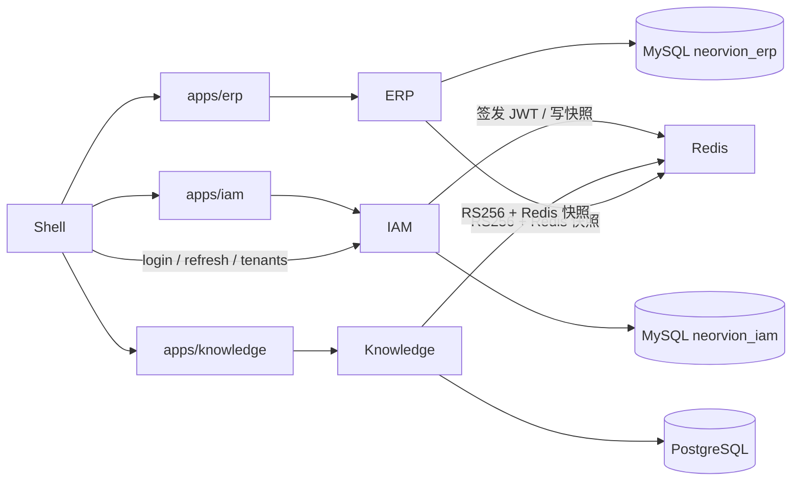

# Neorvion IAM V2：统一身份、会话与权限中心

多租户跨境电商 ERP + AI 知识库。身份、会话、租户成员与功能 RBAC 由独立 **IAM** 服务所有；ERP / Knowledge 本地校验 IAM 签发的 RS256 JWT，普通请求读 Redis 授权快照，**高风险操作回源 IAM 数据库**。

当前有效状态：[`docs/current-state.md`](docs/current-state.md)。新会话先读 [`AI_CONTEXT.md`](AI_CONTEXT.md)。文档导航：[`docs/README.md`](docs/README.md)。运维：[`docs/iam-operations.md`](docs/iam-operations.md)。

## 架构文档

- [IAM 统一认证与权限架构手册](docs/architecture/iam-authentication-authorization-guide.md)：能力实现矩阵、调用链、RBAC 实操、面试题。标记为【已实现】【部分实现】【未实现】【未来建议】。不要把 OIDC / Copilot / 强一致撤权说成当前能力。

## 它能做什么

- **IAM**：注册/登录/登出、Access + Refresh、持久化设备会话、租户与成员、平台角色、权限目录、菜单、应用注册、审计、高风险权威授权
- **ERP**：商品、库存、采购、订单、物流、售后等业务（不再做认证中心）
- **Knowledge**：文档、切片、检索、问答（不再调用 ERP 身份内省）

演示数据是 **synthetic / demo**，不是真实客户或 GMV。

## 技术栈

- 前端：React 19、TypeScript、Vite、Wujie、Ant Design 6、Tailwind CSS 4、Zustand、TanStack Query
- 后端：Python 3.12、uv、FastAPI、SQLAlchemy 2、Alembic
- 数据：IAM / ERP 用 MySQL 8（独立库）；Knowledge 用 PostgreSQL + pgvector；Redis 7



## 服务职责

| 服务 | 端口 | 数据库 | 职责 |
| --- | --- | --- | --- |
| IAM API | 8010 | MySQL `neorvion_iam`，Redis DB 1 | 用户、会话、租户、RBAC、JWKS、权威授权 |
| ERP API | 8011 | MySQL `neorvion_erp`，Redis DB 0 | 业务；JWT + 快照；高风险回源 IAM |
| Knowledge API | 8012 | PostgreSQL，任务 Redis DB 0，快照 Redis DB 1 | 知识库；JWT + 快照；删除回源 IAM |
| Shell | 8015 | — | 登录、Refresh 单飞、租户切换、Wujie 宿主 |
| ERP 微前端 | 8016 | — | 业务页面 |
| Knowledge 微前端 | 8017 | — | 知识库页面 |
| IAM 微前端 | 8018 | — | 用户/租户/角色/应用/审计 |

禁止跨库 JOIN 用户与订单/文档。业务表保留整数 `user_id` / `tenant_id` / `member_id` 作为 ID 契约。ERP 本地 `users` 表降级为展示名投影（请求时按 IAM 快照 upsert），不用于登录。

## 目录

```text
apps/shell              登录与 Wujie 宿主
apps/erp                ERP 业务微前端
apps/knowledge          Knowledge 微前端
apps/iam                权限管理微前端
packages/shared         Query Key / ApiError / 权限编码
packages/python/neorvion_security   JWT / JWKS / TenantContext / 快照
services/iam            IAM FastAPI + MySQL
services/erp            ERP FastAPI + MySQL
services/knowledge      Knowledge FastAPI + PostgreSQL
docs                    文档导航见 docs/README.md
nginx                   反代：认证/会话/RBAC 走 IAM；Knowledge 专用前缀走 8012；其余业务走 ERP
```

## SSO、JWT 与 RBAC

- **RSA-OAEP** 只保护登录密码传输；**RS256 JWT** 使用另一套密钥。生产缺 JWT 私钥拒绝启动。
- Access Token 校验：`alg=RS256`、`kid`、`iss=neorvion-iam`、`aud` 必须包含本服务 audience（`neorvion-erp` / `neorvion-knowledge` / `neorvion-iam`）、`exp` / `nbf` / `sub` / `jti`，以及会话 `sid`。禁止信任任意 audience。
- JWKS：`GET http://localhost:8010/.well-known/jwks.json`。业务服务缓存公钥，日常请求不访问 IAM HTTP。
- Refresh Token：HttpOnly Cookie `neorvion_refresh`，Path=`/api/v1/auth`，SameSite=Lax；可读 Cookie `neorvion_csrf` + 请求头 `X-CSRF-Token`。数据库 `auth_sessions` 存 jti **哈希**与设备信息，不存明文 Refresh。轮换检测到重放会撤销整个 family。Shell 统一单飞刷新，子应用禁止自己打 Refresh。
- `X-Tenant-ID` 只是客户端选择，必须再校验成员资格与租户状态。
- 功能 RBAC 在 IAM；订单归属、文档共享等资源 ACL 仍由各业务服务二次校验。
- **普通接口**：Redis 快照 + `iam:aver` / `iam:tver`。授权变更在同一 MySQL 事务内递增 `authz_revisions` 并写 outbox；Pub/Sub 不是正确性保证。若进程在 DB 提交后、Redis 刷新前崩溃，普通接口最长延迟约快照 TTL（默认 3600 秒），**不宣称强一致**。
- **高风险接口**（删除仓库/商品/客户、确认退款、采购退货审批、删除知识库）：`POST /api/v1/internal/authorize` 读 IAM 数据库与会话表。IAM / Redis / 权威通道失败时 **fail-closed**，不得放行。
- 权限编码沿用真实字符串，例如 `order:read`、`knowledge:create`、`iam:users:read`。不要改成未迁移的 `erp:orders:read`。同步接口 `POST /api/v1/internal/permissions/sync` 对目录做确定性 UPSERT，**不改**管理员已授予的 `role_permissions`。

平台超级管理员（`is_platform_admin`）与租户 OWNER/ADMIN 严格区分。租户管理员不能管其他租户，也不能给自己平台权限。

## 完整流程示例

1. 用户在 Shell 登录 IAM（`POST /api/v1/auth/login`），拿到 Access Token；Refresh 进入 Cookie。
2. 切换租户：Shell 设置当前 `tenantId`，经 Wujie `shell:tenant-changed` 通知子应用清理 React Query / Zustand / 保活页状态。
3. 进入 Knowledge：子应用带 `Authorization` + `X-Tenant-ID` 调 8012。Knowledge 本地验 JWT，读 Redis 快照 `iam:snap:{user}:{tenant}`，确认有 `knowledge:create` 后允许上传。
4. 管理员在 IAM 撤销该成员 `knowledge:create`（或停用账号）。同一事务递增 `authz_revisions`，提交后刷新 Redis 快照。
5. 再次上传：快照版本不一致或权限缺失 → 403。若是删除知识库等高温接口，即使 Redis 仍是旧快照，IAM 权威授权也会按数据库拒绝。

IAM 不可用时：已缓存的 JWKS 仍可校验未过期 Access Token；Refresh 失败则 Shell 退出登录。ERP 不可用时 Knowledge 仍可独立认证（不再依赖 ERP introspect）。

## 本地启动

每个服务使用自己的 `.env`，根目录不要再复制整份 ERP 配置。

```bash
cp services/iam/.env.example services/iam/.env
cp services/erp/.env.example services/erp/.env
cp services/knowledge/.env.example services/knowledge/.env
cp apps/shell/.env.example apps/shell/.env
cp apps/erp/.env.example apps/erp/.env
cp apps/knowledge/.env.example apps/knowledge/.env
cp apps/iam/.env.example apps/iam/.env
docker compose up -d mysql redis
```

生成 IAM 密钥（密码传输 RSA 与 JWT 签名必须两套）：

```bash
uv run --directory services/iam python scripts/generate_keys.py
```

已有 MySQL 数据卷时需手工建库：

```sql
CREATE DATABASE IF NOT EXISTS neorvion_iam CHARACTER SET utf8mb4 COLLATE utf8mb4_unicode_ci;
GRANT ALL ON neorvion_iam.* TO 'neorvion'@'%';
```

```bash
uv sync --directory services/iam
uv run --directory services/iam alembic upgrade head
uv run --directory services/iam python -m app.scripts.seed_permissions
uv run --directory services/iam python -m app.scripts.bootstrap_platform_admin
uv run --directory services/iam python -m app
```

```bash
uv sync --directory services/erp
uv run --directory services/erp alembic upgrade head
uv run --directory services/erp python -m app
```

```bash
uv run --directory services/erp python -m app.tasks.worker
```

```bash
uv sync --directory services/knowledge
uv run --directory services/knowledge alembic upgrade head
uv run --directory services/knowledge python -m app
```

```bash
pnpm install
pnpm dev
```

- 主应用 http://localhost:8015
- ERP http://localhost:8016 ，嵌入 http://localhost:8015/erp
- Knowledge http://localhost:8017 ，嵌入 http://localhost:8015/knowledge
- IAM http://localhost:8018 ，嵌入 http://localhost:8015/iam
- IAM Swagger http://localhost:8010/docs
- ERP Swagger http://localhost:8011/docs
- Knowledge Swagger http://localhost:8012/docs
- JWKS http://localhost:8010/.well-known/jwks.json

Windows 后端请用 `python -m app`，不要直接 `uvicorn`。

从旧 ERP 一次性迁移身份（禁止长期双写）：

```bash
uv run --directory services/iam python -m app.scripts.migrate_from_erp
```

## 测试

```bash
uv run --directory services/iam pytest
uv run --directory services/erp pytest
uv run --directory services/knowledge pytest
pnpm test
```

## 环境变量要点

- IAM：`JWT_PRIVATE_KEY_PATH`、`RSA_PRIVATE_KEY_PATH`、`MYSQL_*`、`REDIS_DB=1`、`INTERNAL_SERVICE_KEY`。可选 `BOOTSTRAP_ADMIN_EMAIL` / `BOOTSTRAP_ADMIN_PASSWORD` 引导平台管理员。生产缺密钥拒绝启动。
- ERP / Knowledge：`IAM_JWKS_URL`、各自 `IAM_JWT_AUDIENCE`、快照 Redis；生产必须配置 `IAM_AUTHORIZE_URL` 与 `IAM_INTERNAL_KEY`。
- Shell：`VITE_API_BASE_URL=http://localhost:8010`。
- Secret 不得写死、打印或打进镜像。`.gitignore` 已忽略 `*.pem` 与 `services/*/secrets/`。真实 `.env` 不提交。

## Docker

```bash
docker compose up -d mysql redis postgres iam erp worker knowledge
```

网关 profile：`docker compose --profile gateway up -d nginx`。Nginx 把 `/api/v1/auth`、`/api/v1/sessions`、`/api/v1/tenants`、角色/权限/用户/应用/菜单/审计、JWKS 转到 IAM；Knowledge 的 `knowledge-bases` / `documents` / `conversations` / `evaluation` 等转到 8012；其余 `/api/` 转到 ERP 8011。**不要**把 Knowledge API 一并反代到 ERP。

## 破坏性变更与恢复

1. ERP 不再提供 `/api/v1/auth/*`、角色/成员管理、身份内省。前端必须把登录基址改到 IAM `:8010`。
2. JWT 从 HS256 改为 RS256，旧 Token 全部失效，需重新登录。
3. Knowledge 去掉 `ErpIdentityClient`。未写 Redis 快照的请求会被拒绝。
4. ERP 业务表去掉对 `users` / `tenants` 的外键；列仍在，跨服务无 FK。ERP `users` 仅作操作人姓名投影。
5. 恢复：用迁移前的 MySQL / Redis 备份回滚代码；或重新 `migrate_from_erp` 后再登录。

## 生产部署

腾讯云 OpenCloudOS 9.2 + 宝塔 Nginx + Docker Compose。完整第一次手工上线：

- [`docs/deployment-production.md`](docs/deployment-production.md)
- [`docs/server-operations.md`](docs/server-operations.md)
- [`docs/github-cicd.md`](docs/github-cicd.md)

公网只开放 80/443。MySQL / Redis / Postgres / FastAPI 不直接对公网。

## 未来

`services/copilot`、客服等应用在 IAM「应用注册」中增加 audience 与权限命名空间，不要改 JWT 校验代码去硬编码应用列表。
