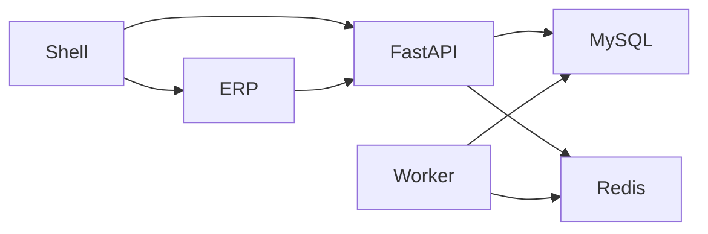

# Neorvion ERP Core V1

多租户跨境电商 ERP。当前仓库是 **ERP Core 第一阶段收口**，不是每个版本重建的项目。

后续阶段：ERP Copilot / Agent、RAG、事件驱动分析。Agent 不直接写 ERP 数据库。

当前有效状态：[`docs/current-state.md`](docs/current-state.md)。新会话先读 [`AI_CONTEXT.md`](AI_CONTEXT.md)。文档导航：[`docs/README.md`](docs/README.md)。

## 它能做什么

SaaS 多租户、RBAC、商品/SKU、仓库、库存一致性、采购与收货、销售预占与出库、物流签收、盘点调拨、销售售后、采购退货、经营看板、业务事件、操作日志、异步任务。

演示数据是 **synthetic / demo**，不是真实客户或 GMV。

## 技术栈

- 前端：React 19、TypeScript、Vite、Wujie、Ant Design 6、Tailwind CSS 4、Zustand、TanStack Query
- 后端：Python 3.12、uv、FastAPI、SQLAlchemy 2、Alembic、MySQL 8、Redis 7、独立 Worker



## 关键设计

- **多租户**：`users` 无 `tenant_id`；业务表有 `tenant_id`；跨租户 404
- **RBAC**：Permission 全局目录，Role 租户内；按钮隐藏不是安全边界
- **库存**：`available` 不落库；确认订单只预占；出库同时减实数和预占
- **事务**：Repository 不 commit；Service 管边界；多 SKU 升序加锁
- **事件 / 任务**：Outbox 与主事务同写；Worker 消费 Redis List 中的 `task_id`

## 目录

```text
apps/shell              登录与 Wujie 宿主
apps/erp                ERP 业务微前端
apps/knowledge          Knowledge 微前端
packages/shared         Query Key / ApiError
services/erp            ERP FastAPI + MySQL
services/knowledge      Knowledge FastAPI + PostgreSQL
docs                    文档导航见 docs/README.md
nginx                   反代示例
```

## 本地启动

```bash
cp .env.example .env
cp .env.example services/erp/.env
cp apps/shell/.env.example apps/shell/.env
cp apps/erp/.env.example apps/erp/.env
docker compose up -d mysql redis
```

后端可在仓库根目录启动（`uv run --directory` 使用对应服务的 venv 与 `.env`；端口见 `APP_PORT`）：

```bash
uv sync --directory services/erp
uv run --directory services/erp alembic upgrade head
uv run --directory services/erp python -m app.scripts.seed_permissions
uv run --directory services/erp python -m app
```

另开终端启动 Worker：

```bash
uv run --directory services/erp python -m app.tasks.worker
```

```bash
pnpm install
pnpm dev
```

- 主应用 http://localhost:8015
- ERP 独立 http://localhost:8016
- 嵌入 ERP http://localhost:8015/erp
- Knowledge 独立 http://localhost:8017
- 嵌入 Knowledge http://localhost:8015/knowledge
- ERP Swagger http://localhost:8011/docs
- Knowledge Swagger http://localhost:8012/docs
- 健康检查 http://localhost:8011/api/v1/health 、http://localhost:8012/api/v1/health

Knowledge 本地启动见 [`docs/knowledge.md`](docs/knowledge.md) 与 [`services/knowledge/README.md`](services/knowledge/README.md)。PostgreSQL 需单独准备，然后：

```bash
uv run --directory services/knowledge python -m app
```

端口 **8012**，Windows 必须用 `python -m app`，不要直接 `uvicorn`。

演示租户（不会在 API 启动时自动执行）：

```bash
# 用环境变量提供账号，不要把真实密码写进 Git
export DEMO_EMAIL=...
export DEMO_PASSWORD=...
uv run --directory services/erp python -m app.scripts.seed_demo
```

已存在 `code=neorvion-demo` 时直接跳过，不会重复插入。

## 测试

```bash
uv run --directory services/erp pytest
uv run --directory services/erp ruff check app tests
```

```bash
pnpm test
pnpm --filter @neorvion/shell build
pnpm --filter @neorvion/erp build
pnpm --filter @neorvion/knowledge test
```

```bash
uv run --directory services/knowledge pytest
uv run --directory services/knowledge ruff check app tests
```

## 生产部署

腾讯云 OpenCloudOS 9.2 + 宝塔 Nginx + Docker Compose。完整第一次手工上线：

- [`docs/deployment-production.md`](docs/deployment-production.md)（主入口）
- [`docs/server-operations.md`](docs/server-operations.md)
- [`docs/github-cicd.md`](docs/github-cicd.md)

本地开发 Docker 仍见 [`docs/deployment.md`](docs/deployment.md)。公网只开放 80/443。MySQL / Redis / Postgres / FastAPI 不直接对公网。

## 未来

ERP Copilot 将通过 Tool 调用现有只读查询 API；高风险写操作需要预览确认。设计见 [`docs/agent-readiness.md`](docs/agent-readiness.md)。
