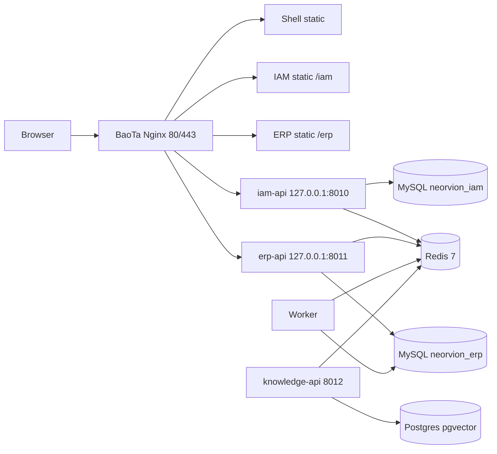

# 架构说明

当前定义：**Neorvion IAM V2 统一身份与权限中心**。有效范围见 `docs/current-state.md`。

## 目标

IAM 统一身份与功能 RBAC。ERP / Knowledge 作为业务服务本地校验 JWT。后续 Copilot 通过 IAM 应用注册扩展，不硬编码应用列表。

开发机：Shell 8015 / ERP 8016 / Knowledge 8017 / IAM 8018 / IAM API 8010 / ERP API 8011 / Knowledge API 8012。

后续 Copilot：`Agent → Tool → ERP API → TenantContext / RBAC → Service → DB`。Agent 不直连 MySQL。

## 前端

### 应用边界

- `apps/shell`：登录、注册、当前用户、当前租户、工作空间、顶部导航、Wujie 宿主
- `apps/erp`：业务菜单与页面，可独立启动
- `apps/iam`：用户、租户成员、角色、应用注册、审计
- `packages/shared`：路由常量、API 类型、Query Key、`ApiError`、租户请求头。ERP 业务菜单不放这里

主应用不得读取 ERP 内部 store。ERP 只通过 `window.$wujie.props` 与 bus 接收显式状态。

### 无界

宿主在 `apps/shell/src/micro`。默认 Shadow DOM。ERP / Knowledge `alive: true`，离开挂载前缀不销毁。租户切换发 `shell:tenant-changed` 并隔离 Query 缓存、重置不安全的子应用详情路由，不 `destroyApp`。关闭 Wujie 原生 `sync`。

### 状态

- Zustand：Access Token、当前租户 UI、`isSwitching`。ERP 多页签在子应用内 `useTabsStore`（persist / localStorage），不放进 Shell。Tab UI 用 `@sinm/react-chrome-tabs`，不承载页面内容
- React Query：服务端数据。租户 Key 必须 `['tenant', tenantId, ...]`。不要用 React Query 存 Tab UI 状态
- 切换租户：取消并移除旧 tenant 查询，不清空整个 QueryClient；ERP Tab 重置为工作台

### 样式

Tailwind CSS 4 + 必要 SCSS Modules。Ant Design 只走 ConfigProvider Token。V6.1 布局：`#root` 100%、Flex、`min-height: 0`、Table 内部滚动。

## 后端分层

1. API Router：HTTP、校验、权限依赖
2. Service：状态机、事务、锁顺序
3. Repository：查询与持久化，禁止 commit
4. Model / Schema
5. Core：配置、安全、异常、日志、TenantContext

库存调整 `SELECT FOR UPDATE`；预占/扣减用条件 UPDATE。收货、出库、盘点、调拨、退货与库存共用同一 Session。`*_within_transaction` 不单独 commit。

报表走 Analytics Repository，SQL 聚合，不把明细拉到 Python 再 sum。

## 认证与授权

- Access Token：IAM 签发的 RS256 JWT，业务服务本地验签
- Refresh：IAM HttpOnly Cookie，Redis `GETDEL` 轮换。ERP 不轮换 Refresh
- 密码传输：IAM RSA-OAEP，与 JWT 密钥分开
- `X-Tenant-ID` 必须再校验 IAM 授权快照，不能当成成员证明
- `require_permission` 读快照编码；OWNER 不是未知权限后门
- ERP 数据库无 `users` / `tenant_members`；单据姓名走 `identity_name_snapshots`

## 事件与任务

- `system_events` Outbox，与主事务同写，after_commit 入 Redis
- Worker 消费 `task_id`，状态在 `async_tasks`
- 不用 Celery / FastAPI BackgroundTasks 跑关键长任务
- `app/agents` 预留，Core V1 不实现

## 连接池

当前默认 `pool_size=5`、`max_overflow=5`、`pool_pre_ping=True`、`pool_recycle=3600`。面向 2C2G 单实例，不要按网上海量连接模板放大。每个请求一个 Session，Worker 另开连接，10 个总量足够开发与小型演示。

## Redis

任务队列、Refresh 会话、RSA challenge、Worker 心跳、可选限流。**禁止**缓存强一致库存 quantity。

## 端口

| 服务 | 端口 |
| --- | --- |
| Shell | 8015 |
| ERP | 8016 |
| FastAPI | 8011（公网不直接暴露） |
| Knowledge 微前端 | 8017 |
| Knowledge FastAPI | 8012（公网不直接暴露） |
| MySQL | 3306（不公网） |
| PostgreSQL | 5432（Knowledge + pgvector，不公网） |
| Redis | 6379（不公网） |
| Nginx | 80 / 443 |
