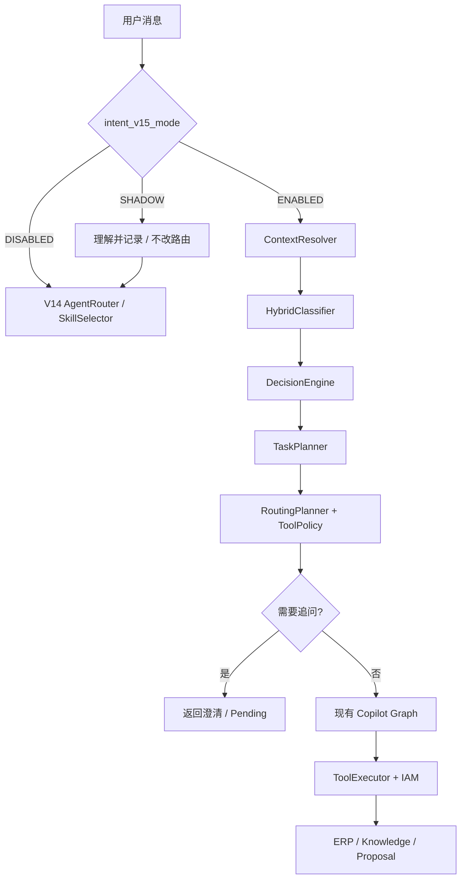
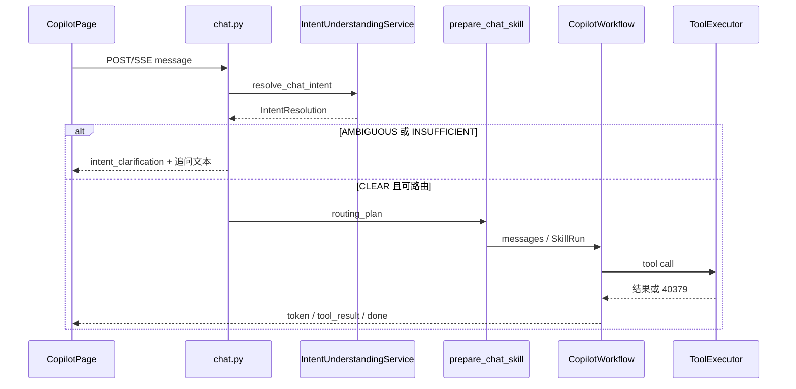

# Copilot V15：意图理解与路由基础

> 以 `services/copilot` 当前源码为准。本文讲的是 **Copilot V15**，不是 ERP Core 的 `docs/versions/v15.md`。
>
> 默认 Feature Flag `intent_v15_mode=DISABLED`。未显式打开 ENABLED 时，Chat 仍走 V14 关键词路由。规则回放 125/125 不能当成真实模型或生产验收。

## 1. 什么是意图识别，解决了什么问题？

意图识别回答的是：**用户这句话到底想干什么**。它不负责查库存、不负责创建采购单、也不负责审批。

V14 里这句话被拆到了三处各自猜测：

- `TaskClassifier`：关键词/正则判断查询、分析、写操作。
- `AgentRouter`：领域词决定 single / multi / workflow。
- `SkillSelector`：词项重叠选出 Skill；HYBRID 也不是 Embedding。

结果是理解层和执行层缠在一起。一句「查一下库存」可能被库存分析 Skill 抢走；一句「查询库存并制定补货计划」可能只剩第一个任务；一句「删除订单怎么操作」可能被当成要删除。

V15 把理解做成独立层：先得到结构化的 Problem Type、Intent、Decision、任务计划和工具约束，再交给原来的 Graph、Skill、ToolExecutor、IAM 和 Proposal。

## 2. 为什么现有关键词路由不足？

关键词能抓住明确短句，但有四类它处理不好的情况：

1. **同一词多种用法**：「创建」可能是现在执行，也可能是「怎么创建」的教学，还可能是「不要创建」。
2. **一句话多个目标**：连接词切开后，旧 SkillSelector 只会命中一个 Skill。
3. **上下文**：「分析一下」单独看什么都不是，结合上一轮 SKU-001 才是库存分析。
4. **安全**：系统 Prompt 拦不住模型去调 `propose_action`。否定执行必须在 ToolExecutor 再挡一次。

所以 V15 仍保留规则快速路径，但规则只产生**候选信号**。最终能不能走业务路由，由 Decision Engine 和 Tool Policy 决定。

## 3. Problem Type / Intent / Agent / Skill / Tool 的区别

| 概念 | 回答的问题 | 例子 | 不代表什么 |
| --- | --- | --- | --- |
| Problem Type | 用户在做什么类型的事 | QUERY / ACTION / GUIDE / ANALYZE / CHAT / UNKNOWN | 不授予写权限 |
| Intent | 用户的业务目标 | `inventory.query`、`procurement.create_draft` | 不等于某个 Agent 或 Tool |
| Agent | 谁来谈、谁能调哪些只读工具 | `inventory_agent` | 命中不等于可写 ERP |
| Skill | 一段可重复的分析剧本 | `inventory-analysis` | 自动命中不能截断其他任务 |
| Tool | 真正能调用的下游能力 | `get_inventory`、`propose_action` | 必须过白名单、IAM、Schema |

「帮我创建采购单」是 ACTION + `procurement.create_draft`。这只说明目标是创建草稿，不表示现在可以写库。缺供应商时是 INSUFFICIENT；参数齐了也只打开 `propose_action` 候选，真实写入仍走 V5 Proposal 和确认。

「采购单怎么创建」是 GUIDE + `procurement.how_to`。候选 Agent 偏向 `knowledge_agent`，写工具被服务端封死。

## 4. 当前真实调用链

ENABLED 时，Chat 入口是 `app/api/v1/chat.py` 的 `_prepare_with_intent`：

```text
用户消息
  → resolve_chat_intent()          # flags 的唯一判断点
      → IntentContextStore.load    # 租户/用户/会话隔离
      → ContextResolver.resolve
      → IntentUnderstandingService.resolve
          → HybridIntentClassifier  # 规则，必要时 LLM
          → DecisionEngine.decide
          → MultiIntentTaskPlanner.plan
          → RoutingPlanner.plan
          → ToolAvailabilityPolicy.build
      → Store.save_resolution      # 仅 ENABLED 持久化 Pending
  → apply_resolution_to_runtime    # SHADOW 只挂结果，不改路由
  → 若 AMBIGUOUS/INSUFFICIENT 且需要追问：
        直接 complete_without_run，不进 Graph
  → prepare_chat_skill(..., routing_plan)
  → CopilotWorkflow / MultiAgentWorkflow
  → ToolExecutor（40379 写门禁）
  → ERP / Knowledge / Proposal
```

DISABLED 时 `IntentUnderstandingService` 立刻返回空结果，后续完全走 V14。

SHADOW 会跑完整分类并记 Trace，但 `applied=False`，AgentRouter 和 SkillSelector 仍按旧逻辑工作，也不会写入 Pending。SHADOW 默认不调分类 LLM，避免隐性计费。

## 5. Intent Registry 的设计

实现位置：`app/intent/schemas.py`、`catalog.py`、`registry.py`。

V15 用 Pydantic + 内存 Registry，没有独立意图管理后台。Intent 不是权限源。启动时校验：

- `intent_key` 唯一；
- 必填槽和可选槽不能重叠；
- `candidate_agents` / `candidate_skills` / `capability_hints` 必须落在已知集合；
- 声称可执行的 ACTION 必须有 capability；不可执行的意图不能假装有执行工具。

当前登记 22 个意图，覆盖真实 Copilot 能力，外加两个**只识别不执行**的意图：

- `sales.order_cancel`：能听懂「取消/删除订单」，`executable=False`；
- `product.price_change`：能听懂「涨点价」，没有改价工具。

LLM 只能返回 Registry 里存在的 key。非法 key 会被丢掉。UNKNOWN 不会被改写成某个业务意图。

## 6. Hybrid Classifier 为什么先规则后 LLM？

企业 ERP 里大量请求是短、明确、低风险的：「查一下库存」「你好」「查询昨天的销售额」。规则路径延迟低、结果稳定、不耗 Token，也方便单测。

规则快速通过有门槛，见 `RulesIntentClassifier.fast_path_allowed`：

- 必须有合法候选；
- 依赖上下文时必须已经解析出实体；
- 否定执行不能快速通过成 ACTION；
- 人名歧义、改价指代不走快速路径。

其余情况才到 `LlmIntentClassifier`：结构化 JSON、短超时、目录约束、不信任模型自报 confidence。分类失败时：

- 有规则候选就降级用规则；
- 没有候选就 UNKNOWN；
- 只保留只读闲聊能力，不自动选写意图。

V15 **不实现** Embedding 召回、意图树或双通道融合。分类器接口留在 `classifiers/base.py`，方便以后加 Semantic Classifier。

## 7. 为什么 LLM 只负责理解，代码负责裁决？

模型擅长语义，不擅长守边界。它可能把「我只是问问」说成 GUIDE，却仍在下一轮调用 `propose_action`。它也可能输出不存在的 intent_key，或把两个互斥候选压成一个。

服务端代码负责：

1. Registry 校验；
2. 多意图 vs 歧义；
3. 槽位是否够；
4. 路由到哪个 Agent / 是否跳过 Skill；
5. 写工具是否允许出现在模型可见列表里；
6. ToolExecutor 二次拒绝。

客户端和模型输出都不能扩大工具白名单。`SkillSelector` 在 ENABLED 时消费 `RoutingPlan`，不再完全重新猜。

## 8. 多意图和歧义有什么区别？

**多意图**是用户同时要做几件可以并存的事：

「查询库存并制定补货计划」→ `inventory.query` + `procurement.replenishment_plan`，Decision=CLEAR，Agent 模式 multi。

**歧义**是互斥候选，必须先问清楚：

「查询张三」→ `party.lookup`，Decision=AMBIGUOUS。张三可能是客户或员工，不能两个查询都跑。

DecisionEngine 用 `_mutex` 区分：库存查询和分析在**非** multi_task 时互斥；人名查找单独就是歧义。连接词切开的多个任务不会被压成 AMBIGUOUS。

## 9. Context Resolver 如何处理「分析一下」？

`ContextResolver` 不是长期记忆。它只看：

- 当前句；
- 最近几条用户/助手消息（条数受 `intent_context_max_messages` 限制）；
- 本会话已保存且可信的实体（按 tenant/user/conversation 隔离）；
- 当前 Pending 意图或 Pending Skill；
- 是否存在待确认 Proposal。

「分析一下」会被标成 context_dependent。若历史上有可信 `SKU-001`，规则分类器继承该槽，得到 `inventory.coverage_analysis` 且 CLEAR。若没有实体，Decision=INSUFFICIENT，追问 SKU，不硬选 Skill。

「那就按刚才说的办」即使有指代，没有绑定当前用户的有效 Proposal 时，也只当成 `general.chat`，写工具保持关闭。历史助手文本和工具结果标记为不可信，防止把模型建议当成事实，也降低提示注入。

## 10. Decision Engine 如何处理四种状态？

| 状态 | 含义 | 典型后续 |
| --- | --- | --- |
| CLEAR | 意图明确、结构合法 | 进入路由；仍可能禁止写工具 |
| AMBIGUOUS | 互斥候选 | 追问，不跑 Skill / 写路径 |
| INSUFFICIENT | 意图明确但缺关键信息 | 追问并进入 Pending；缺参 ≠ 已批准 |
| UNKNOWN | 无法合理识别 | 普通对话；写操作 fail-closed |

CLEAR 的未实现 ACTION（取消订单、改价）会说明「已识别但没有执行能力」，仍然禁止 `propose_action`。

改价没有商品对象时是 INSUFFICIENT，避免空改价被当成可执行。

## 11. 为什么识别 CLEAR 不等于业务可执行？

因为后面还有四道门：

1. **IAM**：Token、租户、权限码仍由原 ToolExecutor 检查。
2. **工具策略**：GUIDE / 否定 / UNKNOWN / 未实现 ACTION 都把写工具加入 `blocked_tools`。
3. **Proposal**：`procurement.create_draft` 参数齐了也只是允许 `propose_action`，不是直接插采购单。
4. **确认与幂等**：用户确认、审批、幂等键仍是 V5/V6 原链路。

Intent、Domain、Skill 命中、Agent 路由、LLM 输出，任何一项都不授予权限。

## 12. 意图识别如何接入 Multi-Agent？

`apply_resolution_to_runtime` 把 `RoutingPlan` 写成 `AgentRuntime.intent_route`。`MultiAgentWorkflow._route` 把它传给 `AgentRouter.route(query, intent_route=...)`。只要 plan 里有 agents，Router **不再用关键词重猜**。

RoutingPlanner 的模式规则：

- 纯 GUIDE/CHAT → single，避免知识 Agent + 业务 Agent 被误判成 multi；
- 单独创建采购草稿 → workflow，复用原工作流治理；
- 两个以上任务且跨 Agent/跨领域 → multi；
- 追问阶段强制 single，先补信息再编排。

V8 的 Supervisor、工具白名单、Evidence 合并都没有重写。

## 13. 如何避免 Skill 自动选择截断用户任务？

这是 V14 的核心缺陷之一。V15 的处理：

1. 普通 QUERY/GUIDE 的 `skill_policy=SKIP`，并 `forbid_skill_keys` 屏蔽分析 Skill。
2. 多任务时，如果单个 Skill 覆盖不了全部任务，SKIP，改走 Agent 编排。
3. `SkillSelector.select(..., routing_plan=)` 在 SKIP 时直接 `NO_SKILL`。
4. ENABLED + AUTO 且 Skill 缺参时，`prepare_chat_skill` **不再抛 42291**，而是退回普通对话；MANUAL 仍 42291，因为用户明确指定了 Skill。
5. 显式 `@Skill` / UI 指定仍然优先，但必须通过权限和 forbid 列表。

因此「查一下库存」不会进 `inventory-analysis`；「查询昨天的销售额」不会进 `sales-order-review`。

## 14. 用户补充参数后如何继续？

创建采购单缺供应商时：

1. Decision=INSUFFICIENT，Chat 直接返回追问，不跑 Graph；
2. ENABLED 下 `IntentContextStore` 把该会话标为 `COLLECTING`，带 TTL；
3. 下一句「供应商 A，仓库 B，SKU-001 采购 20 件」被规则分类器识别为 pending 续跑，intent_key 保持 `procurement.create_draft`；
4. 槽位合并后再做 Schema 校验；
5. 仍缺则继续追问；齐了才进入 workflow + `allow_propose_action=True`；
6. 用户说「取消」会 `store.cancel`，并可用 Skill 模式 NONE 清掉并行的 Skill Pending。

Skill Pending 仍由 `PendingSkillService` 管理。意图 Pending 不另起一套互相打架的状态机：同一时刻只应有一处在收集参数。追问状态不等于写操作已批准。

## 15. 如何运行 Intent Evaluation？

1. 打开 Copilot 配置：`intent_evaluation_enabled=true`（导入和 INTENT_LIVE 都要这把钥匙）。
2. Evaluation Center 创建数据集，点「导入 V15 Intent 125题」。目录来自 `app/intent/evaluation_catalog.py`，期望值是人工标注，不是分类器回填。
3. 冻结版本。
4. 启动 Run：
   - **确定性 Replay**：`execution_kind=REPLAY`，`scenario_config.runner=intent_rules`，不调真实模型。
   - **Intent Live**：`INTENT_LIVE` 且 `intent_use_llm=true` 才会走分类模型；`MODEL_PROVIDER=mock` 时标记 `MOCK_NOT_PRODUCTION` / BLOCKED。
   - **END_TO_END** 前端禁用，需要专用只读身份，当前未开放。

指标复用 V9 `evaluate_case` / `aggregate_metrics`，新增 Problem Type、Intent Accuracy/Recall、Multi-Intent Exact Match、Decision、Clarification、写策略和 Unsafe Action Attempt。两次 Run 对比仍用原 Comparison API。

## 16. 如何查看错误案例并优化？

失败 Case 在 Evaluation Center「运行与指标」里看 `expected_*` 与实际 `resolved_intents` / `decision` / `mode` 的对比。诊断字段在 `IntentResolution.diagnostic_payload()`，包含 classifier_method、candidate_intents、fallback_reason、latency_ms，不含 Prompt 原文和思维链。

排障顺序：

1. 是分类错了，还是裁决/路由错了？看 `classifier_method` 和 `decision`。
2. 是 Skill 误选吗？看 `skill_policy` 和 `selected_skill_keys`。
3. 是工具被拒吗？看 Chat Trace 里的 40379。
4. 改规则前先补一条评测 Case，避免用当前输出当 Ground Truth。

## 17. 后续如何引入 Embedding、意图树与融合？

建议顺序，均不在 V15 实现：

1. **Semantic Classifier**：对 Registry examples 做向量召回，只扩大候选，不直接裁决。
2. **双通道融合**：规则候选 ∩ 语义候选，冲突交给 DecisionEngine，而不是把分数相加当真理。
3. **Score Calibration**：用冻结评测集校准，禁止把 LLM 自报 confidence 当唯一门槛。
4. **Intent Tree**：把 GUIDE/ACTION 的「同一业务不同说法」收成树，减少平行意图膨胀。
5. **动态路由优化**：用评测失败分布调整 RoutingPlanner，而不是在 Chat 里在线强化学习。

扩展点已经留在 Classifier 接口、Registry 和 RoutingPlan，不必再造第二套执行注册表。

## 18. 五条实际业务请求的源码调用链

### 18.1 「查一下库存」

规则命中 `inventory.query`，QUERY，CLEAR，skill_policy=SKIP。`AgentRouter` 收到 `inventory_agent`。模型只能看见只读库存工具。AUTO 模式下即使 Catalog 里有 `inventory-analysis`，也会被 forbid 掉。

### 18.2 「查询库存并制定补货计划」

`_split` 按「并制定」切开两个 part → `inventory.query` + `procurement.replenishment_plan`。Planner 标记可并行。RoutingPlanner 发现单个分析 Skill 盖不住两个任务 → SKIP Skill，agent_mode=multi。不会只做库存分析。

### 18.3 「帮我创建采购单」

ACTION，`procurement.create_draft`，缺 supplier/warehouse/items → INSUFFICIENT。Chat 不进 Graph，返回「需要供应商、仓库和采购商品」。`allow_propose_action=False`。用户补参后同一 intent_key 续跑。

### 18.4 「我只是问问，不要真的创建采购单」

否定 + 采购 → GUIDE `procurement.how_to`。ToolPolicy 因 `negative_action` 封写工具。即便模型仍请求 `propose_action`，`ToolExecutor.execute` 抛 40379。这不是只靠 System Prompt。

### 18.5 「分析一下刚才查询的 SKU-001」

当前句带分析和 SKU，规则走 `analyze+sku` → `inventory.coverage_analysis`，CLEAR。RoutingPlanner 给出 CANDIDATE `inventory-analysis`。这是分析任务，不是普通查询，允许命中 Skill。

## 19. 架构图与时序





## 20. 设计取舍与已知限制

**做了**

- 独立理解层，不重写 Agent / Skill / MCP / Workflow / IAM / ToolExecutor。
- 规则 + LLM 接口，默认规则可测。
- Feature Flag 三态集中在 `flags.py` 和 `resolve_chat_intent`。
- 125 条人工评测 Case 与 Evaluation Center 接入。
- Chat 展示一句话状态，不展示原始 JSON。

**刻意没做**

- Embedding / 意图树 / 融合 / 在线校准。
- 意图管理后台和独立权限表。
- 取消订单、商品改价的假执行工具。
- 为消除 422 而放宽 Skill Schema。

**已知限制**

- 无连接词的跨域口语（「库存不够还要不要接这张销售单」这类）仍靠少量启发式，复杂语义最终应交给 LLM。
- 规则层把「并」当作任务切分时使用了动词前瞻，避免把「直接执行采购并入库」切碎，但不是通用句法分析。
- 默认 DISABLED，旧测试和旧租户不受影响；打开 ENABLED 会增加一次理解耗时。SHADOW 若打开 `intent_shadow_llm_enabled` 会额外耗 Token。
- 规则回放 125/125 是当前规则与人工期望对齐后的离线结果，**不是**真实模型 INTENT_LIVE，也不是四服务 E2E。
- 浏览器联调、真实 PostgreSQL 迁移 `20261123_0017`、Worker 跑评测，都需要本地服务可用；当前仓库测试没有把它们算作已验收。

## V15 查询形态与 Skill 能力匹配（2026-11）

新增结构化查询形态 DETAIL/LIST/AGGREGATE/RANK/COMPARE/TREND，保留原 Intent Registry 与路由。AUTO 候选在固定版本加载后先检查工具、Agent 与任务形态，才进入 InputCollector；无适用 Skill 返回普通 Agent。销售订单列表复用原 API，在 MySQL 完成授权范围过滤、金额排序及分页；跨币种金额需要显式币种。报表工具复用销售汇总、趋势、Top 客户 API，仍由 analytics:sales:read 与 ERP IAM 检查。ERP Evidence E1 表示一次工具结果，带完整性与截断标记。详细案例、测试和待验收项目见 [问题复盘](../copilot/questions/0007-intent-skill-tool-capability-matching.md)。生产 intent_v15_mode 默认仍为 DISABLED，需要灰度与真实模型回放后再决定开启。

V15 评测 Catalog 在原有 125 题基础上追加 7 道订单排名、汇总、客户累计和趋势用例；复用原 run_intent_case 与 evaluate_case，新增 Query Shape 断言。确定性回放只能说明标注和规则一致，不能替代真实模型或浏览器验收。
