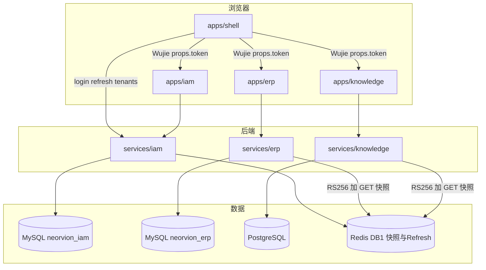
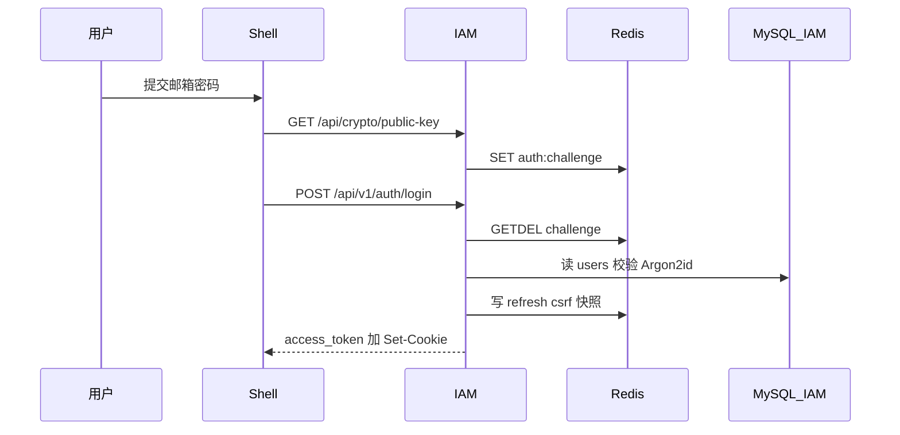
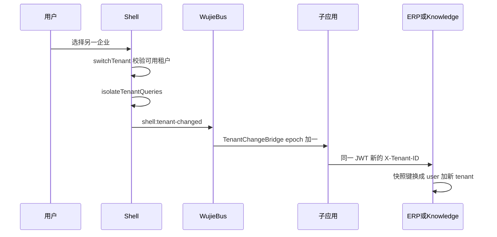
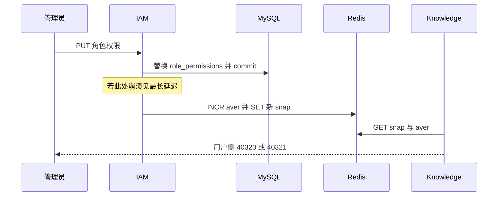
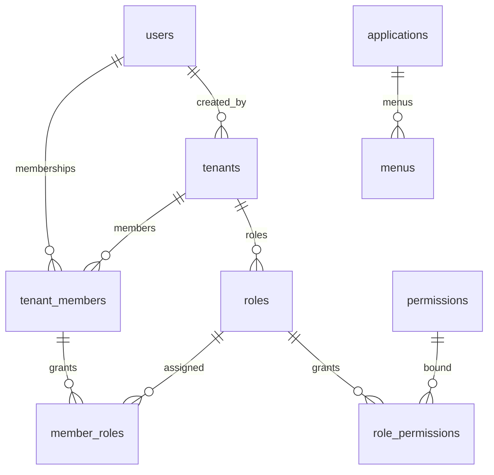
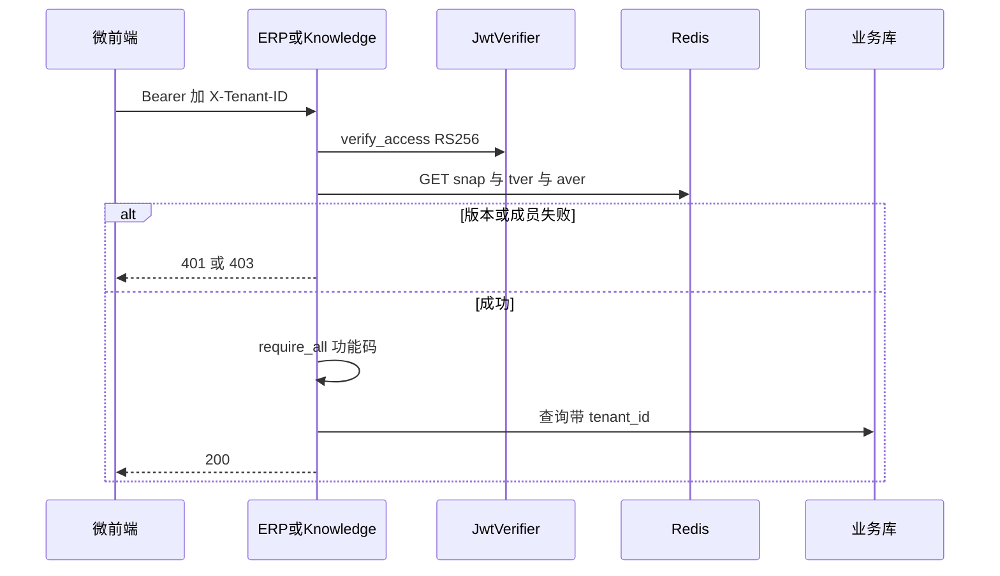

# Neorvion IAM V1 统一认证与权限架构手册

> 依据仓库 **2026-10-18 源码**（身份拆分后的 IAM V1 / 根 README 所称 V12）。对象：有前端经验、正在建立 FastAPI / SQLAlchemy / 多服务思维的工程师。
>
> **铁规则：** 【已实现】必须能指出文件。【部分实现】必须写出断点。【未实现】和【未来建议】绝不能说成当前系统能力。面试时按这张表说话，不要把目标架构讲成生产经验。

状态图例：

| 标记 | 含义 |
| --- | --- |
| 【已实现】 | 有可运行代码，通常还有测试 |
| 【部分实现】 | 有模型、API 或参数，但缺口明确（未接线、未打通、无测试） |
| 【未实现】 | 仓库中没有对应服务、表或接口 |
| 【未来建议】 | 值得做，但不是 V1 能力 |

相对路径均以本文件为起点：`docs/architecture/`。例如 IAM 登录服务为 [`../../services/iam/app/services/auth.py`](../../services/iam/app/services/auth.py)。

---

## 目录

1. [怎么读：四层模型](#怎么读四层模型)
2. [能力实现矩阵](#一能力实现矩阵)
3. [全局架构](#二全局架构)
4. [端到端调用链（11 个场景）](#三端到端调用链11-个场景)
5. [数据库与数据所有权](#四数据库与数据所有权)
6. [权限核心：六个为什么](#五权限核心六个为什么)
7. [权限管理实操教程](#六权限管理实操教程)
8. [JWT、缓存与安全边界](#七jwt缓存与安全边界)
9. [性能、故障与部署](#八性能故障与部署)
10. [面试训练（60 题）](#九面试训练60-题)
11. [真正掌握项目](#十真正掌握项目)
12. [V2 及未来优化](#十一v2及未来优化)
13. [源码与文档不一致问题](#十二源码与文档不一致问题)

---

## 怎么读：四层模型

用「张三要给星河贸易上传一份 PDF」把四件事拆开，后面所有章节都绕着它转。

1. **Authentication（认证）**：你是不是张三？——密码、JWT、Refresh Cookie。
2. **SSO（统一登录）**：进 ERP 和 Knowledge 还要不要再输密码？——Shell 内存 Access + 共享 Cookie。
3. **Tenant Membership（租户成员）**：现在代表哪家企业？——`tenant_members` + `X-Tenant-ID` + Redis 快照。
4. **RBAC（功能资格）**：允不允许「上传」这个操作？——角色上的 `knowledge:create`。
5. **ACL（资源授权）**：允不允许动**这一本**知识库？——`KnowledgeBaseGrant`。
6. **JWT 本地验证**：Knowledge 如何不打电话问 IAM/ERP？——RS256 验签 + 读快照。
7. **缓存与撤销**：管理员刚去掉权限，旧 Token 为什么还能或不能上传？——`iam:aver` / `iam:tver`。

混在一起就会说错话，例如「JWT 验过了所以有权限」「Header 里写了租户所以安全」「撤权立即全局强一致」。

---

## 一、能力实现矩阵

找不到代码就不能标【已实现】。测试列写「无对等测试」表示该能力靠人工或间接业务测试，不是「一定没测过业务」。

| 能力 | 状态 | 源码 | 实现说明 | 限制 | 测试 |
| --- | --- | --- | --- | --- | --- |
| 注册 / 登录 / 退出 | 【已实现】 | [`services/iam/app/api/v1/auth.py`](../../services/iam/app/api/v1/auth.py)、[`services/iam/app/services/auth.py`](../../services/iam/app/services/auth.py) | `POST /register` `/login` `/logout` | 登录失败不区分邮箱是否存在 | [`tests/test_auth.py`](../../services/iam/tests/test_auth.py) |
| Access Token | 【已实现】 | [`neorvion_security/jwt.py`](../../packages/python/neorvion_security/neorvion_security/jwt.py) `LocalJwtSigner.sign` | RS256，响应体 `access_token` | 内存持有，刷新页面靠 Refresh | 同上 |
| Refresh Token | 【已实现】 | [`token_store.py`](../../services/iam/app/core/token_store.py) | HttpOnly Cookie `neorvion_refresh`，Redis `iam:refresh:{jti}` | **无 Session 表**，无设备列表 | `test_register_login_me_and_refresh` |
| RSA-OAEP 密码传输 | 【已实现】 | [`rsa_crypto.py`](../../services/iam/app/core/rsa_crypto.py)、[`apps/shell/src/lib/password.ts`](../../apps/shell/src/lib/password.ts) | 与 JWT 密钥分离；challenge GETDEL | 挑战 300s 过期 | 登录相关测试 |
| Argon2id | 【已实现】 | [`security.py`](../../services/iam/app/core/security.py) `PasswordHasher` | 明文不入库 | — | 登录失败用例 |
| RS256 + JWKS | 【已实现】 | [`jwt.py`](../../packages/python/neorvion_security/neorvion_security/jwt.py)、[`jwt_keys.py`](../../services/iam/app/core/jwt_keys.py) | `GET /.well-known/jwks.json`；可带上一把公钥 | 业务进程内缓存 300s | `test_alg_none_and_wrong_issuer_are_rejected` |
| 多微前端 SSO | 【已实现】 | [`apps/shell/src/api/client.ts`](../../apps/shell/src/api/client.ts)、[`ErpMicroApp.tsx`](../../apps/shell/src/micro/ErpMicroApp.tsx) | 同一 Access + Cookie；Wujie props | **不是 OIDC** | 前端以单测/手工为主 |
| 用户 / 租户 / 成员 | 【已实现】 | [`models/user.py`](../../services/iam/app/models/user.py)、[`tenant.py`](../../services/iam/app/models/tenant.py) | 一人多企业 | 无 OWNER 转移 API | `test_member_cannot_access_other_tenant` |
| 多应用统一 RBAC | 【部分实现】 | [`permissions.py`](../../services/iam/app/core/permissions.py)、[`seed_permissions.py`](../../services/iam/app/scripts/seed_permissions.py) | 种子应用 iam/erp/knowledge；角色可勾多模块 code | Copilot 仅 UI 占位；编码并非全是 `erp:` 前缀 | IAM 角色测试 |
| 权限注册与同步 | 【已实现】 | [`catalog.py`](../../services/iam/app/api/v1/catalog.py) `sync_permissions` | 内部接口 insert-only | 管理页**不能**手建任意 code | 无独立 pytest 名，靠同步密钥校验 |
| 菜单权限 | 【部分实现】 | IAM [`menus` 表](../../services/iam/app/models/catalog.py)；ERP [`routes.ts`](../../apps/erp/src/router/routes.ts) | 子应用按 `permission` 过滤菜单 | `menus` 表**未驱动** ERP 运行时菜单；Shell 顶栏不按权限藏入口 | IAM `filterMenuRoutes` 侧 |
| 按钮权限 | 【部分实现】 | [`Can.tsx`](../../apps/erp/src/components/Can.tsx) | 无权限则 hide/disable | 不是安全边界；无 `buttons` 表 | UI 测试零星 |
| API 权限 | 【已实现】 | [`rbac_deps.py`](../../services/iam/app/api/rbac_deps.py)；Knowledge [`deps.py`](../../services/knowledge/app/api/deps.py) | FastAPI Depends | IAM 查库；ERP/Knowledge 信快照 | `test_viewer_cannot_upload` 等 |
| 权限缓存与撤销 | 【部分实现】 | [`snapshot.py`](../../packages/python/neorvion_security/neorvion_security/snapshot.py)、[`snapshots.py`](../../services/iam/app/services/snapshots.py) | Redis 快照 + `tver`/`aver` | **无 Pub/Sub**；DB 已提交但未写 Redis 时最长可到快照 TTL；`high_risk` 未接线 | `test_role_permission_revoke_updates_snapshot` |
| 多租户隔离 | 【已实现】 | [`TenantMixin`](../../services/erp/app/db/mixins.py)；Knowledge Repository | SQL 必带 `tenant_id` | 跨库无 FK | 多份 `*_isolation*` 测试 |
| 资源级 ACL | 【部分实现】 | [`access.py`](../../services/knowledge/app/services/access.py) | 知识库 grants | ERP 订单主要靠租户隔离+归属字段，不是独立 ACL 引擎；无 ABAC | `test_grants_restrict_non_owner` |
| Session 持久化 | 【未实现】 | — | Refresh 只在 Redis | 无设备管理、无多端踢除精细列表 | — |
| OIDC | 【未实现】 | 全仓无 authorize / id_token | 内部 Cookie SSO | 不能对接企业 IdP | — |
| Agent / Copilot 授权 | 【未实现】 | 无 `services/copilot`；[`agent-readiness.md`](../agent-readiness.md) 仅边界 | 应用注册 UI 可填 audience | Tool 未实现 | `neorvion-copilot` 仅用于错误 aud 测试 |
| 高风险实时鉴权 | 【未实现】 | `SnapshotStore.load(high_risk=)` 参数存在但**无人传 True**，且与上一行 aver 检查重复 | — | 不得宣称退款会实时打 IAM | — |

---

## 二、全局架构

### 2.1 谁干什么【已实现】

| 位置 | 端口 | 角色 |
| --- | --- | --- |
| [`apps/shell`](../../apps/shell) | 8015 | 门卫：登录、选企业、嵌套子应用、Refresh 单飞 |
| [`apps/iam`](../../apps/iam) | 8018 | 权限办公室（路由仅用户/成员/角色/权限/应用/菜单/审计） |
| [`apps/erp`](../../apps/erp) | 8016 | 进销存柜台 |
| [`apps/knowledge`](../../apps/knowledge) | 8017 | 知识库柜台 |
| [`services/iam`](../../services/iam) | 8010 | 发 JWT、管花名册、写 Redis 快照 |
| [`services/erp`](../../services/erp) | 8011 | 业务；**不再发牌** |
| [`services/knowledge`](../../services/knowledge) | 8012 | 文档；**不再问 ERP 这人是谁** |
| [`packages/python/neorvion_security`](../../packages/python/neorvion_security) | — | 共用验牌器，禁止放业务模型 |

`services/copilot` **目录不存在**。【未实现】

数据所有权：IAM = MySQL `neorvion_iam` + Redis DB 1；ERP = MySQL `neorvion_erp` + Redis DB 0；Knowledge = PostgreSQL。禁止跨库 JOIN 用户与订单。

### 2.2 为什么从 ERP 拆出来

改造前 Knowledge 用 `ErpIdentityClient` 每次 HTTP 问 ERP「Token 是谁」。ERP 一挂，知识库登录一起挂。全库已无该类，仅 [`identity.py`](../../services/knowledge/app/services/identity.py) 一行迁移注释。

改造后：认证集中，鉴权本地。代价是多一个服务、Cookie 路径、网关分流和一次性迁移脚本。

### 2.3 端到端架构图



替代方案与取舍见第八、十一章。

---

## 三、端到端调用链（11 个场景）

每个场景：**业务 → API → 文件/函数 → DB/Redis → 结果 → 异常 → 为什么**。示例 JSON 均标注为**示意**，不是一次真实抓包。

### 场景 1：输入账号密码登录【已实现】

张三打开 `http://localhost:8015/login`。

1. [`LoginPage.tsx`](../../apps/shell/src/pages/LoginPage.tsx) 调 [`encryptAuthPassword`](../../apps/shell/src/lib/password.ts)。
2. `GET /api/crypto/public-key` → [`crypto.py`](../../services/iam/app/api/crypto.py) 签发 `challenge_id`，Redis `auth:challenge:{id}`。
3. 浏览器 RSA-OAEP-SHA256 加密，`POST /api/v1/auth/login`：`email` + `encrypted_password` + `key_id` + `challenge_id`。
4. [`AuthService.login`](../../services/iam/app/services/auth.py)：`consume_challenge`（GETDEL）→ `decrypt` → `verify_password`（Argon2id）→ 更新 `last_login_at` → `SnapshotService.refresh_user` → `_issue_tokens`。
5. 响应体只有 Access（示意）：`{"code":0,"data":{"access_token":"<jwt>","token_type":"bearer","expires_in":1800}}`。
6. Set-Cookie：`neorvion_refresh` HttpOnly Path=`/api/v1/auth`；`neorvion_csrf` 可读 Path=`/`。
7. 前端 [`markAuthenticated`](../../apps/shell/src/stores/auth-store.ts)，Token **不写 localStorage**。

异常：challenge 用过 40020；RSA 失败 40022；密码错 40010；禁用 40300。

为什么：HTTPS 仍可能进代理日志；RSA 保护传输，Argon2id 保护落库；Access 给 JS，Refresh 不给 JS。



### 场景 2：JWT 签发、保存、后续携带【已实现】

[`LocalJwtSigner.sign`](../../packages/python/neorvion_security/neorvion_security/jwt.py) 写入 `sub/iss/aud/exp/nbf/iat/jti/type/ver`，header `alg=RS256` `kid`。权限**不在** JWT 里。

后续 [`apiClient`](../../apps/shell/src/api/client.ts) 请求拦截器：`Authorization: Bearer ${accessToken}`，并按 [`decideTenantHeader`](../../packages/shared) 附加 `X-Tenant-ID`。子应用读 `window.$wujie.props.token`。

### 场景 3：Shell 打开 ERP 与 Knowledge【已实现】

[`ErpMicroApp.tsx`](../../apps/shell/src/micro/ErpMicroApp.tsx) / [`KnowledgeMicroApp.tsx`](../../apps/shell/src/micro/KnowledgeMicroApp.tsx) 传入 `{ token, tenantId, user, refreshSession }`。不重新登录。Audience 默认列表含 `neorvion-erp` 与 `neorvion-knowledge`。

断点：【部分实现】各服务若改为单 audience 签发，跨应用会 40106，当前默认是多 aud 便利折中。

### 场景 4：Knowledge 本地验 JWT，不依赖 ERP【已实现】

[`get_tenant_context`](../../services/knowledge/app/api/deps.py)：Bearer → `jwt_verifier().verify_access` → 解析 `X-Tenant-ID` → `snapshot_store().load`。无 IAM HTTP，无 ERP HTTP。

`ErpIdentityClient` 已删除。错误实现是再调 ERP introspect；正确实现就是这 20 行。

### 场景 5：管理员创建角色并配置 ERP+Knowledge 权限【已实现】

页面：[`RolesPage.tsx`](../../apps/iam/src/pages/system/RolesPage.tsx) → [`createRole`](../../apps/iam/src/api/roles.ts) `POST /api/v1/roles`，树来自 `GET /api/v1/permissions/tree`（Python `PERMISSION_TREE`，不是 `menus` 表）。

勾选 `order:read` 与 `knowledge:create`（真实码，不是 `erp:orders:read`）。`PUT /roles/{id}/permissions` → [`RoleService.replace_role_permissions`](../../services/iam/app/services/rbac.py) → commit → [`refresh_role_members`](../../services/iam/app/services/snapshots.py)。

OWNER 系统角色核心权限冻结。不能把 OWNER 授给普通加人接口。

### 场景 6：成员通过角色获得权限【已实现】

[`addMember`](../../apps/iam/src/api/members.ts) `POST /api/v1/tenants/{id}/members` `{ email, role_ids }`。[`TenantService.add_member`](../../services/iam/app/services/tenant.py) 写 `tenant_members` + `member_roles`，然后 `_refresh_snapshot`。

张三再请求业务 API 时，快照 `permission_codes` 含角色并集。OWNER 走 `known_permission_codes()` 全集。

### 场景 7：前端菜单和按钮【部分实现】

- ERP/IAM：路由 `permission` + [`filterMenuRoutes`](../../apps/iam/src/router/access.ts) + [`Can`](../../apps/erp/src/components/Can.tsx)。
- 权限数据：`GET /api/v1/tenants/current/my-permissions`（IAM 查库；ERP 用快照 [`AuthorizationService.current_member_access`](../../services/erp/app/services/authorization.py)）。
- Shell 顶栏不按权限过滤。【部分实现】
- Knowledge 整应用主要看 `knowledge:read`。【部分实现】细粒度按钮少。
- IAM 磁盘仍有未挂路由的 ERP 页面副本，**不会进菜单**。

隐藏不等于安全：curl 仍打 API。

### 场景 8：后端 RBAC + 租户隔离【已实现】

ERP：Depends `get_tenant_context` → Service `require_all(ORDER_READ)` → Repository `tenant_id == context.tenant_id`。[`TenantMixin`](../../services/erp/app/db/mixins.py) 注释写明跨服务无外键。

Knowledge 上传另加 [`assert_writable`](../../services/knowledge/app/services/access.py)。

错误：`SELECT * FROM sales_orders WHERE id=:id`。正确：永远带租户谓词。

### 场景 9：切换租户【已实现前端隔离】【已实现后端按 Header 重建上下文】



[`switchTenant`](../../apps/shell/src/lib/switch-tenant.ts) 无权则抛 40310。后端不换 Token。Knowledge 额外 `abortKnowledgeStreams`。

切租户不销毁全部微应用（销毁在登出）。断点：若漏掉 epoch/query，保活 iframe 会串数据。

### 场景 10：过期、Refresh、并发 401、退出【已实现】

Access 默认 30 分钟。401 → 模块级 `refreshPromise` 单飞 → `POST /auth/refresh`（`authClient` 带 CSRF，不带 Bearer）。服务端 GETDEL 旧 jti，失败 40104。登出删 Redis 会话并清 Cookie。[`endSessionDueToExpiry`](../../apps/shell/src/lib/session.ts) 清 store、Query、销毁微应用。

为什么前端还要单飞：两个 Tab 仍可能各打一次；协议正确性靠 GETDEL，单飞降低误踢。

### 场景 11：撤权后的实际行为与最长延迟【部分实现「立刻」】

管理员 `PUT` 角色权限去掉 `knowledge:create` 后：

| 路径 | 何时生效 |
| --- | --- |
| IAM 管理端 `GET /tenants/current` | **查库**，几乎立刻 |
| Redis 快照 | `refresh_role_members` 成功则下一跳业务请求 |
| ERP/Knowledge API | 读到新 snap 或 aver 不一致（40321） |
| 前端菜单 | 下次 `my-permissions`（`refetchOnWindowFocus`） |

**不能说「强一致立即生效」。**

最长延迟场景：DB 已 commit，进程在调用 `refresh_role_members` **之前**崩溃 → 旧 snap 与旧 aver 仍匹配 → 业务继续放行，直到：

- 快照 TTL（默认 **3600 秒**）过期后缺 key → 40310，或
- 用户登录/刷新触发 `refresh_user`，或
- 另一次会写快照的管理操作。

若已 `INCR aver` 但未 `save` 新 JSON：下一请求 **拒绝**（版本不一致）。这是 fail-closed，不是放行。

`high_risk` **未接线**，退款不会额外实时打 IAM。【未实现】



---

## 四、数据库与数据所有权

迁移：[`20261018_0001_init_iam.py`](../../services/iam/alembic/versions/20261018_0001_init_iam.py)。**没有** `sessions` / `refresh_tokens` / `buttons` 表。

### 4.1 ER 图



`audit_logs` 有 `tenant_id` / `actor_user_id` 索引，**无外键**（主体删除后审计仍在）。

### 4.2 三套 ID

| ID | 表 | 含义 |
| --- | --- | --- |
| `user_id` | `users.id` | 全局登录主体 |
| `tenant_id` | `tenants.id` | 企业；业务行都带它 |
| `member_id` | `tenant_members.id` | 「张三在这家企业的任职」；角色挂这里 |

`UNIQUE(tenant_id, user_id)`。`member_roles` / `role_permissions` 用复合 FK `(tenant_id, role_id)`，从库层禁止把 A 企业角色授给 B 企业成员。

权限目录全局；角色实例租户私有（`uq_roles_tenant_code`）。`TenantMember.role` 只有 OWNER / MEMBER；ADMIN 是 `roles.code`，不是成员列。

### 4.3 ERP 旧身份表怎么处理【已实现迁移策略】

- IAM：身份唯一真相。一次性 [`migrate_from_erp`](../../services/iam/app/scripts/migrate_from_erp.py)，禁止长期双写。
- ERP：[`20261018_0021_drop_identity_fks`](../../services/erp/alembic/versions/20261018_0021_drop_identity_fks.py) 去掉业务表对 `users`/`tenants` 的 FK，**列还在**。
- ERP `users` 降级为展示名投影：[`project_display_user`](../../services/erp/app/core/identity_projection.py) 按快照 upsert，`password_hash="!"`，不能登录。

不一致风险：投影邮箱与 IAM 邮箱短暂不同步；订单 `created_by` 只是整数，IAM 删用户不会级联 ERP。这是有意的所有权切割。

测试里 ERP [`identity_stub.py`](../../services/erp/tests/helpers/identity_stub.py) 把旧认证 API 映射为 JWT+快照，**不是生产双写**。

---

## 五、权限核心：六个为什么

**为何 IAM 统一配置、ERP/Knowledge 自己校验？**  
配置需要一张全公司角色表，否则「运营专员」无法同时覆盖订单和文档。执行必须在有数据的服务：IAM 没有 `sales_orders`，不知道单子属谁。替代：每服务自己一套角色（配置漂移）或每次 API 问 IAM（把 IAM 变成 QPS 热点）。

**为何 JWT 验签通过不等于有权限？**  
签名只证明「IAM 发过给 user 42 的牌」。牌里没有权限。停用、撤角色、换企业都在 Redis。替代：把权限塞进 JWT（切权必须等 exp，或把 Access 缩到 60 秒狂刷）。

**为何 X-Tenant-ID 不能信？**  
它是「我想以哪家办事」。伪造 Header 必须被快照打回。测试：[`test_member_cannot_access_other_tenant`](../../services/iam/tests/test_security.py)。替代：把 tenant 编进 JWT（切企业就要重签）。

**IAM 宕机是否影响已登录用户？**  
未过期 Access + 进程内已有 JWKS + Redis 仍在 → 业务 API 可验签。不能登录、不能刷新、不能改权限。从未拉过 JWKS 的新进程 → 50312。

**跨系统权限如何生效？**  
IAM 写 Redis；业务下次 GET。不是 Pub/Sub 推送。见场景 11 的最长延迟。

**隐藏菜单为何不是授权？**  
浏览器属于攻击者。[`Can`](../../apps/erp/src/components/Can.tsx) 只减误操作。真正拦的是 Depends 40320。

**如何防跨租户提权和自授 OWNER？**  
复合 FK；`resolve_assignable_role_ids` 拒绝 OWNER；注册强制 `is_platform_admin=False`；用户接口只改 status。缺口：【未实现】把某用户提升为平台管理员的正规 API；【未实现】OWNER 转移；【未来建议】「可授权限 ⊆ 调用者权限」的委托约束。

---

## 六、权限管理实操教程

前提：Shell `VITE_API_BASE_URL=http://localhost:8010`，IAM 种子已跑。以下 JSON 为**示意**。

### 6.1 查看 / 注册应用【已实现页面】

[`ApplicationsPage.tsx`](../../apps/iam/src/pages/system/ApplicationsPage.tsx)，需 `iam:apps:read` / `iam:apps:manage`（平台管理员）。种子已有 iam、erp、knowledge。

```http
POST /api/v1/applications
{"code":"copilot","name":"Copilot","audience":"neorvion-copilot"}
```

限制：注册 audience **不会**自动让 JWT 校验器信任它；业务服务 `IAM_JWT_AUDIENCE` 仍是白名单。Copilot 服务本身【未实现】。

### 6.2 注册权限编码【部分实现 UI】

[`PermissionsPage.tsx`](../../apps/iam/src/pages/system/PermissionsPage.tsx) **只读列表**。新增 code 走：

```http
POST /api/v1/internal/permissions/sync
X-Permission-Sync-Key: <PERMISSION_SYNC_KEY>
{"application_code":"knowledge","permissions":[{"code":"knowledge:export","name":"导出","module":"knowledge","description":"..."}]}
```

已存在则 skip。不在目录且不以 `{application_code}:` 开头则 skip。管理界面不能点选「新建权限」。

### 6.3 新建角色并勾选 ERP+Knowledge【已实现】

IAM → 角色管理 → 创建 `code=OPERATOR_BIZ` → 配置权限树勾 `order:read`、`knowledge:create`。

```http
POST /api/v1/roles
{"name":"运营专员","code":"OPERATOR_BIZ","permission_ids":[12,88]}
```

`permission_ids` 必须是目录里真实 ID（示意数字）。

### 6.4 授予成员【已实现】

```http
POST /api/v1/tenants/7/members
{"email":"ops@example.com","role_ids":[55]}
```

空 `role_ids` 会默认 VIEWER。不能塞 OWNER。

MySQL 示意：`tenant_members` 多一行；`member_roles` 多一行。Redis 示意：`iam:snap:42:7` 的 `permission_codes` 含 `order:read`。

### 6.5 用该用户验证菜单与接口

登录 Shell → 选同一租户。ERP 无 `order:read` 则订单菜单被过滤；有则列表 API 200。Knowledge 无 `knowledge:create` 上传 40320（[`test_viewer_cannot_upload`](../../services/knowledge/tests/test_documents.py)）。

### 6.6 取消权限再验证

角色权限 `PUT` 空掉 `knowledge:create` → 再上传 403。IAM 当前页查库立即变；ERP 取决于快照是否写成功（场景 11）。

### 6.7 切换租户看隔离

换企业后订单 ID 不可复用显示。错误 Header 403/404。SQL 必须有 `tenant_id`。

### 6.8 页面缺口清单

| 想做的事 | 现状 |
| --- | --- |
| 图形化新建权限码 | 【未实现】只有同步 API |
| 菜单表驱动 ERP 侧栏 | 【未实现】ERP 用自己的 `routes.ts` |
| 把用户设为平台管理员 | 【未实现】需改库 |
| 转移 OWNER | 【未实现】 |
| 设备会话列表 | 【未实现】无 Session 表 |

---

## 七、JWT、缓存与安全边界

### 7.1 两套 RSA

| 用途 | 配置 | 算法 |
| --- | --- | --- |
| 登录密文 | `RSA_*_KEY_PATH` | RSA-OAEP-SHA256 |
| JWT | `JWT_*_KEY_PATH` | RS256 |

共用一把钥等于「能解密密码就能伪造工牌」。生产缺 JWT 私钥拒绝启动。

### 7.2 Claim 与 kid

业务服务校验 `alg∈{RS256}`、`kid`、`iss`、`aud` 必须包含**本服务** audience、`exp/nbf/iat/sub/jti/type`。`ver` 对 `iam:tver`。JWKS 轮换靠当前+上一把 kid。

无状态优势：ERP 不查 IAM 用户表。撤销困难：靠短 TTL + `tver`/`aver`，不是服务端 Access 黑名单。

### 7.3 缓存键

| 键 | TTL | 作用 |
| --- | --- | --- |
| `iam:snap:{user}:{tenant}` | 默认 3600s | 权限快照 |
| `iam:aver:{user}:{tenant}` | 随 snap | 授权版本 |
| `iam:tver:{user}` | **无 TTL** | 令牌版本 |
| `iam:refresh:{jti}` | Refresh 寿命 | 会话 |
| `iam:csrf:{jti}` | 同 Refresh | CSRF |

多 Worker **每次请求 GET Redis**，没有进程内权限 Map。进程内只有 JWKS。

禁用账号 / 改密：`INCR tver`，旧 Access 40104。移除成员：bump aver。退出：删 refresh jti，**不**自动废 Access，靠短 TTL 或下次 tver。

### 7.4 必须写进面试的安全边界

**V1 没有高风险操作实时重读。** 不得说「撤权立即、强一致、退款回源 IAM」。

攻击面：

| 风险 | V1 对策 | 剩余 |
| --- | --- | --- |
| XSS 偷 Refresh | HttpOnly + Path | Access 仍能被脚本读，有效期内可用 |
| CSRF 续命 | Double Submit + Origin | SameSite=Lax 开发环境非 HTTPS |
| alg=none / 错 iss/aud | 硬编码 RS256 | — |
| IDOR | tenant 谓词 + 404 模糊 | 漏写 tenant 的查询仍是漏洞 |
| 跨租户 Header | 快照校验 | — |
| 重放登录密文 | challenge GETDEL | — |
| 自授 OWNER | API 拒绝 | 平台管理员引导缺失 |
| JWT 泄露 | 短 Access | 无设备吊销列表 |

---

## 八、性能、故障与部署

### 8.1 内省 vs 本地验签（调用链差异）

```text
旧：Browser → Knowledge → ERP introspect → ERP DB → Knowledge
新：Browser → Knowledge → 验签(CPU) → Redis GET → Knowledge DB
```

少一跳同步 HTTP。代价：权限变更要写 Redis；IAM 与 Redis 成为授权平面。

### 8.2 故障

| 故障 | 已登录 | 新登录 |
| --- | --- | --- |
| IAM 宕、JWKS 已缓存、Redis 好 | 业务可验签 | 否 |
| Redis 宕 | 授权 50313，**不放行** | 不能发 Refresh |
| IAM MySQL 宕 | 不影响验签 | 不能登录 |
| JWKS 空缓存 | 新进程 50312 | — |

并发 Refresh：GETDEL。多 Worker 权限：请求级读 Redis，一致；JWKS 缓存短暂用旧钥是有意换可用性。

### 8.3 性能（禁止伪造数字）

本仓库**没有**对外发布的 QPS/P95 压测报告。下面是**假设与量法**，不是成绩：

- 100 QPS：鉴权通常不是瓶颈。
- 1000 QPS：看 Redis GET 延迟与验签 CPU。
- 10000 QPS：若每请求打 IAM HTTP 会先炸；设计目标是业务不打 IAM。用 access 日志统计 8010 是否被打满来验证，而不是报一个编造 TPS。

### 8.4 Docker Compose 与腾讯云

本地：`docker compose up -d mysql redis iam erp worker`。网关 profile 把 `/api/v1/auth` 等到 IAM。密钥 volume 进容器，不写进镜像。

[`docs/deployment-production.md`](../deployment-production.md) **仍大量按「ERP 即 API 中心、8011」书写**，与 IAM V1 端口 8010 **不一致**（见第十二章）。上腾讯云时边界应是：公网仅 80/443；MySQL/Redis/Postgres/FastAPI 不暴露；JWT 与 RSA 私钥仅 IAM 可读；`PERMISSION_SYNC_KEY` 不进前端。

拆分成本：多一份 Compose 服务、多一份迁移、Cookie 域名与 Path、Nginx location 顺序（更长前缀优先）。

---

## 九、面试训练（60 题）

每题固定七段。系统设计题从第 51 题起，必须能比较方案。

### 登录与凭证

**1.【面试题】** 登录时密码如何从浏览器到数据库？  
**【30～60秒回答】** 先拉 RSA 公钥和一次性 challenge，浏览器 OAEP 加密，服务端解密后 Argon2id 比对，明文不落库。  
**【技术原理】** 传输保护 ≠ 存储保护；非对称加密与密码哈希解决不同威胁。  
**【Neorvion】** [`password.ts`](../../apps/shell/src/lib/password.ts)、[`AuthService._unlock_password`](../../services/iam/app/services/auth.py)。  
**【追问】** HTTPS 是否足够？  
**【深入回答】** HTTPS 防链路窃听，防不了应用日志和错误的明文落盘；challenge GETDEL 防重放密文。  
**【局限】** 无私钥硬件托管；challenge 仅 Redis。

**2.【面试题】** Access 和 Refresh 分别放哪？  
**【30～60秒回答】** Access 在 Zustand 内存给 JS 带 Authorization；Refresh 在 HttpOnly Cookie，JS 读不到。  
**【技术原理】** XSS 能读内存不能读 HttpOnly。  
**【Neorvion】** [`auth-store.ts`](../../apps/shell/src/stores/auth-store.ts)、[`_set_refresh_cookie`](../../services/iam/app/api/v1/auth.py)。  
**【追问】** 刷新页面为什么还在登录？  
**【深入回答】** Access 丢了，Cookie 还在，`restoreSession` 打 refresh。  
**【局限】** 无设备列表。

**3.【面试题】** 为什么 Refresh Path 是 `/api/v1/auth`？  
**【30～60秒回答】** 缩小 Cookie 发送面，业务 API 不自动带长期凭证。  
**【技术原理】** Cookie 按 Path 发送。  
**【Neorvion】** `refresh_cookie_path`。  
**【追问】** 子应用 refresh 会怎样？  
**【深入回答】** 破坏 GETDEL 轮换，后到者把新会话废掉。  
**【局限】** 网关必须把该 Path 转到 IAM。

**4.【面试题】** CSRF 怎么做的？  
**【30～60秒回答】** 可读 CSRF Cookie + `X-CSRF-Token`，刷新校验 Origin。  
**【技术原理】** 跨站读不到自定义头。  
**【Neorvion】** [`auth-client.ts`](../../apps/shell/src/api/auth-client.ts)。  
**【追问】** 有 SameSite=Lax 还要吗？  
**【深入回答】** Lax 已挡多数跨站 POST，双重提交是纵深。  
**【局限】** 开发环境常非 Secure。

**5.【面试题】** 并发两个 Refresh？  
**【30～60秒回答】** Redis GETDEL 只让一个成功；前端 Promise 单飞减少碰撞。  
**【技术原理】** 轮换刷新必须原子消费旧 jti。  
**【Neorvion】** [`consume_refresh_session`](../../services/iam/app/core/token_store.py)、`refreshPromise`。  
**【追问】** 只用前端单飞行吗？  
**【深入回答】** 两个浏览器不行，协议必须在服务端。  
**【局限】** 被踢的那次只能重新登录。

**6.【面试题】** 登出后 Access 立刻废吗？  
**【30～60秒回答】** Refresh 立刻废；Access 靠 exp 或 tver。改密/停用会 INCR tver。  
**【技术原理】** 无状态 Access 默认不能立刻列黑名单。  
**【Neorvion】** `logout` 只 `revoke_refresh_session`。  
**【追问】** 如何立刻废 Access？  
**【深入回答】** 停用账号走 tver；没有全量 Access 黑名单。  
**【局限】** 被盗 Access 在 TTL 内仍可用。

### JWT 与验签

**7.【面试题】** 为什么用 RS256 不用 HS256？  
**【30～60秒回答】** 私钥只在 IAM，业务服务只有公钥，被攻破不能伪造 Token。  
**【技术原理】** 非对称签验分离。  
**【Neorvion】** `ALLOWED_ALGORITHMS = ("RS256",)`。  
**【追问】** 性能？  
**【深入回答】** RSA 验签比 HMAC 慢，鉴权 QPS 通常不是第一瓶颈。  
**【局限】** 密钥轮换要运维 JWKS。

**8.【面试题】** JWT 有哪些 claim？有没有权限？  
**【30～60秒回答】** sub/iss/aud/exp/nbf/iat/jti/type/ver。没有 permission_codes。  
**【技术原理】** 牌证明身份，资格放有状态存储。  
**【Neorvion】** `LocalJwtSigner.sign`。  
**【追问】** 把权限放 JWT 如何？  
**【深入回答】** 撤权要等过期或把 TTL 缩到一分钟狂刷。  
**【局限】** 多 aud 列表偏宽。

**9.【面试题】** kid 和 JWKS 做什么？  
**【30～60秒回答】** 头里 kid 选公钥；JWKS 发布当前和上一把。  
**【技术原理】** 轮换时旧 Token 仍能验。  
**【Neorvion】** `build_jwks`、`JwksCache`。  
**【追问】** IAM 宕机能验吗？  
**【深入回答】** 已有缓存可短暂用旧钥；空缓存 50312。  
**【局限】** 缓存最多延长 30s。

**10.【面试题】** alg=none 怎么防？  
**【30～60秒回答】** 先看 header，alg 不是 RS256 直接 401，再 decode。  
**【技术原理】** 经典 JWT 攻击。  
**【Neorvion】** [`test_alg_none_and_wrong_issuer_are_rejected`](../../services/iam/tests/test_security.py)。  
**【追问】** HS256 混淆？  
**【深入回答】** 算法白名单同样拒绝 HS*。  
**【局限】** 共享包缺少独立单测目录。

**11.【面试题】** aud 为什么不能任意信任？  
**【30～60秒回答】** 每个服务配自己的 audience，Copilot 的牌不能进 ERP。  
**【技术原理】** audience restriction。  
**【Neorvion】** 测试用 `neorvion-copilot` 期望 401。  
**【追问】** 当前签发策略？  
**【深入回答】** 默认多 aud 便利；更严可单服务 Token。  
**【局限】** 未做 per-app 签发开关。

**12.【面试题】** JWT 无状态如何撤权？  
**【30～60秒回答】** 权限在快照；停用走 tver；改角色走 aver。  
**【技术原理】** 无状态身份 + 有状态授权。  
**【Neorvion】** `SnapshotStore.load`。  
**【追问】** 和内省比？  
**【深入回答】** 内省立刻准但每 QPS 依赖 IAM。  
**【局限】** 见场景 11 延迟。

### SSO 与微前端

**13.【面试题】** 你们的 SSO 是 OIDC 吗？  
**【30～60秒回答】** 不是。是第一方 Cookie + 内存 Access 的内部共享登录态。  
**【技术原理】** OIDC 有 IdP、client_id、id_token、redirect。  
**【Neorvion】** 无 authorize 端点。  
**【追问】** 对外给合作方登录怎么办？  
**【深入回答】** 那是 V2 OIDC，现在做不到。  
**【局限】** 【未实现】OIDC。

**14.【面试题】** 子应用如何拿到 Token？  
**【30～60秒回答】** Wujie props，不是 localStorage。  
**【技术原理】** 宿主注入受控状态。  
**【Neorvion】** `ShellToErpProps`。  
**【追问】** 保活 iframe 如何更新 Token？  
**【深入回答】** `syncTokenToAliveSandboxes` 改 provide.props。  
**【局限】** 依赖 Wujie 内部结构。

**15.【面试题】** 多个子应用同时 401？  
**【30～60秒回答】** 都回调 Shell 单飞 refresh。  
**【技术原理】** 单飞 + GETDEL。  
**【Neorvion】** `refreshSessionFromShell`、`micro:unauthorized`。  
**【追问】** 为什么两套通知？  
**【深入回答】** props 与 bus 兜底。  
**【局限】** 子应用若漏接会自己乱 refresh。

**16.【面试题】** Shell 为何不按权限藏 ERP 入口？  
**【30～60秒回答】** Shell 只做宿主；细粒度在子应用；API 仍 403。  
**【技术原理】** 纵深防御。  
**【Neorvion】** `ShellLayout.tsx`。  
**【追问】** 算漏洞吗？  
**【深入回答】** 产品体验问题，不是授权绕过。  
**【局限】** 入口可见增加试探面。

**17.【面试题】** 切租户如何避免串数据？  
**【30～60秒回答】** 事件 `shell:tenant-changed`，清 Query，epoch remount。  
**【技术原理】** 前端缓存也是租户状态。  
**【Neorvion】** [`switch-tenant.ts`](../../apps/shell/src/lib/switch-tenant.ts)。  
**【追问】** 为何不销毁全部微应用？  
**【深入回答】** 保留保活，代价是必须隔离。  
**【局限】** 漏 epoch 仍会串。

### RBAC

**18.【面试题】** 真实上传权限码是什么？  
**【30～60秒回答】** `knowledge:create`，没有 `knowledge:documents:upload`。  
**【技术原理】** 编码即契约。  
**【Neorvion】** `PermissionCode.KNOWLEDGE_CREATE`。  
**【追问】** README 举例？  
**【深入回答】** 那是风格说明，面试要对源码。  
**【局限】** 命名空间未全部 `app:resource:action`。

**19.【面试题】** 权限目录全局还是租户私有？  
**【30～60秒回答】** code 全局，角色实例租户私有。  
**【技术原理】** 统一语言，隔离授权关系。  
**【Neorvion】** `permissions.py` 模块注释。  
**【追问】** 一家企业自定义一个全新 code？  
**【深入回答】** 同步 API 可插入，UI 不能手建。  
**【局限】** 产品化不足。

**20.【面试题】** 为何菜单隐藏不能当授权？  
**【30～60秒回答】** 前端属于攻击者。  
**【技术原理】** UI 不是信任边界。  
**【Neorvion】** `Can.tsx` vs Depends。  
**【追问】** 那前端权限还有用吗？  
**【深入回答】** 减少误操作和 403 噪音。  
**【局限】** 两套权限源可能漂移。

**21.【面试题】** IAM 配权、业务执行，为什么？  
**【30～60秒回答】** 配置要统一，数据在业务库。  
**【技术原理】** 控制面 / 数据面。  
**【Neorvion】** 快照是下发的控制面副本。  
**【追问】** 每次问 IAM 不行吗？  
**【深入回答】** 行，但 IAM 成为同步热点，Knowledge 又绑死可用性。  
**【局限】** 快照延迟。

**22.【面试题】** 如何防止自授 OWNER？  
**【30～60秒回答】** 加人接口禁止 OWNER；创建企业才允许。  
**【技术原理】** 特权分离。  
**【Neorvion】** `resolve_assignable_role_ids` 40321。  
**【追问】** ADMIN 呢？  
**【深入回答】** ADMIN 是角色码不是成员列；改权限须保留租户管理码。  
**【局限】** 无 OWNER 转移。

**23.【面试题】** 权限同步为何只插入？  
**【30～60秒回答】** 防止服务发布覆盖管理员改过的目录。  
**【技术原理】** 受控 schema 演进。  
**【Neorvion】** `sync_permissions`。  
**【追问】** 删废弃 code？  
**【深入回答】** 标 deprecated，不自动删关联。  
**【局限】** 无管理端审批流。

**24.【面试题】** tree 和 menus 表是一回事吗？  
**【30～60秒回答】** 不是。树是 Python 常量；menus 是应用菜单配置。  
**【技术原理】** 授权 UI ≠ 运行时信息架构。  
**【Neorvion】** `list_permission_tree` 不写 menus。  
**【追问】** 目标？  
**【深入回答】** V2 用 menus 驱动各微前端。【未来建议】  
**【局限】** 两套来源。

### 多租户与数据

**25.【面试题】** user_id 和 member_id 区别？  
**【30～60秒回答】** user 是人；member 是任职；角色挂任职。  
**【技术原理】** 主体与成员关系分离。  
**【Neorvion】** `tenant_members`。  
**【追问】** 一人两家？  
**【深入回答】** 两行 member，同一 Access，换 Header。  
**【局限】** JWT 不含当前租户。

**26.【面试题】** 为何跨服务不建用户外键？  
**【30～60秒回答】** 不同库，身份所有权在 IAM。  
**【技术原理】** 限界上下文。  
**【Neorvion】** ERP `20261018_0021`。  
**【追问】** 用户删了订单怎么办？  
**【深入回答】** 订单保留整数 created_by，审计不级联丢。  
**【局限】** 展示名靠投影。

**27.【面试题】** X-Tenant-ID 为何不能当成员证明？  
**【30～60秒回答】** 客户端可改。必须快照证明资格。  
**【技术原理】** 永不信任客户端。  
**【Neorvion】** `get_tenant_context`。  
**【追问】** API Key？  
**【深入回答】** 租户以 Key 记录为准，对不上 40365。  
**【局限】** Header 拼写历史有 `X-Tenant-Id` 文档混用，以常量 `X-Tenant-ID` 为准。

**28.【面试题】** 什么是 IDOR，你们怎么防？  
**【30～60秒回答】** 改 ID 访问别人对象；查询带 tenant，无权限当 404。  
**【技术原理】** 防探测。  
**【Neorvion】** `assert_readable` 40450。  
**【追问】** 404 和 403 怎么选？  
**【深入回答】** 不泄露资源是否存在时用 404。  
**【局限】** 漏写条件仍会出事。

**29.【面试题】** ERP users 表还能登录吗？  
**【30～60秒回答】** 不能，只是姓名投影。  
**【技术原理】** 消除身份双写。  
**【Neorvion】** `identity_projection.py`。  
**【追问】** 测试 stub？  
**【深入回答】** 仅测试把旧 API 映射到 JWT，不是生产双写。  
**【局限】** 投影可能短暂落后。

**30.【面试题】** 复合外键防什么？  
**【30～60秒回答】** 把 A 租户角色 ID 写到 B 租户成员。  
**【技术原理】** 数据库不变量。  
**【Neorvion】** `member_roles` FK。  
**【追问】** 应用层还要检查吗？  
**【深入回答】** 要，错误信息对用户友好；库是最后一道。  
**【局限】** 审计表故意无 FK。

### Redis 与一致性

**31.【面试题】** 快照键为什么带 user 和 tenant？  
**【30～60秒回答】** 同一人两家企业权限不同。  
**【技术原理】** 缓存键必须等于授权维度。  
**【Neorvion】** `snapshot_key`。  
**【追问】** 只按 user？  
**【深入回答】** 会串权。  
**【局限】** 企业多时 refresh_user 写多条。

**32.【面试题】** TTL 和 Access TTL 关系？  
**【30～60秒回答】** 独立。快照先过期会 40310。  
**【技术原理】** 不同生命周期。  
**【Neorvion】** 3600 vs 30min。  
**【追问】** 快照永不过期？  
**【深入回答】** 停用账号靠 tver 不靠 snap TTL。  
**【局限】** 需 refresh 重建 snap。

**33.【面试题】** 有没有 Pub/Sub？  
**【30～60秒回答】** 没有，靠下次 GET 版本号。  
**【技术原理】** 拉模型 vs 推模型。  
**【Neorvion】** 无 pubsub 调用。  
**【追问】** 推的好处？  
**【深入回答】** 更快，但要处理丢失和订阅管理。  
**【局限】** 见 V2。

**34.【面试题】** Redis 宕机放行吗？  
**【30～60秒回答】** 不放行，50313。  
**【技术原理】** fail-closed。  
**【Neorvion】** `load` except。  
**【追问】** 可用性？  
**【深入回答】** 用 Redis HA，而不是降级成「无快照当 OWNER」。  
**【局限】** Redis 成为授权平面单点。

**35.【面试题】** 撤权最长多久生效？  
**【30～60秒回答】** 写快照成功则下一请求；若 commit 后崩溃，最长约快照 TTL。  
**【技术原理】** 控制面下发失败窗口。  
**【Neorvion】** 场景 11。  
**【追问】** 高风险呢？  
**【深入回答】** high_risk 未接线，不能声称实时。  
**【局限】** 【未实现】强一致回源。

**36.【面试题】** 多容器权限缓存会脏吗？  
**【30～60秒回答】** 业务每次读 Redis，不脏；脏的是 JWKS 进程缓存。  
**【技术原理】** 共享存储 vs 本地缓存。  
**【Neorvion】** deps 每请求 load。  
**【追问】** Worker？  
**【深入回答】** ERP handler 手搓空上下文，比 HTTP 弱。  
**【局限】** 【部分实现】异步任务鉴权。

### 微服务与故障

**37.【面试题】** IAM 宕了业务还能跑吗？  
**【30～60秒回答】** 已登录且 JWKS/快照在则能；不能登录续期。  
**【技术原理】** 签发中心与验证点分离。  
**【Neorvion】** `JwksCache._refresh`。  
**【追问】** Knowledge 还依赖 ERP 吗？  
**【深入回答】** 不依赖。  
**【局限】** 新实例冷启动要拉到 JWKS。

**38.【面试题】** Nginx 验 JWT 吗？  
**【30～60秒回答】** 只做路由分流，验权在 FastAPI。  
**【技术原理】** 网关可验可不管。  
**【Neorvion】** `nginx/nginx.conf`。  
**【追问】** 网关验的好处？  
**【深入回答】** 统一挡非法 Token；坏处是网关要拿 JWKS，业务仍要做租户与 ACL。  
**【局限】** Knowledge 开发直连 8012。

**39.【面试题】** 糊涂代理是什么？  
**【30～60秒回答】** 有权限的服务被诱导动别人数据。  
**【技术原理】** confused deputy。  
**【Neorvion】** 浏览器流量用用户 JWT；Agent【未实现】。  
**【追问】** 服务账号怎么做？  
**【深入回答】** audience 与租户白名单，禁止任意 Header。  
**【局限】** 无 client credentials。

**40.【面试题】** 测试如何证明伪造 Token 失败？  
**【30～60秒回答】** IAM `test_security.py` 覆盖伪造、错 aud、alg=none、错 iss、跨租户、撤权。  
**【技术原理】** 安全回归。  
**【Neorvion】** 该文件。  
**【追问】** ERP 有对等套件吗？  
**【深入回答】** 无同级 forged 套件，多是业务隔离测试。  
**【局限】** 包级无独立 tests 目录。

### 安全攻防

**41.【面试题】** XSS 拿到 Access 怎么办？  
**【30～60秒回答】** TTL 内可冒用；Refresh 仍 HttpOnly。停用账号 INCR tver。  
**【技术原理】** XSS 等于用户。  
**【Neorvion】** 短 Access 30min。  
**【追问】** CSP？  
**【深入回答】** 前端工程有常规防护，不是本手册范围。  
**【局限】** 无异常 IP 强制下线。

**42.【面试题】** 登录如何防用户枚举？  
**【30～60秒回答】** 用户不存在和密码错误同一文案。  
**【技术原理】** 反侦察。  
**【Neorvion】** `AuthService.login`。  
**【追问】** 时序攻击？  
**【深入回答】** Argon2 本身慢；未做严格恒定时间到「用户不存在」分支。  
**【局限】** 注册接口仍能暴露邮箱占用。

**43.【面试题】** 平台管理员怎么来的？  
**【30～60秒回答】** 字段在，公开 API 不提供提权。  
**【技术原理】** 破窗：引导流程缺失。  
**【Neorvion】** `users.py` 只改 status。  
**【追问】** 种子？  
**【深入回答】** 需库内运营，文档应写清楚。  
**【局限】** 【未实现】引导。

**44.【面试题】** 资源 ACL 和 RBAC 一起怎么走上传？  
**【30～60秒回答】** 先 JWT 和成员，再 `knowledge:create`，再 grants。  
**【技术原理】** 先资格后对象。  
**【Neorvion】** `upload_documents`。  
**【追问】** 无 grants？  
**【深入回答】** 回退为租户内有功能权限者可写。  
**【局限】** 无 visibility 字段。

**45.【面试题】** Worker 越权风险？  
**【30～60秒回答】** 报表 handler 空权限上下文，比 HTTP 入口弱。  
**【技术原理】** 内部任务常漏鉴权。  
**【Neorvion】** `handlers.py` `_context`。  
**【追问】** 正确做法？  
**【深入回答】** `load_for_principal`。  
**【局限】** 【部分实现】。

### 部署与运维

**46.【面试题】** 密钥如何避免进镜像？  
**【30～60秒回答】** volume / 环境变量路径；gitignore pem。生产缺钥拒启动。  
**【技术原理】** 秘密与制品分离。  
**【Neorvion】** `.gitignore`、`generate_keys.py`。  
**【追问】** 轮换步骤？  
**【深入回答】** 配 previous，发 JWKS，再切新签发。  
**【局限】** 无自动轮换 Job。

**47.【面试题】** Compose 单机和多节点差什么？  
**【30～60秒回答】** 多节点必须共享 Redis 和密钥。  
**【技术原理】** 会话与授权在 Redis。  
**【Neorvion】** Redis DB 1。  
**【追问】** IAM 无状态吗？  
**【深入回答】** 进程无会话表，状态在 Redis/MySQL。  
**【局限】** 单机同命运。

**48.【面试题】** 生产文档和 V1 一致吗？  
**【30～60秒回答】** 不完全。`deployment-production.md` 仍偏 ERP 8011 中心。  
**【技术原理】** 文档滞后是事故源。  
**【Neorvion】** 第十二章。  
**【追问】** 上云先改什么？  
**【深入回答】** 端口、Nginx location、IAM 库、密钥。  
**【局限】** 部署文档待同步。

**49.【面试题】** PERMISSION_SYNC_KEY 是什么？  
**【30～60秒回答】** 内部同步目录的共享密钥，不是用户 JWT。  
**【技术原理】** 服务间静态密钥，能力很强。  
**【Neorvion】** Header 校验。  
**【追问】** 泄露？  
**【深入回答】** 攻击者可插入权限码（仍受前缀规则）。应轮换。  
**【局限】** 无 mTLS。

**50.【面试题】** 用 30 秒介绍鉴权。  
**【30～60秒回答】** 独立 IAM 发 RS256；Shell 单飞刷新；业务本地验签读 Redis 快照做功能 RBAC；订单和知识库再做租户与资源校验。教学项目不是银行 IAM。  
**【技术原理】** 控制面/数据面。  
**【Neorvion】** 根 README。  
**【追问】** 和 Keycloak 差什么？  
**【深入回答】** 无 OIDC/联邦/设备/Outbox。  
**【局限】** 见第十一章。

### 系统设计比较（10 题）

**51.【面试题】** 集中内省 vs 本地验签，怎么选？  
**【30～60秒回答】** 要强一致撤权且服务少，内省简单；要解耦和高 QPS 读路径，本地验签+短 TTL+版本号。  
**【技术原理】** 一致性与可用性。  
**【Neorvion】** 从 ErpIdentityClient 迁到 RS256+快照。  
**【追问】** 混合？  
**【深入回答】** 读路径本地，删库退款回源 IAM。这正是未接线的 high_risk。  
**【局限】** 只有本地路径。

**52.【面试题】** 权限放 JWT vs Redis 快照 vs 每次查 IAM DB？  
**【30～60秒回答】** JWT 最快难撤；查库最准最慢；快照折中。  
**【技术原理】** 缓存策略。  
**【Neorvion】** 选快照。  
**【追问】** 何时选 JWT 内嵌？  
**【深入回答】** 权限极少变、TTL 极短的边缘 ticket。  
**【局限】** 快照下发失败窗口。

**53.【面试题】** 一人一 Token 多租户 vs 每租户一 Token？  
**【30～60秒回答】** 前者切企业改 Header；后者更难伪造租户但切企业要重签。  
**【技术原理】** 绑定强度。  
**【Neorvion】** Header + 快照。  
**【追问】** 安全团队常要哪种？  
**【深入回答】** 受控环境可 Header；高对抗可把 tenant 进 aud/claim。  
**【局限】** Header 依赖服务端不偷懒。

**54.【面试题】** 功能 RBAC 放 IAM 还是各服务？  
**【30～60秒回答】** 跨应用角色要 IAM；极具领域性的规则留业务。  
**【技术原理】** 统一语言 vs 领域自治。  
**【Neorvion】** 功能 IAM，资源 ACL 业务。  
**【追问】** 双写角色表？  
**【深入回答】** V1 禁止身份双写；业务也不该再养一套角色真相。  
**【局限】** ERP 测试 stub 容易让人误解。

**55.【面试题】** 网关验 JWT vs 服务验？  
**【30～60秒回答】** 网关挡垃圾流量；租户、RBAC、ACL 仍要在有数据的服务。只验网关会把内部调用变成裸奔。  
**【技术原理】** zero trust 内部。  
**【Neorvion】** 仅服务验。  
**【追问】** sidecar？  
**【深入回答】** 网格可统一验签，业务仍要 tenant 谓词。  
**【局限】** 无网格。

**56.【面试题】** Refresh 存 Redis vs 存表 vs 无状态 Refresh？  
**【30～60秒回答】** Redis 易轮换吊销；表可设备管理；完全无状态 Refresh 难登出。  
**【技术原理】** 会话存储。  
**【Neorvion】** Redis jti，无表。  
**【追问】** Redis 丢了？  
**【深入回答】** 全部重新登录，这是取舍。  
**【局限】** 【未实现】Session 表。

**57.【面试题】** 微前端共享 Token 的三种做法？  
**【30～60秒回答】** Cookie 自动带、postMessage、宿主注入 props。Cookie 要注意 Path；postMessage 要验 origin；props 简单但绑 Wujie。  
**【技术原理】** 跨源凭证。  
**【Neorvion】** props + 第一方 Cookie 给 refresh。  
**【追问】** 子域拆开？  
**【深入回答】** Cookie Domain 要重新设计，CSRF 更关键。  
**【局限】** 同站点假设。

**58.【面试题】** Agent 调 ERP：用户委托 vs 服务账号？  
**【30～60秒回答】** 用户委托可继承 RBAC；服务账号要严格白名单否则糊涂代理。  
**【技术原理】** 委托身份。  
**【Neorvion】** 文档要求走用户 API；代码未实现 Agent。  
**【追问】** Tool 写库存？  
**【深入回答】** 预览+确认；禁止直连 MySQL。  
**【局限】** 【未实现】Copilot。

**59.【面试题】** fail-open 和 fail-closed 怎么选？  
**【30～60秒回答】** 鉴权失败应 closed；静态只读或降级内容可 open。授权平面 open 等于没锁。  
**【技术原理】** 安全默认。  
**【Neorvion】** Redis 失败 503。  
**【追问】** 全站 503 可接受吗？  
**【深入回答】** 用 Redis HA 换，而不是悄悄当管理员。  
**【局限】** 可用性绑定 Redis。

**60.【面试题】** 若重做 V2，你先上哪三件事？  
**【30～60秒回答】** 高风险回源、OWNER 转移与平台管理员引导、部署文档与 IAM 对齐。OIDC 和 Agent 看是否真有外部 IdP/产品。  
**【技术原理】** 风险优先于名词。  
**【Neorvion】** 矩阵与第十一章。  
**【追问】** 为什么不是先 OIDC？  
**【深入回答】** 内部只有一个浏览器宿主时 OIDC 成本高收益低。  
**【局限】** 需产品判断。

---

## 十、真正掌握项目

### 10.1 三分钟话术

> 我做的 Neorvion 是多租户 ERP 加知识库。V1 把登录和功能 RBAC 拆到独立 IAM：密码 RSA 传输、Argon2id 存储，RS256 发 Access，Refresh 放 HttpOnly Cookie。Shell 做单飞刷新，子应用通过 Wujie props 共享登录态，这是内部 SSO 不是 OIDC。ERP 和 Knowledge 本地验签，读 Redis 里按用户+租户的权限快照，不再让知识库去问 ERP。订单和文档的数据隔离仍由各服务用 tenant_id 和资源授权保证。这是能跑测试的个人项目，不是已上线的商业 IAM。

### 10.2 八到十分钟提纲

1. 拆 IAM 的事故动机（内省绑死可用性）。  
2. 四层：认证 / 成员 / RBAC / ACL。  
3. 登录与两套 RSA。  
4. JWT claim 清单，强调没权限。  
5. 快照键与 tver/aver，诚实讲延迟。  
6. 微前端单飞与切租户 epoch。  
7. 上传四段校验。  
8. **主动讲缺口：** OIDC、Copilot、high_risk、平台管理员、Worker、部署文档滞后。  
9. 故障矩阵。  
10. 收尾：实践而非夸大。

### 10.3 二十个核心知识点

1. IAM 唯一身份所有权，禁止双写。  
2. Access 内存，Refresh HttpOnly。  
3. RS256 + JWKS，算法白名单。  
4. JWT 无权限列表。  
5. `ver` / `aver` 撤销。  
6. `X-Tenant-ID` 不可信。  
7. user / member / tenant。  
8. 目录全局，角色租户私有。  
9. 真实码 `order:read`、`knowledge:create`。  
10. 前端藏菜单不是安全。  
11. 资源 ACL 在业务服务。  
12. fail-closed。  
13. Refresh GETDEL。  
14. Shell 单飞。  
15. 内部 SSO ≠ OIDC。  
16. Copilot 未实现。  
17. high_risk 未接线。  
18. 无 Session 表。  
19. ERP users 是投影。  
20. 撤权并非强一致立即。

### 10.4 十道源码追踪练习

1. `LoginPage` → `AuthService.login`。  
2. `jwt.py` 拒绝 none。  
3. 对比 IAM 查库 Depends 与 ERP 快照 Depends。  
4. 撤 `order:read` 看 `iam:snap`。  
5. 列出 `20261018_0001` 全部唯一约束。  
6. 解释 `member_roles` 复合 FK。  
7. 上传 API 四层校验。  
8. `refreshPromise.finally` 为何置空。  
9. `_context` vs `load_for_principal`。  
10. `seed_permissions.py` audience 与校验配置是否一致。

### 10.5 五个安全实验

1. 改 `X-Tenant-ID`。  
2. `alg=none` JWT。  
3. 无 `knowledge:create` 上传。  
4. 并发两次 refresh。  
5. 撤权后不重新登录再调业务 API。  

在 `*_test` 库做，不要动业务库。

### 10.6 三个业务案例复盘

**案例 A 运营专员：** 角色勾 `order:read`+`knowledge:create` → 快照并集 → ERP 能看单不能改库存（无 inventory:adjust）→ Knowledge 能上传但 grants 外的库 404。说明 RBAC 与 ACL 叠加。

**案例 B 误把 Header 当授权：** 张三把租户改成 8，快照缺失 403。说明成员关系。

**案例 C 管理员撤权但以为立刻全站失败：** IAM UI 立刻变，ERP 仍成功直到快照更新。说明控制面下发。

### 10.7 授权时序图（功能 RBAC）



脱离源码时用这四张图复述：架构图、登录图（场景 1）、授权图（本节）、变更图（场景 11）、切租户图（场景 9）。

---

## 十一、V2 及未来优化

以下**不是 V1 能力**。不要写进「我们系统已经」。

| 项 | 价值 | 难度 | 优先级 | 适用场景 |
| --- | --- | --- | --- | --- |
| Session 表 / 设备管理 | 能列设备、踢一端、审计登录地 | 中 | 中 | 真有多端用户 |
| OIDC / 外部 IdP | 企业微信、Google Workspace 登录 | 高 | 低（仅内部宿主时） | 对外或企业客户 |
| Copilot 用户委托 + Tool 权限 | Agent 不越权写库存 | 高 | 产品需要时高 | 真做 Agent |
| 高风险实时鉴权 | 退款/删库不吃过期快照 | 中 | **高** | 任何写资金/库存 |
| 快照 Outbox / 对账 | 消除 commit 后崩溃窗口 | 中 | 高 | 认真当控制面 |
| Redis HA + 多实例 IAM | 授权平面可用 | 中 | 上云时高 | 多节点 |
| 审计监控告警 | 发现提权与跨租户扫描 | 中 | 中 | 有真实用户 |
| JWKS 自动轮换 Job | 少人工 | 中 | 中 | 密钥合规 |
| 菜单表驱动微前端 | 配置一处 | 中 | 低 | 菜单常变 |
| 平台管理员引导 + OWNER 转移 | 堵住运营口子 | 低 | **高** | 现在就缺 |
| 委托授权 ⊆ 调用者权限 | 防 ADMIN 乱授 | 中 | 中 | 精细分工 |
| ERP Worker 走 `load_for_principal` | 异步与 HTTP 同权 | 低 | 高 | 已有任务系统 |

Agent 安全执行要点（仅建议）：Tool 带**当前用户** JWT；写操作预览+确认；禁止直连 MySQL；禁止把向量库数字当可写真相。见 [`agent-readiness.md`](../agent-readiness.md)。

---

## 十二、源码与文档不一致问题

以源码为准，记录如下：

1. 根 README 举例 `erp:orders:read` / `knowledge:documents:upload`，**实际编码**是 `order:read` / `knowledge:create`。  
2. README 写「高风险操作每次重读快照」，`high_risk` **从未被调用**。  
3. [`deployment-production.md`](../deployment-production.md) 仍按 ERP 8011 身份中心描述，**未完整反映 IAM 8010**。  
4. [`access.py`](../../services/knowledge/app/services/access.py) 文件头仍写「复用 ERP 用户与租户」。  
5. IAM `apps/iam` 残留未挂路由的 ERP 页面；`access.test.ts` 可能仍断言旧路径。  
6. Knowledge 开发直连 8012，生产 Nginx 示例主要把剩余 `/api/` 打到 ERP，Knowledge 需单独 location。  
7. `PUBLIC_ROUTES` 存在，但未见全局中间件强制白名单，靠各路由 Depends。  
8. ERP 异步任务鉴权弱于 HTTP。

后续文档优先修 1–3；代码优先修 high_risk 接线、Worker 上下文、部署文档。本次**只改文档**。

---

## 附录：路径速查

| 主题 | 路径 |
| --- | --- |
| 登录 | [`services/iam/app/services/auth.py`](../../services/iam/app/services/auth.py) |
| Cookie | [`services/iam/app/api/v1/auth.py`](../../services/iam/app/api/v1/auth.py) |
| Redis 会话 | [`token_store.py`](../../services/iam/app/core/token_store.py) |
| JWT | [`neorvion_security/jwt.py`](../../packages/python/neorvion_security/neorvion_security/jwt.py) |
| 快照 | [`snapshot.py`](../../packages/python/neorvion_security/neorvion_security/snapshot.py) |
| 权限目录 | [`services/iam/app/core/permissions.py`](../../services/iam/app/core/permissions.py) |
| Shell 单飞 | [`apps/shell/src/api/client.ts`](../../apps/shell/src/api/client.ts) |
| 切租户 | [`switch-tenant.ts`](../../apps/shell/src/lib/switch-tenant.ts) |
| Knowledge 上传 | [`documents.py`](../../services/knowledge/app/api/v1/documents.py) |
| 安全测试 | [`test_security.py`](../../services/iam/tests/test_security.py) |

*完。代码变更时先改状态标记再改叙述。*
