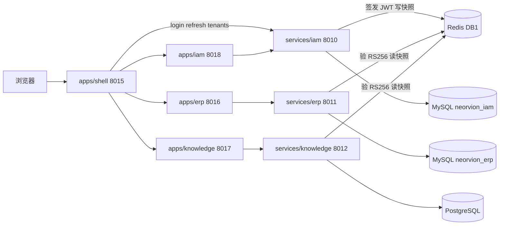
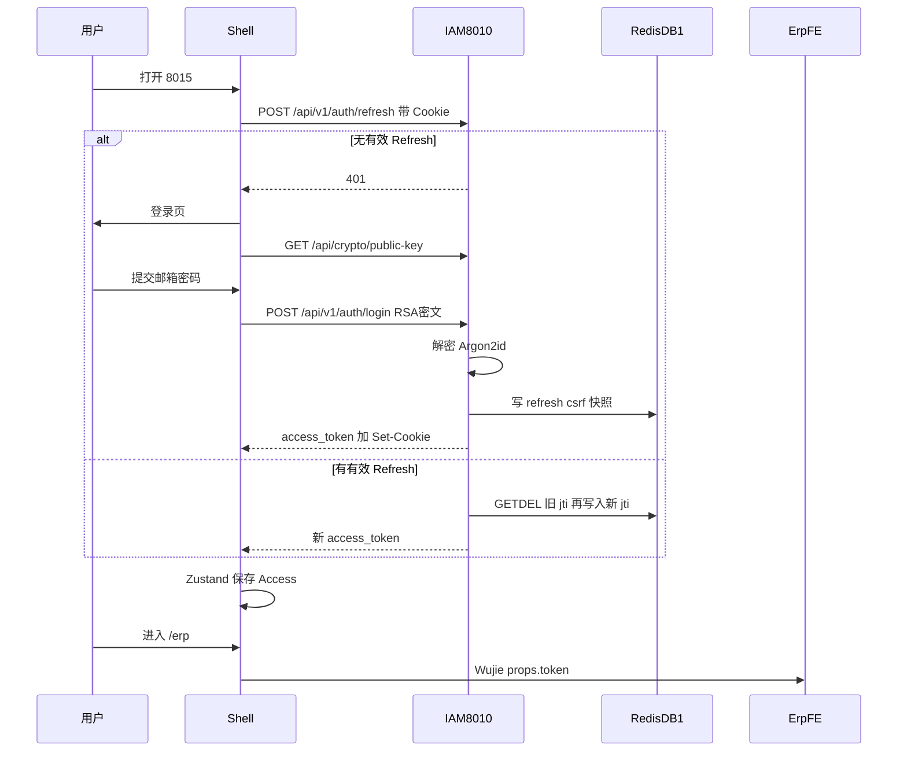
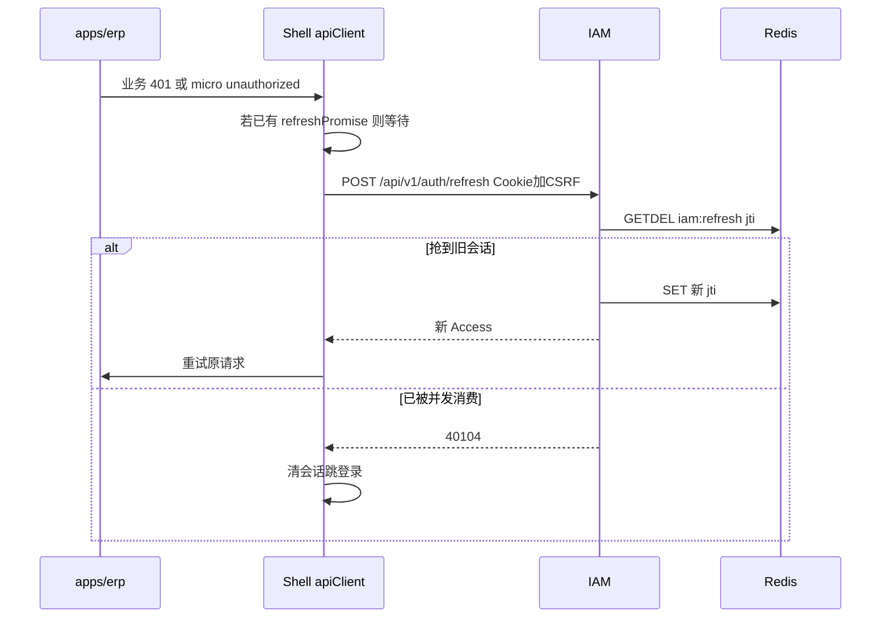
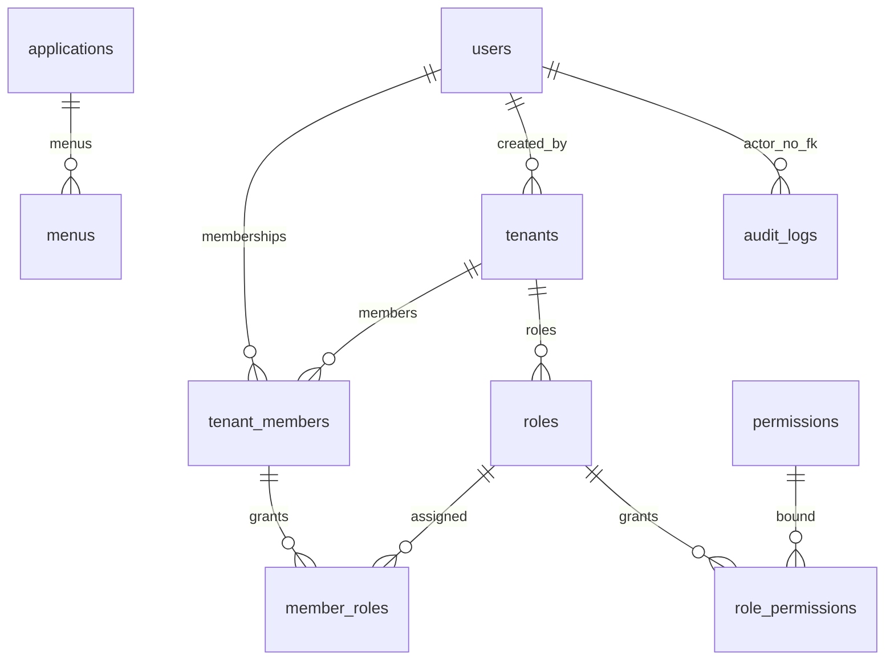
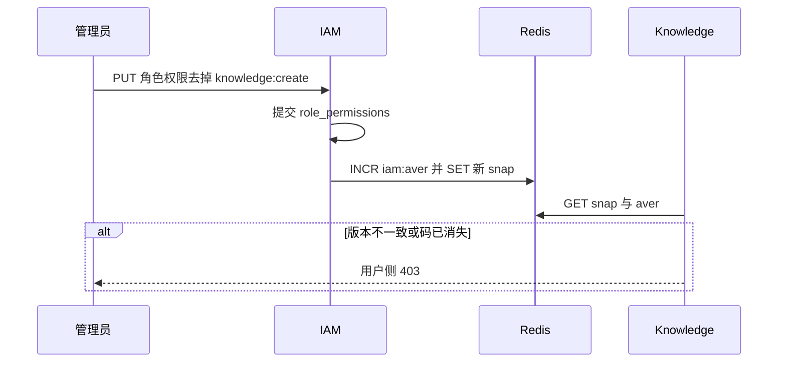

# Neorvion IAM 统一认证与权限架构：学习与面试手册

> 依据仓库 **2026-10-18 实装（V12）** 编写。目的：让有前端背景、正在建立后端架构思维的工程师，真正搞懂「谁在登录、谁在发令牌、谁在验权、租户如何隔离」。
>
> **阅读规则：** 每个关键设计都标【已实现】【部分实现】【待实现】【建议设计】。后两类不是现网能力，面试时不要说成「我们做了」。

---

## 怎么读这份文档

先用一个业务画面把四件事分开，再进源码：

1. **认证（Authentication）**：你是不是张三？——邮箱密码、JWT、Refresh Cookie。
2. **授权（Authorization / RBAC）**：张三能不能「上传文档」「看订单」？——功能权限编码。
3. **租户隔离（Tenancy）**：张三现在代表哪家企业？——`X-Tenant-ID` + 成员表 + 快照。
4. **资源 ACL**：张三能不能改**这一本**知识库、看**这一张**订单？——业务服务二次校验。

四层混在一起，就会出现「Token 还有效但已经没权限」「改了 Header 就进别人公司」这类事故。

状态图例：

| 标记 | 含义 |
| --- | --- |
| 【已实现】 | 有可运行代码与测试，路径写在正文 |
| 【部分实现】 | 有模型/API/参数，但缺口明确（例如从未被调用） |
| 【待实现】 | README/注释提到，仓库里没有对应服务或接口 |
| 【建议设计】 | 本文为讲解补的目标方案，**当前不存在** |

---

## 目录

1. [全局架构与职责划分](#一全局架构与职责划分)
2. [统一登录与 SSO 完整流程](#二统一登录与-sso-完整流程)
3. [IAM 数据库模型与多租户](#三iam-数据库模型与多租户)
4. [统一 RBAC 权限管理](#四统一-rbac-权限管理)
5. [JWT 本地验证与跨服务鉴权](#五jwt-本地验证与跨服务鉴权)
6. [权限缓存、Redis 与一致性](#六权限缓存redis-与一致性)
7. [资源级权限与多租户安全](#七资源级权限与多租户安全)
8. [六条真实调用链](#八项目真实调用链深度分析)
9. [架构取舍、性能与故障](#九架构取舍性能与故障分析)
10. [面试问答](#十面试问答不少于-50-道)
11. [学习与复盘](#十一学习与复盘)

---

## 一、全局架构与职责划分

### 1.1 Monorepo 里谁干什么【已实现】

把公司前台理解成「一栋楼、多个柜台」：

| 位置 | 端口 | 角色（通俗） |
| --- | --- | --- |
| `apps/shell` | 8015 | 大楼门卫：登录、选企业、嵌套子应用 |
| `apps/iam` | 8018 | 人事与权限办公室 |
| `apps/erp` | 8016 | 进销存业务柜台 |
| `apps/knowledge` | 8017 | 知识库柜台 |
| `services/iam` | 8010 | 发工牌（JWT）+ 管花名册 |
| `services/erp` | 8011 | 订单库存，**不再发工牌** |
| `services/knowledge` | 8012 | 文档检索，**不再问 ERP 这人是谁** |
| `packages/python/neorvion_security` | — | 各服务共用的验牌器 |
| `packages/shared` | — | 前端权限码、事件名、Query Key |

`services/copilot` **目录不存在**。【待实现】后续 Copilot 应走 IAM「应用注册」加 audience，而不是改 JWT 校验去写死应用列表。见根目录 `README.md`「未来」与 `docs/agent-readiness.md`。

数据库所有权（禁止跨库 JOIN 用户与订单）：

- IAM：MySQL `neorvion_iam` + Redis DB 1（刷新会话、授权快照）
- ERP：MySQL `neorvion_erp` + Redis DB 0（业务缓存/任务）
- Knowledge：PostgreSQL + pgvector；任务 Redis DB 0，快照 Redis DB 1

依据：`README.md`、`services/iam/README.md`、`docker-compose.yml`。



### 1.2 为什么从 ERP 拆 IAM【已实现拆分】

改造前（V12 之前）：ERP 既卖货又当派出所。Knowledge 通过 `ErpIdentityClient` HTTP 内省「这个 Token 是谁、有没有权限」。ERP 一挂，知识库登录一起挂。

改造后：派出所独立成 IAM。ERP / Knowledge **每个请求只做两件事**：用公钥验 JWT 签名，再读 Redis 快照确认「仍是这家企业的有效成员」。日常请求**不访问 IAM HTTP**。

依据：`services/knowledge/app/services/identity.py` 现为单行注释空壳；全库已无 `class ErpIdentityClient`。

对比：

| | 改造前内省 | 改造后本地验签 |
| --- | --- | --- |
| Knowledge 依赖 | 每个请求打 ERP | 只依赖 JWT 公钥 + Redis 快照 |
| ERP 宕机 | Knowledge 无法鉴权 | Knowledge 仍可服务已登录用户 |
| 权限变更 | 以 ERP 当次查询为准 | IAM 改快照版本，下一次业务请求失效 |
| 延迟 | 多一次跨服务 RTT | 本机验签 + Redis GET |

### 1.3 IAM 管什么、业务服务管什么【已实现】

**IAM 唯一数据所有权：** 用户账号、密码哈希、平台管理员标记、租户、成员、角色、功能权限目录、应用注册、菜单配置、审计日志、Refresh 会话（Redis）。

**业务服务所有权：** 订单、库存、文档、切片、知识库授权名单 `KnowledgeBaseGrant`。业务表上的 `user_id` / `tenant_id` / `member_id` 是 **ID 契约**，不是跨库外键。

ERP 本地仍有 `users` 表，但语义已改成展示名投影：`services/erp/app/core/identity_projection.py` 的 `project_display_user` 按快照 upsert 姓名，`password_hash="!"`，**不能用来登录**。

### 1.4 认证、授权、租户、ACL 四层【已实现分层】

用「张三要上传一份 PDF」：

1. JWT 验签通过 → 认证成功，他是 `sub=42`。
2. Redis 快照说 42 号用户在租户 7 里是 ACTIVE，且有 `knowledge:create` → 功能授权通过。
3. Header `X-Tenant-ID: 7` 必须与快照 `tenant_id` 一致 → 租户上下文成立。
4. `AccessService.assert_writable(知识库 15)` 再看 grants → 资源 ACL。

少任何一层都等于「门口保安看了身份证，仓库钥匙却随便拿」。

---

## 二、统一登录与 SSO 完整流程

这里的 SSO（Single Sign-On，单点登录）是 **同一套自建账号在 Shell 里进多个微前端不再登录**。它 **不是** OAuth2 / OIDC。【已实现内部共享登录态】【待实现 OIDC】

### 2.1 打开 Shell，如何判断是否登录【已实现】

Access Token **只在内存**（Zustand `auth-store`），刷新页面会丢；持久会话靠 HttpOnly Refresh Cookie。

启动链：

1. `apps/shell/src/components/AuthBootstrap.tsx`：`status === 'initializing'` 时显示「正在恢复登录状态…」。
2. 若内存已有 `accessToken` → `markAuthenticated`。
3. 否则 `restoreSession()` → `POST /api/v1/auth/refresh`（见 `apps/shell/src/api/client.ts`）。
4. 有新 Access Token → 已登录；401 → `markUnauthenticated`。
5. `RequireAuth`（`apps/shell/src/components/RequireAuth.tsx`）看到不是 `authenticated` 就跳登录页。

新标签页没有内存 Token，但浏览器会带上 Cookie，因此会再走一次 refresh，看起来像「免登」。这是 Cookie SSO，不是 OIDC silent iframe。

### 2.2 RSA-OAEP 加密密码【已实现】

密码不能明文过 HTTPS 日志和代理。登录前：

1. 前端 `GET /api/crypto/public-key`（`services/iam/app/api/crypto.py`）。
2. 服务端签发一次性 `challenge_id`，Redis 键 `auth:challenge:{id}`，TTL 约 300 秒。
3. 浏览器 Web Crypto：`RSA-OAEP` + SHA-256（`apps/shell/src/lib/password.ts`）。
4. 提交 `encrypted_password` + `key_id` + `challenge_id`。
5. 服务端 `challenge_store.consume_challenge` **GETDEL**（一次性），再 `RsaKeyStore.decrypt`（`services/iam/app/core/rsa_crypto.py`）。

RSA 传输密钥与 JWT 签名密钥 **必须两套**：`scripts/generate_keys.py`。生产缺 JWT 私钥拒绝启动。

### 2.3 Argon2id 存密码【已实现】

解密后的明文只在调用栈里。`hash_password` / `verify_password` 使用 Argon2 `PasswordHasher()`（`services/iam/app/core/security.py`）。登录失败文案统一「邮箱或密码错误」，避免枚举邮箱（`AuthService.login`）。

### 2.4 签发 Access / Refresh【已实现】

`AuthService._issue_tokens`：

1. 读 `iam:tver:{user_id}` 作为 JWT `ver`。
2. `create_access_token` / `create_refresh_token` → `LocalJwtSigner.sign`（RS256）。
3. Refresh 的 `jti` 写入 Redis `iam:refresh:{jti}=user_id`，CSRF 写入 `iam:csrf:{jti}`。
4. HTTP 响应体只有 `access_token` + `expires_in`，**没有 refresh_token 字段**。Refresh 只进 Cookie。

默认 TTL：Access 30 分钟（`JWT_ACCESS_EXPIRE_MINUTES`），Refresh 7 天（`JWT_REFRESH_EXPIRE_DAYS`）。

### 2.5 JWT 三段分别是什么【已实现】

JWT（JSON Web Token）= Header.Payload.Signature，用 `.` 连接的 Base64。

**Header：** `alg=RS256`，`kid=jwt-v1`，`typ=JWT`。验签时若 `alg` 不是 RS256（例如伪造 `none`/`HS256`）直接 401。依据：`neorvion_security/jwt.py` `ALLOWED_ALGORITHMS = ("RS256",)`。

**Payload（实际写入）：**

| Claim | 含义 | 本项目值 |
| --- | --- | --- |
| `sub` | 主体 | 用户 ID 字符串 |
| `iss` | 谁签发 | 默认 `neorvion-iam` |
| `aud` | 给谁用 | 默认 `neorvion-iam,neorvion-erp,neorvion-knowledge` |
| `exp` / `nbf` / `iat` | 过期 / 生效 / 签发时间 | UTC |
| `jti` | 令牌唯一 ID | `uuid4().hex` |
| `type` | access 或 refresh | 互斥，Refresh 不能当 Access |
| `ver` | 会话版本 | 对应 Redis `iam:tver:` |

**JWT 里没有 permission_codes。** 权限在 Redis 快照。这是「无状态令牌 + 有状态授权」的折中。

**Signature：** IAM 私钥签，业务服务公钥验。私钥不出 IAM 容器。

### 2.6 JWKS 与密钥轮换【已实现当前+上一把】

- `GET /.well-known/jwks.json` 与 `GET /api/v1/jwks`（`services/iam/app/main.py` / `jwt_keys.py` `build_jwks`）。
- 可配置 `JWT_PREVIOUS_KEY_ID` + 上一把私钥路径，JWKS 同时返回两把公钥，旧 Token 在过期前仍能验。
- 业务侧 `JwksCache` 默认 300 秒；IAM 短暂不可用且**已有缓存**时延长最多 30 秒继续用旧公钥；**无缓存**则 50312。

### 2.7 Cookie / CSRF【已实现】

| Cookie | 默认名 | HttpOnly | Path | 作用 |
| --- | --- | --- | --- | --- |
| Refresh | `neorvion_refresh` | 是 | `/api/v1/auth` | 只有 refresh/logout 能带上 |
| CSRF | `neorvion_csrf` | 否 | `/` | 前端读出放入 `X-CSRF-Token` |

SameSite 默认 Lax；生产 `Secure=true`。刷新还校验 Origin（`_assert_refresh_origin`）。这是 Double Submit Cookie，防跨站带着 Refresh Cookie 静默续命。

### 2.8 微前端如何共享登录态【已实现】

不是每个子应用自己存 Token。Shell 把状态塞进 Wujie props：

```ts
// apps/shell/src/micro/ErpMicroApp.tsx
{ token, tenantId, user, refreshSession: refreshSessionFromShell }
```

子应用 `window.$wujie.props.token` 作为 Bearer。Refresh 成功后 `syncTokenToAliveSandboxes` 改保活 iframe 里的 props，避免子应用各刷一次。

### 2.9 401 单飞刷新【已实现】

`apps/shell/src/api/client.ts` 模块级 `refreshPromise`：并发 401 共用一个 `POST /auth/refresh`。`authClient` **禁止**自动 refresh，避免自己刷新自己。子应用 401 调用 `props.refreshSession()` 或 `bus.$emit('micro:unauthorized')`，由 Shell 监听。

并发刷新在服务端用 Redis `GETDEL`：第二个请求拿到空 jti → 40104。所以前端单飞不仅是体验，也是和轮换协议匹配。

### 2.10 登出 / 过期【已实现】

- 登出：`AuthService.logout` 删除 `iam:refresh` / `iam:csrf`，清 Cookie。
- Refresh 过期或被抢：前端 `endSessionDueToExpiry` 清 Zustand、React Query、销毁微应用。
- 改密：`invalidate_sessions` 递增 `iam:tver:`，旧 Access 即使未过期也会 40104。

### 2.11 登录时序图



### 2.12 Token 刷新时序图



### 2.13 一条前后端完整调用链（登录）

| 步 | 谁 | 文件 / 函数 | 入参 / 出参 |
| --- | --- | --- | --- |
| 1 | 页面 | `apps/shell/src/pages/LoginPage.tsx` | email + 明文密码（仅内存） |
| 2 | 加密 | `lib/password.ts` `encryptAuthPassword` | 得到密文三件套 |
| 3 | HTTP | `apps/shell/src/api/auth.ts` `loginAccount` | `POST /api/v1/auth/login` |
| 4 | 路由 | `services/iam/app/api/v1/auth.py` `login` | 设 Refresh/CSRF Cookie |
| 5 | 服务 | `AuthService.login` | 解密、Argon2id、写 `last_login_at` |
| 6 | 快照 | `SnapshotService.refresh_user` | 该用户所有租户的 `iam:snap:` |
| 7 | 令牌 | `_issue_tokens` | Access 回 JSON，Refresh 回 Cookie |
| 8 | 前端 | `markAuthenticated` + `fetchCurrentUser` | `GET /api/v1/auth/me` |

异常：challenge 用过 → 40020；RSA 对不上 → 40022；禁用账号 → 40300；密码错 → 401/40010。

---

## 三、IAM 数据库模型与多租户

迁移：`services/iam/alembic/versions/20261018_0001_init_iam.py`（`20261018_0001`）。

### 3.1 真实存在的 10 张表【已实现】

`users`、`tenants`、`tenant_members`、`permissions`、`roles`、`member_roles`、`role_permissions`、`applications`、`menus`、`audit_logs`。

**不存在（不要在面试里说「我们有会话表」）：**

| 名称 | 状态 |
| --- | --- |
| `sessions` / `refresh_tokens` | 【建议设计】当前用 Redis `iam:refresh:{jti}` |
| `buttons` | 【建议设计】按钮 = 权限树 `ACTION` 节点 + `Menu.menu_type` |
| 软删除 `deleted_at` | 【待实现】用户/成员用 `status=DISABLED`；移除成员是硬删行 |

### 3.2 ER 图



要点：

- `users` **没有** `tenant_id`：一个人可以加入多家企业。
- `UNIQUE(tenant_id, user_id)`：同一人不能重复加入同一企业。
- `member_roles` / `role_permissions` 用 **复合外键** `(tenant_id, member_id)`、`(tenant_id, role_id)`，从数据库层禁止「把 A 企业角色授给 B 企业成员」。
- `permissions` 是**全局目录**，所有租户共用 code；`roles` 是**租户私有**（`uq_roles_tenant_code`）。
- `audit_logs.tenant_id` / `actor_user_id` **没有外键**，避免审计被用户删除级联掉。

### 3.3 三个 ID 不要混【已实现】

用数据举例：张三 `users.id=42`，加入「星河贸易」`tenants.id=7`，成员行 `tenant_members.id=100`。

- **user_id=42**：全局账号，登录用。
- **tenant_id=7**：当前企业。业务表每行都带它。
- **member_id=100**：张三**在这家企业**的身份。角色挂在 member 上，不是挂在 user 上。

张三再加入「蓝海」`tenant_id=8` 会有另一条 `member_id=101`。同一 Access Token，换 `X-Tenant-ID` 才换企业；服务端必须证明 42 在 8 里有 ACTIVE 成员。

### 3.4 平台管理员 vs OWNER vs ADMIN vs 成员【部分实现】

| 身份 | 落地 | 能做什么 | 不能做什么 |
| --- | --- | --- | --- |
| 平台管理员 | `users.is_platform_admin` | `GET/PATCH /api/v1/users`、应用注册、审计 | 代码里 **没有** 把它设为 True 的 API【待实现】；迁移脚本也写 False |
| 租户 OWNER | `tenant_members.role=OWNER` + 系统角色 OWNER | 本企业一切功能权限（`known_permission_codes()`） | 不能管其他租户；不能给自己加平台管理员 |
| ADMIN | **角色** `roles.code=ADMIN`（不是成员列） | 模板近乎全目录，改权限时必须保留租户管理码 | 不能授 OWNER（40321） |
| 普通成员 | `role=MEMBER` + `member_roles` 并集 | 被分配的功能码 | 不能自我提权成 OWNER |

`TenantMember.role` 枚举只有 `OWNER` / `MEMBER`。ADMIN 是角色表里的一行，面试时别说「成员表有 ADMIN 列」。

OWNER 转移：注释称「独立流程」，**IAM 无转移 API**【待实现】。创建企业时 `bootstrap_tenant(..., allow_owner_role=True)` 才允许挂 OWNER。

### 3.5 为什么跨服务不建外键【已实现】

ERP `20261018_0021_drop_identity_fks` 删掉业务表指向 `users`/`tenants` 的 FK。原因：身份已迁走，ERP 库里的 users 行不再是真相；跨 MySQL 实例也无法 FK。隔离靠每次查询 `tenant_id == context.tenant_id`（`TenantMixin` + Repository）。

### 3.6 为什么权限必须带租户上下文【已实现】

角色是租户私有的。只拿 user_id 问「有没有 order:read」没有意义——在 A 企业是仓管，在 B 企业可能只是访客。所有业务 Depends 都是：JWT → 解析 tenant header → 快照/查库 **该成员在该租户** 的权限。

---

## 四、统一 RBAC 权限管理

RBAC（Role-Based Access Control，基于角色的访问控制）：不给张三直接勾 200 个按钮，而是给「运营专员」角色勾权限，再把张三绑到这个角色。

### 4.1 应用注册【已实现 ERP/Knowledge/IAM】【待实现 Copilot 服务】

种子：`services/iam/app/scripts/seed_permissions.py` 写入 `applications`：

| code | audience |
| --- | --- |
| iam | `neorvion-iam` |
| erp | `neorvion-erp` |
| knowledge | `neorvion-knowledge` |

API：`GET/POST /api/v1/applications`（平台管理员）。界面文案提到 Copilot，但 **没有 `services/copilot`**。

### 4.2 权限编码怎么命名【已实现，并非全部 `erp:` 前缀】

目录在 `services/iam/app/core/permissions.py` `PermissionCode`。真实风格是 **`{模块}:{动作}`**，例如：

- `order:read`、`order:create`（ERP 订单，**不是** `erp:orders:read`）
- `knowledge:read`、`knowledge:create`（**不是** `knowledge:documents:upload`）
- `iam:users:read`、`iam:apps:manage`

根 README 里的 `erp:orders:read` / `knowledge:documents:upload` 是**命名风格举例**。面试请说仓库里的真实字符串，否则对不上校验。

新应用同步：`POST /api/v1/internal/permissions/sync`，Header `X-Permission-Sync-Key`。只插入不存在的 code，不更新、不删除，避免启动时覆盖管理员配置。【已实现 insert-only】

业务服务启动时 **不会** 自动覆盖 IAM 目录。

### 4.3 角色、勾选、绑成员【已实现】

贯穿例子：管理员创建「运营专员」，给 `order:read` + `knowledge:create`，再把张三绑上。

1. 登录 IAM 微应用，选中星河贸易（`X-Tenant-ID=7`）。
2. `POST /api/v1/roles` `{ name, code: "OPERATOR_BIZ", permission_ids: [...] }` → `RoleService.create_role`。
3. 或 `PUT /api/v1/roles/{id}/permissions` 全量替换。OWNER 系统角色核心权限冻结；ADMIN 必须保留租户管理码。
4. `POST /api/v1/tenants/7/members` `{ email: "zhangsan@...", role_ids: [新角色] }`。`role_ids` 为空才默认 VIEWER；**不能**把 OWNER 塞进 role_ids（40321）。
5. `replace_role_permissions` 之后 `SnapshotService.refresh_role_members` 重写该角色下所有成员快照。

### 4.4 菜单、按钮、API 三层关系【部分实现】

| 层 | 实现 | 能否当安全边界 |
| --- | --- | --- |
| 前端菜单 | 子应用 `filterMenuRoutes` + `permission` 字段 | 否，可改 JS |
| 前端按钮 | `Can` 组件 | 否 |
| 后端 API | FastAPI `Depends(require_permission(...))` | **是** |
| IAM `menus` 表 | 平台可 PATCH 路径/可见性 | 与 ERP 运行时菜单 **未完全打通**【部分实现】 |
| `PERMISSION_TREE` | Python 常量，`GET /permissions/tree` | 授权 UI 用，不写 `menus` 表 |

Shell 顶部导航（工作台 / ERP / Knowledge / 权限中心）**不做权限过滤**【已实现但不按 RBAC 藏入口】。进了 IAM 子应用后，无 `iam:users:read` 会看不到用户管理菜单，但直接打 API 仍 403。

IAM `rbac_deps.py` 写得很清楚：先 `TenantContextDep`，再查权限；**不要把 JWT 或请求体里的角色列表当授权依据**。IAM 当前租户接口会 **再查库** 汇总权限（强于只信快照）。ERP/Knowledge 则信快照里的 `permission_codes`。

### 4.5 为什么隐藏按钮不等于安全

浏览器属于攻击者。藏按钮只减少误操作。真正拦的是 `AuthorizationService.require_all` → 40320。测试：`services/knowledge/tests/test_documents.py::test_viewer_cannot_upload`。

### 4.6 为什么认证统一、授权要分布式执行

认证「你是谁」适合集中，避免每套系统一套密码。授权「能不能动这张订单」必须在拥有数据的服务做：IAM 没有 `sales_orders` 表，无法判断订单归属。功能资格在 IAM/快照；资源归属在 ERP/Knowledge。

### 4.7 防自我提权【已实现主要路径】

- 注册强制 `is_platform_admin=False`。
- 不能授予 OWNER。
- 系统角色不可删；OWNER 权限不可经管理接口改掉核心集。
- 平台用户接口仅 `PlatformAdmin`。
- 【缺口】没有「调用者不能授予自己没有的权限」的通用检查——租户 OWNER 本身拥有全目录，问题较小；若未来精细化委托授权，需要 **授权范围 ⊆ 调用者权限**【建议设计】。

---

## 五、JWT 本地验证与跨服务鉴权

### 5.1 为什么不再每次请求 IAM【已实现】

验签是 CPU 上的数学运算，公钥可缓存。成员是否仍有效、有哪些功能码，走 Redis GET。IAM HTTP 只出现在：登录、刷新、管理权限、偶尔拉 JWKS。

### 5.2 验签成功 ≠ 人还能进这家企业【已实现】

`SnapshotStore.load` 额外检查：

- `claims.ver == iam:tver:{user}`（账号停用/改密后旧 Token 立刻废）
- 存在 `iam:snap:{user}:{tenant}`
- `authz_version` 与 `iam:aver:` 一致
- 快照 `status`、`tenant_status` 为 ACTIVE
- `snapshot.tenant_id` 等于请求头解析出的租户

Knowledge：`services/knowledge/app/api/deps.py` `get_tenant_context`。ERP 同构：`services/erp/app/api/deps.py`，并 `project_display_user`。

### 5.3 HS256 vs RS256【已实现 RS256】

HS256 用同一把密钥签和验：每个业务服务都得拿「签发密钥」，泄露一个服务等于能伪造全站 Token。RS256 私钥只在 IAM，业务服务只有公钥，最多拒绝请求，不能伪造。这就是拆 IAM 后必须换非对称的原因。旧 HS256 Token 全部作废。

### 5.4 `X-Tenant-ID` 为什么不能信【已实现】

它只表示「我想以哪家企业办事」。伪造 Header 把 7 改成 8：快照不存在或成员不匹配 → 40310/40410。测试：`services/iam/tests/test_security.py::test_member_cannot_access_other_tenant`。

Knowledge API Key（`nk_` 前缀）租户以 Key 记录为准，Header 不一致 → 40365。

### 5.5 IAM 不可用时【部分实现降级】

| 能力 | IAM 宕机后 |
| --- | --- |
| 未过期 Access + 进程内已有 JWKS | 仍可验签 |
| Redis 快照仍在 | 仍可授权 |
| 登录 / 刷新 / 改权限 | **不能** |
| 从未拉过 JWKS 的新进程 | 50312 |
| Redis 也宕 | 50313 fail-closed，**不会放行** |

ERP 不可用时 Knowledge **可以**独立认证（不再 introspect ERP）。

### 5.6 Token 被盗 / 禁用 / 移出企业【已实现对应机制】

- 被盗 Access：有效期内可用，除非 `tver` 递增或等到 `exp`。缓解：短 TTL + Refresh HttpOnly。
- 平台停用用户：`PATCH /users/{id}` → `invalidate_sessions` + 刷新快照。
- 移出成员：硬删 `tenant_members`，`refresh_member` 只 bump aver，旧快照失效。
- 【建议设计】Refresh Token 家族检测、设备列表、异常 IP 强制下线——当前没有会话表，做不到精细设备管理。

### 5.7 网关与业务双重校验【部分实现】

`nginx/nginx.conf`：认证、租户、角色、用户、应用、菜单、审计、JWKS → IAM；其余 `/api/` → ERP。Nginx **只做路由，不验 JWT**。安全仍在各 FastAPI Depends。

Knowledge 在 8012，开发时前端直连，不经过这段 `/api/` 分流。生产若只配了 ERP 反代，需要单独 location 到 Knowledge【部署时注意】。

### 5.8 服务间调用与 Confused Deputy【待实现 Copilot】【已实现用户委托路径】

Confused Deputy（糊涂代理人）：服务 A 有权限，被诱导去动用户 B 的数据。

当前浏览器流量是 **用户委托**：子应用带用户 JWT + 用户选择的租户，业务服务以该用户快照鉴权，没有「ERP 用上帝账号代 Knowledge 办事」。

`docs/agent-readiness.md` 要求未来 Agent → Tool → **现有 HTTP API** → TenantContext，禁止 Agent 直连 MySQL。仓库 **没有** Copilot 服务、没有独立服务账号 JWT。【待实现】独立服务身份（client credentials）时必须绑定允许的 tenant/audience，禁止拿着服务 Token 改任意 `X-Tenant-ID`。

### 5.9 上传文档的真实鉴权链【已实现】

不要说 `knowledge:documents:upload`，真实码是 `knowledge:create`。

```text
POST /api/v1/knowledge-bases/{id}/documents
  documents.py::upload_documents
    Depends KnowledgeCreateContext
      = TenantContextDep + require_permission(knowledge:create)
        jwt_verifier.verify_access
        snapshot_store.load(X-Tenant-ID)
  DocumentService.upload
    再次 require_all(KNOWLEDGE_CREATE)
    AccessService.assert_writable(知识库 id)   # 资源 ACL
    _save_one → 本租户 Repository → 排队解析
```

---

## 六、权限缓存、Redis 与一致性

### 6.1 快照里有什么【已实现】

键：`iam:snap:{user_id}:{tenant_id}`，JSON 含成员 ID、是否 OWNER、成员/租户状态、`permission_codes`、`role_codes`、两个版本号、平台管理员、改密标记、展示名、邮箱。

另：`iam:tver:{user_id}`（Token 版本，**无 TTL**）、`iam:aver:{user_id}:{tenant_id}`（授权版本）。

### 6.2 为什么键要带 user + tenant【已实现】

张三在两家企业权限不同。只按 user 缓存会串权。版本号让「角色变了但 JSON 还在 TTL 内」也能被下一跳请求发现。

### 6.3 TTL 与 Access TTL 不同【已实现】

快照默认 3600 秒（`SNAPSHOT_TTL_SECONDS`），Access 默认 30 分钟。快照 TTL 到期缺 key → 40310「缺少租户授权快照」，需要重新登录/刷新让 IAM `refresh_user`。二者独立：Token 没过期也可能因快照过期进不去企业。

### 6.4 如何失效【已实现版本号，无 Pub/Sub】

| 事件 | 动作 |
| --- | --- |
| 登录 / 刷新 | `refresh_user` 重写该用户所有租户快照 |
| 改角色 / 改成员状态 | `refresh_member`：先 `INCR aver` 再 save |
| 改某角色的权限 | `refresh_role_members` 遍历持有该角色的成员 |
| 停用账号 / 改密 | `INCR tver`，旧 Access 全部 40104 |
| 移除成员 | 成员不存在则只 bump aver |

**没有** Redis Pub/Sub，**没有** Outbox 事件表。【待实现】多机进程内权限缓存的主动推送。当前业务服务 **每次请求读 Redis**（不是进程内权限 Map），所以多 Worker 只要连同一 Redis，不会出现「A 容器还用旧权限」——除非有人自己做本地 cache。【已实现请求级读 Redis】

`high_risk` 参数在 `SnapshotStore.load` 里存在，但与上一行 aver 检查重复，且 **全仓库没有调用方传 `high_risk=True`**【部分实现】。README「高风险操作每次重读」不能当成已接线能力。退款/删库等应显式再读快照或回源 IAM【建议设计】。

### 6.5 现有实现保证什么、不保证什么

**能保证（在 Redis 正常时）：** 下一次业务请求看到新 aver 后拒绝旧快照；停用账号后旧 Access 因 `ver` 失败；校验失败 fail-closed。

**不能保证：** IAM 写快照与业务读之间的毫秒级窗口仍可能用旧 JSON（直到 INCR 被读到）；丢失 Redis 后不是「放过」而是「全站授权 503」；事件丢失补偿（无 Outbox）；跨区域多 Redis 复制延迟。

这是 **读时版本校验的准实时失效**，不要对外说「强一致事务」。

### 6.6 击穿 / 雪崩 / 单飞【部分在 Refresh，不在快照】

Refresh 有 GETDEL + 前端 Promise 单飞。快照是常规 GET，无 stampede 锁。【建议设计】热点用户用 single-flight 重建快照。IAM/Redis 宕机策略见第九节，原则是 **宁 503 不放行**。



---

## 七、资源级权限与多租户安全

### 7.1 RBAC / ACL / ABAC / ReBAC（概念 + 本项目落点）

| 模型 | 一句话 | 本项目 |
| --- | --- | --- |
| RBAC | 角色绑定功能 | IAM 角色 + 快照【已实现】 |
| ACL | 资源上的主体名单 | `KnowledgeBaseGrant`【已实现】 |
| ABAC | 按属性规则 | 【待实现】 |
| ReBAC | 关系图（Google Zanzibar） | 【待实现】 |

### 7.2 Knowledge 文档 / 知识库【已实现 grants，无 visibility 列】

`KnowledgeBase` **没有** `visibility` / `owner_id`。`AccessService`（注意文件头注释仍写「复用 ERP 用户」，已过时）：

- 无 grants：本租户有功能权限者默认可读/写（回退）。
- 有 grants：名单外不可见（对外 40450，防 IDOR 探测）；写需要 WRITE/ADMIN。
- 租户 OWNER：跳过名单。
- API Key：不能写（40361）。

错误实现：`SELECT * FROM documents WHERE id=:id`。  
正确实现：Repository 构造即带 `tenant_id`，再叠加 `assert_writable`。

### 7.3 ERP 订单 / 仓库【已实现】

`TenantMixin.tenant_id` 注释写明「IAM 租户 ID，跨服务无外键」。`SalesOrderRepository` 查询一律 `SalesOrder.tenant_id == tenant_id`。跨租户猜 ID：对不上行，表现 404，不泄露「别的公司有没有这张单」。

### 7.4 切租户时前端隔离【已实现】

事件：`shell:tenant-changed`（`packages/shared/src/types/bridge.ts`）。

Shell `applyCurrentTenant`：隔离 React Query 旧租户 key、改 Zustand `currentTenantId`、重置不安全 last location、广播事件。子应用 `TenantChangeBridge`：再隔离 Query、`epoch++` 强制内容区 remount、Knowledge 中止流式请求。Tabs 发现 tenant 变化则 `resetForTenant`。

切租户 **不**销毁全部微应用（销毁发生在登出）。保活 iframe 必须靠 epoch/query 隔离，否则会把 A 企业列表闪到 B 企业——这是微前端最典型的串租事故。

### 7.5 Agent 调 ERP【待实现 Agent】【已实现 API 层前提】

正确：Tool 使用**当前用户** JWT + 其 `X-Tenant-ID`，走 `order:read` 等已有接口。  
错误：Agent 持有服务端万能密钥、或把向量库里的库存数字当可写真相（`agent-readiness.md` 明文禁止）。

ERP Worker `_context`（`services/erp/app/tasks/handlers.py`）手搓空权限 `TenantContext`，**没有**走 `load_for_principal`【部分实现】。报表导出等异步任务的授权比 HTTP 入口弱，面试应主动承认。

---

## 八、项目真实调用链深度分析

### A. 登录 → Shell → 打开 ERP【已实现】

**需求：** 张三进系统后打开商品列表。  
**步骤：** AuthBootstrap 尝试 refresh → 登录页 RSA 登录 → `markAuthenticated` → `RequireTenant` 选企业 → 路由 `/erp` → `ErpMicroApp` 传入 props。  
**ERP 首个 API：** 子应用 axios Bearer + `X-Tenant-ID` → ERP `get_tenant_context` → 快照含 `product:read` → 列表查询带 `tenant_id`。  
**异常：** 无企业 → 引导创建工作空间；快照缺失 → 40310。  
**原因：** 子应用不持有 Refresh，避免三套单飞逻辑。

### B. ERP 切到 Knowledge 无需再登录【已实现】

**需求：** 同一浏览器会话进知识库。  
**步骤：** Shell 仍是 `authenticated`；Knowledge 微应用读同一 `props.token`。Audience 在签发时已包含 `neorvion-knowledge`，Knowledge 的 `IAM_JWT_AUDIENCE` 必须匹配。  
**不会发生：** 再走一遍密码。  
**会失败若：** Token 的 aud 被签成单服务且不含 knowledge（当前默认多 aud 列表）。  
**原因：** 这是内部 SSO，不是 OIDC `id_token` 换票。

### C. 管理员新增角色并跨应用授权【已实现功能码】【部分实现菜单同步】

见第四节运营专员流程。数据库：`roles` insert、`role_permissions` 替换、`member_roles` 绑定、Redis 快照重写。IAM 管理端 `GET /tenants/current` **查库**立即看到新权限；ERP/Knowledge 下一请求读快照。菜单表不会自动出现「订单列表」新行——ERP 菜单仍由 `apps/erp` 路由表驱动。

### D. Knowledge 上传【已实现四段校验】

JWT → 成员快照 → `knowledge:create` → `assert_writable`。错误文件名、超限个数在 `DocumentService.upload`。测试：`test_viewer_cannot_upload`、`test_grants_restrict_non_owner`。

### E. 撤销权限后再请求【已实现】

`PUT /roles/{id}/permissions` 去掉 `knowledge:create` → `refresh_role_members`。用户 Access **不用重新登录**。再上传：Depends 40320。IAM 测试 `test_role_permission_revoke_updates_snapshot` 同时断言 Redis JSON 已无 `order:read`。

若只改 DB 不 bump aver：ERP 在快照 TTL 内会继续放行——这正是必须写快照版本的原因。

### F. 切换租户清理微前端【已实现】

`switchTenant` 校验 `listUsableTenants`，无权 40310。然后 `isolateTenantQueries` + `shell:tenant-changed`。后端不「切换 Token」，只切换 Header；服务端每次用 Header+快照重建上下文。旧租户 React Query 被移除，避免商品 ID=1 在两家企业显示成同一条。

---

## 九、架构取舍、性能与故障分析

### 9.1 统一 IAM vs ERP 集中认证

拆分后：Knowledge 不绑 ERP 存活；密钥职责清晰；未来 Copilot 可注册 audience。代价：多一个服务、多一次迁移、本地要再开 8010/8018，Refresh Cookie Path 与网关分流变复杂。

### 9.2 IAM 统一功能 RBAC vs 每服务自己一套角色

统一目录让「运营专员」同时覆盖订单与知识库。资源 ACL 仍分散——这是正确的，因为数据不在 IAM。

### 9.3 本地验签 vs 内省

本地验签延迟低、抗 IAM 短宕（未过期 Token）。内省能立刻看到停用，但把 IAM/ERP 变成每 QPS 的同步依赖。本项目用 **短 Access + tver/aver** 补「无状态 JWT 难撤销」。

### 9.4 单体模块化 vs 微服务

当前是 **同仓多服务**，不是独立团队级微服务。事务不能跨 MySQL 与 Postgres 一笔提交；身份迁移是一次性脚本 `migrate_from_erp`，禁止长期双写。网络失败要 fail-closed，不能「IAM 超时就算登录成功」。

### 9.5 假设负载与测量（**不是**压测成绩）

| 假设 QPS | 更可能先热的点 | 建议怎么测 |
| --- | --- | --- |
| 100 | 几乎任意部署都能撑住鉴权 | 单机 compose + 日志 |
| 1000 | Redis GET 快照、JWT 验签 CPU | `redis-cli --latency`、进程 CPU |
| 10000 | JWKS 若每请求都打 IAM 会打爆；必须缓存命中 | 错误打开 `JwksCache` 才会出现；用 access 日志看 8010 QPS |

不要把上表说成「我们压测到 1 万」。

### 9.6 故障矩阵

| 故障 | 已登录用户 | 新登录 |
| --- | --- | --- |
| IAM 宕、JWKS 已缓存、Redis 正常 | 业务 API 可验签 | 不能登录/刷新 |
| Redis 宕 | 授权 50313 | 不能发 Refresh 会话 |
| IAM MySQL 宕 | 不影响已发 Token 的验签 | 不能登录 |
| JWKS 从未缓存 | 新业务进程 50312 | — |
| ERP MySQL 宕 | Knowledge 仍可 | ERP 业务不可 |

Docker Compose 单机：IAM/ERP/Redis 同命运。多节点时必须共享 Redis 与同一套 JWT 密钥/JWKS；进程内 JWKS 缓存会造成短暂用旧钥，这是有意换可用性。

### 9.7 安全 vs 复杂度

当前选择：RSA 登录密文、CSRF、RS256、版本号失效、fail-closed。没有做：设备管理、OIDC、Outbox、高风险强制回源。对教学项目这是可讲清的边界；对银行级 IAM 还差很远——面试里主动划清，比吹「企业级零信任」更加分。

---

## 十、面试问答（不少于 50 道）

每题含 30～60 秒口播、追问、结合本仓的深度、以及代码位置。

### A. SSO、JWT、Refresh Token

**1.【问题】** 什么是 SSO？你们做的是 OIDC 吗？  
**【简洁回答】** SSO 是一次登录用多个应用。我们是自建账号 + 共享 Access 内存和 Refresh Cookie，不是 OIDC。  
**【深入追问】** 和 OAuth2 授权码差在哪？  
**【深度回答】** OAuth2/OIDC 有授权服务器、client_id、redirect_uri、id_token。本仓无 authorize 端点。内部微前端是同一浏览器第一方 Cookie。  
**【对应代码】** `apps/shell/src/api/client.ts`；仓库无 OIDC 实现。

**2.【问题】** 为什么 Access 放内存、Refresh 放 HttpOnly Cookie？  
**【简洁回答】** Access 给 JS 带 Authorization；Refresh 不给 JS，降低 XSS 一次偷走长期凭证的风险。  
**【深入追问】** XSS 仍能拿 Access 做什么？  
**【深度回答】** 有效期内可代发请求，所以 Access 要短、敏感操作应再验快照。Cookie Path 限制 Refresh 只打 `/api/v1/auth`。  
**【对应代码】** `services/iam/app/api/v1/auth.py` `_set_refresh_cookie`。

**3.【问题】** 为什么用 RS256 而不是 HS256？  
**【简洁回答】** 私钥只在 IAM，业务服务只有公钥，被攻破也不能伪造 Token。  
**【深入追问】** 性能呢？  
**【深度回答】** RS256 比 HMAC 慢，但鉴权 QPS 通常不是瓶颈；密钥分发安全更重要。V12 从 HS256 迁走，旧 Token 作废。  
**【对应代码】** `neorvion_security/jwt.py` `ALLOWED_ALGORITHMS`。

**4.【问题】** JWT 无状态如何撤销权限？  
**【简洁回答】** Token 不带权限。权限在 Redis 快照；停用账号递增 `ver`。  
**【深入追问】** 只改 DB 不改 Redis 会怎样？  
**【深度回答】** ERP 在快照 TTL 内仍放行。所以改角色必须 `INCR aver` 并重写 snap。  
**【对应代码】** `SnapshotStore.load`；`SnapshotService.refresh_role_members`。

**5.【问题】** `jti` 有什么用？  
**【简洁回答】** Refresh 轮换和登出按 jti 定位 Redis 会话，不必把整段 JWT 存进去。  
**【深入追问】** Access 的 jti 用来黑名单了吗？  
**【深度回答】** 没有 Access 黑名单表。Access 失效靠 exp 和 tver。  
**【对应代码】** `token_store.py`；无 sessions 表。

**6.【问题】** 并发两个 Refresh 会怎样？  
**【简洁回答】** Redis GETDEL 只有一个成功，另一个 40104；前端再用 Promise 单飞减少碰撞。  
**【深入追问】** 为什么还要前端单飞？  
**【深度回答】** 两个 Tab 仍可能打两次；单飞是体验和降低误踢。协议正确性靠 GETDEL。  
**【对应代码】** `consume_refresh_session`；`refreshPromise`。

**7.【问题】** CSRF 怎么防的？  
**【简洁回答】** 可读 Cookie `neorvion_csrf` + 请求头 `X-CSRF-Token` 双重提交，刷新还校验 Origin。  
**【深入追问】** SameSite=Lax 还要 CSRF 吗？  
**【深度回答】** Lax 挡大部分跨站 POST，双重提交防更松的跨站或调试代理场景，属于纵深。  
**【对应代码】** `auth.py` `_read_csrf`；`auth-client.ts`。

**8.【问题】** RSA-OAEP 和 JWT RS256 能共用一把钥吗？  
**【简洁回答】** 不能。传输解密钥泄露不等于能签发登录态，职责分离。  
**【深入追问】** challenge 是什么？  
**【深度回答】** 一次性绑定 key_id，GETDEL 防重放密文。  
**【对应代码】** `rsa_crypto.py`；`challenge_store.py`。

**9.【问题】** Access 里有没有租户 ID？  
**【简洁回答】** 没有。租户来自请求头，再用快照证明成员资格。  
**【深入追问】** 做成多 tenant 的 Token 不好吗？  
**【深度回答】** 切企业就要重签；当前换 Header 即可，服务端强制再验。  
**【对应代码】** `LocalJwtSigner.sign` payload 字段。

**10.【问题】** `aud` 为什么不能信任任意值？  
**【简洁回答】** 每个服务配置自己的 audience，例如 Knowledge 只接受 `neorvion-knowledge`。Copilot 的 aud 不能进 ERP。  
**【深入追问】** 多 aud 列表是不是太宽？  
**【深度回答】** 当前签发默认带三个 aud，是便利折中；更严可做单服务 Token【建议设计】。测试用 `neorvion-copilot` 验证拒绝。  
**【对应代码】** `test_security.py` `test_forged_token_and_wrong_audience_are_rejected`。

### B. 微前端统一登录态

**11.【问题】** 子应用同时 401 怎么办？  
**【简洁回答】** 都回调 Shell 的 `refreshSessionFromShell`，共享一个 Promise。  
**【深入追问】** 子应用自己 refresh 会怎样？  
**【深度回答】** 破坏 GETDEL 轮换，后到的请求把刚换的会话废掉，用户被踢。类型注释明确禁止。  
**【对应代码】** `ShellToErpProps.refreshSession`；`client.ts`。

**12.【问题】** Token 怎么进 iframe？  
**【简洁回答】** Wujie props，不是 localStorage。保活时改 iframe 内 provide.props。  
**【深入追问】** 刷新页面为什么还能登录？  
**【深度回答】** Access 丢了，Refresh Cookie 还在，AuthBootstrap restoreSession。  
**【对应代码】** `ErpMicroApp.tsx`；`AuthBootstrap.tsx`。

**13.【问题】** Shell 侧栏为什么不按权限隐藏 ERP 入口？  
**【简洁回答】** Shell 只做宿主导航；细粒度菜单在子应用。  
**【深入追问】** 这算漏洞吗？  
**【深度回答】** 入口可见不等于 API 能通。真正安全在 Depends。产品上也可以以后做权限过滤。  
**【对应代码】** `apps/shell/src/layouts/ShellLayout.tsx`。

**14.【问题】** `micro:unauthorized` 和 props.refreshSession 为何两套？  
**【简洁回答】** 保活沙箱有时拿得到 props，有时用 bus 兜底。Shell 都进同一单飞。  
**【对应代码】** `MICRO_EVENTS.unauthorized`；`AuthBootstrap` 监听。

**15.【问题】** 切租户为什么要 `epoch++`？  
**【简洁回答】** 强制 React 卸载内容区，避免 Zustand/表格选中残留上一家企业。  
**【对应代码】** 各 app `TenantChangeBridge`；`AppRouter` `key={epoch}`。

### C. IAM、RBAC、菜单

**16.【问题】** 为什么拆 IAM？  
**【简洁回答】** 认证中心应独立，避免 Knowledge 绑死 ERP，也避免业务库成为身份真相。  
**【深入追问】** 拆分最大风险？  
**【深度回答】** 身份双写、Cookie 域名、网关分流错误把 `/auth` 打到 ERP。本仓禁止双写，用一次性 `migrate_from_erp`。  
**【对应代码】** `services/iam/app/scripts/migrate_from_erp.py`。

**17.【问题】** 权限目录是租户私有的吗？  
**【简洁回答】** code 全局共享，角色实例租户私有。  
**【对应代码】** `permissions.py` 模块注释；`uq_roles_tenant_code`。

**18.【问题】** 真实的上传权限码是什么？  
**【简洁回答】** `knowledge:create`，没有 `knowledge:documents:upload`。  
**【对应代码】** `PermissionCode`；`KnowledgeCreateContext`。

**19.【问题】** 为何菜单隐藏不能替代后端鉴权？  
**【简洁回答】** 前端属于攻击者，curl 可以直打 API。  
**【对应代码】** `require_permission`；Knowledge 上传测试。

**20.【问题】** 系统角色和自定义角色差别？  
**【简洁回答】** `is_system` 的不能删；OWNER 核心权限不能经管理接口改光。  
**【对应代码】** `RoleService.delete_role` / `replace_role_permissions`。

**21.【问题】** 权限同步为什么只插入不覆盖？  
**【简洁回答】** 防止业务服务发布时把管理员改过的名称/目录冲掉。  
**【对应代码】** `catalog.py` `sync_permissions`。

**22.【问题】** IAM 的 permissions/tree 和 menus 表是不是一张表？  
**【简洁回答】** 不是。树是 Python 常量；menus 是应用菜单配置。  
**【对应代码】** `RoleService.list_permission_tree` 注释。

**23.【问题】** 如何防止用户给自己分配管理员角色？  
**【简洁回答】** 不能授 OWNER；平台管理员字段无自助 API；改别人角色需要 `tenant:member:role:update`。  
**【深入追问】** OWNER 不是全能吗？  
**【深度回答】** OWNER 能管本企业角色，但不能把自己写成 `is_platform_admin`，也不能改其他租户。  
**【对应代码】** `resolve_assignable_role_ids`；`users.py`。

**24.【问题】** ADMIN 和 OWNER 在成员表如何区分？  
**【简洁回答】** 成员列没有 ADMIN。ADMIN 是 `roles.code`。  
**【对应代码】** `MemberRole` 枚举；`SystemRoleCode`。

### D. 多租户隔离

**25.【问题】** 跨服务如何保证 tenant_id 安全？  
**【简洁回答】** Header 只是意愿；快照校验成员；SQL 必须带 tenant_id。  
**【对应代码】** `TenantMixin`；`get_tenant_context`。

**26.【问题】** 什么是 IDOR？  
**【简洁回答】** 改 URL 里的 ID 访问别人对象。应对：租户条件 + 不存在与无权限同一 404。  
**【对应代码】** `AccessService.assert_readable` 40450。

**27.【问题】** 用户 ID 和成员 ID 区别？  
**【简洁回答】** user 是登录主体；member 是「在某企业的任职」，角色挂 member。  
**【对应代码】** `tenant_members`。

**28.【问题】** 为什么不跨库外键用户和订单？  
**【简洁回答】** 不同数据库，身份所有权在 IAM；用整数契约。  
**【对应代码】** ERP 迁移 `20261018_0021`。

**29.【问题】** 切租户会取消已排队的解析任务吗？  
**【简洁回答】** 文档约定不会；任务落库后按原 tenant_id 跑。前端只清 UI 缓存。  
**【对应代码】** Knowledge 评测 FAQ；`abortKnowledgeStreams` 只中断浏览器流。

**30.【问题】** API Key 能改 Header 进别的企业吗？  
**【简洁回答】** 不能，40365。  
**【对应代码】** `_resolve_api_key`。

### E. Redis 缓存一致性

**31.【问题】** 快照和 Token 哪个过期先发生？  
**【简洁回答】** 独立配置。快照先过期会 40310，Token 先过期会 401 再 refresh。  
**【对应代码】** `SNAPSHOT_TTL_SECONDS`；`JWT_ACCESS_EXPIRE_MINUTES`。

**32.【问题】** 有没有 Pub/Sub 推权限？  
**【简洁回答】** 没有。靠版本号，下次请求读 Redis。  
**【对应代码】** 全 IAM 无 pubsub。

**33.【问题】** Redis 宕机放行吗？  
**【简洁回答】** 不放行，50313。  
**【对应代码】** `SnapshotStore.load` except。

**34.【问题】** 多容器会不会用到过期进程内权限？  
**【简洁回答】** 业务路径每次 GET Redis，没有进程内权限 Map。JWKS 才是进程内缓存。  
**【对应代码】** `deps.py`；`JwksCache`。

**35.【问题】** 高风险操作强一致做到了吗？  
**【简洁回答】** 参数 `high_risk` 未接线，不能说已做强一致回源。  
**【对应代码】** `load(..., high_risk=False)` 默认；无调用方。

**36.【问题】** 快照 TTL 到期但人还在用系统？  
**【简洁回答】** 下次请求 403，需要 refresh 触发 `refresh_user` 或重新进企业。  
**【对应代码】** `AuthService.refresh` 调 `refresh_user`。

### F. 微服务本地鉴权

**37.【问题】** IAM 宕机后其他服务还能跑吗？  
**【简洁回答】** 已登录且 JWKS/快照仍在则能；不能登录和续期。  
**【对应代码】** `JwksCache._refresh` 软退化；`auth/login` 依赖 IAM。

**38.【问题】** Knowledge 还依赖 ERP 身份吗？  
**【简洁回答】** 不依赖。`ErpIdentityClient` 已删除。  
**【对应代码】** `identity.py` 空壳。

**39.【问题】** Worker 和 HTTP 鉴权一致吗？  
**【简洁回答】** 不完全。`load_for_principal` 已提供，ERP 报表 handler 仍手搓空上下文。  
**【对应代码】** `handlers.py` `_context`。

**40.【问题】** Nginx 验 JWT 了吗？  
**【简洁回答】** 没有，只按路径分流。  
**【对应代码】** `nginx/nginx.conf`。

**41.【问题】** 服务间会不会出现糊涂代理？  
**【简洁回答】** 浏览器流量用用户 JWT。Agent 尚未实现；文档要求走用户 API 而不是上帝账号。  
**【对应代码】** `docs/agent-readiness.md`。

### G. 数据库模型

**42.【问题】** 一人多企业怎么建表？  
**【简洁回答】** users 全局，tenant_members 中间表，唯一约束 (tenant_id, user_id)。  
**【对应代码】** `app/models/tenant.py`。

**43.【问题】** 复合外键防止了什么？  
**【简洁回答】** 把 A 租户角色 ID 写到 B 租户成员上，数据库会拒绝。  
**【对应代码】** `member_roles` FK 到 `(tenant_id, role_id)`。

**44.【问题】** Session 表在哪？  
**【简洁回答】** 没有。Refresh 在 Redis。  
**【对应代码】** `token_store.py`。

**45.【问题】** audit_logs 为什么不建用户外键？  
**【简洁回答】** 审计要在主体删除后仍能读。  
**【对应代码】** `catalog.py` AuditLog。

**46.【问题】** ERP users 表还能登录吗？  
**【简洁回答】** 不能。投影占位哈希，登录只打 IAM。  
**【对应代码】** `identity_projection.py`。

### H. 安全攻防

**47.【问题】** `alg=none` 怎么防？  
**【简洁回答】** 先读 header，alg 不在 (RS256,) 直接拒绝，再 decode。  
**【对应代码】** `JwtVerifier._verify`；测试 `test_alg_none_and_wrong_issuer_are_rejected`。

**48.【问题】** 伪造 iss / aud 呢？  
**【简洁回答】** PyJWT 校验 iss/aud，再显式确认本服务 audience 在列表中。  
**【对应代码】** 同上测试。

**49.【问题】** 如何防止 Agent 越权调 ERP？  
**【简洁回答】** 现在没有 Agent。未来必须带用户 Token，Tool 不能持有跨租户密钥，写操作要人确认。  
**【对应代码】** `agent-readiness.md`；无 copilot 代码。

**50.【问题】** XSS 拿到 Access 后撤权是否立即失效？  
**【简洁回答】** 功能撤权看快照版本，账号停用看 tver；未改这两项则直到 Access 过期。  
**【对应代码】** `load` 中 ver/aver 比较。

**51.【问题】** 登录接口如何防用户枚举？  
**【简洁回答】** 用户不存在和密码错误同一文案。  
**【对应代码】** `AuthService.login`。

**52.【问题】** 平台管理员如何产生？  
**【简洁回答】** 字段在，公开 API 不提供提权，需库内运营。这是当前缺口。  
**【对应代码】** `users.py` 只改 status。

### I. 高可用与扩展

**53.【问题】** JWKS 轮换怎么平滑？  
**【简洁回答】** JWKS 同时放当前和上一把公钥，旧 Token 用旧 kid。  
**【对应代码】** `LocalJwtSigner.jwks`；`JWT_PREVIOUS_*`。

**54.【问题】** Compose 单机和多节点差在哪？  
**【简洁回答】** 多节点要共享 Redis 与密钥；进程内 JWKS 不一致窗口靠 TTL。  
**【对应代码】** `docker-compose.yml`；`JwksCache`。

**55.【问题】** 一万 QPS 时鉴权瓶颈怎么论证（没有假数据）？  
**【简洁回答】** 先看 IAM HTTP 是否被每请求打到；设计目标是业务只打 Redis。用日志和 Redis 监控验证，而不是报一个编造的 TPS。  
**【对应代码】** `get_tenant_context` 无 IAM HTTP。

### J. 收口题

**56.【问题】** 用 30 秒介绍本项目鉴权。  
**【简洁回答】** 独立 IAM 发 RS256 JWT；Shell 单飞刷新；ERP/Knowledge 本地验签并读 Redis 快照做功能 RBAC；订单和知识库再做租户与资源校验。  
**【对应代码】** 根 `README.md`。

**57.【问题】** 这套离生产 IAM（Keycloak）差什么？  
**【简洁回答】** 无 OIDC、无联邦登录、无设备会话表、无 Outbox、平台管理员引导不完整、高风险回源未接线。  
**【对应代码】** 本文状态表。

**58.【问题】** 为什么 Refresh Path 是 `/api/v1/auth`？  
**【简洁回答】** 缩小 Cookie 发送面，业务 API 不自动带 Refresh。  
**【对应代码】** `refresh_cookie_path`。

**59.【问题】** 前端 `PERMISSION_CODE` 和后端 `PermissionCode` 不一致会怎样？  
**【简洁回答】** 菜单可能错，但后端以自己的枚举校验为准。应对齐 shared 与 Python 目录。  
**【对应代码】** `packages/shared/src/types/tenant.ts`；`services/iam/app/core/permissions.py`。

**60.【问题】** 你如何证明自己没在面试里夸大？  
**【简洁回答】** 区分已实现路径、测试名、以及 Copilot/OIDC/high_risk 等未接线项。能指出 `identity.py` 只剩一行注释。  
**【对应代码】** 本手册状态标记。

---

## 十一、学习与复盘

### 11.1 知识依赖（从简单到复杂）

```text
HTTP Cookie / CORS
  → JWT 三段与 RS256
    → Refresh 轮换与 CSRF
      → 多租户成员表
        → RBAC 角色权限
          → Redis 版本号失效
            → 微前端 props 与单飞
              → 资源 ACL 与 IDOR
                → 故障与一致性边界
```

不要第一天就背 Zanzibar。

### 11.2 十个源码练习

1. 从 `LoginPage` 点到 `AuthService.login`，画出序列。
2. 在 `jwt.py` 找到拒绝 `alg=none` 的两行。
3. 对比 IAM `get_tenant_context`（查库）和 ERP `get_tenant_context`（只读快照）。
4. 给测试用户撤 `order:read`，看 Redis `iam:snap:` JSON 变化。
5. 读 `20261018_0001` 列出全部 UniqueConstraint。
6. 解释为何 `member_roles` 要复合 FK。
7. 追踪上传 API 的四层校验。
8. 在 `client.ts` 说明 `refreshPromise.finally` 为何置空。
9. 找出 ERP Worker `_context` 与 `load_for_principal` 的差异并评估风险。
10. 对照 `seed_permissions.py` 与 JWT audience 是否一致。

### 11.3 五个安全测试场景

1. 改 `X-Tenant-ID` 为别人的企业（已有 IAM 测试）。
2. 构造 `alg=none` JWT（已有测试）。
3. 无 `knowledge:create` 上传（已有测试）。
4. 并发两次 refresh（可用两个客户端验证 GETDEL）。
5. 角色撤权后不重新登录再调业务 API（已有快照测试）。

不要在生产库做；用 `neorvion_*_test`。

### 11.4 二十个应记住的点

1. IAM 是身份唯一所有者，禁止双写。  
2. Access 内存，Refresh HttpOnly。  
3. RS256，公钥 JWKS。  
4. JWT 无权限列表。  
5. `ver` / `aver` 做撤销。  
6. `X-Tenant-ID` 不可信。  
7. user / member / tenant 三个 ID。  
8. 权限目录全局，角色租户私有。  
9. 真实码是 `order:read`、`knowledge:create`。  
10. 前端藏菜单不是安全。  
11. 资源 ACL 在业务服务。  
12. fail-closed。  
13. Refresh GETDEL 轮换。  
14. Shell 单飞。  
15. 内部 SSO ≠ OIDC。  
16. Copilot 未实现。  
17. `high_risk` 未接线。  
18. 无 Session 表。  
19. ERP users 是姓名投影。  
20. Worker 鉴权弱于 HTTP。

### 11.5 三分钟项目介绍（可照读）

> 我做的 Neorvion 是多租户跨境 ERP 加 AI 知识库。V12 把登录和功能 RBAC 拆到独立 IAM。用户在 Shell 登录，密码 RSA-OAEP 传输、Argon2id 存储，IAM 用 RS256 签发 Access，Refresh 放 HttpOnly Cookie。ERP 和 Knowledge 本地验签，并从 Redis 读取按用户+租户维度的权限快照，不再每请求回源，也不再让知识库依赖 ERP 内省。订单和文档的数据隔离仍由各服务用 tenant_id 和资源授权保证。这是教学向全栈项目，不是已上线的商业 IAM。

### 11.6 八到十分钟深度介绍（提纲）

1. 改造动机：ErpIdentityClient 把可用性绑死。  
2. 四层模型：认证 / 功能 RBAC / 租户 / ACL。  
3. 登录与 Cookie 细节、CSRF、GETDEL。  
4. JWT claim 清单，强调没有权限。  
5. 快照键与版本号，撤权用例。  
6. 微前端 props 与 401 单飞。  
7. Knowledge 上传四段校验。  
8. **主动讲缺口：** OIDC、Copilot、high_risk、平台管理员引导、Worker 上下文。  
9. 故障：IAM 与 Redis 不同影响。  
10. 收尾：这是能跑测试的个人项目实践，不是银行生产经验。

### 11.7 面试表述边界（避免夸大）

| 可以说 | 不要说 |
| --- | --- |
| 我在个人项目里把身份中心从 ERP 拆到 IAM | 我设计过公司级零信任平台 |
| 我实现了 RS256 + Redis 快照失效 | 我们是完整 OIDC Provider |
| 测试覆盖伪造 Token、跨租户、撤权 | 线上抗住了 1 万 QPS |
| Agent 只有准备文档 | 我上线了 Copilot 权限中台 |
| 高风险强一致是下一步 | 退款每次都实时打 IAM |

---

## 附录：关键路径速查

| 主题 | 路径 |
| --- | --- |
| IAM 登录 | `services/iam/app/services/auth.py` |
| Cookie | `services/iam/app/api/v1/auth.py` |
| Redis 会话 | `services/iam/app/core/token_store.py` |
| JWT | `packages/python/neorvion_security/neorvion_security/jwt.py` |
| 快照 | `.../snapshot.py`；`services/iam/app/services/snapshots.py` |
| 权限目录 | `services/iam/app/core/permissions.py` |
| 租户成员 | `services/iam/app/services/tenant.py` |
| Shell 单飞 | `apps/shell/src/api/client.ts` |
| 切租户 | `apps/shell/src/lib/switch-tenant.ts` |
| ERP Depends | `services/erp/app/api/deps.py` |
| Knowledge 上传 | `services/knowledge/app/api/v1/documents.py` |
| 知识库 ACL | `services/knowledge/app/services/access.py` |
| 安全测试 | `services/iam/tests/test_security.py` |
| 迁移 | `services/iam/alembic/versions/20261018_0001_init_iam.py` |

---

*文档结束。若代码变更，以仓库为准，并先改状态标记再改叙述。*
