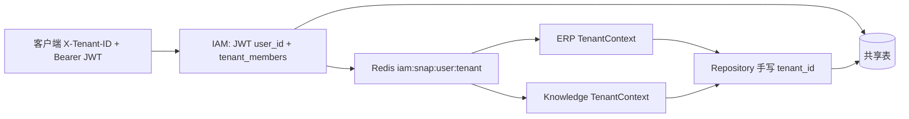

# 多租户隔离架构审查

审查日期：2026-10-22。范围是 ERP、IAM、Knowledge 三个 FastAPI + SQLAlchemy 后端。本轮只做审查和设计，不改业务实现，不改 API 契约，不执行 git add、commit、push 或 tag。

结论先说清楚：

- 三个服务都是**共享库、共享表、行上带 `tenant_id`**。没有按租户分库或分 schema。
- HTTP 入口**不会**只凭客户端 `X-Tenant-ID` 放行。IAM 查 `tenant_members`；ERP 与 Knowledge 用 JWT 加 IAM 写入的 Redis 授权快照，并核对快照里的 `tenant_id`、成员状态和租户状态。
- 数据库对业务关联使用 **`UNIQUE(tenant_id, id)` + 复合外键 `(tenant_id, resource_id)`**。这能挡住「把 A 租户的子行指向 B 租户的父行」，挡不住「SELECT 忘了写 `tenant_id`」。
- 普通查询的租户条件**全部是手写的**。生产 `SessionLocal` 仍是普通 `Session` / `AsyncSession`，没有安装隔离事件。`BaseRepository.ensure_tenant()` 只检查构造参数不是 `None`，不会改 SQL。V1 把 `do_orm_execute` 和 `before_flush` 挂在 `neorvion_db` 的会话子类上，不替换 `get_db`。
- 因此适合加一层**失败即拒绝**的会话基础设施，作为手写条件的后盾。不能用它替换现有 `WHERE`，也不能把它理解成覆盖了原生 SQL、Core `Connection` 和批量写入。
- ERP、IAM 使用 **MySQL**。Knowledge 使用 **PostgreSQL + pgvector**。PostgreSQL RLS 不能作为三个服务的统一方案。

现有说明见 `docs/multi-tenancy.md`。其中「不要做隐式全局过滤器」仍然适用：显式 `tenant_id` 条件要保留，方便阅读和排错。本文建议的会话事件是后盾，不是把 Repository 里的条件删掉。该文档里「`TenantMixin` 指向 `tenants.id`」已经过时：身份表在 IAM，ERP / Knowledge 的 `tenant_id` **不建跨库外键**。

审查以磁盘上的源码为准。索引里仍能搜到已删除的 `services/erp/app/models/rbac.py`、`user.py`、`services/erp/app/services/auth.py` 等路径，这些文件当前不存在。ERP 模型包不再导出身份表。

---

## 1. 三个服务当前租户隔离架构

### 1.1 共同请求路径



共享身份对象在 `packages/python/neorvion_security/neorvion_security/tenant.py`：

- `TENANT_HEADER = "X-Tenant-ID"`。
- `TenantContext` 是已校验身份：`user_id`、`tenant_id`、`member_id`、权限码、`is_platform_admin` 等。
- 文件头写明：请求头只是客户端意愿，不能单独当作成员证明。权限码来自 IAM 快照，不是 JWT 内嵌权限。订单归属、文档共享仍要各服务再查。

JWT 不含 `tenant_id`。切换企业只改请求头，不重新登录。这是正确拆分，前提是服务端把「头里的租户」和「这个 user 的成员关系」再绑一次。

三个服务各自有一份 `app/core/context.py`，用 `ContextVar` 保存 `current_tenant_id` / `current_user_id`。注释写着后续 Redis、日志、后台任务从这里读。**这个变量不参与 SQL，不是安全边界。** 漏传给 Repository 时，数据库不会因此拒绝。

### 1.2 ERP（MySQL，同步 `Session`）

| 层 | 实现 | 隔离强度 |
| --- | --- | --- |
| 入口 | `services/erp/app/api/deps.py` `get_tenant_context`（约 42–59 行） | 强 |
| 快照 | `SnapshotStore.load`：键 `iam:snap:{user_id}:{tenant_id}`，并比对 token 版本、授权版本、`snapshot.tenant_id == tenant_id`、成员/租户 `ACTIVE` | 强 |
| 高风险 | `get_high_risk_context`（约 69–102 行）回源 IAM `/authorize`。生产环境没有权威通道则 503，不降级放行 | 强 |
| Session | `services/erp/app/db/session.py` `get_db` 只 `yield SessionLocal()` | 无租户 |
| Repository | `BaseRepository(session, tenant_id)` + 各查询手写 `Model.tenant_id == tenant_id` | 中，靠约定 |
| 数据库 | 业务表 `TenantMixin.tenant_id NOT NULL`，`UNIQUE(tenant_id, id)`，子表复合外键 | 关联强，SELECT 不强 |
| Worker | Redis 只投递 `task_id` / `event_id`，再按全局键领取 | 系统级，见风险 |

`TenantMixin`（`services/erp/app/db/mixins.py` 21–33 行）注释写明：共享库靠每行 `tenant_id`，查询必须带该列，不能只靠前端过滤。`tenant_id` 注释为「IAM 租户 ID，跨服务无外键」。

ERP 不再建 `users` / `tenants` / `tenant_members`。单据上的姓名来自 `identity_name_snapshots`，主键是 IAM `user_id`，没有租户列。这是展示缓存，不是登录表。

导出任务在执行前会用任务行上的 `created_by` + `tenant_id` 重新加载快照（`services/erp/app/tasks/handlers.py` 27–37 行）。缺任一字段直接拒绝，不允许空身份跑报表。这是三个服务里后台身份还原做得最严的一处。

### 1.3 IAM（MySQL，同步 `Session`）

IAM 同时保存**全局身份**和**租户域数据**。不能给所有查询统一加 `tenant_id`。

入口分两段（`services/iam/app/api/deps.py`）：

1. `get_current_user`（41–71 行）：只解析 Access Token，得到全局 `User`。`set_tenant_context(tenant_id=None, ...)`。
2. `get_tenant_context`（89–127 行）：解析 `X-Tenant-ID`，用 **JWT 的 `user_id` + 头里的 `tenant_id`** 查 `tenant_members`。无行、成员非 `ACTIVE`、租户非 `ACTIVE` 都拒绝。然后当场从数据库汇总权限码。

平台管理员没有跳过成员校验。`require_platform_admin`（134–137 行）是另一条依赖，只保护平台目录类路由。`is_platform_admin` 会写入 `TenantContext`，但 ERP / Knowledge 的 Repository **没有**因这个标志去掉 `tenant_id`。

内部回源 `services/iam/app/api/v1/internal.py` 同样是 JWT 用户 + 请求头租户 + `tenant_members`，不是只看请求头。

IAM **没有** `TenantMixin`。租户列写在具体模型上。`BaseRepository.ensure_tenant()` 有定义，业务代码没有调用它；租户条件写在具体方法参数里。

### 1.4 Knowledge（PostgreSQL，异步 `AsyncSession`）

| 层 | 实现 |
| --- | --- |
| HTTP | `get_tenant_context`（`services/knowledge/app/api/deps.py` 46–56 行）：JWT + `SnapshotStore.load`，与 ERP 相同 |
| API Key | `_resolve_api_key`（59–91 行）：租户以 Key 行的 `tenant_id` 为准。头里的租户若存在且不一致，返回 403。头不能把 Key 改绑到另一家企业 |
| Session | `async_sessionmaker(..., class_=AsyncSession)`，`get_db` 不绑定租户 |
| Repository | `BaseRepository(AsyncSession, tenant_id)`，查询手写条件 |
| 检索 | `RetrievalService._visible_chunk_filters` 在 SQL 里同时限制 chunk、document、knowledge base 的 `tenant_id`，并限制授权知识库 ID |
| Worker | Redis List `knowledge:tasks` 只放 `task_id` 或 `eval:{run_id}`。状态在 PostgreSQL |

`INTERNAL_SERVICE_HEADER` 在 `services/knowledge/app/core/tenant.py` 导出，当前没有路由用它换租户。

软删除只存在于 Knowledge（`deleted_at`）。检索路径会写 `deleted_at IS NULL`。没有全局软删除过滤器，新查询可以既漏租户、又把已删行算进去。ERP 没有软删除列。

---

## 2. 已有的公共封装以及重复实现

### 2.1 已经共享、应继续共用

| 能力 | 位置 | 说明 |
| --- | --- | --- |
| `TenantContext`、`TENANT_HEADER` | `neorvion_security.tenant` | 三个服务的 `app/core/tenant.py` 都是再导出 |
| JWT 校验、快照读写 | `neorvion_security.jwt`、`snapshot` | ERP / Knowledge 只读快照；IAM 写入 |
| 快照键 | `iam:snap:{user}:{tenant}`、`iam:aver:{user}:{tenant}`、`iam:tver:{user}`、`iam:refresh:{jti}`、`iam:csrf:{jti}` | 前两个带租户；后三个是用户或会话，**不能**改成带租户 |

不要再定义第二个 `TenantContext`。会话层如果需要租户 ID，应从已经校验过的 `TenantContext.tenant_id` 传入，而不是再解析请求头。

### 2.2 三份几乎相同、适合收进共享包的代码

| 重复 | ERP | IAM | Knowledge |
| --- | --- | --- | --- |
| `TimestampMixin` | `app/db/mixins.py` | 同左，无 `TenantMixin` | 同左，时间带时区 |
| `TenantMixin` | `tenant_id NOT NULL` | 无 | 同 ERP，注释不同 |
| `BaseRepository` | 同步 `Session` | 与 ERP 相同，`ensure_tenant` 未被调用 | 异步 `AsyncSession`，其余相同 |
| `ContextVar` | `app/core/context.py` | 相同 | 相同 |
| 解析 `X-Tenant-ID` | `deps._parse_tenant_id` | 相同 | 相同 |
| 高风险回源分支 | `get_high_risk_context` | 自身就是权威源 | 与 ERP 相同 |
| Challenge / Refresh Redis | `app/core/token_store.py`、`challenge_store.py`、`redis_keys.py` **存在但没有业务引用** | `auth.py` 实际使用 | 不签发登录态 |

`BaseRepository` 的三份文档都写了「查询必须带 `tenant_id`」，运行时都没有执行这条约定。

### 2.3 查询风格已经分叉

同一类列表，有的 JOIN 带租户，有的只按 `id`：

- 带齐的：`services/erp/app/repositories/sales_order.py` 186–208 行，`purchase.py` 144–157 行，`analytics_sales.py` 89–96 行，`analytics_inventory.py` 77–85 行。条件是 `Other.tenant_id == Root.tenant_id AND Other.id == Root.fk_id`。
- 只按 `id` 的：`outbound.py` 175–177 行，`shipment.py` 212–215 行，`after_sale.py` 92–97 行与 193–194 行，以及采购收货、采购退货、退款、调拨、盘点等列表。根表的 `WHERE tenant_id = ?` 仍然在。

Knowledge 检索把租户放在 `WHERE`（`retrieval.py` 262–277 行），向量 JOIN 对 embedding 使用了复合条件（327–331 行），对 document / base 仍是 `id` 相等，再靠 `WHERE` 补租户。

这是重复实现，不是三套产品规则。

### 2.4 不该当成「已有租户缓存框架」的部分

`services/erp/app/core/redis_keys.py` 定义了 `erp:tenant:{tenant_id}:...`。仓库内没有业务代码调用 `tenant_cache_key`。实际 Redis 是：

| 键 | 含租户 | 用途 |
| --- | --- | --- |
| `erp:queue:async-tasks`、`erp:queue:outbox-events`、`erp:worker:heartbeat` | 否 | 全局队列 |
| `knowledge:tasks`（配置项 `task_queue_key`） | 否 | 文档任务与 `eval:{run_id}` |
| `erp:tenant:{id}` 作为 MySQL `GET_LOCK` 名 | 是 | `warehouse.py` 约 78–79 行，租户级互斥，不是缓存 |
| IAM 快照 / 授权版本 | 是 | 见上 |
| Refresh、CSRF、登录 challenge | 否 | 用户或一次性挑战 |
| Knowledge API Key 限流 | 否 | 进程内按 `key_id` |

审计也是三套：ERP `operation_logs.tenant_id` 可空；IAM `audit_logs.tenant_id` 可空（空表示平台操作）；Knowledge `knowledge_audit_logs` 走 `TenantMixin`，租户必填。

---

## 3. 风险清单

严重程度按**现在就能造成的影响**排序，不把「以后可能写错」和「已经在串数据」写成同一级。

主键是各表全局 `BIGINT AUTO_INCREMENT`。在这个前提下，`JOIN ... ON other.id = root.fk_id` **不会**因为两家企业撞上同一个 `id` 而带出另一家的名称。复合外键再保证子行的 `(tenant_id, fk_id)` 必须在父表存在。所以下面「JOIN 只按 id」列为中等：当前不是泄露通道，但是约定不统一，自动过滤也覆盖不到这种已经写死的单列 `primaryjoin`。

### 高

**H1. 租户隔离完全依赖手写 SQL，会话层没有失败即拒绝。**

- `services/erp/app/db/session.py` 26–32 行、`services/iam` 同类 `get_db`、`services/knowledge/app/db/session.py` 17–28 行：Session 与租户无关。
- 三个 `BaseRepository.ensure_tenant()` 只在 `tenant_id is None` 时抛错。传入错误的整数也会通过。
- 生产 `Session` / `AsyncSession` 上没有 `with_loader_criteria`、`do_orm_execute`、`before_flush`。V1 只在 `TenantSession` 等子类上注册这两类事件，现有请求不会走到它们。
- 影响：新增 Repository 方法、CTE、聚合或 Core `update()` 时漏写 `tenant_id`，HTTP 层的成员校验挡不住按主键读到另一家的行。现有详情接口大多写了 `id AND tenant_id`，并有跨租户测试；风险在新增代码和少数系统入口，不是「所有列表已经在漏」。

**H2. Knowledge 评测执行身份绕过知识库授权。这是租户内越权，不是跨租户读写。**

- `services/knowledge/app/services/evaluation_run.py` 301–309 行：Worker 构造 `TenantContext(is_owner=True, role="SYSTEM", permission_codes=全部权限)`。
- `services/knowledge/app/services/access.py` 37–38 行：`is_owner` 时 `readable_base_ids()` 返回租户内全部知识库。
- `services/knowledge/app/services/evaluation.py` 889–898 行：`_authorize_bases` 只调用 `get_in_tenant`，不调用 `AccessService`。
- 对照：ERP 导出（`handlers.py` 27–37 行）会按任务上的用户重新加载快照，不允许伪造高权限。
- 影响：能创建评测的成员可以把实验指向同租户内自己没有 grant 的知识库；Worker 再以所有者身份检索。数据仍写在该 Run 的 `tenant_id` 上，复合外键阻止写到另一家企业。

**H3. Redis 队列和 Worker 领取按全局主键，租户只存在于数据库行上。**

- ERP：`services/erp/app/repositories/async_task.py` 106–115 行 `lock_task_for_worker` 只按 `task_id` + 状态，不看 `tenant_id`。`services/erp/app/tasks/worker.py` 97–100 行 `_lock_running` 再次只按 `task_id`。
- ERP Outbox：`system_event.py` 121–142 行 `claim_pending` / `claim_pending_events(session, None)` 领取所有租户的 `PENDING` 事件。
- Knowledge：`tasks/queue.py` 24–37 行 LPUSH 纯数字 `task_id` 或 `eval:{run_id}`。`tasks/worker.py` 28–55 行用无租户的 `TaskRepository` 和 `EvaluationRepository(session, 0)` 回收全部 `RUNNING` / `QUEUED`。`processing.py` 37–39 行按 `task_id` 加锁，之后才用 `task.tenant_id` 读文档（49 行）。`evaluation_run.py` 767–788 行租约 `UPDATE` 只有 `EvaluationRun.id == run_id`。
- 影响：能写 Redis 的一方可以触发任意租户的解析或评测。执行时读写的是**该行自己的** `tenant_id`，不是攻击者请求头里的租户。这不是「A 的接口读到 B 的行」，而是「队列信任边界等于 Redis 网络边界」。业务 Repository 若误用这些无租户入口，才会变成接口级 IDOR。

### 中

**M1. 列表 / 聚合 JOIN 与 ORM `primaryjoin` 没有统一带上 `tenant_id`。**

当前根表过滤 + 全局主键 + 复合外键下，展示字段不会串租户。仍应视为隔离债：

- ORM：ERP 大量 `relationship(..., primaryjoin="Child.fk_id == Parent.id")`，例如 `services/erp/app/models/inventory.py` 89–94 行、`outbound.py` 88 行、`sales_order.py` 154–159 行。复合外键本来可以让默认关系带上两列，显式 `primaryjoin` 把租户列拿掉了。`selectinload` / 懒加载因此只按 `id`。
- SQL 只按 `id` 的代表：`outbound.py` 93 行（`open_planned_by_item` 的 JOIN；`WHERE` 有 `OutboundOrder.tenant_id`，没有 `OutboundOrderItem.tenant_id`）、175–177 行；`shipment.py` 212–215 行；`after_sale.py` 92–97、124、181、193–194、218–219 行；`stock_transfer.py` 136–137 行；`stocktake.py` 135 行；`purchase_receipt.py` 127–129 行；`purchase_return.py` 103、136、158、240–242 行；`return_order.py` 135–138 行；`refund.py` 118–120 行；`supplier_refund.py` 128–130 行；`purchase_return_outbound.py` 131–134 行。
- 分析查询里销售、库存路径已经用复合 JOIN。改造时以这些方法为样板，不要先删掉现有 `WHERE`。

**M2. 按全局主键加载、且不带租户的方法，和安全方法放在一起。**

| 方法 | 位置 | 现状 |
| --- | --- | --- |
| `TenantMemberRepository.get_by_id` | `services/iam/app/repositories/tenant.py` 38–39 行 | 只 `session.get(TenantMember, member_id)`。业务路径用的是 `get_by_tenant_user` / `get_in_tenant`。当前无业务调用方，留下就会被误用 |
| `EvaluationRepository.get_run_for_update` | `services/knowledge/app/repositories/evaluation.py` 371–374 行 | 只按 `id` `FOR UPDATE`。定义存在，请求路径用的是带租户的 `get_run`（365–369 行） |
| `TaskRepository.get_by_id` | `services/knowledge/app/repositories/documents.py` 382–384 行 | Worker 领取。旁边的 `get_in_tenant`（374–379 行）才是请求该用的 |
| `ApiKeyRepository.get_by_hash` | `services/knowledge/app/repositories/ops.py` 128–129 行 | 故意全局。Key 哈希全局唯一，随后以行上的 `tenant_id` 建上下文。`touch_used`（131–136 行）只按 `id` 更新 `last_used_at`，调用前已经由哈希定位，本身不选租户 |
| `OperationLogRepository.get_by_id` | `services/erp/app/repositories/operation_log.py` 14–18 行 | `tenant_id is None` 时只按主键。列表在 `None` 时只查 `tenant_id IS NULL`（34–37 行），不会扫出全部企业。`None` 同时表示「系统行」和「没传上下文」 |

**M3. 可空 `tenant_id` 与「系统查询」共用 `None`，没有独立会话类型。**

- `AsyncTask.tenant_id`、`AsyncTaskLog.tenant_id`、`SystemEvent.tenant_id`、`OperationLog.tenant_id` 可空（`async_task.py` 36–40 行，`system_event.py` 25 与 37–40 行，`operation_log.py` 32–36 行）。
- `SystemEventRepository(session, None)` 被 Worker 用来领取全部事件。同一个构造参数如果被某个 API 误用，`get_by_task_id` 在 `tenant_id is None` 时返回任意任务（`async_task.py` 20–24 行）。
- 这还不是「全局管理员 bypass 标志」，但效果会变成：谁能构造 `tenant_id=None` 的 Repository，谁就能走系统查询。不能再增加 `skip_tenant=True` 这类参数。

**M4. IAM 读租户详情与进入租户上下文的状态检查不一致。**

- `get_tenant_context` 拒绝非 `ACTIVE` 成员和租户（`deps.py` 95–98 行）。
- `TenantService.get_tenant`（`services/iam/app/services/tenant.py` 88–90 行）走 `_require_membership`（444–452 行），只要求成员行存在，不看 `MemberStatus` / `TenantStatus`。
- 影响限于**已经是成员**的人仍能读这家企业的元数据，不能因此进入另一家。

**M5. IAM 在 Redis 异常且 JWT 带 `session_id` 时，可能跳过 `token_version` 比对。**

- `deps.py` 50–59 行：`AppError` 会抛出；其他异常仅在没有 `session_id` 时返回 503。有 `session_id` 时仍会查数据库会话，但不再比对 `iam:tver:{user_id}`。
- 这是认证降级，不是租户 SQL 漏洞。快照路径（`snapshot.py` 197–205 行）在 Redis 失败时是拒绝，两边策略不一致。

**M6. Knowledge 标签任务按主键取行，再信任行上的租户，不回源快照。**

- `label_suggestion.py` 595–617 行 `context_for_label_job` / `execute_label_job`：`session.get(EvaluationLabelJob, job_id)` 后用 `job.tenant_id` 造一个只有读、改权限的上下文。
- `run_job` 134–135 行会丢掉 `job.tenant_id != context.tenant_id` 的任务。跨租户写入被这行挡住。
- 与 H2 同类：后台身份是代码造出来的，不是 IAM 快照。权限集合比评测 Worker 小，所以低于 H2。

### 低

**L1.** `ContextVar` 与 SQL 脱节。日志若只读 `ContextVar`，Worker 线程或新任务没有 `set_tenant_context` 时会记成空租户，但不能靠它补查询条件。

**L2.** `EvaluationRepository(session, 0)`（`worker.py` 48、69 行）。`ensure_tenant()` 把 `0` 当成有效租户。当前只调用了不执行 `ensure_tenant()` 的回收方法。一旦误调用 `get_run`，会去匹配 `tenant_id = 0`，而不是「全部租户」。

**L3.** ERP `token_store.py`、`challenge_store.py`、`redis_keys.py` 仍定义 `auth:refresh:` / `auth:challenge:`，业务代码已不引用。登录态在 IAM。留下会让后续缓存又按用户键或按租户键各写一套。

**L4.** Knowledge 软删除和模型配置是手写条件。`ModelProfile` 无 `tenant_id`（平台模型）。漏写 `deleted_at` 会把已删文档算进统计，漏写 `tenant_id` 才会跨租户。两者都没有会话级保证。

**L5.** `is_platform_admin` 出现在快照和 IAM 目录读权限里（`catalog` 菜单读）。它没有被用作 SQL bypass。后续若有人写 `if context.is_platform_admin: 不加 tenant`，就破坏现有边界。设计上禁止这条分支。

### 明确不是漏洞的部分

- 只伪造 `X-Tenant-ID`：IAM 查成员表；ERP / Knowledge 要求该 `(user_id, tenant_id)` 的快照存在且 `snapshot.tenant_id` 一致（`snapshot.py` 212–217 行）。非成员不能进入 `TenantContext`。
- API Key 携带另一家的 `X-Tenant-ID`：Knowledge `deps.py` 69–73 行拒绝。
- 子行插入时 `tenant_id` 用当前企业、外键指向另一家：复合外键拒绝。正常 Service 从 `context.tenant_id` 赋值，关联 ID 经本租户 Repository 解析。
- 库存 Core `UPDATE`（`inventory.py` 241–381 行）和出库作废（`outbound.py` 112–124 行）的 `WHERE` 含 `tenant_id`。`_execute_update` 本身不追加条件，安全取决于调用方传入的语句。
- `text("SELECT 1")` 与 MySQL `GET_LOCK` 不是业务读取。`GET_LOCK` 的名字含租户 ID。

### ORM 自动过滤覆盖不到的语句

下面这些即使用了 `do_orm_execute` / `with_loader_criteria`，也必须单独对待：

| 语句 | 会不会走进 ORM 执行事件 | 处理方式 |
| --- | --- | --- |
| `session.execute(select(Model)...)` | 会 | 可追加租户条件；**保留**手写条件 |
| `session.execute(update(Model)...)` / `delete(Model)` | 会走进 `do_orm_execute`。SQLAlchemy 2.0 的 `with_loader_criteria` **支持**这种 ORM-enabled UPDATE/DELETE | 可在 `TenantSession` 上追加实体条件。这不保护 `update(Table)`、`text()`、`Connection.execute`、bulk 或 Alembic |
| `session.execute(text("..."))` | 事件能看到「这是一段文本」，**不能**安全改写 SQL | 租户会话默认拒绝未标注的 `text()`。健康检查用系统会话 |
| `session.connection().execute(...)` | **不会**走 `do_orm_execute` | 租户会话禁止裸 `connection()`，或包装后拒绝 |
| `before_flush` 里的 ORM 对象 INSERT/UPDATE/DELETE | 只覆盖身份映射里的对象 | 校验 `tenant_id` 与会话一致；不管 Core 批量语句 |
| `bulk` / `insert().values([...])` | 不一定创建 ORM 对象 | 与 Core INSERT 同一条规则：租户列缺失或与会话不一致则拒绝 |
| CTE、子查询、`aliased()` | 条件加在错误的 FROM 上会改变语义 | 第一版只对「语句主体是已注册模型且没有别名包装」自动追加；复杂语句要求手写条件并打执行标记，缺标记则拒绝 |
| PostgreSQL `COPY`、运维脚本、Alembic | 不经应用 Session | 不属于请求隔离。脚本使用独立数据库角色 |

SQLAlchemy 2.0 的 `with_loader_criteria` 作用于 ORM 实体加载，也作用于通过 `Session.execute(update(Model))` / `delete(Model)` 发出的 ORM-enabled UPDATE/DELETE。它不改写 `text()`、`Connection.execute`、Core `update(Table)`、未映射的 bulk / `COPY` 和 Alembic。不能因为 ORM DML 会带上实体条件，就认定所有 Core SQL 已受保护。

---

## 4. 需要保护的 Model / 表清单

「必须保护」表示：请求路径上的 SELECT / UPDATE / DELETE 默认只能看到本租户行。系统任务要用专门会话，并在领取后按行上的 `tenant_id` 打开租户会话做业务读写。

### 4.1 ERP 必须保护（`TenantMixin`，`tenant_id NOT NULL`）

这些表都有 `UNIQUE(tenant_id, id)`。有父资源的表使用复合外键，没有单列 `ForeignKey()`。

| 表 | 模型 |
| --- | --- |
| `product_categories` `brands` `products` `product_skus` | `ProductCategory` `Brand` `Product` `ProductSku` |
| `customers` `suppliers` `warehouses` `carriers` | `Customer` `Supplier` `Warehouse` `Carrier` |
| `inventories` `inventory_transactions` | `Inventory` `InventoryTransaction` |
| `purchase_orders` `purchase_order_items` | `PurchaseOrder` `PurchaseOrderItem` |
| `purchase_receipts` `purchase_receipt_items` | `PurchaseReceipt` `PurchaseReceiptItem` |
| `purchase_returns` `purchase_return_items` | `PurchaseReturn` `PurchaseReturnItem` |
| `purchase_return_outbounds` `purchase_return_outbound_items` | `PurchaseReturnOutbound` `PurchaseReturnOutboundItem` |
| `supplier_refund_records` | `SupplierRefundRecord` |
| `sales_orders` `sales_order_items` | `SalesOrder` `SalesOrderItem` |
| `outbound_orders` `outbound_order_items` `outbound_picks` `outbound_pick_lines` | 对应四个类 |
| `shipments` `shipment_items` `shipment_tracking_events` | `Shipment` `ShipmentItem` `ShipmentTrackingEvent` |
| `stock_transfers` `stock_transfer_items` | `StockTransfer` `StockTransferItem` |
| `stocktake_orders` `stocktake_items` | `StocktakeOrder` `StocktakeItem` |
| `after_sale_orders` `after_sale_items` | `AfterSaleOrder` `AfterSaleItem` |
| `return_orders` `return_order_items` | `ReturnOrder` `ReturnOrderItem` |
| `refund_records` | `RefundRecord` |

主数据（客户、供应商、仓库、物流商、类目、品牌）自身往往没有父外键，但被单据用 `(tenant_id, id)` 引用。它们仍然必须按租户过滤。

### 4.2 ERP 混合表：租户行要保护，空租户行只允许系统会话

| 表 | 规则 |
| --- | --- |
| `operation_logs` | 请求只看本租户。`tenant_id IS NULL` 的系统行不能从普通租户接口列出 |
| `async_tasks` `async_task_logs` | 同上。Worker 领取可以按全局 `task_id`，领取后的报表查询必须进入该行的租户会话 |
| `system_events` | 同上。Outbox 扫描是系统会话；事件处理若读业务表，使用事件行上的 `tenant_id` |

### 4.3 ERP 故意不按租户保护

| 表 | 原因 |
| --- | --- |
| `identity_name_snapshots` | 全局展示名，主键 `user_id`。不含库存、订单金额。JOIN 它不等于读了另一家的单据 |

### 4.4 IAM：禁止统一加 `tenant_id` 的全局表

| 表 | 原因 |
| --- | --- |
| `users` | 一个人可以属于多家企业。登录、按邮箱加人、平台用户管理都按全局用户 |
| `permissions` `applications` `menus` | 平台目录。租户通过 `role_permissions` 引用，不复制一份目录 |
| `auth_sessions` | 登录会话属于用户。Refresh 不含当前企业 |
| `tenants` | 租户实体本身。按 id / code 查找是创建企业和列「我的企业」的前提 |

这些表上的外键是普通外键：`permissions.application_id`、`roles.tenant_id -> tenants.id`、`tenant_members.tenant_id`、`tenant_members.user_id`、`auth_sessions.user_id`、`tenants.created_by`。`roles.tenant_id` 指向 `tenants.id` 是单列，因为父表就是租户，不需要再复合一次。

### 4.5 IAM 必须按租户保护

| 表 | 约束 |
| --- | --- |
| `tenant_members` | `UNIQUE(tenant_id, user_id)`，以及供复合外键使用的 `UNIQUE(tenant_id, id)`。列出租户成员、改角色必须带 `tenant_id`。`list_for_user` 按 `user_id` 列「我的企业」是故意的全局查询 |
| `roles` | `UNIQUE(tenant_id, code)`、`UNIQUE(tenant_id, id)`，`tenant_id -> tenants.id` |
| `member_roles` | 复合外键 `(tenant_id, member_id)`、`(tenant_id, role_id)`（`rbac.py` 97–106 行） |
| `role_permissions` | 复合外键 `(tenant_id, role_id)`；`permission_id` 指向全局 `permissions`（135–144 行） |
| `authz_revisions` | `UNIQUE(user_id, tenant_id)`。没有指向 `tenants` 的外键 |
| `authz_outbox` | 每行带 `tenant_id`，无租户外键。Worker 可以扫描未处理行，写入 Redis 时必须使用行上的一对 `(user_id, tenant_id)` |

`audit_logs.tenant_id` 可空：空是平台操作，非空是某企业的审计。平台管理员查询可以看空租户行；租户接口只能看本企业。

### 4.6 Knowledge 必须保护

除 `model_profiles` 外，`knowledge.py`、`rag.py`、`evaluation.py`、`ops.py` 中的业务类都使用 `TenantMixin`，并用 `UNIQUE(tenant_id, id)`。子表对父表是复合外键，例如：

- `knowledge_documents (tenant_id, knowledge_base_id) -> knowledge_bases`
- `document_chunks` 指向 document 与 knowledge base
- `document_processing_tasks` 指向 document 与 knowledge base
- `chunk_embeddings` 指向 chunk、document、knowledge base
- 评测数据集、版本、题目、实验、Run、结果、标注建议、标注任务沿同样模式
- `document_revisions`、`knowledge_base_grants` 指向知识库

`knowledge_api_keys.key_hash` 全局唯一，这是认证查找需要的。列出、吊销、改绑知识库仍必须带 `tenant_id`。`get_by_hash` 是唯一的全局读。

`model_profiles` 是平台模型配置，没有 `tenant_id`。租户会话不能给它自动加租户条件，否则模型列表会空。

---

## 5. 可以统一的基础设施设计

目标：普通业务 SELECT / UPDATE / DELETE **默认**带租户约束；系统任务显式声明；不改变现有 API 的路径、状态码和响应字段。第一阶段不删除已经写好的 `tenant_id` 条件。

### 5.1 共享包放哪

建议新增 `packages/python/neorvion_db`（或 `backend-common` 里的 db 子包），**不要**把 SQLAlchemy 事件放进 `neorvion_security`。安全包现在只依赖 JWT、Redis 和密码学，被三个服务导入。放进数据库事件会迫使 IAM 的全局查询和 Knowledge 的异步会话共用一套错误的默认值。

共享包只提供：

- `TenantSession` / `SystemSession` 及异步对应类型
- `install_tenant_guard(session_factory, registry)`
- 模型登记：哪些类是租户表、哪些是可空租户表、哪些是全局表
- `before_flush` 与 `do_orm_execute` 的共同实现
- 测试辅助：两租户夹具、断言语句被改写或被拒绝

不提供：IAM 成员查询、知识库 grant、库存扣减。那些仍留在各服务。

`TenantMixin` 可以迁到共享包，但 IAM 全局表不要继承它。Knowledge 的时区与 ERP / IAM 的朴素 `DateTime` 保持各服务 `TimestampMixin`，不要为了共用而改列类型。

### 5.2 两种会话，禁止第三种「跳过开关」

下面是审查时的草图。V1 没有实现 `SystemSession(reason=...)`，也没有把事件挂到 `sqlalchemy.orm.Session` 基类。已落地的划分是 `TenantSession`、`GlobalIdentitySession` 和 `PrivilegedSystemSession`，见文末。

```text
TenantSession(tenant_id: int > 0)
SystemSession(reason: Literal["worker-claim", "outbox", "health", "migration", "platform-catalog"])
```

规则：

- 业务 Router 的 `get_db` 改为 `get_tenant_db(context)`，只能构造 `TenantSession(context.tenant_id)`。`tenant_id` 来自已经校验的 `TenantContext`，不再读请求头。
- `is_platform_admin`、角色名 `OWNER`、`SYSTEM` **不能**把 `TenantSession` 变成系统会话。
- 不提供 `session.info["bypass"] = True`。系统能力来自类型不同，而不是同一个对象上的布尔值。
- `SystemSession` 不从 FastAPI 业务依赖注入。只允许 Worker、Outbox、健康检查、迁移、IAM 平台目录这些模块的工厂函数构造，并且 `reason` 必须落在白名单。
- Worker 的两段式：`SystemSession` 只负责按全局 id 领取任务行；随后 `TenantSession(task.tenant_id)` 跑业务查询和业务写入。领取语句本身列入系统语句登记，不能在租户会话里调用。
- Repository 构造函数改为接收 `TenantSession`。需要扫描全表的回收函数改到 `SystemRepository`，避免 `tenant_id=None` 或 `0`。

同步路径（ERP、IAM）：`sessionmaker(class_=TenantSession)` 不可行，因为租户 ID 每请求不同。工厂是 `sessionmaker` 产出基类 `Session` 后包装，或自定义 `sessionmaker` 的 `__call__`。事件注册在基类 `Session` 上，读取 `session.info["tenant_scope"]`。

异步路径（Knowledge）：`AsyncSession.execute` 会把 ORM 事件发到内部的 `sync_session`。工厂必须同时写入 `async_session.info` 和 `async_session.sync_session.info`。只写一边时，`do_orm_execute` 看不到租户。测试要分别走 `await session.execute(select(...))` 和 `await session.flush()`，不能只测同步 Session。

### 5.3 `do_orm_execute` 做什么、不做什么

对 `TenantSession`：

1. 语句主体是已注册租户模型的 ORM `SELECT`：若手写条件里已经有该表的 `tenant_id`，保持不变；若没有，追加 `Model.tenant_id == scope`。追加是后盾，不是替换。
2. 已注册模型的 ORM-enabled `UPDATE` / `DELETE`（`session.execute(update(Model))` / `delete(Model)`）：`with_loader_criteria` 可以追加 `tenant_id`。V1 骨架在 `TenantSession` 上这样做，并用测试确认只改本租户的行。Core `update(Table)` 不在此列，V1 直接拒绝。生产 `Session` 尚未安装该事件。
3. 全局模型（`User`、`Permission`、`ModelProfile`、`IdentityNameSnapshot`）：不追加。
4. 可空租户模型：租户会话只允许 `tenant_id == scope`，不允许 `IS NULL`。`IS NULL` 只在 `SystemSession` 的明确查询里出现。
5. `text()`、多实体且无法判断主体、CTE：租户会话拒绝，除非 `execution_options(tenant_sql_reviewed=True)`。该标记只能打在已经人工带上租户条件的语句上，代码评审要能看到标记旁边的 `tenant_id`。标记不是 bypass 全部隔离。
6. `SystemSession`：不自动追加。系统语句必须写在系统模块。业务 Repository 的类型提示拒绝接收它。

`with_loader_criteria` 同时覆盖 ORM SELECT 的实体加载和 ORM-enabled UPDATE/DELETE。它仍然不是 Core `update(Table)`、`text()` 或 `Connection.execute` 的机制。relationship 的长期修复仍是把 `primaryjoin` 改回复合外键的两列条件，并保留现有测试。

### 5.4 `before_flush` 写校验

在 `TenantSession` 的 `before_flush`：

- 新对象或被修改对象若是租户模型：`tenant_id` 必须等于会话租户。缺失、`None`、其他正整数都拒绝。
- 不允许在 flush 时把 `tenant_id` 从 A 改成 B。
- 关联赋值：如果关系属性上已经加载了另一个租户的父对象，拒绝。数据库复合外键仍然保留，应用层提前失败，避免只靠数据库异常文案。
- 不在 `before_flush` 里补写 `tenant_id`。静默填充会把「忘了赋值」变成「写进当前租户」，可能把本来该失败的跨租户关联写成本租户的脏数据。拒绝比填空安全。
- Core `update()` 不进入 `before_flush`。库存那种语句继续手写 `tenant_id`，并由 `do_orm_execute` 拒绝缺失条件。

`SystemSession` 的 flush 不自动填租户。系统代码插入租户行时必须显式写出 `tenant_id`，并与随后打开的 `TenantSession` 一致。

### 5.5 PostgreSQL RLS 只评估 Knowledge

| 问题 | 结论 |
| --- | --- |
| 三个服务统一用 RLS？ | 不适合。ERP 与 IAM 是 MySQL，没有 RLS |
| Knowledge 要不要做？ | 可以作为 V4 的第二层，不能替代应用会话 |
| 它多挡住什么？ | 同一连接上的 `text()`、被绕过的 ORM、pgvector SQL，只要策略写在 `tenant_id` 上，数据库会拒绝其他租户的行 |
| 前提 | 应用角色不是表主；`FORCE ROW LEVEL SECURITY`；`SET LOCAL app.tenant_id` 放在事务内；连接归还池时不能把上一个请求的设置带到下一个请求。`SET LOCAL` 随事务结束，和「每请求一个事务」匹配 |
| 系统任务 | 用另一个数据库角色，或 `SET LOCAL` 到行上的租户后再跑业务 SQL。不要用超级用户跑 Worker |
| 全局表 | `model_profiles` 不做租户策略 |
| 成本 | 向量检索的 `WHERE tenant_id = ?` 已经在用。RLS 再加同一谓词，规划器通常能走现有 `(tenant_id, ...)` 索引，但仍要用真实数据看 `ORDER BY embedding <=> query` 是否退化 |

在应用层后盾和回归测试没有完成前，不启用 RLS。RLS 配错时请求会全空或全拒绝，且排错比手写 `WHERE` 难。

### 5.6 和现有文档的关系

`docs/multi-tenancy.md` 要求查询条件写在 Repository 里。本设计遵守这一点。会话事件只做两件事：缺了条件的 SELECT 被补上同一租户；缺了条件的 UPDATE/DELETE/`text()` 被拒绝。补上的条件与手写条件必须是同一个整数。上线后抽查 SQL 日志，确认没有出现「只有自动条件、手写条件被删掉」的语句。

---

## 6. 不应统一的业务差异

| 差异 | 原因 |
| --- | --- |
| IAM 全局用户、目录、会话 vs 租户角色 | 一个人多家企业。给 `users` 加 `tenant_id` 会退回单企业账号 |
| `list_for_user`、按邮箱找人、平台管理员用户列表 | 故意跨租户。放进 `SystemSession(reason="platform-catalog")` 或保持全局 Repository，不要走 `TenantSession` |
| JWT 不写 `tenant_id` | 现有契约。隔离在快照和成员表，不在 token |
| Refresh / CSRF / `iam:tver:{user}` 不带租户 | 失效的是这个人的登录，不是某一家企业的授权。授权失效用 `iam:aver:{user}:{tenant}` |
| ERP 同步 Session + MySQL；Knowledge 异步 Session + PostgreSQL | 事件要挂到各自的执行路径。不能只测 ERP 然后假定 Knowledge Worker 已保护 |
| Knowledge `ModelProfile`、ERP `IdentityNameSnapshot` | 全局只读投影或平台配置 |
| 知识库 grant、API Key 绑定的知识库列表 | 这是租户内资源 ACL。`TenantSession` 只保证「不出这家企业」。grant 仍由 `AccessService` 做。评测 Worker 不能靠 `is_owner=True` 代替 grant |
| 可空 `tenant_id` 的日志、任务、Outbox | 语义是「系统行或租户行」，不是所有业务表的模板。新业务表继续 `NOT NULL` |
| 复合外键 vs IAM 里指向全局 `permissions` 的单列外键 | `role_permissions.permission_id` 必须能引用平台目录 |
| 软删除 | 仅 Knowledge 部分表。不要为了统一给 ERP 补 `deleted_at` |
| Worker 共享队列 | 可以继续一条 Redis List，但领取必须是系统会话，业务阶段必须换租户会话。不要求改成每租户一条队列才算隔离；改队列是运维隔离，不是 SQL 隔离 |

---

## 7. V1–V4 分阶段改造计划

每阶段都不改 API 契约。不删除现有 `tenant_id` 条件，除非该阶段的回归测试已证明自动条件与手写条件同时存在且结果一致。

### V1：登记、会话骨架、不动生产查询

审查初稿曾写「V1 不安装事件」。实施时按后续要求把事件挂在**新的会话子类**上，用来做可测试骨架；生产 `get_db` 仍返回普通 Session。落地细节见文末「V1 已实现」。

- 新增共享包 `packages/python/neorvion_db` 和三个服务的模型登记。不改 `get_db`，不删除手写 `WHERE`。
- 为三个服务补「两租户」回归：A 的 token 配 B 的租户头必须 403/404；A 的成员用 B 的资源 id 必须 404；B 的客户 / 仓库 / SKU / 知识库不能被 A 的单据引用（数据库复合外键测试 Knowledge 已有，ERP 按聚合补）。
- 增加一条专门断言：**只按 id 的 JOIN 在两租户数据同时存在时，列表里的名称仍属于本租户**。防止以后把全局主键改成租户内编号时没有测试。
- 静态检查（测试或脚本）：`repositories/` 里对已登记模型的 `select` / `update` / `delete`，函数体必须出现 `tenant_id`，或者函数名登记在系统查询白名单。白名单只允许第 3 节已列出的 Worker 领取和 IAM 全局查询。
- 不把 `get_by_id(member_id)`、`get_run_for_update` 接到新 API。

V1 完成标准：现有测试全绿；新增跨租户测试绿；静态检查能对一个故意漏写的假方法失败。生产行为不变。

### V2：把会话骨架接到生产路径

- `TenantSession`、`GlobalIdentitySession`、`PrivilegedSystemSession` 和异步包装已在 V1 可测。V2 才把 `get_db` 改成必须带 `TenantContext`。Worker 领取改走 `PrivilegedSystemSession`，业务处理改走 `TenantSession(row.tenant_id)`。IAM 全局身份查询改走 `GlobalIdentitySession`，不要用特权会话读用户表。
- 保持全部手写 `WHERE`。
- UPDATE/DELETE 缺租户条件时拒绝，不静默改写。
- 未标注的 `text()` 在租户会话拒绝。现有的 `SELECT 1` 和 `GET_LOCK` 放到系统会话或 `tenant_sql_reviewed`。
- 禁止 `connection().execute` 出现在业务模块。
- 评测 Worker 停止使用 `is_owner=True` 和全部权限码。改为：Run 上记录创建者；执行前 `load_for_principal(created_by, tenant_id)`；检索继续走 `AccessService`。创建实验时 `_authorize_bases` 改为与检索相同的授权。这样才不改变「成员只能评测自己能读的库」这一应有边界。若现有产品允许所有者为整个企业建评测，只让所有者走全库，普通成员仍走 grant。这是权限纠正，上线前用现有评测测试确认所有者路径仍能跑通。

V2 完成标准：故意去掉一个 Repository 的 `tenant_id` 时，租户会话仍只返回本租户或直接拒绝；`text("SELECT * FROM products")` 被拒绝；Core `update(Inventory)` 不带租户被拒绝；ORM `Product(tenant_id=别的企业)` flush 被拒绝。然后把那个试验改动还原，手写条件仍在。

### V3：收紧 JOIN 与危险方法，仍不删手写条件

- 把 M1 的单列 JOIN / `primaryjoin` 改成与 `sales_order.py` 相同的两列条件。改一个聚合就跑该聚合的跨租户测试和原有状态机测试。
- 删除或改名未使用的 `get_by_id(member)`、`get_run_for_update`，避免以后接进路由。若 Worker 仍需要按主键领取，方法移到系统模块并只接受 `SystemSession`。
- `OperationLog` / `AsyncTask` / `SystemEvent` 的 `tenant_id is None` 分支从普通 Repository 去掉，只留系统查询。
- IAM `get_tenant` 与 `get_tenant_context` 对齐成员、租户状态。这会让已禁用成员不再读到租户详情，属于修正不一致，需对照现有成员测试。
- Redis 键：业务缓存继续走 `tenant_cache_key`；不要把队列改成带租户前缀作为唯一手段。队列载荷可以增加 `tenant_id` 供日志核对，但**以数据库行上的 `tenant_id` 为准**，载荷不一致则拒绝执行。不能信任客户端或队列里的租户胜过数据库行。
- 清掉 ERP 中无引用的 `token_store` / `challenge_store`，避免双份 Refresh 键。单独提交，不与 SQL 隔离混在同一个行为变更里。

### V4：仅 Knowledge 试点 RLS

- 在应用守卫和 V1–V3 测试都稳定之后，给 Knowledge 租户表加 RLS，`FORCE`，应用角色非 owner。
- `model_profiles` 不加策略。
- Worker 使用同一套 `SET LOCAL`，值来自任务行，不来自 Redis 字符串。
- 用评测和向量检索的现有测试对比延迟。出现计划退化就停在应用层，不强制保留 RLS。
- ERP / IAM 不迁移到 PostgreSQL，也不做 MySQL 视图冒充 RLS。视图挡不住直接写基表。

---

## 8. 涉及文件与测试方案

### 8.1 本轮

只新增本文档：`docs/architecture/multi-tenant-isolation-review.md`。

### 8.2 后续实现会碰到的文件

共享：

- 新建 `packages/python/neorvion_db/`（名称实施时再定）
- 不改 `TenantContext` 的字段语义；如需系统原因枚举，放在 db 包而不是塞进 `is_platform_admin`

ERP：

- `services/erp/app/db/session.py`、`app/db/mixins.py`、`app/repositories/base.py`、`app/api/deps.py`
- 第 3 节 M1 列出的 Repository，以及 `async_task.py`、`system_event.py`、`operation_log.py`
- `services/erp/app/tasks/worker.py`、`tasks/handlers.py`、`tasks/queue.py`
- 模型上的 `primaryjoin`（`outbound.py`、`sales_order.py`、`inventory.py` 等）

IAM：

- `services/iam/app/db/session.py`、`repositories/base.py`、`repositories/tenant.py`、`api/deps.py`
- `services/iam/app/services/tenant.py`（`get_tenant` / `_require_membership`）
- 不改 `UserRepository.get_by_id`、`PermissionRepository.list_all`、登录与 Refresh

Knowledge：

- `services/knowledge/app/db/session.py`、`repositories/base.py`、`api/deps.py`
- `tasks/worker.py`、`tasks/queue.py`、`services/processing.py`
- `services/evaluation_run.py`、`services/evaluation.py`、`repositories/evaluation.py`、`repositories/documents.py`
- `services/retrieval.py` 保持现有 `_visible_chunk_filters`，自动条件只做重复保护
- `services/label_suggestion.py`、`services/access.py`

文档（V1 可以改字，不改代码）：`docs/multi-tenancy.md` 里关于「不要隐式过滤器」和「TenantMixin 外键指向 tenants」的句子，改成与本文一致。

### 8.3 测试方案

已有测试要保留并继续跑，包括：

- ERP：`test_inventory.py`、`test_sales_orders.py`、`test_after_sales.py`、`test_warehouses.py`、`test_stock_transfer.py`、`test_stocktake.py`、`test_purchase_returns.py`、`test_fulfillment.py` 中的跨租户用例
- IAM：`test_security.py` 中 A 的 token 配 B 的 `X-Tenant-ID`
- Knowledge：`test_knowledge_bases.py` 跨租户与伪造 body、`test_rag.py`、`test_evaluation.py` 的 header 伪造、`test_v5_ops.py` 的 API Key 跨租户、`test_eval_resume.py`

新增，按阶段挂上：

| 测试 | 阶段 | 断言 |
| --- | --- | --- |
| 两租户列表 JOIN | V1 | A 的出库/发货/售后列表中的客户名、单号属于 A。即使 B 有数据 |
| 复合外键拒绝 | V1 | A 的单据不能引用 B 的仓库、SKU、客户、知识库 |
| 静态扫描 Repository | V1 | 未登记的无 `tenant_id` 查询失败 |
| 去掉手写条件的对照 | V2 | 在试验分支中，`TenantSession` 仍只返回本租户；试验不进入主干 |
| Core `update` / `delete` 无租户 | V2 | 租户会话拒绝；不会把另一租户行改掉 |
| `text()` 与 `connection().execute` | V2 | 租户会话拒绝；证明 loader criteria 没有覆盖它们 |
| flush 写错 `tenant_id` | V2 | `before_flush` 拒绝；数据库里不出现这行 |
| 同步与异步各一条 | V2 | ERP `Session.execute` 与 Knowledge `await session.execute` / `await session.flush()` |
| 系统会话不能注入业务路由 | V2 | 业务依赖的类型是 `TenantSession`；构造 `SystemSession` 的模块有白名单测试 |
| 队列载荷租户与行不一致 | V3 | Worker 拒绝执行 |
| 评测普通成员 | V2/V3 | 不能检索无 grant 的知识库；所有者行为与产品约定一致 |
| 禁用成员 `get_tenant` | V3 | 与 `get_tenant_context` 一样拒绝 |
| RLS | V4 | 用非 owner 角色，ORM 与一条 `text()` 都看不到另一租户；`model_profiles` 仍可读。只在 Knowledge |

回归命令沿用各服务现有的 `pytest`。V2 之后至少跑：ERP 与 IAM 的租户/权限/库存/订单相关测试，Knowledge 的文档、RAG、评测测试。不在隔离改造的同一提交里修改业务状态机。

### 8.4 不在本设计里做的事

- 不把 ORM 事件当成全部 SQL 的替代品。
- 不用 `is_platform_admin` 或任何全局 bypass 标志跳过租户条件。
- 不给 IAM 的 `users`、`permissions`、`auth_sessions` 强制加 `tenant_id`。
- 不在没有回归测试的情况下删除现有 `Model.tenant_id == tenant_id`。
- 不把 ERP / IAM 迁到 PostgreSQL 以便使用 RLS。
- 不自动提交或打标签。

---

## 9. V1 已实现

日期：2026-10-22。这一节记录 V1 骨架。生产业务依赖在 V2 已改接会话子类，见第 10 节。`SessionLocal` 本身仍是普通 Session。

### 9.1 会话划分

`TenantSession` 只接受已认证的正整数 `tenant_id`。构造之后不能改这个值，也不接受 `bypass`、`skip_tenant` 或 `reason`。`is_platform_admin` 不能跳过隔离。

全局身份和特权系统操作分成两种会话，不靠 reason 字符串授权：

- `GlobalIdentitySession` 只能接触登记为 `global` 的模型。用途是 `IAM_DIRECTORY`、`DISPLAY_PROJECTION`、`PLATFORM_MODEL`。它读不了租户表和可空租户表。
- `PrivilegedSystemSession` 只能由 `open_privileged_session` 打开。调用方模块必须落在该服务的 `PRIVILEGED_CALLERS` 里，凭证带有模块内封印。当前枚举只有 `WORKER_CLAIM` 和 `OUTBOX_SCAN`。健康检查与 Alembic 继续用普通 Session。每条语句还要带 `execution_options` 里的同一个枚举值，字符串无效。把该选项传给 `TenantSession` 不会关闭租户条件。

事件只 `listen` 在这三个子类上。`sqlalchemy.orm.Session` 基类没有监听器，所以现有 `SessionLocal` 的查询不变。

`TenantSession.do_orm_execute` 对 SELECT 追加当前租户的 WHERE 和 `with_loader_criteria`，手写条件保留。UPDATE/DELETE 不自动补条件：WHERE 子句树里必须有与会话租户相等的 `tenant_id`，否则拒绝。比较的是 SQLAlchemy 表达式，不是 SQL 字符串。可空租户行的 `tenant_id IS NULL` 不会被等值条件选中。未审查的 `text()` 和无法证明租户的 Core DML 直接拒绝。`before_flush` 拒绝写入其他租户、拒绝在已有行上改 `tenant_id`，也不自动填充 `tenant_id`。已加载且租户不一致的 relationship 会拒绝；未加载的外键仍靠数据库复合外键。`bulk_save_objects`、`bulk_insert_mappings`、`bulk_update_mappings` 在租户会话上直接拒绝。

`session.connection().execute(text())` 不进入 `do_orm_execute`。测试把这个缺口固定下来，没有重写 `Session.connection()`，因为 `Session.execute` 自己会调用它。特权会话在 `Session._flushing` 期间放行 flush 产生的 INSERT/UPDATE/DELETE，查询仍必须带 `PrivilegedOperation`。`SELECT GET_LOCK` / `RELEASE_LOCK` 只有同时带上 `ReviewedSql.ADVISORY_LOCK` 且文本不含业务表时才放行。

### 9.2 三服务登记

分类由 `tenant_id` 列推断：无此列是 `global`，可空是 `nullable_tenant`，非空是 `tenant_scoped`。后两类必须写原因，原因里的类名必须真实存在。

ERP 需要原因的模型：`IdentityNameSnapshot`（全局展示名）、`AsyncTask`、`AsyncTaskLog`、`OperationLog`、`SystemEvent`（可空租户，空值表示系统级）。其余业务表是 `tenant_scoped`。特权模块是 `app.tasks.worker`。

IAM 需要原因的模型：`User`、`Permission`、`Application`、`Menu`、`AuthSession`、`Tenant` 为全局；`AuditLog` 为可空租户。`TenantMember`、`Role`、`MemberRoleGrant`、`RolePermission`、`AuthzRevision`、`AuthzOutbox` 是 `tenant_scoped`。特权模块只有 `app.services.snapshots` 的 outbox 扫描。用户和权限查询登记为全局查询，不进入特权会话。

Knowledge 只有 `ModelProfile` 是全局。其余映射类是 `tenant_scoped`。特权模块是 `app.tasks.worker`。

静态检查扫描 `app/repositories`。函数出现 `Model.tenant_id` 或 `ensure_tenant`，或者直接调用同文件里这样做的函数，视为已有标记。参数名叫 `tenant_id` 不算。`session.execute` 即使语句在别处构造也会被看到。合法例外写在各服务 `app/db/query_allowlist.py`，并说明原因。这条检查不能代替运行时隔离。

### 9.3 接入时已经处理的点

- Worker 领取在 `app.tasks.worker` 内调用 `open_privileged_session`。调用点放在别的模块时，白名单会拒绝。
- `connection().execute` 仍是已知缺口，没有包住 `Session.execute` 内部使用的连接。
- 评测执行改为 `load_for_principal(created_by, tenant_id)`，不再构造 `is_owner=True`。
- `EvaluationRepository` 不再用 `tenant_id=0`。`ensure_tenant` 拒绝非正整数。
- IAM 在有 `session_id` 时 Redis 异常不再跳过 `token_version` 校验，统一返回 503。

## 10. V2 已接入

日期：2026-10-22。业务路由使用租户会话。`SessionLocal` 和健康检查仍是普通 Session，避免和 `TenantContext` 循环依赖，也避免把守卫挂到基类上。

### 10.1 依赖链

ERP：

1. `get_identity_db` 打开 `GlobalIdentitySession(DISPLAY_PROJECTION)`，不读取租户上下文。
2. `get_tenant_context` 用这个会话写展示名并提交，再返回已校验的 `TenantContext`。
3. `get_tenant_db` 依赖该上下文，打开 `TenantSession(context.tenant_id)`。业务路由的 `DbSession` 就是它。
4. `/health` 自己依赖 `session.get_db`，仍是普通 Session。
5. Worker 在 `app.tasks.worker` 里用 `WORKER_CLAIM` 领取、用 `OUTBOX_SCAN` 扫 Outbox。读到任务行上的正整数 `tenant_id` 后，另开 `TenantSession` 做业务读写。缺少租户的任务在领取事务里标失败。

IAM：

1. `get_identity_db` 是 `GlobalIdentitySession(IAM_DIRECTORY)`。登录、刷新、会话列表和撤销走它。
2. 登录后的 `refresh_user` 要读该用户的全部成员。全局身份会话遇到这个方法时，改用一次普通 `SessionLocal` 做投影，不把租户表放进全局会话。
3. `get_tenant_context` 用请求头里的租户打开短生命周期 `TenantSession` 查成员和权限，并只补刷该租户的 Outbox，然后关闭。业务路由再拿到另一个同租户的 `TenantSession`。
4. 创建租户、我的租户列表、内部 `/authorize`、平台用户和目录审计继续用普通 `get_db`。这些事务要同时碰全局表和租户表，或者要跨租户读取。
5. Redis 读取 `token_version` 失败时一律 503。会话行仍先做 `require_active`。登录和 Refresh 不经过 `get_current_user`。

Knowledge：

1. `get_request_context` 对 JWT 只读快照；对 `nk_` API Key 用普通 `SessionLocal` 按哈希定位，提交最近使用时间后关闭。
2. `get_tenant_db` 依赖这个上下文，打开 `TenantAsyncSession`。
3. `/health` 使用普通 `get_db`，因为探活语句是 `SELECT 1`。
4. Worker 先用特权会话按主键读任务或评测行上的 `tenant_id`，再开租户会话执行。队列里的 id 不携带可信任的租户。

### 10.2 语句覆盖

| 路径 | 租户会话 | 特权会话 | 普通 Session |
| --- | --- | --- | --- |
| ORM SELECT | 追加本租户条件，并加 loader criteria | 必须带 `WORKER_CLAIM` 或 `OUTBOX_SCAN` | 不拦截 |
| JOIN / 别名 / selectinload / joinedload | loader criteria；只对本层 FROM 里已有的表追加 WHERE | 同特权查询 | 不拦截 |
| 聚合 `count()` | 本层 FROM 是租户表时追加 WHERE | 同特权查询 | 不拦截 |
| 子查询 | 内层直接读租户表时，必须自己带本租户等值 | 同特权查询 | 不拦截 |
| ORM UPDATE / DELETE | WHERE 必须证明本租户，否则拒绝 | 显式语句要带枚举；flush 写入在 `_flushing` 中放行 | 不拦截 |
| `session.delete(obj)` | `before_flush` 核对对象租户 | 禁止改已有行的 `tenant_id` | 不拦截 |
| Core INSERT | 参数里的 `tenant_id` 必须等于会话 | 未带枚举则拒绝 | 不拦截 |
| Core UPDATE / DELETE | 表能回到登记且 WHERE 证明租户才放行 | 未带枚举则拒绝 | 不拦截 |
| `text()` | 拒绝，除非是已审查的 `GET_LOCK` / `RELEASE_LOCK` | 拒绝 | 不拦截 |
| `connection().execute` | 不经过守卫 | 不经过守卫 | 不拦截 |
| bulk mapping | 拒绝 | 未单独拦截 | 不拦截 |
| 异步 `execute` / `flush` | 转到内部同步会话的同一套守卫 | 同特权会话 | 不拦截 |

### 10.3 尚未覆盖

- 业务代码若拿到裸 `Connection`，仍可绕过守卫。生产路径没有把 `connection()` 包起来。
- 普通 `SessionLocal` 仍能读写全部租户。脚本、测试、健康检查、IAM 创建租户和内部授权使用它。
- IAM 租户请求只补刷当前租户 Outbox。其他企业的积压要等到该企业下次请求，或内部授权那条普通会话。
- Alembic、`COPY`、数据库控制台不经过应用守卫。
- Knowledge 导入脚本仍可自行构造所有者上下文，它不是 Worker。

## 11. V3 下一步

- 单列 JOIN 改为租户加主键的复合条件，并给每个聚合补跨租户测试。
- 把可空租户表的系统查询从普通 Repository 挪到只接受特权会话的模块。
- 评估是否把 IAM 内部授权的跨租户 Outbox 扫描改成显式特权语句，同时保持与当前事务可见性一致。
- Knowledge RLS 仍留在 V4。应用层守卫稳定之前不加策略。

