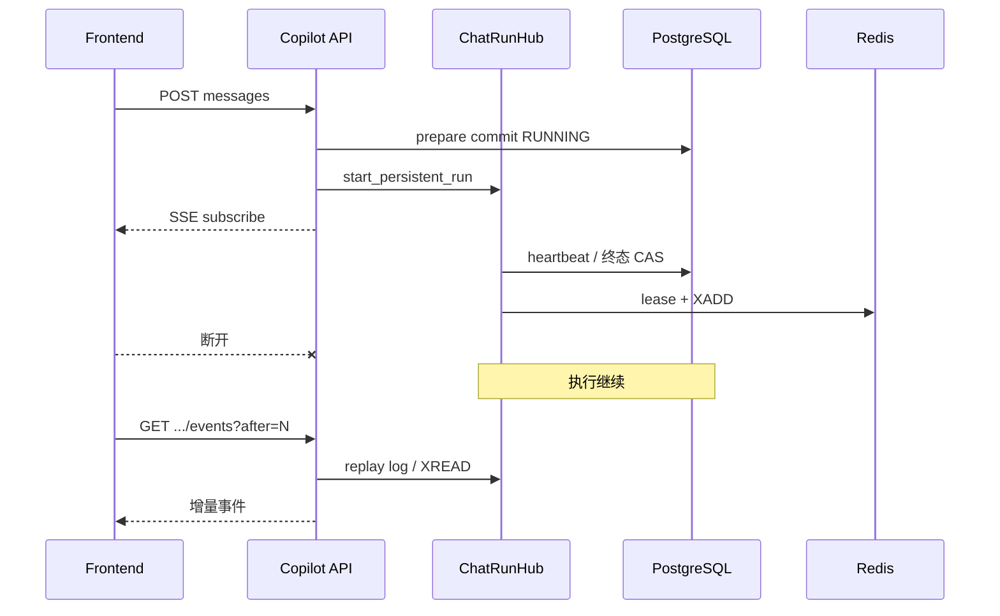

# Copilot Chat Run 生命周期

本文描述 Chat 任务执行与 SSE 订阅解耦后的架构。实现以 PostgreSQL 为权威状态，Redis 仅缓存租约与近期事件，不引入平行任务系统。

## 1. 本次问题的根本原因

2026-11-27 21:11:40 的复现数据（Message 179/180、Agent Run 53、`request_id=55ceae2d957a4e3c80002cd7deb8f6e4`）与源码路径一致，但**本环境未能查询当时 PostgreSQL / Redis / 应用日志**，因此不能把「断在哪一行」写成已确认事实。

已确认的代码路径：

1. `PersistentChatService.prepare` 在模型调用前 commit：用户消息 COMPLETED，助手消息空内容 RUNNING。
2. `events()` 创建 `AgentRun(graph_type=PENDING, status=RUNNING)` 后再跑 Graph。
3. Agent 执行绑定在 FastAPI `StreamingResponse` 请求协程上。HTTP/SSE 断开曾被当作 `disconnected()` → 49900 取消。
4. `CancelledError` 与进程被杀时，`finally` 可能不跑或事务回滚，RUNNING 留在库里。
5. `recover_stale` 只在下一次 `prepare`（再发消息）执行，GET 会话不补偿。
6. 前端 `message.status === 'RUNNING' && !content` 永久三个点；刷新不会订阅已有 Run，只会再 POST 新消息。

Message 180 有 `agent_runs: [{graph_type: PENDING, tasks: []}]`，说明至少进入了 `begin_agent_run`，尚未 `agent_route`。这与断点停在 Graph 早期、或进程在路由前退出相符。这是路径一致性推断，不是历史日志还原。

## 2. 改造前执行链

Frontend `streamChat` POST `/conversations/{id}/messages`
→ `chat_stream` / `event_stream`
→ `PersistentChatService.prepare`（commit RUNNING 占位）
→ `_prepare_with_intent`
→ `PersistentChatService.events`（`begin_agent_run` + LangGraph `workflow.stream`）
→ 同一请求协程 `yield` SSE
→ 客户端断开：`request.is_disconnected` 取消 Graph

## 3. 改造后执行链

```
Frontend
  → POST /conversations/{id}/messages   （创建消息 + 幂等投递）
  → PostgreSQL Message / AgentRun
  → ChatRunHub.start_persistent_run     （独立租户会话中的 asyncio 任务）
  → Intent / Skill / LangGraph / ToolExecutor
  → Event Publisher（内存 log + Redis Stream）
  → SSE subscribe（本次 POST 或之后 GET .../events）
  → Frontend
```

刷新、关页、短暂断网只结束订阅，不取消允许后台继续的任务。
重新订阅走 GET `/conversations/{id}/messages/{message_id}/events`，不创建 User/Assistant/AgentRun。

`asyncio.create_task` 不是恢复方案：进程退出后靠 PostgreSQL + 启动/定时 Reconciliation。任务仍登记在库中。

## 4. 任务执行与 SSE 订阅



RUNNING + DISCONNECTED 是合法组合。SSE 断开 ≠ 任务失败。UI 等待超时 ≠ 执行超时。心跳丢失 ≠ 外部 ERP 已停止。

## 5. 任务状态机

Message：`RUNNING` → `COMPLETED` | `FAILED` | `CANCELLED` | `INTERRUPTED` | `TIMED_OUT`

AgentRun：`RUNNING` → `SUCCEEDED` | `DEGRADED` | `FAILED` | `CANCELLED` | `INTERRUPTED` | `TIMED_OUT`

- 终态只允许从 RUNNING CAS 写入；旧 Worker 不能把终态写回 RUNNING，也不能覆盖其他实例的终态。
- 已完成的子任务（SUCCEEDED ToolRun / AgentTask）不会因父任务中断被改成 FAILED。
- `WAITING_APPROVAL` / Pending Skill 仍走既有 Skill/Proposal 状态，不重复造表。
- `interrupt_reason=cancel_requested` 表示取消已登记、执行者尚未停下。

## 6. 前端连接状态机

`CONNECTING` → `CONNECTED` → `RECONNECTING` | `RECONNECT_FAILED` | `WAITING_TOO_LONG` | `DISCONNECTED`

- CONNECTING/CONNECTED：正在收业务事件或心跳。HTTP 200 或 ping 不算任务已恢复。
- RECONNECTING：同一 `message_id` 有限重连，文案为「正在重新连接（第 X / N 次）」。计数存在模块级 Map，不因 React 重渲染、Query 刷新或心跳而重置。
- RECONNECT_FAILED：次数或时间上限到达，或收到 4xx（含订阅 404）等不可恢复连接错误。只表示前端连不上，不把后端任务改成 FAILED。
- WAITING_TOO_LONG：30 秒无业务进度（ping 不算），只改提示。
- DISCONNECTED：订阅结束且未到终态。
- 上限：`CHAT_SSE_MAX_RECONNECT_ATTEMPTS=5`，`CHAT_SSE_MAX_RECONNECT_DURATION_SECONDS=60`；间隔 1s、2s、4s、8s、16s + 抖动。
- 收到 `done`/`error` 且 Message 已终态、或服务端确认不可恢复后立即停止，不耗尽剩余次数。
- 手动「重新连接」重置该 Run 的预算并再次订阅原 `message_id`，不创建新消息或新 Agent Run。
- 「重新发送」走现有 `POST /messages`，携带新的 `client_request_id` 和可选 `retry_of_message_id`：不插入新的用户消息，创建新的助手消息和 Agent Run，保留原失败记录。以后端 `can_retry` 为准；不允许时返回 `retry_denied_reason`。
- Chat 消息只展示用户可读状态（任务已中断 / 正在理解问题等）。`graph_type=PENDING` 且无 Agent Task 时不展示 Agent 协作区域，也不展示无内容的「查看运行详情」。
- 严禁前端修改服务端持久化状态。

## 7. Heartbeat 与 Lease

| 字段 | 含义 |
| --- | --- |
| `heartbeat_at` | 执行器仍存活 |
| `last_progress_at` | 出现过非 ping 业务事件 |
| `lease_until` / Redis `copilot:chat-lease:{tenant}:{message}` | 租约，TTL = `chat_lease_seconds`（默认 90s） |
| `worker_instance_id` | `{pid}:{uuid}`，区分当前调试进程与上一轮残留 |
| `event_seq` | 快照水位 |

续租与终态更新校验 `status=RUNNING` 且 `worker_instance_id` 匹配。Redis 租约过期不表示 ERP 工具已停止；写工具仍走既有幂等、Receipt、审批。

## 8. Worker 崩溃恢复

触发：Copilot 启动（非 test）、每 `chat_reconcile_interval_seconds`（30s）、GET 会话、GET `.../events` 订阅前、下一次 prepare。

存活证明只有两种，缺一不可用“还在跑”来跳过补偿：

- 当前进程 `ChatRunHub.is_live`（含刚 register、task 尚未挂上的启动窗口，以及断点暂停但 task 未 done）。
- Redis `copilot:chat-lease:{tenant}:{message}` 仍在。

历史 RUNNING 行即使缺少 `worker_instance_id` / `heartbeat_at` / `lease_until`，只要 Hub 与租约都不在，就必须进入补偿，不得因 Debug Mode 或字段为 NULL 永久跳过。

- 执行者丢失：标记 `INTERRUPTED`（50081），`interrupt_reason=worker_lost`，不自动 Resume 半截 LLM。
- 无 AgentRun 的 RUNNING 占位：超过约 2 个心跳窗口后 `INTERRUPTED`；窗口内订阅返回 `run_status/unknown`，不得假装已结束。
- 用户取消且执行者已不在：`CANCELLED`（49900）。
- 执行超时：`TIMED_OUT`（50482）。
- ERP 写结果未知：不自动重试，沿用 Receipt/Reconciliation。`can_retry` 仅在无 SUCCEEDED 工具时为 true。

GET `.../events` 不得只判断 `Message.status == RUNNING` 后无限 ping。先 `prepare_subscribe`：live 才进入 Hub/Redis 流；terminal/unavailable 立即发 `done`；unknown 发 `run_status` 后结束本连接。流在无终态事件的情况下结束时，再核对一次快照。

多实例扫描同一行靠 CAS `status=RUNNING`。

## 9. SSE 断线重连与补发

- 事件带 `event_id` / `sequence` / `run_id` / `request_id` / `message_id`。
- SSE 行包含 `id:`，客户端带 `Last-Event-ID` 与 `?after=`。
- 同进程：内存 log 补发后挂 waiter。
- 跨进程：Redis Stream `copilot:chat-events:{tenant}:{message}` replay + XREAD。
- Stream TTL 约 `lease * 20`；过期 ≠ Conversation 过期。缺事件时用任务快照，不宣称无损回放。
- 心跳不是业务进度。
- Reconnect ≠ Resume ≠ Retry。

## 10. LangGraph Checkpoint

现有 PostgreSQL Checkpointer 仍用于 Graph 节点。PENDING 阶段刚 `begin_agent_run` 时通常还没有可恢复的节点 Checkpoint。

不允许把 Checkpointer 当成 Python 断点续跑。流式 LLM 半截不得从某个 Token 精确恢复。高风险写工具不得因 Resume/Retry 直接再跑。无 Checkpoint 的孤儿 Run 标记 INTERRUPTED，由用户按 `can_retry` 发起新的 Execution Attempt。

## 11. 开发断点调试

环境变量（禁止客户端传参）：

- `COPILOT_DEBUG_EXECUTION`
- `COPILOT_DEBUG_DISABLE_EXECUTION_TIMEOUT`
- `COPILOT_DEBUG_DISABLE_LEASE_RECOVERY`

`APP_ENV=development` 默认视为调试执行：Hub 中仍登记且 task 未结束的同进程任务，即使心跳/租约因断点冻结而过期，也不得标失败或拉起第二个 Worker。Debug Mode **不**豁免：

- 上一进程残留的 `worker_instance_id`
- `worker_instance_id` 为空的历史 RUNNING
- 当前进程 Hub 已 drop、task 已 done 的死任务

前端允许有限自动重连；达到上限后进入 `RECONNECT_FAILED` 并提示可能正在断点暂停，提供手动重新连接。前端重连失败不得取消后端任务。断点恢复后若原执行者仍在 Hub，手动重连可继续订阅。

生产 `require_runtime_secrets()` 拒绝上述豁免。外部 HTTP/DB/模型超时无法因 Debug 关闭。

本地生效前提：必须重启 Copilot 进程（`--reload` 或重新 F5），并执行 `alembic upgrade head`（`20261128_0018`）。仅前端 HMR 不会注册 `GET .../messages/{id}/events`。

## 12. Redis TTL 与 PostgreSQL 边界

| Key | TTL | 过期影响 |
| --- | --- | --- |
| `copilot:chat-lease:{tenant}:{message}` | 90s | 不能证明存活；不删 PG 行 |
| `copilot:chat-events:{tenant}:{message}` | ~1800s | 只能靠快照，可能缺增量 |
| `copilot:chat-cancel:{tenant}:{message}` | ~1800s | 跨进程取消信号 |

PostgreSQL Message/AgentRun 是权威状态。Access Token 只在进程内存 `ChatRunAuth`，不写入 Redis 任务参数。

## 13. 幂等与防双执行

- `client_request_id`：RUNNING 重复请求改为订阅已有 Run，不再 409 或新建消息。
- 会话行锁 + `running_message` 防止并行新轮。
- Hub 按 `(tenant_id, message_id)` 单飞。
- `finish_message` / `finish_agent_run` / `interrupt_run` 均 CAS RUNNING。
- 队列投递失败：本切片 Chat 不走 workflow Redis 队列；prepare 已提交而任务未启动时，Reconciliation 将无存活证明的 RUNNING 标 INTERRUPTED。

## 14. 高风险工具恢复限制

`can_retry` 在 FAILED/INTERRUPTED/TIMED_OUT/CANCELLED 且没有任何 SUCCEEDED 工具、也没有未知状态的写工具时为 true。不允许时 API 返回 `retry_denied_reason`，前端展示原因而不是隐藏后让用户无法处理。写路径继续走 Proposal / Confirmation / Receipt。

## 15. 超时配置

| 层级 | 配置 | 默认 | 职责 |
| --- | --- | --- | --- |
| UI 进度 | `chat_ui_progress_timeout_seconds` | 30s | 只改前端文案 |
| SSE 心跳 | `chat_heartbeat_seconds` | 10s | ping，保活 Nginx 300s `proxy_read_timeout` |
| 租约 | `chat_lease_seconds` | 90s | 存活证明 |
| 补偿扫描 | `chat_reconcile_interval_seconds` | 30s | 孤儿回收 |
| SSE 重连次数 | `chat_sse_max_reconnect_attempts` | 5 | 前端自动重连上限 |
| SSE 重连时长 | `chat_sse_max_reconnect_duration_seconds` | 60s | 前端自动重连墙钟上限 |
| 执行 | `chat_execution_timeout_seconds` | 300s | 生产只读查询；调试可关 |
| 模型 | `chat_timeout_seconds` | 30s | 单次 Provider |
| 工具 | `tool_total_timeout_seconds` | 30s | 工具预算 |
| DB | `database_statement_timeout_ms` | 5000 | 语句 |

审批等待、Pending 补参不按普通 RUNNING 墙钟一律超时。

## 16. 关键文件与调用链

- `app/api/v1/chat.py` `chat_stream` / `iter_message_sse`
- `app/api/v1/conversations.py` GET events、POST cancel
- `app/services/chat_run.py` `start_persistent_run` `subscribe` `request_cancel`
- `app/services/chat_reconcile.py` `reconcile_all` `interrupt_run` `run_is_alive` `settle_running_message`
- `app/services/persistent_chat.py` `prepare` `events`
- `app/services/conversations.py` `get` `prepare_subscribe` `cancel_message`
- `app/main.py` `_chat_reconcile_loop`
- `apps/copilot/src/api/chat.ts` `streamChat` `subscribeChatRun` `cancelChatRun`
- `apps/copilot/src/pages/CopilotPage.tsx` 刷新恢复订阅
- `alembic/versions/20261128_0018_chat_run_lifecycle.py`

## 17. 测试

确定性单测覆盖：SSE 断开不取消、事件按 sequence 去重、180 类孤儿判定、历史缺租约字段、Hub 内存活才 debug hold、跨进程不 hold、未知订阅不发 done、生产拒绝 debug 豁免、前端次数/时间上限、404 立即失败、预算不因重复挂载重置、401 订阅刷新。

需要 PostgreSQL、Redis、IAM、真实模型或浏览器的场景标记为联调项，见交付汇报 M。

## 18. 本地验证

1. 重启 Copilot（当前若仍为 OpenAPI 10.0.0 且无 `/messages/{id}/events`，说明跑的是旧进程）。
2. 应用迁移 `20261128_0018`（`copilot_alembic_version`）。
3. 打开昨晚仍 RUNNING 的会话：应被补偿为 INTERRUPTED，出现「重新发送」，不再永久「正在重新连接」。
4. 开发环境发送查询，刷新页面：应 GET events 恢复，不重复用户消息。
5. 断点暂停：前端有限重连后进入等待/连接失败，提供手动重连；继续后订阅恢复。
6. 停止按钮调用 cancel API，不是只 abort fetch。

## 19. 已知限制

- 单进程 Hub 是热路径；多 Worker 靠 Redis Stream 订阅，执行仍在接到 POST 的那个进程。
- 不自动 Resume 半截 LLM。
- Access Token 仅内存：长任务中途过期时工具调用会失败并收敛，不会把 Refresh Token 写入 Redis。
- Redis 不可用时同进程订阅仍可用；跨进程补发降级为快照。
- Debug 不能关闭 IAM、租户隔离、工具门禁、配额与审批。
