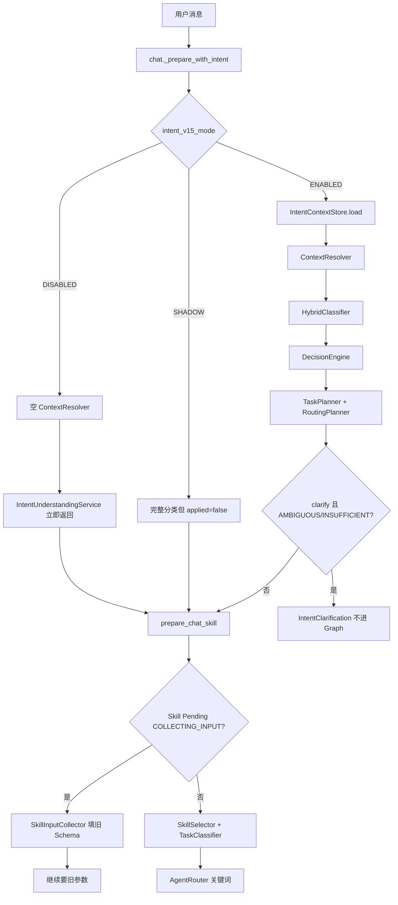
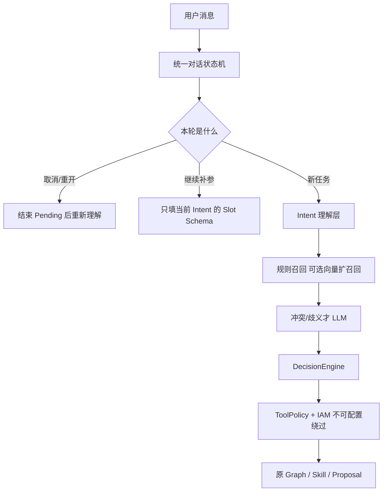

# Copilot V15 意图理解：后续架构优化与待解决问题

- 日期：2026-11-25
- 范围：`services/copilot/app/intent/`、`skills/pending.py`、`skills/chat.py`、`skills/selector.py`、`agents/router.py`、`core/config.py`
- 性质：源码分析与方案整理，**本次不实施代码**
- 相关个案：[0001 误选订单审查](0001-sku-query-stuck-on-sales-order-review.md)、[0002 取消口令过严](0002-pending-cancel-too-strict.md)

阅读约定：

- **真实问题**：当前源码路径上已经会发生。
- **潜在扩展问题**：现在体量还能撑，业务实体变多后会痛。
- **尚未验证**：逻辑上可能出问题，但本仓库还没有稳定复现或评测数字。
- 状态取值：已实现 / 部分实现 / 待实现 / 待验证。
- 优先级：P0 先挡住错误续跑和职责打架；P1 可扩展性与校准；P2 向量、配置中台等后置能力。

当前进程默认（以 `app/core/config.py` 为准，部署环境变量可覆盖）：

| 配置 | 默认 | 含义 |
| --- | --- | --- |
| `intent_v15_mode` | `DISABLED` | 理解层不算正式路由 |
| `skill_chat_enabled` | 以环境为准 | Chat 自动 Skill |
| `skill_pending_enabled` | `true` | Skill 缺参会建 Pending |
| `intent_pending_ttl_seconds` | `900` | 意图 Pending 15 分钟 |
| `skill_pending_ttl_seconds` | `900` | Skill Pending 15 分钟 |

因此：V15 理解层代码在仓库里，但默认 Chat 仍可能只走 V14 `AgentRouter` + `SkillSelector` + `PendingSkillService`。下面凡写「ENABLED 时」都明确标出。

---

## 当前实际调用链

要点：即使 ENABLED 已经算出 `RoutingPlan`，`prepare_chat_skill` 仍会先 `PendingSkillService.resume()`；若恢复成功，后面的 `SkillSelector` 结果会被 `RESUMED` 覆盖。见 I-01。

---

## 推荐优化架构

原则：一个会话同一时刻只有一个待补全任务；理解层决定「继续还是换任务」；Skill Pending 只是该任务的参数仓库，不再自己决定意图。

---

## 1. Pending 多轮上下文

### I-01 Skill Pending 覆盖意图路由

- 问题类型：真实问题
- 优先级：P0
- 状态：部分实现（两套机器都在，未协调）

**当前实现**

意图 Pending：`IntentContextStore`（`app/intent/store.py`），表 `copilot_intent_contexts`，状态 `IDLE/COLLECTING/READY/CANCELLED/EXPIRED`。仅 `intent_applied()`（ENABLED）时 `save_resolution(persist_pending=True)`。`RoutingPlanner` 只在 **INSUFFICIENT 且存在 ACTION** 时把 `routing.pending=True`（`app/intent/routing.py`）。ANALYZE 缺 SKU 会追问，但通常不落意图 Pending。

Skill Pending：`PendingSkillService`（`app/skills/pending.py`），表 `PendingSkillInvocation`，状态 `COLLECTING_INPUT`。`prepare_chat_skill` 在会话且 `skill_pending_enabled` 时**先 resume**。

Chat 顺序（`app/api/v1/chat.py` `_prepare_with_intent`）：

1. `resolve_chat_intent`
2. ENABLED 且需要澄清 → 直接返回，不进 Skill
3. 否则 `prepare_chat_skill` → **resume 成功则强制 RESUMED**，丢掉刚算的 `RoutingPlan` 选 Skill 结果

取消：

| 入口 | 口令 |
| --- | --- |
| Intent `integration._is_cancel` | 整句 `取消/算了/不用了/停止` 或 `取消本次…`；或 Skill 模式 NONE |
| 规则 `_is_cancel` | 整句 `取消/算了/不用了/停止` |
| 规则 `_is_restart` | 文本**包含**「重新开始」或「换一个任务」（只跳过意图续跑，**不**调用 `store.cancel`） |
| Skill `SkillInputCollector.cancelled` | 整句恰好 `取消/算了/停止/不用了/cancel` |

过期：两边都是 TTL，load/resume 时标 EXPIRED。意图过期后 `pending_payload` 为空，但 **entities 仍会灌进 ContextResolver**（见 I-05）。

**问题**

与 [0001](0001-sku-query-stuck-on-sales-order-review.md) 同一根因：旧 Skill Pending 在时，新消息先被当成补 `order_id`，意图层即使认出「这是 SKU 销售情况」也晚了。

**推荐方案**

1. 会话级只保留一个「待补全任务」视图；Skill 行是实现细节。
2. `prepare_chat_skill`：若本轮 Intent 已 CLEAR 且 Skill 策略为 SKIP，或判定为新任务，先 `cancel_active` 再选 Skill。
3. resume 前问：这句话是补槽、改槽，还是换意图。

**验收**

- 卡在 `sales-order-review` 补订单主键时，发送带 SKU、否定「销售订单」的话，应结束旧 Pending 并改走库存/查询。
- ENABLED 下 `RoutingPlan.skill_policy=SKIP` 不得再被 RESUMED 覆盖。
- 同一会话不会长期同时 `COLLECTING` 与 `COLLECTING_INPUT` 且指向不同业务。

### I-02 有 Pending 时几乎总是继承旧意图

- 问题类型：真实问题
- 优先级：P0
- 状态：部分实现

**当前实现**

`RulesIntentClassifier.classify`：只要 `context.pending_intent_key` 存在，且不是取消/重开，就走 `_pending_continuation`：把当前句抽到的槽合并进旧 `intent_key`，score 固定 `0.95`，method=`PENDING`。**不**再跑 `_classify_part`。

新任务信号目前只有：

- 整句取消
- 文本包含「重新开始」「换一个任务」

「供应商 A，仓库 B」会正确续上 `procurement.create_draft`。  
「先别创建了，改查库存」在有采购 Pending 时仍会当成补采购槽，因为否定检测被 continuation 短路。

**问题**

没有「继续 / 改参 / 新任务」三分类。改参和新任务都可能被吞进旧意图。

**推荐方案**

在 continuation 前加轻量门：

1. 明显新领域关键词 + 完整新意图 → 结束 Pending，重新分类。
2. 只含当前 missing/optional 槽值 → 继续。
3. 「把仓库改成 B」→ 改参，intent 不变。
4. 吃不准 → AMBIGUOUS 问一句「继续刚才的采购草稿，还是新任务？」不要默默继承。

**验收**

- Pending 创建采购单时发「查一下库存」→ `inventory.query`，旧 Pending 取消。
- 只发「仓库 B」→ 仍是 `procurement.create_draft`，槽合并。
- 不把「不要创建」续成 ACTION。

### I-03 取消与重开口令过严且三处不一致

- 问题类型：真实问题（[0002](0002-pending-cancel-too-strict.md)）
- 优先级：P0
- 状态：待实现（口令已有，语义不够）

**当前实现** 见 I-01 表格。规则层认「重新开始」，Intent Store 和 Skill Pending 不认。`_cancelled()` 把决策写成 CLEAR + `general.chat`，`cancel_pending=True`。

**问题**

「重新开始：帮我看 SKU」不会清 Skill Pending；意图规则会当新分类，随后又被 Skill resume 拉回去。纠正句、抱怨句继续填旧 schema。

**推荐方案**

统一取消/重开检测，一处实现、三处调用。至少支持：整句取消、句首「重新开始/换一个任务」、明确否定当前 Pending 目标（「不是销售订单」）。取消必须同时清意图 Store 和 Skill Pending。

**验收**

- 「重新开始：…」后选择器重新跑，不再要上一轮订单主键。
- 「取消」后两边状态都不是 COLLECTING*。

### I-04 Skill 缺参 42291 与意图追问未打通

- 问题类型：真实问题 + 部分实现
- 优先级：P0
- 状态：部分实现

**当前实现**

`prepare_chat_skill` 缺参时：

- 有会话且 `skill_pending_enabled` → 创建 Skill Pending，返回追问（正常多轮）。
- ENABLED 且已有 `routing_plan` 且非 MANUAL → **返回 None**，不抛 42291，改走普通对话（可能不再追问必填项）。
- 否则抛 **42291**。

意图侧：ACTION 缺参 → INSUFFICIENT + `routing.pending` + `should_clarify_without_run` 直接追问。ANALYZE 缺 SKU → INSUFFICIENT + clarify，但 `pending` 多为 false，下一轮靠指代/实体，不靠 Pending 状态机。

**问题**

1. 无会话、Pending 关闭、MANUAL 仍可能 42291，对话中断。
2. AUTO + ENABLED 为了躲避 42291 直接丢 Skill，用户看不到「请补 SKU」。
3. 分析类缺参没有 Intent Pending，短句「SKU-001」不一定接到上一轮分析任务。

**推荐方案**

缺参统一走「澄清回复 + Pending」，禁止对 AUTO Chat 抛 42291。MANUAL 可保留 422 给 API 调用方。ANALYZE 与 ACTION 一样绑定会话 Pending。42291 只留给非对话的内部编排（如 `orchestration.py` 多 Skill 计划）。

**验收**

- Chat AUTO 缺参：HTTP 200 + 追问，无 42291。
- 「分析一下」→ 要 SKU → 用户回 `SKU-001` → 同一分析意图继续。
- MANUAL 缺参行为单独测，不与 AUTO 混用。

### I-05 过期 Pending 仍注入历史实体

- 问题类型：真实问题
- 优先级：P1
- 状态：待实现

**当前实现**

`IntentContextStore.load`：COLLECTING 且过期 → 标 EXPIRED，**仍 return row**。`resolve_chat_intent` 把 `row.entities` 交给 ContextResolver。`pending_payload` 对非 COLLECTING 返回 `{}`，所以不会续 intent_key，但 SKU/订单仍可能被「分析一下」继承。

**问题**

过期本应切断补参，实体却还能当可信事实。尚未用评测集固定复现，属逻辑缺口。

**推荐方案**

EXPIRED/CANCELLED 后实体降为 untrusted 或丢弃；过期只允许用户重新点名。

**验收**

Pending 过期后再发「分析一下」，应 INSUFFICIENT 追问，不得默用 15 分钟前的 SKU。

---

## 2. 实体提取与上下文管理

### I-06 `_merge_entities` 只认 SKU 和订单号形态

- 问题类型：潜在扩展问题（当前 SKU/SO 能用，加客户/仓/供应商会炸）
- 优先级：P1
- 状态：部分实现

**当前实现**

`ContextResolver._merge_entities`（`app/intent/context.py`）：

- `_SKU`：`\bsku[-_]?[a-z0-9]+\b`
- `_ORDER`：`\b(?:so|order)[-_]?[a-z0-9]+\b`
- 命中后**写死** `name="sku_code"` / `"order_id"`
- 用户历史同样抽 SKU/订单；助手文本只抽 SKU 且 `trusted=False`；**不抽助手里的订单号**
- 分类器 `RulesIntentClassifier._slots` 再扫一遍 SKU/订单/昨天/七天/供应商/仓库/数量，与 Context 重复且规则不同（供应商要「供应商」二字，仓库要「仓库」二字）

「分析下订单：SO2026000004」能进 `order_id`，是因为 `SO`+数字撞上 `_ORDER`，不是因为理解了「订单」二字。

**问题**

每加一种实体就加正则和 if。客户名、仓库编码、物流单、订单状态没有统一入口。Skill `SkillInputCollector._extract` 是第三套（按 schema 字段名）。

**推荐方案**

分层，而不是一个超级 if：

1. **EntityExtractorRegistry**：每种实体一个抽取器（正则、词典、可选 NER），输出 `type/value/span/source`。
2. **EntityResolver**：去重、可信度、过期、与租户主数据对齐（是否真有这个仓）。
3. **Intent Slot Schema**：Registry 里已有 `required_slots/optional_slots`。分类出候选 Intent 后，只把相关实体填进这些槽；不相关的实体留下当上下文，不强迫进当前任务。

V16 先把 SKU、order_id、warehouse、supplier 迁进 Registry，行为与现在对齐；不要一上来上 NER。

**验收**

- 新增 `warehouse_code` 抽取器不必改 `_merge_entities` 主循环。
- 同一句里的 SKU 与 SO 仍能同时抽出。
- 无「订单」二字但有 `SO2026…` 的行为与现在一致，并在文档里写明这是形态约定。

### I-07 去重、可信度、覆盖、多实体、指代

- 问题类型：部分真实 + 扩展
- 优先级：P1
- 状态：部分实现

**当前实现**

- 去重键 `(name, value.upper())`，后写覆盖；可信记录不会被不可信覆盖。
- 指代：`这个/那个/刚才…` 或短句「分析一下」；`_slots` **只把历史 sku_code 继承到当前句**，订单号不走这套指代。
- 同类多个：后出现的同名同值合并；不同值都保留，但 `_entity()` 从后往前取**第一个**可信值，等于「最近一个」。
- 存储 `entities[-20:]` 在 `save_resolution` 里用本轮 slots **整表替换**（有新实体时），不是 merge。

**问题**

「刚才那张」不会继承 order_id。「SKU-001 和 SKU-002」只留列表，填槽时只取一个。助手提到的订单号进不了上下文。save 用本轮 slots 覆盖，可能丢掉上一轮仓/供应商。

**推荐方案**

实体带 `turn_id` 与 `aliases`。槽填充：单值槽在歧义时追问；列表槽才收多个。指代规则按槽类型注册（订单/SKU/仓各一条），不要只写 SKU。Store merge 而不是有值就替换整表。

**验收**

- 「查 SO-1」再「它发了没」→ 同一 `order_id`。
- 一句两个 SKU 的分析任务 → AMBIGUOUS 或明确双任务，不默取最后一个。
- 补参「仓库 B」不得抹掉已收集的 supplier。

### I-08 先全量扫描实体，再分类，而不是按候选 Intent 抽槽

- 问题类型：潜在扩展问题
- 优先级：P2
- 状态：待实现

**当前实现**

先 `_merge_entities`（全句 SKU/订单），再规则分类，分类时 `_slots` 再全量抽一遍。Intent 的 `required_slots` 只用于算 missing，不约束「抽什么」。

**问题**

实体种类变多时，每句都跑全部抽取器，误抽也会污染槽（例如把物流单当成 SO）。

**推荐方案**

两段：便宜召回（领域词）→ 只运行候选 Intent 声明过的抽取器 → 填槽。全量抽取仅用于评测或 DEBUG。

**验收**

- `inventory.query` 候选时不跑客户名抽取。
- 评测集 Intent Accuracy 不因「少扫几种实体」而下降。

---

## 3. 意图识别与分类器

### I-09 规则顺序匹配 + `fast_path_allowed`

- 问题类型：机制已实现，缺口是扩展与冲突
- 优先级：P1
- 状态：部分实现

**当前实现**

`RulesIntentClassifier._classify_part`：从上到下第一条命中即返回（教学/否定 → 确认短语 → 短分析 → 库存查询 → 覆盖/风险 → 畅销 → 订单审查 → 销售汇总 → … → 库存兜底）。关键词是**候选信号**，不是授权。

`fast_path_allowed` 同时为真才跳过 LLM：

- 有候选且非 unknown
- 上下文依赖必须已抽到槽
- 多任务里不能有 `party.lookup`
- 人名/改价 + 指代 → 不快走
- `top.score < 0.72` → 不快走
- 否定且顶层是 ACTION → 不快走

否则 `HybridIntentClassifier` 调 LLM；无 adapter 或 LLM 关闭则用规则结果（`llm_skipped`）或 UNKNOWN。

冲突：`DecisionEngine._mutex` 目前主要是人名歧义，以及「非多任务时多个库存 query/analyze/risk」。规则层还有少量跨域 companion。

**问题**

1. 顺序决定胜负，「销售」出现在库存句前就可能先走销售分支。
2. 规则失败或冲突时，LLM 被关就只能 UNKNOWN 或带 `llm_skipped` 的规则结果，没有「再问一句」。
3. 接口 `IntentClassifier` 已预留 Semantic，仓库里没有实现。

**推荐方案**

规则只做召回（可多候选），裁决交给 DecisionEngine。快路径仅限：单候选、低风险、无指代、无否定写操作。其余进 LLM。不要在规则函数里用 if 链模拟整个 Decision。

**验收**

- 「查一下库存」仍 RULES 快走，不调分类 LLM。
- 「查询张三」不快走，AMBIGUOUS。
- 关闭 LLM 时 UNKNOWN 不得变成某个写意图。

### I-10 向量语义召回：现在不要上，什么时候才值得

- 问题类型：尚未验证 / 明确未实现
- 优先级：P2
- 状态：待实现（V15 有意不做）

**当前实现**

无 Embedding、无向量索引。SkillSelector HYBRID 是词项重叠。分类器 Protocol 可加第三实现。

**何时才值得引入（建议门槛）**

同时满足再立项：

1. 冻结意图评测集上，规则+LLM 的 Intent Recall 明显不够（例如口语/同义句失败集中），且失败不能靠加几条规则消化。
2. Intent 数量大到无法靠读 if 链维护（远超当前 22 个）。
3. 已有租户隔离的向量基础设施（可复用 Knowledge），延迟和费用可计量。
4. 向量**只扩召回**，不直接授权，不替代 DecisionEngine。

未到门槛时加向量，等于多一套分数和一套误召回。

**推荐职责划分**

| 层 | 负责 | 不负责 |
| --- | --- | --- |
| 规则 | 明确短句、教学/否定、单号形态、连接词切句 | 最终授权、口语同义 |
| 向量（未来） | 扩召回、给 Decision 参考分 | 单独定 CLEAR、定写工具 |
| LLM | 歧义、多意图、指代、规则没覆盖的说法 | 自报 confidence 当真、输出非法 intent_key |
| DecisionEngine | 互斥 vs 多任务、缺槽、UNKNOWN | 调 ERP、改 IAM |

**验收**

引入前必须有：对比评测（无向量 vs 有向量）、延迟 P95、误召回写意图次数不增加。

---

## 4. Score 与阈值

### I-11 规则分是手写常数，不是校准分数

- 问题类型：真实设计债（不是运行时必炸，但不可解释）
- 优先级：P1
- 状态：部分实现

**当前实现**

分支写死，例如库存查询 `0.94`、问候 `0.99`、Pending 续跑 `0.95`、库存兜底 `0.74`、人名 `0.62`。`fast_path_allowed` 用 `0.72`。这些数**没有**标注集、Precision/Recall 或误判率支撑，和评测 Case 的 expected 也对不齐成「分越高越对」。LLM 自报 confidence 已被丢掉（`LlmIntentClassifier` 把 score 置 `0.0`），这一点是对的。

SkillSelector 另有 `skill_selector_llm_confidence_threshold = 0.72`，只是数字碰巧相同，**不是同一套分**。

**问题**

后人会以为 0.94 比 0.74「模型更有把握」。其实只是 if 写在前面的分支给了更高常数。快路径阈值改 0.8 或 0.6 都没有回归曲线。

**推荐方案**

1. 规则分改成离散档：`certain / likely / weak`，快走只允许 `certain`。
2. 或保留 0–1，但必须用 V15-INTENT-125（及后续人工集）算：快走集合的 Precision、漏掉的 Recall、误进 ACTION 的次数。改阈值必出对比表。
3. 永远分栏记录：`rule_tier`、`embedding_similarity`、`llm_self_confidence`，禁止相加平均。

**验收**

- 文档或配置写明快走条件，不再只留魔法 0.72。
- 改阈值 PR 必须带评测 delta，不能只改一个 float。

### I-12 快路径未按风险分级

- 问题类型：潜在扩展问题
- 优先级：P1
- 状态：部分实现

**当前实现**

快走已挡：unknown、未解析指代、人名/改价指代、否定 ACTION、低分。未按 `risk_hint` 区分：`READ_ONLY` 与 `DRAFT_WRITE` 只要分高都可以快走。`HIGH_RISK` / `APPROVAL_REQUIRED` 在 Schema 里存在，目录里几乎没用，Policy 也不读 `risk_hint`（只看 problem_type、executable、`propose_action` 提示、否定）。

支付类能力当前不存在，不必假装有支付快路径。

**推荐方案**

| 风险 | 快走 | 分类 CLEAR 后 |
| --- | --- | --- |
| READ_ONLY 查询 | 允许 | 原只读 Tool |
| ANALYZE | 无缺槽才允许 | Skill/Agent，仍只读 |
| DRAFT_WRITE | 默认不快走，要 LLM 或明确动词+槽 | 只开 Proposal |
| UNIMPLEMENTED / HIGH_RISK | 禁止快走 | 禁止写工具，只说明 |

**验收**

- 「帮我创建采购单」即使规则很像，也不因 0.93 快走成可写。
- 只读「查一下库存」仍快走。

---

## 5. 配置管理

### I-13 配置全在进程环境变量

- 问题类型：潜在扩展问题
- 优先级：P2
- 状态：部分实现（Flag 已集中，无租户/版本）

**当前实现**

`Settings`：`intent_v15_mode`、`intent_classifier_llm_enabled`、`intent_shadow_llm_enabled`、超时、模型名、Pending TTL、上下文条数、`intent_evaluation_enabled`。读写集中在 `flags.py` + Chat 入口 `resolve_chat_intent`，业务代码较少散落判断。无 DB 配置表、无租户覆盖、无请求级覆盖、无版本号、无审计、无回滚，灰度只能靠改环境重启。

**适合继续留在 config.py**

- 超时、消息长度、TTL 上限、默认 Feature Flag
- 分类模型名（空则走全局 chat 模型）
- 评测总开关（避免误跑 LIVE）

**适合以后动态化（不要本轮做）**

- 某租户 ENABLED / SHADOW
- 是否允许分类 LLM、SHADOW 是否计费
- 规则快路径策略档位
- 追问文案

**推荐分层**

1. 平台默认（环境变量，可回滚部署）
2. 租户策略（需审核发布；**不能**出现「允许跳过 IAM」字段）
3. 请求级：仅 Skill 模式 AUTO/MANUAL/NONE、显式 skill_key。客户端不得传 intent_key 或扩大工具白名单

版本、缓存、灰度、审计、回滚：复用治理策略那套思路（已有 `AIGovernancePolicy`），不要为意图再做一套权限系统。Intent Registry 保持代码内 Pydantic，动态的是 Flag 与阈值，不是运行时任意加可写 Intent。

**验收**

- 非法 `intent_v15_mode` 仍当 DISABLED。
- 动态配置即使被改坏，ToolExecutor 仍要 IAM + 40379。
- SHADOW 默认不调分类 LLM。

### I-14 动态配置不得绕过 IAM 和高风险限制

- 问题类型：原则已在执行层实现；配置层待设计
- 优先级：P1
- 状态：执行层已实现 / 配置层待实现

**当前实现**

`ToolAvailabilityPolicy` fail-closed；`ToolExecutor` 对 `blocked_tools` / `forbid_write_tools` 抛 40379；IAM permission 仍检查。Registry 声明「不是权限源」。

**问题**

以后若把「允许 propose_action」做成租户开关，可能有人当成授权。源码里还没有这种开关，属于设计约束，不是现存漏洞。

**推荐方案**

配置只允许：关功能、降级到只读、缩短 TTL、关 LLM。不允许：加写工具、跳过 Proposal、跳过确认、扩大 permission。高风险名单代码写死或跟 IAM 走。

**验收**

安全测试：租户配置怎么改，无权限用户都不能 `propose_action`。

---

## 6. Decision Engine 与执行安全

### I-15 四态裁决已有，和授权、Skill 追问仍有缝

- 问题类型：部分实现
- 优先级：P1
- 状态：部分实现

**当前实现（判断依据）**

| 状态 | 源码依据 |
| --- | --- |
| UNKNOWN | 无合法候选，或 unknown 且空候选 |
| AMBIGUOUS | 仅 `party.lookup`，或非 multi 时多个库存互斥意图 |
| INSUFFICIENT | ACTION/ANALYZE 缺 required_slots；指代句无槽；改价无对象 |
| CLEAR | 其余，包括「已识别但 executable=False」的取消订单/改价 |

分层（当前设计是对的，需要守住）：

1. 分类：候选 Intent / Problem Type  
2. 快走：要不要调 LLM  
3. Decision：能不能进入业务路由  
4. ToolPolicy + IAM + Proposal：能不能动数据  

CLEAR ≠ 可执行：未实现 ACTION 仍 CLEAR，但 Policy 封写工具。草稿齐槽才 `allow_propose_action=True`，真正写入仍是 V5/V6。

**问题**

- `risk_hint` 几乎不参与 Policy（无支付、无 HIGH_RISK 分支）。
- 互斥组很窄，销售汇总 vs 订单审查不在 mutex 里，主要靠规则顺序。
- INSUFFICIENT 的 ANALYZE 常常不 pending（I-04）。

**推荐方案**

Decision 输出保持四态。Policy 增加读取 `risk_hint`。互斥表按「同一对象的 query/analyze/review」扩展，但必须带评测，避免把多意图误判成歧义。

**验收**

- 「我只是问问不要创建」：GUIDE + 40379，无 Proposal。
- 「帮我取消订单」：可 CLEAR，无执行工具。
- 「查询库存并制定补货计划」：CLEAR 多任务，不是 AMBIGUOUS。

### I-16 与 AgentRouter / SkillSelector / TaskClassifier 职责重复

- 问题类型：真实问题（DISABLED 时必现；ENABLED 时 resume 仍可现）
- 优先级：P0
- 状态：部分实现

**当前实现**

| 组件 | 仍在做什么 |
| --- | --- |
| `TaskClassifier` | SkillSelector 每次 `select` 都跑；风险词与意图规则重复 |
| `AgentRouter` | 无 `intent_route` 时关键词选 single/multi/workflow |
| `SkillSelector` | 无 SKIP/CANDIDATE 时词项 HYBRID |
| `RoutingPlanner` | ENABLED 时本应是唯一路由建议 |

DISABLED：V15 整层跳过，0001 完全走旧路径。  
SHADOW：分类记账，路由仍旧。  
ENABLED：Router 可吃 `intent_route`；Selector 可吃 `routing_plan`；随后 Skill Pending resume 可能作废 Selector。

**推荐方案**

- ENABLED：禁止 TaskClassifier 再决定选哪个 Skill（最多留作 trace）。
- AgentRouter 只做「无理解结果时的安全单 Agent 回退」。
- SkillSelector 在有 RoutingPlan 时不得再用词项猜分析 Skill。
- 默认何时切 ENABLED 是发布决策，不在本文实施。

**验收**

- ENABLED + 无 Skill Pending：「查一下库存」不进 `inventory-analysis`，「查询昨天销售额」不进 `sales-order-review`。
- ENABLED + 有错误 Skill Pending：见 I-01 验收。
- DISABLED：行为与 V14 一致，回归旧测试。

---

## 问题清单汇总

| ID | 主题 | 类型 | 优先级 | 状态 |
| --- | --- | --- | --- | --- |
| I-01 | 两套 Pending，Skill resume 覆盖意图 | 真实 | P0 | 部分实现 |
| I-02 | Pending 无条件继承旧意图 | 真实 | P0 | 部分实现 |
| I-03 | 取消/重开口令过严且不一致 | 真实 | P0 | 待实现 |
| I-04 | 42291 与分析缺参未统一成多轮追问 | 真实 | P0 | 部分实现 |
| I-05 | 过期后仍注入实体 | 真实 | P1 | 待实现 |
| I-06 | 实体抽取硬编码 SKU/订单 | 扩展 | P1 | 部分实现 |
| I-07 | 去重/指代/多实体/Store 覆盖 | 真实+扩展 | P1 | 部分实现 |
| I-08 | 全量扫描而非按 Intent 抽槽 | 扩展 | P2 | 待实现 |
| I-09 | 规则顺序与冲突处理 | 真实+扩展 | P1 | 部分实现 |
| I-10 | 向量召回 | 未实现 | P2 | 待实现 |
| I-11 | 规则分未校准 | 设计债 | P1 | 部分实现 |
| I-12 | 快路径未按风险分档 | 扩展 | P1 | 部分实现 |
| I-13 | 配置仅进程环境变量 | 扩展 | P2 | 部分实现 |
| I-14 | 动态配置不可绕过 IAM | 约束 | P1 | 执行层已实现 |
| I-15 | 四态与 risk_hint/互斥表 | 部分实现 | P1 | 部分实现 |
| I-16 | 与旧 Router/Selector 职责重复 | 真实 | P0 | 部分实现 |

共 **16** 条：P0 **5**，P1 **8**，P2 **3**。

---

## 建议优先解决的 5 个问题

按依赖顺序，不要先上向量：

1. **I-01** 让意图路由压过错误的 Skill Pending，否则后面改分类用户也感知不到。  
2. **I-03** 统一取消/重开，立刻缓解 0001/0002。  
3. **I-02** 区分续跑、改参、新任务，避免补参会话把新问题吞掉。  
4. **I-04** AUTO Chat 缺参改为追问 Pending，去掉对话里的 42291。  
5. **I-16** 在 ENABLED 下停止 TaskClassifier/词项 Selector 二次猜测，与 I-01 一起验收 0001。

I-06 实体注册表、I-11 分数校准适合紧接着做，作为可扩展地基。I-10 向量放到评测证明规则+LLM 不够之后。
