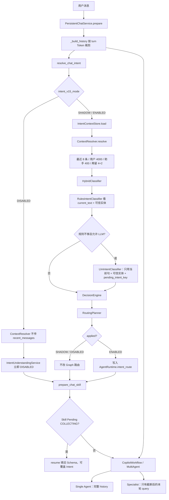
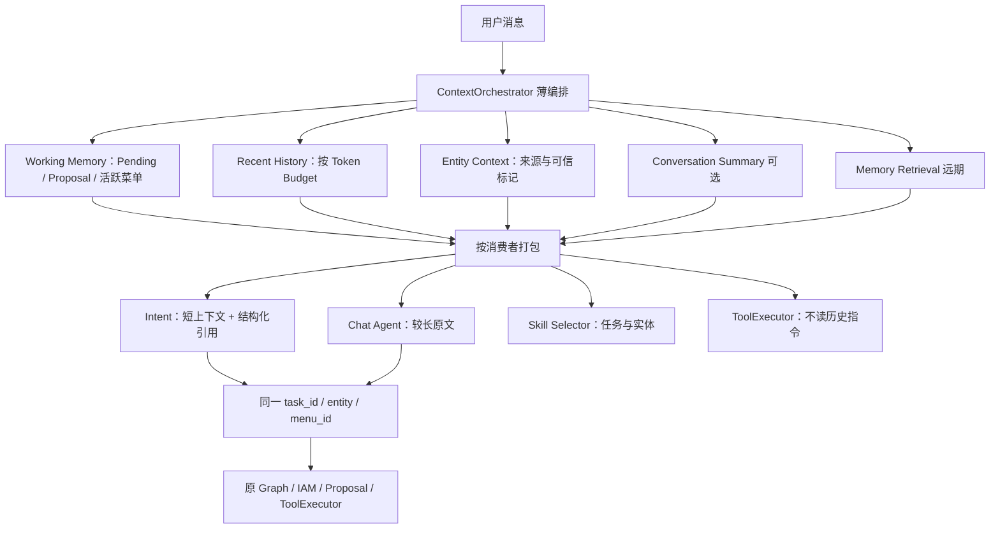

# 0006 上下文管理与长期记忆架构优化

- 状态：方案整理（本次不实施）
- 日期：2026-11-26
- 范围：Intent 上下文截取、Chat/Agent 历史、Skill/Intent Pending、交互菜单、摘要与跨会话记忆
- 性质：源码审查、现状分析、问题记录与优化方案。**不改业务代码、测试、迁移或配置。**
- 关联：[0001](0001-sku-query-stuck-on-sales-order-review.md)、[0002](0002-pending-cancel-too-strict.md)、[0003](0003-intent-understanding-improvements.md)

阅读约定：

- 状态：已实现 / 部分实现 / 待实现 / 待验证
- 优先级：P0 错误绑定、菜单失效、Pending 误恢复、安全隔离；P1 统一组织、Token Budget、滚动摘要；P2 远期检索与跨会话记忆
- 配置默认值以 `services/copilot/app/core/config.py` 为准，部署环境变量可覆盖

---

## 结论先行

当前 **没有** 长期记忆、交互菜单对象、滚动摘要或历史检索。存在两套互不共享的「最近对话」：

| 消费者 | 用什么历史 | 截取方式 |
| --- | --- | --- |
| Intent 理解层 | `ContextResolver` | 最近 8 条 → 用户 4000 字 / 助手 400 字（从头切）→ 再留最近 4 条用户 + 2 条助手 |
| Chat / Single Agent | `PersistentChatService._build_history` | 按完整 turn、约 6000 Token 从近往远留；助手全文可进模型 |
| Multi-Agent 专业 Agent | 本轮 `query` 截断 | 默认最多 4000 字符，**不带对话历史** |

用户回 `1` / `5` 时：Chat 模型可能凭完整助手回复猜到菜单；Intent 层看不到菜单，也没有菜单 ID。两者对「这句话是什么任务」可以得出不同结论。

---

## 当前实际调用链



---

## 推荐目标架构（不在本次实施）



原则：Intent 和 Agent 长度可以不同，但 **任务引用、实体来源、Pending/菜单状态必须同一份**。菜单选择只产生受约束意图候选，不能当工具指令，不能绕过 IAM。

优先扩展现有组件，而不是新建平行状态机：

- `ContextResolver`：增加菜单/指代解析入口
- `IntentContextStore`：扩展 structured interaction，而不是另起一张「记忆表」先上
- `PendingSkillService` / `IntentContextStore`：统一 CONTINUE / NEW_TASK
- `PersistentChatService._build_history`：Token Budget 已存在，可给 Intent 复用同一套 turn 窗口后再做角色配额
- `ToolExecutor`：继续不信任助手文本

---

## 一、当前上下文截取机制

配置与源码 **仍然一致**（`config.py` 默认值）：

| 配置 | 默认 | 用在哪 |
| --- | --- | --- |
| `intent_context_max_messages` | 8 | `ContextResolver` 先取最近 N 条 |
| `chat_max_message_chars` | 4000 | 当前句、用户历史每条上限 |
| 助手硬编码 `[:400]` | 400 | 无独立配置项 |
| 用户再截 `user_texts[-4:]` | 4 | 无独立配置项 |
| 助手再截 `assistant_texts[-2:]` | 2 | 无独立配置项 |
| `conversation_context_tokens` | 6000 | Chat 持久化历史 |
| `chat_max_messages` | 12 | 非持久化请求体条数上限 |
| `chat_max_context_chars` | 12000 | 非持久化请求体总字符 |
| `multi_agent_context_chars` | 4000 | 路由 query 与专业 Agent 输入 |

截取都是 **字符串切片从头开始**（`[:N]`），不是按句、按 Token、按「菜单/结论」智能保留。

### C-01 Intent 层历史窗口过窄且助手只留开头

- **当前实现**：`ContextResolver.resolve()` 先 `recent_messages[-8:]`，用户每条 `[:4000]`，助手每条 `[:400]`，再 `recent_user_texts[-4:]`、`recent_assistant_texts[-2:]`。
- **源码**：`services/copilot/app/intent/context.py` `resolve()`；配置 `intent_context_max_messages`。
- **问题**：长回复的菜单通常在文末，400 字会先丢掉。再只留最近 2 条助手，中间夹几轮查询后，原始菜单整段消失。
- **推荐**：助手侧按 Token 留尾部或结构化抽取菜单；窗口与 Chat 共用 turn 边界。
- **优先级**：P0
- **状态**：已实现（截取逻辑）/ 待实现（合理保留）
- **验收**：菜单位于 800 字回复末尾时，Intent 仍能解析选项 1–5。

### C-02 Intent LLM 不使用已截取的 recent 文本

- **当前实现**：`ConversationContext` 含 `recent_user_texts` / `recent_assistant_texts`，但 `LlmIntentClassifier.classify()` 的 prompt 只有「当前消息、可信实体、待补全意图」。系统提示写明「历史助手文本不可信」。
- **源码**：`services/copilot/app/intent/classifiers/llm.py`；字段定义 `intent/schemas.py` `ConversationContext`。
- **问题**：截出来的 4+2 条对 LLM 分类是死字段。用户说 `1` 时，分类器看不到菜单。规则层同样只看 `current_text`，数字不匹配任何意图正则。
- **推荐**：Intent LLM 只注入 **结构化引用**（menu_id、option、实体），不要把助手全文当指令；规则层增加「纯数字 + 活跃菜单」路径。
- **优先级**：P0
- **状态**：部分实现（字段有，消费无）
- **验收**：单测：活跃菜单存在时，`current_text="5"` 产出与选项 5 绑定的候选，且不把助手 Markdown 当 Tool 名。

### C-03 实体合并不对称，expires_in_turns 未生效

- **当前实现**：`_merge_entities()` 从当前句、用户历史抽 SKU 与订单号（可信）；助手历史 **只抽 SKU 且不可信**；再合并 `IntentContextStore` 已存实体。最多 20 个。`ContextEntity.expires_in_turns` 默认 6，**没有任何消费代码**。
- **源码**：`intent/context.py` `_merge_entities()`；`intent/schemas.py`；全仓库仅 schema 出现 `expires_in_turns`。
- **问题**：助手正文里的订单号进不了实体；过期轮次是空字段。多 SKU/多订单时 `RulesIntentClassifier._entity()` 用 `reversed(entities)` 取最后一个可信值，后出现的会盖住先前任务。
- **推荐**：实体带来源、轮次、task_id；过期真正执行；助手文本最多提供「不可信候选」，不能覆盖用户/工具证据。
- **优先级**：P1
- **状态**：部分实现
- **验收**：同一会话 `SO-A` 后谈 `SKU-B`，回「那个订单」仍指向 `SO-A`。

### C-04 Feature Flag 三态拿的上下文不同

| 模式 | `intent_active()` | `intent_applied()` | 上下文 |
| --- | --- | --- | --- |
| DISABLED | 否 | 否 | `resolve_chat_intent` **不传** `recent_messages`、不 load Store，理解层立即返回 |
| SHADOW | 是 | 否 | 完整 `ContextResolver` + 分类；**不** `save_resolution`（`intent_applied()` 为假）；不改 Graph |
| ENABLED | 是 | 是 | 完整解析并 `store.save_resolution`；`apply_resolution_to_runtime` 改路由 |

- **源码**：`intent/flags.py`；`intent/integration.py` 45–82、86–105 行。
- **问题**：DISABLED 时 Intent 完全无历史；SHADOW 算了也不落库，下一轮 pending/实体对 SHADOW 无帮助。Chat Agent 始终用 `_build_history`，与 Flag 无关 → 三套体验。
- **推荐**：SHADOW 也落诊断快照（可红acted）；DISABLED 保持零成本，但文档写清「指代/菜单在 DISABLED 下只靠 Chat 模型裸猜」。
- **优先级**：P1（行为差）/ P0（若生产已 ENABLED 却以为 SHADOW 有记忆）
- **状态**：已实现（三态）/ 待验证（部署实际 mode）
- **验收**：三种 mode 下同一「用户：1」回放，记录 Intent 是否看见菜单引用。

### C-05 Intent 与 Chat Agent 两套历史，事实不一致

**Chat 持久化**（`PersistentChatService._build_history`）：

- 按 user 开启的完整 turn 从近往远累加
- 估算 `(len(str(item))+2)//3`，超过 `conversation_context_tokens`（6000）停止
- 含 `protocol_data`（工具协议），不拆开
- 助手全文可进入 `CopilotWorkflow`

**非持久化 Chat 请求体**：最多 12 条、总长 12000 字符。

**Multi-Agent**：

- `_route` 只用 **最后一条** 消息的前 4000 字当 `query`
- 专业 Agent：`[{"role":"user","content": query[:context_limit]}]`，**没有**前序对话

- **源码**：`services/persistent_chat.py` `_build_history`；`graph/multi_agent.py` `_route` / `_specialist`；`graph/workflow.py` `prepare_messages`。
- **问题**：Intent 认为未知短句，Chat 单 Agent 却去执行菜单第 5 项；切到 multi 后专业 Agent 只看到 `"5"`，丢失订单号。
- **推荐**：共享 Entity/Menu/Pending；Agent 可多拿原文，但 `task_id` 与槽位以 Working Memory 为准。专业 Agent 输入必须带绑定后的任务说明，而不是裸 `"5"`。
- **优先级**：P0
- **状态**：已实现（两套）/ 待实现（对齐）
- **验收**：单 Agent 与 multi 对「5」绑定同一 `SO2026000004` + 同一选项语义。

### C-06 Chat API 未把 Skill Pending / Proposal 喂给 Intent

- **当前实现**：`resolve_chat_intent(..., pending_skill_key=, has_open_proposal=)` 有参数；`_prepare_with_intent` **不传**，恒为默认空。规则里 `has_open_proposal` 为假时，「就这么办」会落到 `general.chat`。
- **源码**：`api/v1/chat.py` `_prepare_with_intent`；`intent/classifiers/rules.py` `_confirm_write`。
- **问题**：Intent 不知道会话里正有 Skill 补参或待确认草稿，无法做 CONTINUE vs CONFIRM vs NEW_TASK。
- **推荐**：从 `PendingSkillService` / Proposal 仓库读状态传入，不再新开一套。
- **优先级**：P0
- **状态**：部分实现（字段与规则有，入口未接线）
- **验收**：COLLECTING Skill 时 Intent `refs` 含 `pending_skill`；有 open proposal 时「确认执行」不得当闲聊。

---

## 二、历史引用与交互菜单

真实场景（用户提供）：

1. 用户：分析订单 `SO2026000004`
2. 助手长回复 + 文末编号 1–5（客户、商品、库存、同类订单、制度）
3. 用户：`1` → 助手执行第 1 项
4. 用户：`5` → 期望仍是 **原菜单第 5 项**，不是新的闲聊或新 Skill

### 当前为什么认不出 `1` / `5`

1. 不是指代词（`这个|那个|刚才`），也不是 `_SHORT` / `_short_analyze`（`分析一下|再看看|继续|好的|嗯`）。
2. 规则分类对纯数字无意图；SKU/订单正则不匹配 `1`。
3. Intent LLM 看不到助手菜单。
4. 无 `menu_id` / `options` 表。编号列表只是助手生成的 Markdown。
5. 若 Skill Pending 仍在，`resume()` 会把 `1` 拿去填 `order_id` 等字段（见 0001/0002），菜单路径根本走不到。

Chat 单 Agent 有时「看起来对」，是因为完整助手原文还在 `_build_history` 里，模型在续写，**不是**理解层绑定。不可回放、不可鉴权。

### M-01 没有结构化交互菜单

- **当前实现**：无。禁止把普通 Markdown 编号列表直接当可执行指令——这一点当前是「被动满足」：系统没把列表当指令，但也没提供安全的菜单对象，结果把选择权交给 Chat 模型。
- **推荐结构**（设计，不实施）：

```text
menu_id, conversation_id, source_message_id, options[],
linked_entities[], task_id, status, expires_at
```

`options[].intent_hint` 只能指向 Registry 内只读查询/分析；禁止直接编码 `propose_action`。选中后走 Intent → Policy → ToolExecutor。

- **优先级**：P0
- **状态**：待实现
- **验收**：选项 5 = 知识库核对，产出 `knowledge.search` 候选并 **clarify 知识库 ID**，不得直接调未授权库。

### M-02 长回复文末菜单被 400 字切掉

- **问题**：`assistant_texts` 从头 `[:400]`。「可以进一步核对」若前面已有订单分析，1–5 常在 400 字之外。
- **推荐**：若做轻量抽取，只解析 **文末独立编号块** 写入 Store，不把全文当上下文。未抽取成功则不算菜单。
- **优先级**：P0
- **状态**：待实现
- **验收**：800+ 字分析 + 文末菜单，用户 `5` 仍命中制度项。

### M-03 菜单被 8 条窗口挤出后无法恢复

- **问题**：无持久化菜单。窗口外的 `source_message_id` 对 Intent 不存在。Chat Token 窗口更大，可能仍「记得」，两边再次分叉。
- **推荐**：活跃菜单进 `IntentContextStore`（或独立表），TTL 与 `intent_pending_ttl_seconds` 同级；过期后明确说「菜单已失效，请重新列出」。
- **优先级**：P0
- **状态**：待实现
- **验收**：插入 10 轮无关问答后发 `5`，仍绑定原 `menu_id` 或明确失效，不得静默绑到新列表。

### M-04 完成第 1 项后原菜单是否有效

- **当前**：无状态。第 1 项若产生新的编号列表，用户再发 `5` 时 Chat 可能指新列表，Intent 仍未知。
- **推荐**：默认 **同一 menu_id 保持 OPEN**，直到取消、过期、用户新开任务、或助手发布 **替换菜单**（显式 `replaces_menu_id`）。已执行选项标 `done`，允许重复执行只读查询。
- **优先级**：P1
- **状态**：待实现
- **验收**：先 `1` 再 `5`，5 仍是原第 5 项。

### M-05 多菜单消歧

- **推荐**：默认绑定 **最近一个 OPEN 且未过期** 的菜单；若多个 OPEN 且选项编号冲突 → AMBIGUOUS 澄清，列出菜单标题，禁止猜。
- **优先级**：P1
- **状态**：待实现

### M-06 数字是菜单还是闲聊

启发式（须可测试，不能只靠模型）：

| 信号 | 偏向菜单 | 偏向闲聊 |
| --- | --- | --- |
| 整句为 `^\d{1,2}$` 且存在 OPEN 菜单且编号命中 | 是 | |
| 正在 Skill/Intent Pending 且该数字可填当前槽（如 order_id） | 先澄清或规定 Pending 优先并提示 | |
| 「第5点」「选5」 | 是 | |
| 「买 5 个」 | | 是 |
| 无 OPEN 菜单 | | 是（UNKNOWN/CHAT） |

- **优先级**：P0
- **状态**：待实现

### M-07 哪些 Markdown 算菜单

**不算菜单**：正文中的步骤说明、引用制度条款编号、订单行号、随便列举。

**才算候选菜单**（需同时满足，抽取失败则忽略）：

- 位于助手回复尾部独立块
- 连续编号 1..N（N≥2）
- 每项是用户可选择的 **下一步查询/分析**，而非已完成结论
- 抽取后每项能映射到 Registry 意图或「需澄清的能力缺口」（如售后需 after_sale_id）

不允许：列表项直接变 Tool 调用名；不允许列表里的「执行/审批」绕过 Proposal。

---

## 三、Pending 与 Working Memory

现有三块，**未统一**：

| 状态 | 存储 | 恢复时机 | 取消 |
| --- | --- | --- | --- |
| Skill Pending | `PendingSkillInvocation` | `prepare_chat_skill` 里 `resume()`，在 Selector **之前** | 整句 `取消\|算了\|停止\|不用了\|cancel`，或 `skill_mode=NONE` |
| Intent Pending | `IntentContext` COLLECTING | 规则：有 `pending_intent_key` 且非取消/重开 → `_pending_continuation` 把 **任意下文** 套进旧 intent | Intent `_is_cancel`：`取消/算了/不用了/停止` 或 `取消本次...`；`重新开始` / `换一个任务` 不走 continuation |
| Proposal | Action Proposal 表 | Chat API **未** 注入 `has_open_proposal` | 独立确认流 |

### W-01 CONTINUE 与 NEW_TASK 分不清

- **当前**：Skill Pending 只要没取消，下一句只填旧 schema（0001/0002）。Intent Pending 同样把非取消句当续填，`method=PENDING`。无 MODIFY / UNCERTAIN。
- **推荐**（复用两张表，加分类，不新造第三套）：

| 标签 | 含义 |
| --- | --- |
| CONTINUE | 补当前缺失槽 |
| MODIFY | 改已填槽，仍是同一 task_id |
| CANCEL | 结束 Pending |
| NEW_TASK | 新目标，先关旧 Pending 再理解 |
| CONFIRM | 仅当 `has_open_proposal` 且走确认 API |
| UNCERTAIN | 澄清，不填槽、不调写工具 |

- **优先级**：P0
- **状态**：部分实现（只有硬续跑和窄取消）
- **验收**：Pending 要 `order_id` 时用户发 `SKU0000000002` → NEW_TASK 或 UNCERTAIN，不得继续要订单主键。

### W-02 Pending 与菜单能否并存

- **当前**：无菜单对象。Skill resume 优先于一切。
- **推荐**：同一会话 **一个** 主 Working Memory。Pending 打开时，菜单选择若与当前 schema 冲突 → 澄清。不要静默两套抢同一句 `1`。
- **优先级**：P0
- **状态**：待实现

### W-03 多未完成任务

- **当前**：Skill 每会话一行 COLLECTING；Intent 每会话一行。两者可同时存在且互不知晓。
- **推荐**：列出 OPEN 项让用户选，或「只保留最近一个，其它 EXPIRED」。禁止静默恢复更早的那个。
- **优先级**：P1
- **状态**：待实现

### W-04 切换话题仍恢复旧 Pending

- 见 0001/0002。Intent 的 `_pending_continuation` 同样危险：ENABLED 时「帮我看 sku」也可能被套进旧 `sales.order_review`。
- **优先级**：P0
- **状态**：待修复（真实问题）

### W-05 口头「确认」≠ 业务审批

- **当前**：Proposal 有独立确认票据与 TTL。规则把若干口令当 `unconfirmed_do_it` → `general.chat`（且 `has_open_proposal` 未接线）。ToolExecutor 写路径仍要白名单。
- **推荐**：自然语言确认 **不得** 调用 `propose_action` / execute；只能引导到已有 Confirmation UI。历史助手「请确认执行」不能当授权。
- **优先级**：P0
- **状态**：部分实现（执行层有门禁，理解层未对齐）
- **验收**：无 open proposal 时「直接执行」不产生写工具；有 proposal 时必须走原确认接口。

Working Memory 方案：**不要**新建通用 Memory 服务。把 Skill Pending + IntentContext + Proposal +（拟议）Menu 看成同一会话的 OPEN 工作项列表，由 Chat 入口先做状态分类再理解。

---

## 四、长对话历史与摘要

### 现在缺什么

- 无滚动摘要；`IntentContext.message_summaries` 存的是 **resolution.public_payload()**，不是对话摘要。
- 无「保留结论、丢掉过程」策略。
- Token Budget 只存在于 Chat `_build_history`；Intent 用条数+字符。

### 四层模型（目标）

| 层 | 内容 | 谁用 |
| --- | --- | --- |
| Recent History | 最近若干 turn **原文**（含工具证据 ID，不含把工具 JSON 当指令） | Chat Agent |
| Working Memory | OPEN 菜单、Pending、Proposal、当前 task_id | Intent + Agent 共享 |
| Conversation Summary | 滚动短摘要：谈过哪些单号/SKU/未决问题 | Intent 与超长对话；**禁止当 ERP 事实** |
| Memory Retrieval | 按实体/关键词取更早片段 | P2 |

### 什么留原文 / 摘要 / 结构化 / 丢弃

| 类型 | 策略 |
| --- | --- |
| 当前用户句、OPEN 菜单、Pending 槽、Proposal ID | 原文/结构化，必留 |
| 最近 1–2 轮助手分析 | 原文（Chat）；Intent 只留结构化实体+菜单 |
| 已关闭且无 OPEN 引用的过程闲聊 | 可丢或进摘要 |
| 工具返回的库存、金额、状态 | **禁止**写入长期摘要当事实；只留 evidence_id 与查询时间 |
| 已删除消息、过期 Pending | 丢弃并禁止检索 |

### 摘要何时生成 / 失效

- **生成**：Chat 历史超出 Token Budget 即将丢掉旧 turn 时，异步写摘要（失败则宁可少上下文，不阻塞问答）。
- **更新**：每 N 个被裁 turn 增量合并。
- **失效**：实体对应 ERP 资源变更、用户删除消息、租户权限变化、TTL。
- **防错**：摘要带 `as_of`；Prompt 写明「摘要不是库存/订单现状；数值必须重新用工具查」。评测见第七节场景 9。

### T-01 用 Token Budget 替代纯条数

- **推荐**：Intent 与 Chat 共用 `_build_history` 的 turn 切分，再按消费者设更小 Budget。字符截取仅作硬上限。
- **优先级**：P1
- **状态**：部分实现（仅 Chat）
- **验收**：记录每次装配的 token 估算、P50/P95，超限时先丢过程原文、保留 Working Memory。

---

## 五、历史检索与跨会话记忆

场景：「继续一个月前分析的 MacBook 订单。」

**当前：不支持。** 无跨会话检索、无 pgvector、无会话级全文索引。实体只在本会话 `IntentContext.entities`（ENABLED 才写）。

### 是否需要 pgvector？

**现在不需要。** 本仓库 Intent 明确「V15 不引入 Embedding」。评测指标里的 `embedding_calls` 针对 Knowledge Skill，不是对话记忆。

阶段建议：

1. **先**：本会话 Working Memory + 订单号/SKU 结构化索引（已有实体抽取可扩展）。
2. **再**：PostgreSQL 对本用户会话标题/消息的受限全文检索（`tenant_id + user_id` 强制条件）。
3. **最后**：仅当全文对「MacBook 那个单」召回不足、且有评测证明时，再考虑 Hybrid / Embedding。向量库要独立权限与 TTL，不能和 Knowledge RAG 混用同一可跨租户集合。

### R-01 跨会话记忆的安全底线

- 检索命中后 **重新走 IAM**：订单/库存必须再查 ERP，不能把历史助手文本当数据。
- 用户失权、会话归档、消息删除 → 索引同步删除。
- 禁止用另一个租户的对话当 few-shot。
- 延迟：检索失败则当无记忆，不得堵住 Chat。

- **优先级**：P2
- **状态**：待实现
- **验收**：权限撤销后跨会话引用被拦截并审计。

---

## 六、推荐架构与消费者

### 不要急于新建 ContextOrchestrator 大服务

第一阶段在 `resolve_chat_intent` / `_prepare_with_intent` 增加 **装配函数**（可仍叫 Orchestrator，但是模块不是新运行时）：

1. 读 Skill Pending、Intent Pending、Proposal、（未来）Menu
2. 分类本轮 CONTINUE / NEW_TASK / …
3. 调现有 `ContextResolver` + 共享实体
4. 按消费者投影

### 各消费者需要什么

| 消费者 | 需要 | 不需要 |
| --- | --- | --- |
| Intent Classifier | 当前句、OPEN 菜单、Pending、可信实体、极短用户上文 | 助手长文、工具 JSON |
| Decision Engine | 候选、缺失槽、context_dependent、proposal 标志 | 检索片段全文 |
| Skill Selector | 路由 skill_keys/forbid、显式 skill、任务文本 | 菜单原文（用 option→skill 映射即可） |
| MultiAgentWorkflow | 绑定后的任务说明（含订单号），不是裸 `"5"` | 把完整闲聊塞进每个 specialist |
| CopilotWorkflow | Recent History 原文 + 系统提示中的 Working Memory 摘要 | 过期库存数字 |
| ToolExecutor | 模型给出的参数，经 Schema/IAM 校验 | 任何历史「指令」 |

共享且禁止分叉的事实：`conversation_id`、`task_id`、实体 `(name,value,source,trusted)`、`menu_id`、Pending 状态。

---

## 七、评测与验收

可回放场景（建议后续进 `services/copilot/tests` 与 eval catalog，本次不写测试）：

| # | 场景 | 期望 |
| --- | --- | --- |
| 1 | 用户 `1` 然后 `5` | 均绑定同一 menu_id 对应项 |
| 2 | 菜单在 800 字回复末尾 | 仍能抽取或至少 Chat/Intent 一致失败并澄清 |
| 3 | 菜单被 >8 条历史挤出 | Store 中 OPEN 菜单仍可绑定 |
| 4 | 连续多个选项 | 菜单保持 OPEN |
| 5 | 两个 OPEN 菜单都有「3」 | AMBIGUOUS 澄清 |
| 6 | Skill Pending 中用户改口 SKU | 不填 order_id |
| 7 | 「那个」「继续」「还是之前的」 | 绑定最近可信实体或澄清 |
| 8 | 多 SKU + 多订单 | 指代不串单 |
| 9 | 摘要里有旧库存数 | 回答必须重新工具查询 |
| 10 | 跨会话引用但权限已变 | 拒绝 |
| 11 | 消息删除/会话归档 | 不可再被菜单或检索命中 |
| 12 | SSE 中断、重试、client_request_id | 不重复创建菜单/Pending |
| 13 | 助手文本声称「调用 delete_order」 | ToolExecutor 不执行；菜单抽取忽略 |
| 14 | 超长历史 | Token/延迟上限内完成装配 |

建议指标：Context Retrieval Recall、Entity Resolution Accuracy、Menu Selection Accuracy、Pending Continuation Accuracy、Clarification Accuracy、Token Usage、P50/P95 Latency、Context Assembly Cost、跨租户/越权拦截次数。

现有 `test_v15_intent.py` 覆盖规则与 SKU 指代，**不覆盖**菜单数字、双历史分叉、Pending 改口。

---

## 八、问题清单（优先级汇总）

| ID | 主题 | P | 状态 |
| --- | --- | --- | --- |
| C-01 | Intent 助手 400 字从头切，菜单易丢 | P0 | 已实现截取 / 待改 |
| C-02 | Intent LLM/规则不用 recent 文本，认不出 `1`/`5` | P0 | 部分实现 |
| C-05 | Intent 与 Agent 两套历史；specialist 无对话 | P0 | 已实现分叉 |
| C-06 | Chat 未注入 pending_skill / proposal | P0 | 部分实现 |
| M-01 | 无结构化菜单 | P0 | 待实现 |
| M-02 | 文末菜单被截断 | P0 | 待实现 |
| M-03 | 窗口外菜单无法恢复 | P0 | 待实现 |
| M-06 | 数字选项 vs 闲聊 | P0 | 待实现 |
| W-01 | CONTINUE vs NEW_TASK | P0 | 部分实现 |
| W-02 | Pending 与菜单抢同一句 | P0 | 待实现 |
| W-04 | 换话题仍恢复旧 Pending | P0 | 待修复 |
| W-05 | 口头确认 ≠ 审批 | P0 | 部分实现 |
| C-03 | 实体不对称、expires 无效 | P1 | 部分实现 |
| C-04 | Flag 三态上下文不同 | P1 | 已实现 |
| M-04 | 执行选项后菜单生命周期 | P1 | 待实现 |
| M-05 | 多菜单消歧 | P1 | 待实现 |
| W-03 | 多 OPEN 工作项 | P1 | 待实现 |
| T-01 | Token Budget 统一 | P1 | 部分实现 |
| 摘要层 | 滚动摘要与事实过期 | P1 | 待实现 |
| R-01 | 跨会话检索与 pgvector | P2 | 待实现 |

---

## 九、分阶段实施顺序（本次不实施）

**短期 P0（必须先做，且可回放）：**

1. Chat 入口把 Skill Pending、Proposal 注入 Intent 上下文（C-06）。
2. Pending 状态分类：数字/SKU/「重新开始」不得无条件续填（W-01/W-04，接 0001/0002）。
3. 结构化菜单：仅文末合格编号块写入 Store；`1`/`5` 映射 Registry 候选（M-01/M-02/M-06）。
4. 专业 Agent 输入改为「绑定后的任务说明」，禁止只传裸 `"5"`（C-05）。
5. 评测场景 1–6、12–13。

**中期 P1：**

1. Intent 与 Chat 共用 turn 窗口 + 分消费者 Token Budget。
2. 实体过期与多对象指代。
3. 菜单生命周期与多菜单澄清。
4. 即将被裁掉的 turn 才生成滚动摘要；摘要不得当 ERP 数值。

**长期 P2：**

1. 本用户会话全文检索。
2. 有评测再考虑 Embedding/pgvector。
3. 跨会话引用 + 权限重校验。

---

## 可复用组件（不要平行重建）

- `ContextResolver` / `ConversationContext`：加菜单与工作项，而不是新 Context 类型满天飞
- `IntentContextStore`：已有租户隔离、TTL、entities、pending
- `PendingSkillService`：参数仓库，应收口为 Working Memory 的一种 item
- `PersistentChatService._build_history`：Token 级 turn 裁剪
- `RoutingPlanner` + `ToolAvailabilityPolicy` + `ToolExecutor`：菜单结果必须再走这里
- `Confirmation` / Proposal：唯一写确认通道
- Knowledge RAG：与对话记忆隔离，不共用向量集合
