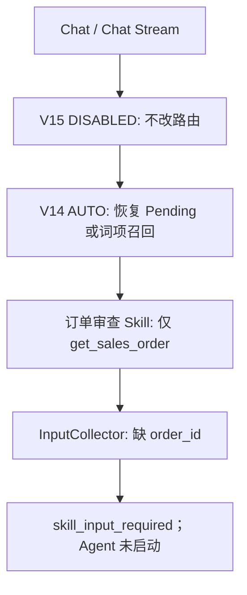
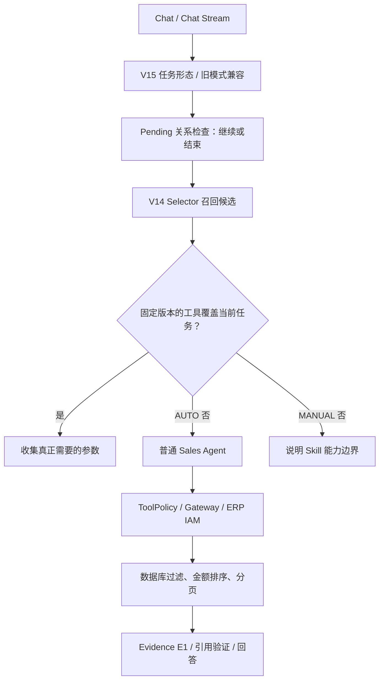

# 一次订单金额排名为什么被要求填写订单主键？

## 1. 真实问题与对照实验

用户问“查询 ERP 数据 销售订单 哪个订单金额最大”。已有真实对照：界面 AUTO（按问题匹配 Skill）返回“请补充销售订单主键”；普通对话执行 `SINGLE_AGENT SUCCEEDED`，2 次模型调用、1 次 `list_sales_orders`、1 条 Evidence，四条 CNY 订单全部返回，模型找出 SO2026000001（32996）。其余三笔为 SO2026000003（29994）、SO2026000002（24993）、SO2026000004（19998）。普通对话前三笔被标为“来源不可验证”，仅最后一笔引用 E1。这里的业务结果碰巧正确，因为只有四条；它不能证明分页后的全局排名正确，也不能证明引用有效。

本地配置中 V15 默认 `DISABLED`，Skill Chat 在本地环境启用并使用 `HYBRID` Selector；UI“普通对话”由前端传 `skill_mode=NONE`，“按问题匹配”传 `AUTO`。没有拿到该次实验的 `request_id`、`message_id`、`pending_id`、`selection_snapshot`、`skill_version_id` 和 Tool Run 原始记录，因此不能断言是本轮 Selector 选中了哪一个固定版本，还是恢复了旧 Pending。可从代码确定：`PendingSkillService.resume` 原先发生在 Selector 之前，`sales-order-review` 固定要求整数 `order_id`，文案由 `SkillInputCollector._question` 生成，补参直接 `complete_without_run`；本次 AUTO 失败的分支没有 Agent Graph 或 ERP 工具调用。

## 2. 修复前后调用链

入口 `services/copilot/app/api/v1/chat.py::_prepare_with_intent` 在普通与 SSE 路径共用 `resolve_chat_intent → apply_resolution_to_runtime → prepare_chat_skill`；后者先判断 Pending 关系，再执行 `SkillSelector.select → SkillRuntimeLoader.load → assess_skill → SkillInputCollector.collect`。AUTO 不适用时返回 `None`，由原来的 Graph、Agent Registry 和 ToolExecutor 执行；MANUAL 显式指定不适用 Skill 返回 42298。NONE 不进入 Skill Catalog。代码没有改生产 V15 默认值；`DISABLED` 仍不改变执行路由，`SHADOW` 只观测，`ENABLED` 使用 RoutingPlan 与 ToolPolicy。

## 3. 六个概念各做什么

| 概念 | 例子 | 职责 |
| --- | --- | --- |
| Intent | `sales.order_query` | 用户想完成什么业务目标 |
| Query Shape | `RANK`、`DETAIL`、`AGGREGATE` | 查询结构；与 Intent 正交，不额外制造六个 Intent |
| Problem Type | `QUERY`、`ANALYZE` | 任务性质与风险粗分 |
| Agent | `sales_agent` | 决定执行主体和工具白名单 |
| Skill | `sales-order-review` | 已审核的专门执行方法与必填输入 |
| Tool | `list_sales_orders` | 带 Schema、IAM、ToolPolicy 的具体数据能力 |

`IntentUnderstandingService.resolve` 把 `describe_query` 的结构填入已有 `ResolvedTask`：实体、指标、聚合、分组、方向、limit、时间、币种。比如订单最大金额是 `sales_order / RANK / total_amount / DESC / 1`，不需要订单主键；客户累计采购最多是 `customer / RANK / SUM(total_amount) / customer_id`，应走 Top 客户报表。`CLEAR` 只表示任务理解清楚，不能替代工具能力或权限校验。确定性的简单语义可走规则，复杂或有歧义的输入仍按原混合分类器回退。普通 Agent 所需排名工具缺失或被治理白名单排除时，Chat 在启动 Graph 前明确报 `CAPABILITY_UNAVAILABLE`，不索取主键。

## 4. Skill 相关不等于适用

HYBRID Selector 的“semantic”实际上是中文双字词项与英文词项的交集评分，并非向量 Embedding。订单排名与订单审查有相似词，所以召回分数高，但订单审查版本只有 `get_sales_order(order_id)`，不能计算全量排名。`app/skills/applicability.py::assess_skill` 用固定版本的 `allowed_tools` 与可选 `query_shapes` 元数据检查能力；老版本没有元数据仍可用工具能力进行保守判断。先通过该关卡，才调用 `SkillInputCollector`。这不是第二套 Selector，也没有给每条简单请求增加一次模型调用。权限仍在 `ToolExecutor` 和 ERP 中复核。

## 5. Pending 不是“下一条消息必然是参数”

`PendingSkillService.resume` 保留 tenant、user、conversation、固定 SkillVersion 绑定，检查过期、重复 request id 和当前消息关系。`123` 是补充主键；`SO2026000004` 是业务订单号，需要经授权 `list_sales_orders(order_no_exact=...)` 精确查得真实主键再填入原 Skill，不能截取尾号当主键。解析订单号经过原 ToolExecutor，工具与证据事件写入会话；即使查无匹配直接进入补参回复，也不伪造 AgentRun。明确的“算了，哪个订单金额最大”“最近一个月销售额是多少”会结束旧 Pending 并执行新任务；“取消刚才的订单查询”只取消会话中的待补参数，不调用 ERP 业务取消工具；含糊文本请用户明确继续还是新任务。前端每次提交会清空旧 Pending UI，并依据 SSE `skill_input_required`、Tool、Evidence、done/error 重建状态。真实并发和 SSE 重试仍须在生产环境验证。

## 6. 一个列表接口如何支持很多问法

`GET /api/v1/sales-orders` 增加受控 `sort_by=created_at|total_amount`、`sort_order=asc|desc`、`currency_code` 和 `order_no_exact`，复用原有状态、时间、订单号、客户、仓库等过滤及分页。`list_sales_orders` Tool 的参数保持同一契约。最大、最小、前十只是排序方向和 `page_size` 不同；金额先在 MySQL 对完整租户数据过滤、聚合、排序，再 LIMIT/OFFSET，不能拿创建时间的第一页交给模型自行排序。金额相同用主键升序稳定打破并列；Top 1 返回稳定的一笔，不隐式枚举所有并列。金额排名默认剔除 DRAFT/CANCELLED 和任何缺定价明细的订单，零金额保留；显式 status 可查询相应状态。不同币种没有可信汇率换算时拒绝裸金额排序，要求指定币种。销售汇总、趋势和 Top 客户复用原 Analytics SQL，报表也按币种过滤；权限为 `analytics:sales:read`，订单列表为 `order:read`。已有索引覆盖 `tenant_id+status` 和 `tenant_id+created_at`；金额是明细 SUM 计算值，本次没有盲目加金额索引，实际大租户需用 EXPLAIN 和压测决定是否做受控汇总表。

## 7. E1 到底覆盖什么

`ToolExecutor._build_evidence` 对 ERP 一次 Tool 调用创建一条 E1，`CopilotWorkflow._validate_citations` 只验证引用编号是否存在；原先工具结果没有把 E1 明确交给模型，后端会把未登记的 `[E2]` 等编号改写为“来源不可验证”。现有材料没有原始模型输出，不能断言实验中的前三笔具体生成了什么编号；这是从源码推断的可能机制。修复后结果容器带 `citation_id="E1"`，E1 的 excerpt 保存本次返回结果（在 Tool 上限内），metadata 记录总数、页码、是否有更多页、排序、截断等。E1 可以支持本次完整返回的多个真实行，但不证明尚未读取的页面，也不证明数据库口径之外的结论。结果截断会标记 `complete=false`。`ConversationRepository.record_evidence` 对 ERP 不再统一裁成 Knowledge 使用的 600 字；Knowledge 引用保持逐 Chunk K 编号。最终回答的排名保护检查数据库金额排序、方向、首页、返回条数与截断状态；仅有默认第一页时不允许宣称全局排名。引用编号验证不等于逐句事实核验。UI 展示的是后端验证后的引用和 Evidence 事件，没有通过关闭验证掩盖错误。

## 8. 验证现状及还要验收什么

确定性测试：Copilot 全套 **207 passed、16 skipped**；`tests/test_intent_skill_query_matching.py` 验证查询结构、AUTO 回退、MANUAL 能力边界、NONE、Pending 关系、工具缺失和受控 Schema；`tests/test_tools.py` 验证 E1 支持两笔返回行及报表权限。ERP 定向 **17 passed**；`tests/test_sales_orders.py` 在独立 MySQL 测试库创建超过一页的订单、将最高金额放在默认第一页之外，另测零金额、未定价、金额并列、跨币种拒绝、报表币种和空租户。V15 旧的 125 题保留，在原 Catalog 追加 7 道查询形态回放，复用 `run_intent_case → evaluate_case` 的 **132/132 确定性回放**。16 个 Copilot 集成或 LIVE 用例因没有 `COPILOT_TEST_DATABASE_URL`、`COPILOT_V14_LIVE_*` 而跳过。没有把确定性测试冒充真实模型测试。前端源码已核对，普通 Chat / SSE 共用准备函数，但本机 pnpm Corepack 下载失败，未完成前端构建或浏览器联调。尚未取得原始 A/B Trace，不能声称已与用户那四笔生产数据做重新跑通。待在部署环境使用同一租户数据执行 NONE/AUTO/MANUAL/Pending 四路回放，核对 `request_id → Intent → Skill 版本 → Pending → Agent/Tool Run → Evidence → 答案`，并完成浏览器 SSE 验收。

继续扩展智能问数时，先定义可信指标口径、汇率和数据权限，再为通用聚合或分组查询增加受控参数；不要从自然语言直接生成任意 SQL、按问法堆接口或复刻一套工具注册表。当前仍有：混合词项召回不是真正向量检索、启用 V15 需灰度和真实模型评测、并列全返回及汇率换算尚未提供、前端浏览器环境和线上治理策略尚待真实验收。

## 本轮原始故障复核（2026-11-27）

上一轮报告的“已完成”仅指本地实现与确定性测试；用户在真实前端选择《按问题匹配》后仍稳定收到 order_id 补参。复核代码发现 `prepare_chat_skill` 的新候选适用性检查仅在 `resumed is None` 时执行，旧 Pending 恢复后可能绕过这一关进入 `SkillInputCollector`。本轮在 `PendingSkillService.resume` 加入对数据库固定 `SkillVersion` 的工具、输入 Schema 和当前任务的适用性检查；排名任务即使被上下文关系判断误当作继续，也不能被旧订单审查 Skill 要求主键。新候选亦检查固定版本的 `input_schema.required`，防止“有列表工具但仍必填 order_id”的历史版本被误认为支持排名。

通过 HTTP Chat / SSE 入口的确定性回归（替身 Skill Catalog、Pending、模型和 ERP）验证原始问题在 V15 DISABLED / ENABLED 下 AUTO 回退普通 Agent，调用 `list_sales_orders(sort_by=total_amount, sort_order=desc)`；历史 Pending 在新任务中结束；真实订单审查保持补参，MANUAL 不适用明确报错。Copilot 当前 **207 passed、16 skipped**。这些结果仍不能替代真实服务 Trace。本地未发现监听 8013 的 Copilot 进程，Docker daemon 不可连接，因此不能读取运行中的数据库 SkillVersion、确认部署镜像或生成修复前后的真实 request_id。真实前端 / 同一批 ERP 数据 / 模型验收状态为 **BLOCKED**。部署代码后，需凭同一请求的 `skill_prepare_start`、`pending_relation` / `pending_inapplicable`、`skill_applicability` 日志和 Tool Run 记录核查，不能再次仅凭本地测试宣称问题已解决。