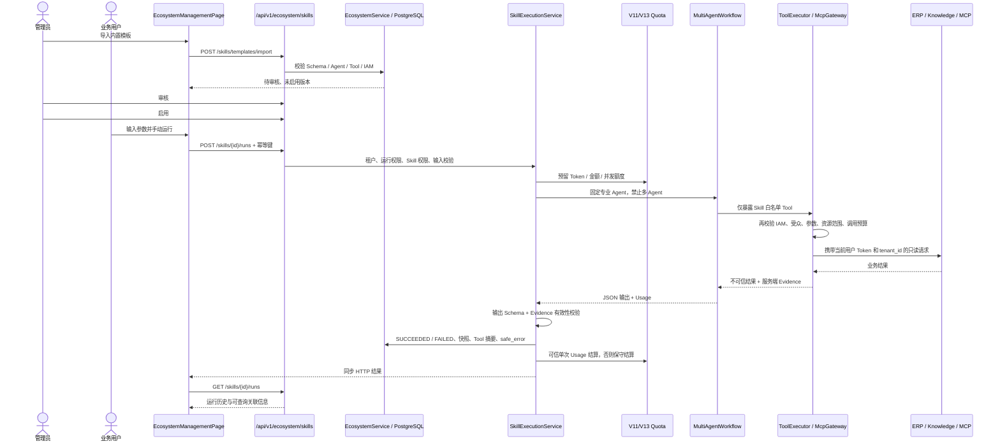

# Copilot V14.1：Skill 基础能力完善与真实执行闭环

希望按一次 `inventory-analysis` 真实运行顺序阅读和调试源码时，请直接进入
[V14.1 Skill 全链路 Walkthrough](./v14.1-skill-walkthrough.md)。

## 1. Skill 是什么

Skill 是一份经过租户管理员审核的只读业务能力声明，由业务说明、输入/输出 JSON Schema、专业 Agent 白名单、Tool 白名单、IAM 权限、Evidence 要求和执行预算组成。它不是 Python 插件，不能携带代码、扩大用户权限或绕过 ToolExecutor。

现有 Copilot 已有 Agent、Tool、MCP、IAM、配额与审计能力，但缺少一个让管理员可重复导入、审核并由业务用户手动运行的完整入口。V14.1 补齐这条闭环；Chat/SSE 仍不会自动选择 Skill。

## 2. V12 与 V14.1 的边界

V12 已有 PostgreSQL Skill Registry、版本/审核/启停/回滚 API、`SkillExecutionService`、Schema 校验和三份 JSON 模板。V14.1 在这些结构上新增：

- 三个模板与真实 Tool 参数、Agent Registry、IAM 权限对齐；
- 管理员幂等模板导入入口，导入版本默认待审核、未启用，已审核配置受保护；
- 独立 `copilot:skill:run` 权限，运行不再要求管理权限；
- 专业 Agent 身份在单 Agent LangGraph 路径中保持不变；
- V11/V13 配额预留、保守结算，以及模型开始前的额度释放；
- 租户治理 Tool 交集、服务端 Tool 白名单、ToolExecutor 二次权限校验；
- 有效 Evidence 来源/时间/Tool 调用关联校验，Tool 摘要、模型版本和可信 Usage 快照；
- 前端详情、版本、Schema、审核、启停、导入、手动运行和历史展示。

没有新增 Registry、Runner、Tool Gateway 或业务微服务，也没有数据库迁移：现有 `SkillRun.output_snapshot` 足以保存结构化结果、Tool 摘要、Evidence 引用和执行元信息。

## 3. 三个内置模板

| Skill | Agent | Tool | 必要权限 | 实际用途 |
|---|---|---|---|---|
| `inventory-analysis` | `inventory_agent` | `analyze_inventory_coverage` | `inventory:read`、`analytics:sales:read` | 使用明确 SKU、开始日期、结束日期和可选仓库计算覆盖天数；不输出补货动作 |
| `sales-order-review` | `sales_agent` | `get_sales_order` | `order:read` | 查询指定销售订单并列出事实和人工复核项；不审批、改单、发货或退款 |
| `knowledge-research` | `knowledge_agent` | `search_knowledge` | `knowledge:read` | 在用户明确指定、Knowledge 服务重新鉴权的知识库列表内研究并引用文档 |

三个模板均为 `READ_ONLY`、要求 Evidence，并有 30 秒超时和 3000 Token 预算。模板中的业务说明被包在 `untrusted_skill_instructions` 中，不能覆盖系统安全规则。

## 4. 真实调用链



## 5. 关键源码入口

- `services/copilot/app/services/ecosystem.py`：模板导入、版本审核、依赖校验。
- `services/copilot/app/services/skill_execution.py`：幂等运行、治理、配额、Agent/Tool 边界、输出和 Evidence 校验。
- `services/copilot/app/graph/multi_agent.py::_single`：保持 `agent_name`，不再覆盖成 `single_agent`。
- `services/copilot/app/graph/workflow.py::_tool_node`：记录 Tool 成功/失败摘要。
- `services/copilot/app/tools/executor.py::execute`：模型外的 Tool 白名单、IAM、受众、参数和超时校验。
- `services/copilot/app/mcp/gateway.py`：动态 MCP 的审核状态、Agent、权限、Schema、资源范围与并发复核。
- `services/copilot/app/services/quotas.py`：配额预留、结算和未开始执行时释放。
- `apps/copilot/src/pages/EcosystemManagementPage.tsx`：管理和手动运行 UI。

## 6. 从导入到运行

1. 拥有 `copilot:skill:manage` 和读取权限的管理员点击“导入内置模板”。
2. 后端只读取登记的三个服务端 JSON 文件。相同内容返回 `UNCHANGED`；已审核/启用且内容不同的配置返回 `PROTECTED`；不会自动发布。
3. 管理员打开详情，检查 instructions、Schema、Agent、Tool、权限和预算。
4. 点击“审核”，Skill 仍保持停用；再点击“启用”。
5. 拥有 `copilot:skill:read`、`copilot:skill:run` 以及模板业务权限的用户填写 Schema 表单并运行。
6. 页面等待同步 HTTP 返回，不把它伪装成后台任务。结果和历史中展示结构化结果、Tool 摘要、Evidence 与安全错误。

## 7. 输入输出示例

### 库存覆盖分析

输入：

```json
{"sku_code":"SKU-001","start_date":"2026-10-01","end_date":"2026-10-31","warehouse_id":12}
```

输出形状：

```json
{"summary":"10 月销量与当前可用库存形成约 8.4 天覆盖 [E1]。未提供安全库存与交期，不能给出补货量。","coverage_days":8.4,"evidence_refs":["E1"]}
```

### 销售订单审查

输入：

```json
{"order_id":71001}
```

输出形状：

```json
{"summary":"订单状态为 SUBMITTED，总金额与明细汇总一致 [E1]。","issues":["客户特殊约定不在当前订单证据中，需人工确认"],"evidence_refs":["E1"]}
```

### 授权知识研究

输入：

```json
{"query":"销售退货入库的审批要求是什么？","knowledge_base_ids":[31],"top_k":5}
```

输出形状：

```json
{"summary":"制度要求退货验收后由指定角色确认入库 [K1]。","unknowns":["当前证据未说明跨仓调拨场景"],"evidence_refs":["K1"]}
```

## 8. Skill、Tool、MCP、Agent、Workflow 的边界

- Skill：审核后的业务说明和声明式约束，不执行代码。
- Agent：可信代码注册的专业身份，决定其最大 Tool/模型调用预算和基础 Tool 集。
- Tool：进程内只读能力；ToolExecutor 在每次调用时重新校验 IAM、JWT audience 和参数。
- MCP：外部只读 Tool；除 Skill 白名单外，还需 Server/Tool 审核、健康、Agent、资源范围和并发全部通过。
- Workflow：LangGraph 的 Agent→Tool→Agent 循环；V14.1 固定单专业 Agent，不编排多 Skill。

白名单的有效集合是：Skill Tool ∩ Agent Tool ∩ 租户治理 Tool ∩ 当前用户 IAM ∩ 下游资源授权。Prompt 只提供业务上下文，不是授权边界。

## 9. 失败、超时与取消语义

- 输入/输出 Schema、权限、租户、Agent 或 Tool 不满足时失败关闭。
- 模型开始前的失败释放配额预留；模型开始后遇到 Tool/LLM 失败或超时，由于 Usage 可能不完整，按预留上限保守结算。
- 超时写入 `FAILED` 和安全错误。已产生的 Tool 摘要/Evidence 会保留在受控快照中，便于审计。
- 幂等键范围为 tenant + user；相同键同参数返回原 SkillRun，不同 Skill 或输入返回 409。
- HTTP 断开不等于外部 Tool 已停止。当前是同步接口，没有新增持久任务调度或显式取消状态；进程仍存活时下游调用可能继续，最终以 SkillRun 为准。V14.1 不声称支持可靠的分布式取消。

## 10. Evidence 与 Trace 现状

手动 SkillRun 没有 Chat Message，而统一 `copilot_evidences` 表强制关联 conversation/message，因此 V14.1 没有伪造 Message 记录或修改历史表约束。Evidence 由真实 ToolExecutor/McpGateway 产生，并以 `skill_run_id`（SkillRun 主键）、`tool_call_id`、来源、资源标识和 observed_at 保存在 `SkillRun.output_snapshot` 中，可通过运行详情/历史查询。

这提供了可查询关联，但还不是 V9 Chat `AgentRun → ModelCall → ToolRun → Evidence` 的完整统一 Trace。若后续要求跨场景统一查询，应设计兼容的可空主体或独立 trace subject 迁移，而不是在 V14.1 强行挂到虚假会话。

## 11. 测试与验收口径

自动测试覆盖模板/真实 Registry 对齐、日期输入、Schema 错误、Evidence 有效性、幂等冲突、配额保守结算与释放、专业 Agent 单路径、前端结果/Tool/Evidence/错误展示，以及既有 V12/V13/Multi-Agent 回归。

`test_v14_skill_postgres_integration.py` 只有在 `COPILOT_TEST_DATABASE_URL` 指向名称以 `_test` 结尾的专用 PostgreSQL 时才会重建表并执行模板导入、审核/启用、运行持久化、幂等、权限和租户隔离。没有该变量时明确 skip。真实 Redis、ERP、IAM、Knowledge 与外部模型仍需部署环境验收；Mock 或内存替身通过不等同于这些系统已验收。

本次工作区实际结果：

- Copilot Ruff：通过。
- V14.1 专项：单元测试通过，PostgreSQL 集成测试因未配置 `COPILOT_TEST_DATABASE_URL` 跳过。
- V12/V13/多 Agent 选定回归：通过。
- Copilot 全量：除需要本地 PostgreSQL 的 Chat API 用例返回 503 外，其余通过或按环境跳过；不能据此声明 Chat HTTP 集成验收。
- IAM：14 项测试通过；本次修改的权限目录文件 Ruff 通过。全目录 Ruff 仍有既存 `tests/test_security.py` 格式问题。
- Copilot 前端：TypeScript 编译、V14.1 组件测试、生产构建通过；全量测试有一项既存 `InsightCenterPage` 测试缺少 Router 上下文，其余通过。
- 未配置真实 Redis、ERP、IAM、Knowledge、模型和浏览器四服务环境，因此这些项目未验收。

## 12. 面试问题与基于当前代码的回答

1. **为什么 Skill 不是插件？** 因为它只保存文本、Schema 和白名单；执行仍走可信 LangGraph、ToolExecutor 与 Gateway。
2. **怎样防止 Prompt 越权？** instructions 被标为不可信，授权集合完全由服务端对象交集决定，Tool 每次调用再校验。
3. **为什么新增 run 权限？** 运行是业务能力，不应自动获得创建、审核、启停权限；同时仍需底层 ERP/Knowledge 权限。
4. **如何处理多租户？** 所有 Skill、版本、Run 与 MCP 查询都带服务端 TenantContext 的 tenant_id，客户端不能传 tenant_id。
5. **模板导入如何幂等？** 规范化版本 JSON 后计算 SHA-256；相同 Hash 不增版本，已审核/启用配置不覆盖。
6. **为什么库存日期必须显式输入？** Tool 的真实参数要求 start/end；让模型猜日期会造成不可复现分析。
7. **allowed_agents 的缺陷如何修复？** `_single` 保留运行上下文中的专业 Agent 名称，因此 MCP Agent 白名单和 Trace 不再看到通用 `single_agent`。
8. **Tool 白名单为什么不能只写 Prompt？** 模型输出不可信；`ToolExecutor.execute` 在模型外拒绝非白名单调用。
9. **Evidence 怎样判有效？** 必须来自允许 Tool 的 ERP/Knowledge/MCP 来源，包含唯一 citation、真实 tool_call_id、资源类型和带时区观测时间。
10. **配额异常如何处理？** 模型未开始就 release；开始后 Usage 不完整时保守 settle，避免漏记费用和并发额度。
11. **幂等为什么包含用户？** 避免同租户不同用户互相读取运行结果，同时允许单用户安全重试。
12. **为什么没有新增数据库字段？** 现有 Run 主键、tenant/user、版本、时间、状态、输入/输出和错误已足够；扩展审计信息可放受控 JSON 快照。
13. **同步接口能可靠取消吗？** 不能。HTTP 断开与下游调用停止没有等价关系，当前只能用服务端超时和最终状态约束。
14. **为什么手动 Evidence 没写统一表？** 该表当前强制依赖 Chat Message；制造虚假会话会破坏数据语义，V14.1 保存可查询的 Run 内关联并明确限制。
15. **为什么 Chat/SSE 没接 Skill？** 这是 V14.1 的明确范围，自动选择和执行要等 Catalog/Selector 与更完整治理后再做。
