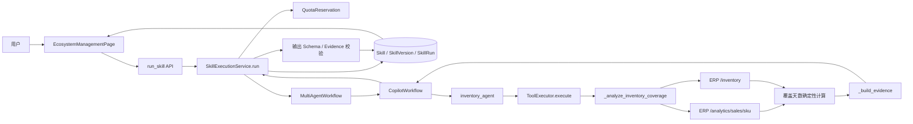

# V14.1 inventory-analysis Skill 全链路 Walkthrough

这是一份按“一次真实运行发生的先后顺序”组织的源码入口。第一次阅读 V14.1 时，先看本文，再看 `services/copilot/tests/test_v14_skill_walkthrough.py`；不需要先通读全部 Skill 文件。

主案例输入：

```json
{
  "sku_code": "SKU-WALK-001",
  "start_date": "2026-10-01",
  "end_date": "2026-10-31",
  "warehouse_id": 12
}
```

## 总调用链



## 第一步：Skill 定义在哪里？

- 当前做什么：声明名称、业务 instructions、输入/输出 Schema、专业 Agent、Tool、权限和预算。
- 为什么需要：Skill 是审核对象；它声明业务做法，但不携带可执行代码，也不是授权来源。
- 文件：`services/copilot/skills/inventory-analysis.json`
- 断点：JSON 无法设 Python 断点，先在编辑器中观察 `version` 对象，下一步在导入函数设断点。
- 关键入参：`sku_code`、显式 `start_date`、`end_date`、可选 `warehouse_id`。
- 关键出参：`summary`、`coverage_days`、`evidence_refs`。
- 下一步：`EcosystemService.import_skill_templates`。

必须显式传日期，因为真实 Tool `AnalyzeInventoryCoverageArgs` 要求日期范围。模型不能猜“最近一段时间”。

## 第二步：Skill 怎么导入数据库？

- 当前做什么：管理员调用模板导入 API，后端读取服务端登记的 JSON，转成 `SkillCreate`，校验依赖后写入 `Skill` 与 `SkillVersion`。
- 为什么需要：模板文件本身不是生产配置；数据库版本才有租户、审核状态和版本历史。
- 文件与函数：
  - `services/copilot/app/api/v1/ecosystem.py::import_skill_templates`
  - `services/copilot/app/services/ecosystem.py::EcosystemService.import_skill_templates`
  - `services/copilot/app/services/ecosystem.py::EcosystemService._add_skill_version`
  - `services/copilot/app/services/ecosystem.py::EcosystemService._validate_skill_dependencies`
- 推荐断点：`payload = SkillCreate.model_validate_json(...)`；`content_hash` 计算；`_add_skill_version` 创建 `SkillVersion`。
- 关键入参：`SkillTemplateImportIn.skill_keys=["inventory-analysis"]`。
- 关键出参：`SkillTemplateImportOut`，状态为 `IMPORTED`、`UNCHANGED` 或 `PROTECTED`。
- 下一步：`review_skill`。

导入是幂等的：相同语义内容不创建无意义版本；已审核或启用的配置不会被模板覆盖。新导入版本保持 `PENDING_APPROVAL` 且未启用。

## 第三步：管理员怎么审核和启用？

- 当前做什么：审核时重新验证 Schema、Agent、Tool 和 IAM 权限目录；审核与启用是两个动作。
- 为什么需要：导入者不能让未经复核的业务 instructions 自动进入模型上下文。
- 文件与函数：
  - `services/copilot/app/api/v1/ecosystem.py::review_skill`
  - `services/copilot/app/services/ecosystem.py::EcosystemService.review_skill`
  - `services/copilot/app/api/v1/ecosystem.py::enable_skill`
  - `services/copilot/app/services/ecosystem.py::EcosystemService.set_skill_enabled`
- 推荐断点：`review_skill` 中 `_validate_skill_dependencies`；`set_skill_enabled` 的审核状态判断。
- 关键入参：`{"approved": true}`。
- 关键出参：先得到 `approval_status=APPROVED, enabled=false`，再得到 `enabled=true`。
- 下一步：前端 `runSkill`。

## 第四步：用户怎么执行 Skill？

- 当前做什么：管理页根据当前 `input_schema` 生成输入控件，生成幂等键，提交同步 Run API。
- 为什么需要：V14.1 只允许用户明确手动运行，不允许 Chat/SSE 自动选择 Skill。
- 文件与函数：
  - `apps/copilot/src/pages/EcosystemManagementPage.tsx::EcosystemManagementPage`
  - 其中 `execute` mutation、`parseSchemaInput`、`RunDetail`
  - `apps/copilot/src/api/ecosystem.ts::runSkill`
- 推荐断点：浏览器 Sources 中 `execute.mutationFn`；检查 `selectedSkillId`、`currentVersion` 和最终 payload。
- 关键入参：`input`、`agent_name=inventory_agent`、客户端生成的 `idempotency_key`。
- 关键出参：`SkillRun` API 响应。
- 下一步：FastAPI `run_skill`。

## 第五步：API 如何接收请求？

- 当前做什么：FastAPI 使用 `SkillRunIn` 校验请求外形，并通过 `SkillRunContext` 要求 `copilot:skill:read + copilot:skill:run`。
- 为什么需要：执行权限与导入、审核、启停使用的 `copilot:skill:manage` 分离。
- 文件与函数：
  - `services/copilot/app/api/v1/ecosystem.py::run_skill`
  - `services/copilot/app/api/deps.py::get_skill_run_context`
  - `services/copilot/app/schemas/ecosystem.py::SkillRunIn`
- 推荐断点：`run_skill` 第一行；构造 `SkillExecutionService` 的位置。
- 关键入参：路径 `skill_id`、当前 `TenantContext`、用户 Token、JWT audiences、request_id。
- 关键出参：`SkillRunOut`。
- 下一步：`SkillExecutionService.run`。

客户端不能提交 tenant_id、access_token、Tool 名称或权限。租户和身份只来自服务端认证上下文。

## 第六步：SkillExecutionService 做了什么？

- 当前做什么：主流程按“加载 → 校验 → 预留 → 执行 → 验证 → 持久化 → 结算”推进。
- 为什么需要：这里是 Skill 声明、治理、LangGraph 和持久化的编排边界，但不重复实现 Agent 或 ToolExecutor。
- 文件与函数：`services/copilot/app/services/skill_execution.py::SkillExecutionService.run`
- 推荐断点：
  1. `existing = await self._idempotent(...)`
  2. `skill, version = await self._active(skill_id)`
  3. `validated_input = validate_arguments(...)`
  4. `reservation = await reserve_chat_quota(...)`
  5. `message = self._message(...)`
  6. `answer, usage = await self.workflow.invoke(...)`
  7. `validate_arguments(version.output_schema, output)`
  8. `row.status = "SUCCEEDED"`
  9. `await reservation.settle(...)`
- 关键入参：租户绑定的 Skill ID、`SkillRunIn`、当前用户上下文。
- 关键出参：数据库中的 `SkillRun` 和 API `SkillRunOut`。
- 下一步：`_active` 加载版本，然后进入 LangGraph。

`_active` 的 SQL 同时要求：当前租户、Skill 已启用、Skill 与当前版本均已审核、风险等级为 `READ_ONLY`。跨租户或未审核对象不会被加载。

开发模式日志使用同一 `request_id` 和 `skill_run_id` 输出阶段名，不记录输入原文、Prompt、JWT 或 Tool 结果。可搜索 `skill_stage=`。

## 第七步：instructions 如何进入 LangGraph 和模型？

- 当前做什么：`SkillExecutionService._message` 把 instructions、已校验输入和 output schema 组成一条 **user message**；`CopilotWorkflow.prepare_messages` 再把可信 system prompt 放在它之前。
- 为什么需要：Skill 是租户审核的业务指导，不是 system/developer 权限指令。
- 文件与函数：
  - `services/copilot/app/services/skill_execution.py::SkillExecutionService._message`
  - `services/copilot/app/graph/multi_agent.py::MultiAgentWorkflow.invoke`
  - `services/copilot/app/graph/multi_agent.py::MultiAgentWorkflow._single`
  - `services/copilot/app/graph/workflow.py::CopilotWorkflow.prepare_messages`
  - `services/copilot/app/graph/workflow.py::CopilotWorkflow._agent_node`
- 推荐断点：`_message` 返回前；`_single` 调用 `self.single.stream`；`_agent_node` 调 adapter 前。
- 关键入参：

```text
role=user
content=
请执行下面已审核的只读业务 Skill……
<untrusted_skill_instructions>...</untrusted_skill_instructions>
input={...}
output_schema={...}
```

模型最终看到的消息顺序是：

```text
1. role=system  -> Copilot 可信安全规则
2. role=user    -> 不可信 Skill instructions + 已校验输入 + output_schema
3. role=assistant/tool/... -> 后续 Tool 循环消息
```

- 关键出参：模型的 Tool Call 或最终 JSON 文本。
- 下一步：`ToolExecutor.definitions` 和 `ToolExecutor.execute`。

Skill instructions 不能覆盖 system prompt，也不能改变 `ToolRuntime` 中的权限、租户、Agent 或 Tool 白名单。模型“理解步骤”依赖自然语言 instructions，但它能做什么由服务端门禁决定。

## 第八步：Agent 如何选择并调用 Tool？

- 当前做什么：当前版本选择 `inventory_agent`。`AgentRegistry` 提供可信 Agent 规格；V14.1 禁止多 Agent，复用既有单 Agent 图。
- 为什么需要：Skill 是业务任务声明，Agent 是可信执行角色，两者不是同一个对象。
- 文件与函数：
  - `services/copilot/app/agents/registry.py::build_agent_registry`
  - `services/copilot/app/graph/multi_agent.py::MultiAgentWorkflow._single`
  - `services/copilot/app/graph/workflow.py::CopilotWorkflow._agent_node`
  - `services/copilot/app/tools/executor.py::ToolExecutor.definitions`
  - `services/copilot/app/tools/executor.py::ToolExecutor.execute`
- 推荐断点：`build_agent_registry` 中 `inventory_agent`；`_agent_node` 生成 `definitions`；`ToolExecutor.execute` 第一行。
- 关键入参：
  - `SkillVersion.allowed_agents=["inventory_agent"]`
  - `SkillVersion.allowed_tools=["analyze_inventory_coverage"]`
  - `ToolRuntime.allowed_tools=frozenset(...)`
- 关键出参：只向模型暴露 `analyze_inventory_coverage` 定义；非白名单 Tool Call 返回 40378。
- 下一步：`ToolExecutor._analyze_inventory_coverage`。

白名单的实际传递链是：

```text
SkillVersion.allowed_tools
  -> SkillExecutionService 创建 ToolRuntime.allowed_tools
  -> CopilotWorkflow._agent_node 调 ToolExecutor.definitions 过滤模型可见工具
  -> ToolExecutor.execute 再检查 call.name 是否仍在 allowed_tools
```

因此白名单既限制“模型能看到什么”，也限制“模型实际请求了什么”。ToolExecutor 还会重新检查当前用户 IAM 权限和 ERP JWT audience。

当前一个 SkillVersion 可以声明多个 allowed_agents，但一次手动运行只选择其中一个专业 Agent；没有 Multi-Agent Skill 编排，也不会改变 LangGraph 的图结构。

## 第九步：Tool 怎么访问 ERP 并计算覆盖天数？

- 当前做什么：Tool 参数先由 `AnalyzeInventoryCoverageArgs` 校验，然后用当前用户 Token 和服务端 tenant_id 调两个固定 ERP GET 接口。
- 为什么需要：销量与当前库存来自两个真实只读来源；计算公式必须由服务端确定，不交给模型心算。
- Copilot 文件与函数：
  - `services/copilot/app/tools/schemas.py::AnalyzeInventoryCoverageArgs`
  - `services/copilot/app/tools/registry.py::build_tool_registry`
  - `services/copilot/app/tools/executor.py::ToolExecutor._analyze_inventory_coverage`
  - `services/copilot/app/erp/client.py::ErpApiClient.get`
- ERP 文件与函数：
  - `services/erp/app/api/v1/analytics.py::sales_sku`
  - `services/erp/app/services/analytics.py::AnalyticsService.sku_sales`
  - `services/erp/app/repositories/analytics_sales.py::AnalyticsSalesRepository.sku_sales`
  - `services/erp/app/api/v1/inventory.py` 的库存查询路由
- 推荐断点：`_analyze_inventory_coverage` 的两个 `client.get`；ERP `sales_sku`；`AnalyticsService.sku_sales`；Repository 构造 SQL 的位置；覆盖天数计算行。
- 关键入参：精确 SKU、日期范围、可选仓库；Token 和 tenant_id 由 `ToolRuntime` 注入。
- 关键出参：

```json
{
  "sku_code": "SKU-WALK-001",
  "period_days": 31,
  "sales_quantity": 310,
  "average_daily_sales": 10.0,
  "available_quantity": 84.0,
  "coverage_days": 8.4,
  "formula": "available_quantity / average_daily_sales"
}
```

- 下一步：`ToolExecutor._build_evidence`。

ERP 销量查询只聚合有效订单状态并绑定当前租户；库存查询若分页总数超过本次返回数，会要求用户指定仓库，避免拿不完整分页结果计算。

## 第十步：Tool 返回什么，Evidence 在哪里生成？

- 当前做什么：确定性结果被序列化为 `<untrusted_erp_tool_result>` Tool Message 返回模型；Evidence 由服务端根据真实 Tool Call 和净化结果生成。
- 为什么需要：模型可以总结结果，但不能自称访问过 ERP 或伪造来源。
- 文件与函数：
  - `services/copilot/app/tools/executor.py::ToolExecutor.execute`
  - `services/copilot/app/tools/executor.py::ToolExecutor._build_evidence`
  - `services/copilot/app/graph/workflow.py::CopilotWorkflow._tool_node`
- 推荐断点：`evidences = self._build_evidence(...)`；`runtime.evidences.extend(...)`；`_tool_node` 追加 `tool_events`。
- 关键入参：真实 `ModelToolCall.id/name/arguments`、净化后的计算结果、`ToolRuntime`。
- 关键出参：
  - 给模型：不可信 Tool Message；
  - 给 SkillRun：`citation_id=E1`、`tool_call_id`、`resource_type`、`resource_id`、excerpt、observed_at；
  - 调试摘要：Tool 名、来源、耗时、状态、Evidence 数量，不保存参数和完整原始响应。
- 下一步：模型第二轮返回最终 JSON。

开发模式可搜索 `tool_stage=started` 和 `tool_stage=completed`。这些日志不包含 JWT、请求参数或 ERP 原文。

## 第十一步：结果怎么校验并持久化？

- 当前做什么：模型文本先解析成 JSON object，再用当前 SkillVersion 的 `output_schema` 校验；Evidence 还要验证来源、Tool Call、资源类型、唯一 citation 和带时区时间。
- 为什么需要：LLM 输出不是可信结构。即使内容看起来合理，字段缺失、额外字段或 Evidence 缺失都必须失败。
- 文件与函数：
  - `services/copilot/app/services/skill_execution.py::SkillExecutionService._parse_output`
  - `services/copilot/app/mcp/security.py::validate_arguments`
  - `services/copilot/app/services/skill_execution.py::SkillExecutionService._valid_evidence`
  - `services/copilot/app/models/ecosystem.py::SkillRun`
- 推荐断点：`output = self._parse_output(answer)`；输出 `validate_arguments`；`_valid_evidence`；成功/失败分支给 `row.status` 赋值处。
- 关键入参：模型 JSON 文本、版本 output_schema、`ToolRuntime.evidences`。
- 关键出参：
  - 成功：`SUCCEEDED`，保存 result、Evidence、Tool 摘要、Agent/模型/Usage 元信息；
  - 失败：`FAILED`，保存 safe_error 和已产生的受控 Tool/Evidence 摘要。
- 下一步：配额结算并返回前端。

成功例：包含 `summary`、数值 `coverage_days`、数组 `evidence_refs`。失败例：缺少 `coverage_days`、输出额外 tenant_id、不是 JSON 或 required_evidence 没有真实 Evidence。

## 第十二步：配额怎么结算，前端怎么展示？

- 当前做什么：模型开始前失败会释放预留；模型开始后失败/超时且 Usage 不完整时保守结算；可信单次 Usage 按实际 Token 结算。前端显示结构化结果、Tool 摘要、Evidence、run ID、版本、状态和时间。
- 为什么需要：不能把失败调用当成零成本，也不能把同步 HTTP 展示成可靠后台任务。
- 文件与函数：
  - `services/copilot/app/services/quotas.py::reserve_chat_quota`
  - `services/copilot/app/services/quotas.py::QuotaReservation.settle`
  - `services/copilot/app/services/quotas.py::QuotaReservation.release`
  - `services/copilot/app/services/ecosystem.py::EcosystemService.skill_run`
  - `apps/copilot/src/pages/EcosystemManagementPage.tsx::RunDetail`
- 推荐断点：成功分支的 `reservation.settle`；失败分支的 `settle/release`；前端 `RunDetail`。
- 关键入参：可信 Usage、模型调用次数、SkillRun output_snapshot。
- 关键出参：配额审计更新和前端执行详情。
- 下一步：无；一次执行闭环结束。

## 一次执行可以观察到的真实阶段

`APP_ENV=development` 时，按代码真实顺序输出：

1. `skill_version_loaded`
2. `input_schema_validated`
3. `permission_and_governance_validated`
4. `skill_run_started`
5. `quota_reserved`
6. `agent_input_built`
7. `langgraph_started`
8. `tool_stage=started`
9. `tool_stage=completed`
10. `langgraph_completed`
11. `output_and_evidence_validated`
12. `skill_run_succeeded`
13. `quota_settled`

这是开发日志，不是新 Trace 平台。持久化审计仍以 SkillRun、Tool 摘要、Evidence 和预算审计为准。

## VS Code / Cursor 调试

`.vscode/launch.json` 新增三项：

- `Copilot: debug 8013`：启动 Copilot FastAPI。
- `Copilot: debug inventory Skill walkthrough`：调试确定性 walkthrough 测试。
- `V14.1 Skill: Copilot + ERP`：同时启动真实 Copilot 与 ERP。

测试调试前，在 `services/copilot/.env` 或启动环境配置：

```dotenv
COPILOT_TEST_DATABASE_URL=postgresql+psycopg://.../neorvion_copilot_test
```

数据库名必须以 `_test` 结尾。测试会重建该专用数据库中的表，禁止指向开发或生产数据库。

推荐按以下顺序设置断点：

1. `app/api/v1/ecosystem.py::run_skill`
2. `app/services/skill_execution.py::SkillExecutionService.run`
3. `SkillExecutionService._active`
4. `SkillExecutionService._message`
5. `graph/multi_agent.py::MultiAgentWorkflow._single`
6. `graph/workflow.py::CopilotWorkflow._agent_node`
7. `tools/executor.py::ToolExecutor.execute`
8. `ToolExecutor._analyze_inventory_coverage`
9. `ToolExecutor._build_evidence`
10. `SkillExecutionService._parse_output` 和输出 Schema 校验行
11. `row.status = "SUCCEEDED"` / `row.status = "FAILED"`
12. `QuotaReservation.settle`

变量查看建议：只看 `skill.id/version.version`、Schema、Agent/Tool 名称、run ID、Tool 状态、Evidence ID 和计算结果。不要展开或复制 access token、Authorization header、完整业务原文。

## 端到端测试入口

文件：`services/copilot/tests/test_v14_skill_walkthrough.py`

### Mock 外部依赖的完整内部链路

```powershell
cd services/copilot
$env:COPILOT_TEST_DATABASE_URL='postgresql+psycopg://.../neorvion_copilot_test'
.\.venv\Scripts\python.exe -m pytest tests/test_v14_skill_walkthrough.py::test_inventory_skill_complete_mock_walkthrough -s -vv
```

真实执行：模板导入、依赖校验、审核、启用、FastAPI Run API、SkillExecutionService、LangGraph、ToolExecutor、覆盖天数计算、Evidence、输出 Schema、SkillRun PostgreSQL 持久化和详情查询。

替代项：LLM adapter 和 ERP HTTP response。该测试不是生产 E2E，但不会 Mock `SkillExecutionService.run`。

同一测试覆盖成功、输入错误、业务权限不足和 Tool 失败。Tool 失败仍会留下 `FAILED` SkillRun 和失败 Tool 摘要。

### 显式真实环境验收

```powershell
$env:COPILOT_V14_LIVE_URL='http://127.0.0.1:8013'
$env:COPILOT_V14_LIVE_TOKEN='...'
$env:COPILOT_V14_LIVE_TENANT_ID='...'
$env:COPILOT_V14_LIVE_SKILL_ID='...'
$env:COPILOT_V14_LIVE_SKU_CODE='...'
.\.venv\Scripts\python.exe -m pytest tests/test_v14_skill_walkthrough.py::test_inventory_skill_live_environment -s -vv
```

只有全部变量存在时才会调用真实 Copilot、模型和 ERP；默认 skip。该用例是只读的，但要求目标 Skill 已审核启用，用户同时拥有 Skill 和底层库存/销量权限。

## 前端演示步骤

1. 启动 IAM、ERP、Copilot、Shell 和 Copilot 前端。
2. 给演示角色授予 `copilot:skill:read`、`copilot:skill:run`；管理员另需 `copilot:skill:manage`。业务用户还需 `inventory:read`、`analytics:sales:read`。
3. 打开 AI 管理中心 → MCP 与 Skills → Agent Skills。
4. 点击“导入内置模板”，打开 `inventory-analysis`。
5. 检查当前版本、instructions、input/output schema、Agent、Tool、权限和预算。
6. 先审核，再启用。
7. 手动填写 SKU、开始日期、结束日期和可选仓库，点击“运行 Skill”。
8. 在执行详情查看 run ID、版本、状态、结构化结果、`analyze_inventory_coverage` Tool 摘要和 `[E1]` Evidence。
9. 在运行历史展开同一 run，确认持久化结果一致。

界面明确标注这是同步 HTTP：关闭页面或连接断开不代表已经发送的 ERP 请求必然停止，最终状态以 SkillRun 为准。

## 九个核心概念

- **Skill Registry**：租户内 Skill 主记录集合，保存稳定 key、名称、当前版本指针、审核和启用状态。它不执行模型或 Tool。
- **SkillVersion**：一次不可变业务配置快照，包含 instructions、Schema、Agent/Tool/权限白名单和预算。任何变更生成新版本并重新审核。
- **SkillExecutionService**：一次手动运行的编排服务，负责加载、校验、配额、调用 LangGraph、验证结果和写 SkillRun；不替代 Agent 或 ToolExecutor。
- **Agent**：可信代码登记的专业执行身份。`inventory_agent` 限制基础 Tool 集、权限、调用次数和 Token 预算；Skill 不等于 Agent。
- **Tool**：模型可请求但由服务端执行的受控函数。`analyze_inventory_coverage` 只读访问 ERP 并执行确定性公式。
- **MCP**：经审核的远程只读 Tool 通道。本案例使用内置 ERP Tool，不经过 MCP，但两者共用服务端白名单和权限思想。
- **Workflow**：LangGraph 的 Agent→Tool→Agent 循环。V14.1 复用既有图，不因 Skill 创建新图，也不做多 Skill 编排。
- **Evidence**：ToolExecutor 根据真实 Tool 调用生成的可验证来源记录，不接受模型自报来源。
- **SkillRun**：一次运行的持久化事实，记录租户、用户、版本、幂等键、输入快照、状态、结果、Tool 摘要、Evidence、安全错误和时间。

## 当前未实现或未声称实现的能力

- Chat/SSE 自动触发 Skill。
- Skill 自动发现、Catalog/Selector、Progressive Disclosure。
- Multi-Agent 或多 Skill 编排。
- 可靠分布式取消。
- 手动 Skill 与 V9 Chat Evidence 表的统一主体 Trace；当前通过 SkillRun 内的 tool_call_id/Evidence 关联查询。
- 未提供真实环境变量时，真实模型、ERP、Redis、IAM、Knowledge 和浏览器 E2E 均不算验收。
