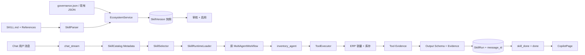

# V14.2 Agent Skills：从 SKILL.md 到 Chat/SSE

本文只讲当前仓库已经实现的调用链。主案例：

> 分析 SKU-WALK-001 从2026-10-01到2026-10-31 在仓库12的库存覆盖天数，并说明库存风险。

启用前必须配置 `SKILL_CHAT_ENABLED=true`。Flag 关闭、没有匹配、候选歧义或用户无权使用 Skill 时，继续走 V13/V14.1 原 Chat 路径。

## 总架构



## 第一步：标准 SKILL.md

- 文件：`services/copilot/skills/inventory-analysis/SKILL.md`
- Reference：`services/copilot/skills/inventory-analysis/references/inventory-rules.md`
- 输入：开发者维护的标准文件。
- 输出：Frontmatter metadata、Markdown instructions 和相对 Reference 路径。
- 为什么需要：让 Skill 具备开放格式的可移植定义，同时把详细规则从主指令中拆出。
- 下一步：`SkillParser.parse_directory`。

Frontmatter 只使用开放规范字段。`allowed_agents`、IAM 权限、风险等级、Token 预算等企业治理字段不放进标准文件，而是继续来自数据库治理 sidecar 和审核流程。

## 第二步：Parser 安全解析

- 文件：`services/copilot/app/skills/parser.py`
- 函数：`SkillParser.parse_directory`、`_resources`
- 输入：一个 Skill 根目录。
- 输出：`SkillDefinition(name, description, instructions, frontmatter, resources)`。
- 为什么需要：限制编码、文件大小、YAML 类型、名称格式和 Reference 路径，不信任磁盘文本。
- 下一步：`EcosystemService.import_skill_templates` 或 `import_skill_package`。

Parser 拒绝 YAML Tag/Anchor/Alias、未知 Frontmatter 字段、目录名不一致、路径穿越、符号链接、缺失文件和超限内容。它不会执行 `scripts/`。

## 第三步：导入并固定数据库版本

- 文件：`services/copilot/app/services/ecosystem.py`
- 函数：`import_skill_templates`、`import_skill_package`、`_add_skill_version`
- 输入：内置 SKILL.md + 现有 JSON 治理模板，或 ZIP 中的 `SKILL.md`、References、`governance.json`。
- 输出：待审核、未启用的 `Skill`/`SkillVersion`。
- 为什么需要：生产运行不能直接读取随时变化的磁盘文件。
- 下一步：`review_skill`、`set_skill_enabled`。

`SkillVersion.instructions/source_metadata/resources/content_hash` 是导入时快照。相同内容返回 `UNCHANGED`；已审核或启用的版本返回 `PROTECTED`，磁盘修改不能覆盖生产配置。

ZIP 入口只读取一个根目录下的 `SKILL.md`、`references/*.md` 和 `governance.json`。它限制压缩包大小、文件数、解压总量和压缩比，不释放或执行 scripts/assets。

## 第四步：审核和发布

- 文件：`services/copilot/app/services/ecosystem.py`
- 函数：`review_skill`、`set_skill_enabled`、`_validate_skill_dependencies`
- 输入：管理员审核决定。
- 输出：`APPROVED + enabled=true` 的当前版本。
- 为什么需要：标准 Skill 文本不是权限来源；Agent、Tool、IAM、Schema 和只读风险必须重新验证。
- 下一步：Chat 的 `SkillCatalog.available`。

## 第五步：Chat 真实入口

- 文件：`services/copilot/app/api/v1/chat.py`
- 函数：`chat`、`chat_stream`
- 输入：自然语言消息、conversation/client_request_id、租户身份和现有治理策略。
- 输出：旧 Chat 或 Skill Chat 的执行流。
- 为什么需要：复用原会话、幂等、配额、MCP、取消和 SSE，不建立第二套 ChatService。
- 下一步：`prepare_chat_skill`。

Chat 仍只预留一次配额。Skill Chat 不调用 V14.1 `run()` 中的第二次配额预留，而是复用 `SkillExecutionService` 的消息、输出和 Evidence 验证规则。

## 第六步：Catalog 只发现 Metadata

- 文件：`services/copilot/app/skills/catalog.py`
- 函数：`SkillCatalog.available`
- 输入：tenant/user/IAM 权限。
- 输出：`SkillCatalogEntry` 列表，只含 ID、key、名称、描述、版本。
- 为什么需要：未选择前不能把所有 Skill instructions 和 References 注入模型。
- 下一步：`SkillSelector.select`。

SQL 只选择 metadata 和 `required_permissions`，过滤未审核、未启用、非只读、缺少 `copilot:skill:run` 或底层业务权限的 Skill。

## 第七步：Selector 保守选择

- 文件：`services/copilot/app/skills/selector.py`
- 函数：`SkillSelector.select`
- 输入：当前用户任务和过滤后的 Catalog。
- 输出：选中 Skill、`NO_SKILL` 或 `AMBIGUOUS`，以及非敏感理由。
- 为什么需要：三个内置 Skill 不需要向量服务；明确意图可确定性测试。
- 下一步：选中时进入 Loader；否则进入旧 LangGraph。

当前需要两个独立意图信号并且只能有一个最高候选。`你好` 和 `我不想删除订单` 都不会触发 Skill。Selector 不是权限系统，Loader 和 ToolExecutor 仍会重新鉴权。

## 第八步：Loader 加载 Instructions 和按需 Resource

- 文件：`services/copilot/app/skills/loader.py`
- 函数：`SkillRuntimeLoader.load`、`read_resource`、`_requested_resources`
- 输入：Catalog 固定的 skill/version ID 和用户任务。
- 输出：`LoadedSkill`。
- 为什么需要：实现第二、第三层 Progressive Disclosure，并防止选择后版本切换。
- 下一步：`prepare_chat_skill` 创建 SkillRun 并绑定 AgentRuntime。

Loader 再次按 tenant、当前版本、审核、启用、风险和权限查询数据库。Resource 从 `SkillVersion.resources` 快照读取，不从运行时磁盘读取；路径必须是 `references/<file>.md`，并受文件数、单文件、累计内容和上下文预算限制。

库存任务只有包含“风险/risk”时才加载 `inventory-rules.md`。把文件读进 Python 与把内容注入 LLM 是两个阶段；只有 `loaded_resources` 才会被注入并记录。

## 第九步：创建 Chat SkillRun 与绑定 Agent

- 文件：`services/copilot/app/skills/chat.py`
- 函数：`prepare_chat_skill`、`ChatSkillSession.apply_runtime`
- 输入：选中版本、明确用户参数、现有 `AgentRuntime`、conversation/message ID。
- 输出：RUNNING SkillRun 和被收窄的 Runtime。
- 为什么需要：把 Skill、消息、Agent、Tool 和审计固定在同一次运行。
- 下一步：`ChatSkillSession.messages`。

参数提取器只接受用户明确提供的 SKU、日期、订单主键或知识库 ID；“最近 N 天”使用服务端当前 UTC 日期确定性展开为含首尾的 N 天。其他缺失参数返回要求补充的安全错误，不让模型猜测日期和资源 ID。

Runtime 被设置为：`allow_multi_agent=false`、固定专业 Agent、固定 Tool 白名单，且 Skill、Agent 与治理策略的调用上限取更小值。

## 第十步：Skill 指令进入原 LangGraph

- 文件：`services/copilot/app/skills/chat.py`、`services/copilot/app/services/skill_execution.py`
- 函数：`ChatSkillSession.messages`、`SkillExecutionService._message`
- 输入：原对话历史、已验证结构化输入、选中 instructions、按需 resources。
- 输出：追加的受限 `user` 消息。
- 为什么需要：Skill 是业务指导，不是 system 权限。
- 下一步：`PersistentChatService.events` → `MultiAgentWorkflow.stream`。

消息结构为：服务端 system prompt → 原对话 → 原用户任务 → `<untrusted_skill_instructions>` → 结构化 input/output_schema → 可选 `<untrusted_skill_resource>`。Skill 和 Reference 不能覆盖 system prompt、租户、权限或 Tool 门禁。

## 第十一步：ToolExecutor 和 ERP

- 文件：`services/copilot/app/graph/workflow.py`
- 函数：`_agent_node`、`_tool_node`
- 文件：`services/copilot/app/tools/executor.py`
- 函数：`execute`、`_analyze_inventory_coverage`、`_build_evidence`
- 输入：模型的 `analyze_inventory_coverage` Tool Call。
- 输出：ERP Tool 结果、ToolRun 事件和 Evidence。
- 为什么需要：模型只能请求，服务端才真正执行。
- 下一步：模型第二轮输出 JSON。

ToolExecutor 再次验证 Tool 白名单、Agent、IAM、ERP audience、调用次数、参数 Schema 和超时。库存 Tool 查询 `/api/v1/analytics/sales/sku` 与 `/api/v1/inventory`，确定性计算 `coverage_days = available_quantity / (sales_quantity / period_days)`。

## 第十二步：输出、Evidence 与 SkillRun

- 文件：`services/copilot/app/skills/chat.py`
- 函数：`ChatSkillSession.complete`、`fail`
- 输入：模型最终文本、ToolRuntime Evidence/Tool events、Usage。
- 输出：SUCCEEDED/FAILED SkillRun。
- 为什么需要：模型输出不是可信结果，必须通过 output_schema；required_evidence 不能只检查非空。
- 下一步：`PersistentChatService._record_event`。

SkillRun 记录 conversation/message、Skill/version、选择方法、脱敏输入、结果、Tool、Evidence、Resources、模型信息和安全错误。Evidence 同时通过原 `ConversationRepository.record_evidence` 保存到统一 Evidence 表。

## 第十三步：SSE 与前端

- 文件：`services/copilot/app/services/persistent_chat.py`
- 函数：`events`、`_record_event`
- 文件：`apps/copilot/src/pages/CopilotPage.tsx`
- 函数：`handleEvent`
- 文件：`apps/copilot/src/components/SkillRunCard.tsx`
- 输入：Graph、Skill 和 Tool 生命周期事件。
- 输出：持久化消息及兼容 SSE。
- 为什么需要：旧客户端继续消费 `message/tool/evidence/done`，新客户端额外显示 Skill。

新增事件：`skill_selected`、`skill_start`、`skill_resource_loaded`、`skill_done`、`skill_error`。事件只包含 ID、名称、版本、状态、选择方法和 Resource 路径，不发送完整 instructions、JWT 或业务原文。

## 测试与调试

快速测试：

```powershell
cd services/copilot
.\.venv\Scripts\python.exe -m pytest tests/test_v14_2_agent_skills.py -q
```

专用 PostgreSQL + Mock LLM/ERP 的完整 Chat/SSE：

```powershell
$env:COPILOT_TEST_DATABASE_URL='postgresql+psycopg://.../neorvion_copilot_test'
.\.venv\Scripts\python.exe -m pytest tests/test_v14_skill_walkthrough.py::test_inventory_skill_complete_mock_walkthrough -s -vv
```

该测试真实执行 ZIP 导入、幂等、审核、启用、Catalog、Selector、Loader、Reference、SkillRun、LangGraph、ToolExecutor、Evidence、消息持久化和 SSE；只替换外部 LLM 与 ERP HTTP。

本次本机验证结果（2026-11-13）：

- V14.2/V14.1/持久化定向后端：`32 passed, 3 skipped`；跳过项需要专用 PostgreSQL 或真实联调环境。
- Copilot 后端全量：`125 passed, 15 skipped, 8 failed`；8 个失败均为旧 Chat/Tool API 用例在本机缺少 PostgreSQL 治理数据库时返回 503，不能计作通过，也不是本次定向断言失败。
- Skill 前端定向：`3 test files, 7 tests passed`；TypeScript 类型检查与生产构建通过。
- Copilot 前端全量：`14 passed, 1 failed`；既有 `InsightCenterPage.test.tsx` 未提供 Router，`useNavigate()` 在渲染阶段失败。
- Alembic 唯一 head 为 `20261113_0014`，PostgreSQL 离线升级 SQL 生成成功；尚未对真实数据库执行迁移。
- 生产构建有一个既有体积提示：主 client chunk 约 640.54 kB，功能构建成功但后续可做拆包。

因此当前结论是“代码主链和可复现 Mock 外部依赖测试已完成”，不是“真实 PostgreSQL、Redis、IAM、ERP、Knowledge 与模型生产联调已验收”。

推荐断点：Parser → import → `chat_stream` → Catalog → Selector → Loader → `prepare_chat_skill` → `ChatSkillSession.messages` → `MultiAgentWorkflow._single` → ToolExecutor → ERP → `ChatSkillSession.complete` → `_record_event`。

## 明确边界

- V14.1 手动 Run API 保持兼容，Feature Flag 默认关闭。
- 当前 Selector 是三个内置 Skill 的保守规则选择，不是大规模语义检索。
- 当前不执行 Skill scripts，也不自动安装 MCP Server。
- HTTP 断开会关闭 Graph 流并收敛消息/SkillRun，但已经发出的外部 Tool 请求不保证停止。
- 真实 PostgreSQL、模型、IAM、ERP、Knowledge 环境仍需部署验收，Mock 测试不能代替生产验收。
