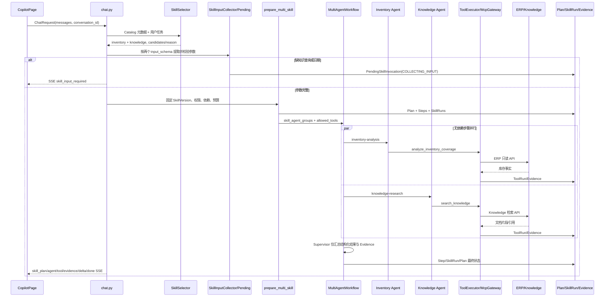

# V14.2 Agent Skills 高级设计与源码导读

> 本文以当前仓库为准。V14.2 新路径由 Feature Flag 控制；真实 PostgreSQL、IAM、ERP、Knowledge、Redis 和模型联合验收尚未完成，因此不能据此宣称生产就绪。

## 1. Skill 与 Agent

Skill 是经过审核、版本固定的任务契约：它声明输入输出 Schema、instructions、允许的 Agent/Tool、权限、预算和 Evidence 要求。Agent 是实际执行主体，仍由 `app/agents/registry.py` 注册。一个 Agent 可执行多个 Skill，一个 Skill 也可授权给多个 Agent；系统不会为每个 Skill 创建新 Agent。

运行时边界是交集而不是并集：

```text
Skill.allowed_tools
∩ Agent.allowed_tools
∩ Tenant governance
∩ User IAM permissions
∩ MCP server authorization
```

任何 Selector、instructions 或模型输出都不能扩大这个交集。

## 2. 混合 Skill Selector

入口为 `app/skills/selector.py::SkillSelector.select`。级联顺序是：

1. `EXPLICIT`：API 的 `skill_key` 或消息中的 `@skill-key`；仍会经过 Catalog 权限过滤。
2. `RULE`：名称、描述、别名和领域信号达到高阈值并与次候选拉开差距。
3. `SEMANTIC`：对 Catalog 元数据做通用轻量词项召回，不加载 instructions/resources。
4. `LLM`：仅在多个候选歧义时可选调用；严格 JSON、候选集、置信度和超时校验。
5. `NO_SKILL`：普通聊天、写请求、否定式操作、无候选或不可用 Skill。
6. `AMBIGUOUS`：候选差距不足，要求澄清而不是冒险执行。

当前所谓 `SEMANTIC` 是无外部向量服务的轻量召回，不是 Embedding。这样几十个 Skill 可低成本工作，也保留未来复用 Knowledge 向量能力的接口空间。禁用、未审核、跨租户或无权限 Skill 在 `SkillCatalog.available` 阶段已被过滤。

## 3. Intent / Complexity / Risk

`app/skills/classification.py::TaskClassifier.classify` 复用 V8 `AgentRouter` 的领域结果，输出严格的 `TaskClassification`：

- Intent：通用聊天、库存、订单、知识、采购、Workflow 或未知。
- Complexity：`SIMPLE / COMPOSITE / MULTI_DOMAIN`。
- Risk：`READ_ONLY / DRAFT_WRITE / APPROVAL_REQUIRED / HIGH_RISK`。
- `negative_action`：识别“不要删除”等否定式操作。

分类只是路由信号。最终授权仍由 IAM、Skill、Agent、ToolExecutor、租户治理和下游服务完成。写操作不会自动进入只读 Skill。

## 4. Skill 选择与 Tool 选择

Skill 选择回答“采用哪份经审核的任务契约”；Tool 选择回答“在这份契约允许的工具集合中，本步调用哪个工具”。前者发生在 LangGraph 前，后者发生在 Agent 推理中。`MultiAgentWorkflow._run_specialist` 会再次把专业 Agent 工具集与计划的 `allowed_tools` 求交，`ToolExecutor` 仍执行参数、权限、资源范围和下游授权检查。

## 5. 多轮参数补全

`app/skills/inputs.py::SkillInputCollector.collect` 从自然语言和显式参数提取 SKU、订单号、知识查询、日期范围等通用字段；必填项由当前 SkillVersion 的 `input_schema.required` 决定。日期“最近 N 天”按 `COPILOT_SKILL_BUSINESS_TIMEZONE`（默认 `Asia/Shanghai`）确定性计算，不允许模型猜日期。

缺字段时，`app/skills/pending.py::PendingSkillService.create` 持久化已确认参数、缺失字段、固定版本和选择快照。下一条消息由 `resume` 合并；修改字段会覆盖旧值，最终再次通过 JSON Schema。取消词会进入 `CANCELLED`，TTL 到期进入 `EXPIRED`。

## 6. Pending Skill 状态

Pending 与 SkillRun 分离，避免尚未执行就伪造 `RUNNING`：

```text
COLLECTING_INPUT -> READY -> 创建 Plan/SkillRun
       |              |
       +-> CANCELLED  +-> 执行态由 Plan/SkillRun 管理
       +-> EXPIRED
```

唯一约束绑定 tenant、user、conversation 和活动状态，防止跨租户、跨会话混用。恢复时重新检查 Skill 是否审核、启用以及用户权限；但继续使用最初固定的 SkillVersion。

## 7. 多 Skill 编排

`app/skills/orchestration.py::prepare_multi_skill` 把已选 Skill 转为受控 DAG：固定版本、校验 Schema/依赖/循环、步骤数、总 Token/时间预算、Agent 和 Tool 能力，随后原子写入 `SkillExecutionPlan`、`SkillExecutionPlanStep` 和每步一个 `SkillRun`。

`_topological_levels` 生成拓扑层：同层无依赖步骤可以并行，不同层顺序执行。上游只传递结构化结果，不传递任意代码。计划有总步骤数、深度、预算和超时上限，不能递归生成新 Skill。

## 8. LangGraph State

`app/graph/workflow.py::AgentRuntime` 增加 `agent_results` 与 `skill_agent_groups`。`app/graph/multi_agent.py` 在原图中增加 `skill_plan` 节点，而非另建执行框架：

```text
route -> skill_plan -> supervisor -> finalize
                 \-> existing specialist nodes
```

`_skill_plan` 按拓扑层运行专业 Agent，同层使用受控并发；每一步结果进入 `AgentResult`，最后仍由原 Supervisor 汇总。路由前后都会校验真实 Agent Registry 和 IAM。

## 9. Skill 与 Multi-Agent

计划步骤声明已审核的 `agent_name`。Inventory Agent 执行库存 Skill，Knowledge Agent 执行知识 Skill，Supervisor 只汇总已有结构化结果和 Evidence，不获得额外工具。专业身份不会被 `single_agent` 覆盖；实际工具边界在 `_run_specialist` 再次收紧。

## 10. Skill 与 Workflow

Skill 只读分析，Workflow 承担有副作用的业务流程。诸如创建采购单、调拨、退款、审批仍必须走原有草稿、预检、确认、Nonce、审批、幂等和回执机制。Skill 可以提供分析结果和 Evidence，但不能直接把 `READ_ONLY` 提升成写能力，也不能修改 Workflow 权限。

## 11. Progressive Disclosure

`app/skills/catalog.py` 仅查询 Metadata；选中后 `app/skills/loader.py::SkillRuntimeLoader` 才装载固定版本 instructions。Reference 只能通过受控资源名加载数据库快照，禁止任意路径和服务器文件访问。

`LoadedSkill.resource_metrics` 分别记录字节数、保守 Token 估计和加载耗时。字节数不是模型实际 Token；真实 Prompt/Completion Token 只在模型适配器返回可信 usage 时记录。未使用资源不注入上下文，缓存按 tenant/skill/version/resource 失效。

## 12. Skill 依赖

依赖在版本 `source_metadata.dependencies` 中声明，由 `EcosystemService._validate_skill_graph` 在创建版本、审核、启用和回滚时检查：依赖存在、已审核、租户一致、无自依赖/循环，且依赖权限不能扩大当前 Skill 权限。依赖是编排关系，不是可执行 Python 包，也不允许隐式安装代码。

## 13. 失败、超时与取消

- 模型、Tool、单 Skill、整 Plan 分层超时；错误写入脱敏 `safe_error`。
- 未开始的计划步骤在失败/取消后进入 `SKIPPED` 或 `CANCELLED`；已开始步骤按真实结果收敛。
- HTTP 断开只表示客户端不再接收，不保证已发出的外部请求停止。
- 当前只读工具可由既有策略有限重试；有副作用的工具仍依赖原 Workflow 幂等回执，Skill 不新增重试体系。
- 配额预留在成功结算，模型启动前失败释放，模型启动后失败按已有可信 usage 结算。
- 手动 Skill 继续使用 SkillRun 幂等键；计划使用 tenant/user/idempotency_key 唯一约束。

当前实现没有跨进程后台调度器，因此进程被终止后的自动恢复、正在进行的 HTTP Tool 强制中止仍未宣称完成。

## 14. Skill Evaluation

V14.2 复用 V9 Evaluation。`AgentEvaluationService.import_v14_skill_catalog` 生成 100 条可冻结 Replay Case；`evaluation/metrics.py` 增加：

- 选择：Accuracy、Precision、Recall、FPR、FNR、NO_SKILL Accuracy。
- 执行：成功率、Schema、Evidence、权限违规、超时、取消。
- 编排：计划有效率、依赖成功率、多 Skill 成功率、部分成功率、不必要调用率。
- 性能：沿用可信的延迟、Token、Tool/Model 次数和费用字段。

确定性规则指标与 LLM Judge 分开；Judge 不是绝对正确率。相同冻结数据集和环境指纹下，才能比较 baseline、Selector 配置或 SkillVersion。

## 15. 定位选择错误

查看 SkillRun 的 `selection_snapshot`：候选、分数、method、reason、classification。然后依次判断：Catalog 是否因租户/权限/启用状态过滤；Metadata 是否足够；阈值/Top-K 是否不合理；是否进入 LLM 裁决；模型结果是否因 Schema/候选集/置信度被拒绝。`skill_diagnostics` 把失败归类为未召回、误触发、冲突、参数等类别，并只提供人工建议。

## 16. 定位 Tool 错误

从 PlanStep/SkillRun 找到 agent、固定版本和 allowed_tools，再检查 Agent Registry 的工具集、租户治理交集、ToolRun 参数与状态、下游 HTTP 状态和 Evidence 来源。若模型建议了白名单外 Tool，ToolExecutor 应拒绝；不要通过扩大 Skill 白名单绕过根因。

## 17. Token 与延迟优化

优先走 explicit/rule fast path；只有歧义候选调用 LLM；Catalog 不加载正文；instructions 只加载选中版本；Reference 按需加载；同层只并行真正无依赖步骤；设置 Top-K、步骤数、模型调用数、Tool 次数、资源字节和总预算。没有真实环境测量时不得宣称百分比优化。

## 18. 发布新 SkillVersion

管理页或 `POST /ecosystem/skills/{skill_id}/versions` 创建新版本。系统校验 Schema、Agent、Tool、权限和依赖，创建后 Skill 自动回到待审核且禁用。审核通过后再显式启用。正在运行的任务继续引用原 `skill_version_id`，新任务才读取新版本。

## 19. 版本 Diff 与回滚

`GET /ecosystem/skills/{skill_id}/versions/diff?from_version=&to_version=` 返回结构化差异。回滚只移动当前版本指针，历史 SkillRun 不变；为防止旧授权复活，回滚后必须重新审核并启用。

## 20. 生产安全约束

多租户复合外键、IAM 权限、Tool/Agent 白名单、资源范围、MCP 授权、Schema、预算、Evidence 校验和下游服务校验缺一不可。SKILL.md、references、用户输入和上游 Agent 结果均是不可信内容；它们不能覆盖系统安全约束。scripts/ 始终不可执行，不提供 Python/Shell/JavaScript 沙箱。JWT、密钥、完整请求头和未经控制的业务全文不进入 Trace。

## V14.2 一条真实业务完整调用链

示例：“分析 SKU-001 最近 30 天库存风险，并查询知识库中的补货制度。”



### 逐步断点表

| 步骤 | 文件与函数 | 主要输入 → 输出 | 作用、下一步与建议断点 |
|---|---|---|---|
| 1 | `app/api/v1/chat.py::chat_stream` | `ChatRequest` → SSE | 建立租户/用户上下文与配额；断点：解析 payload 后；下一步 `prepare_chat_skill`。 |
| 2 | `app/skills/chat.py::prepare_chat_skill` | 用户文本、Catalog、adapter → 单/多 Skill 会话或 Pending | 串起恢复、选择、参数和加载；断点：Catalog 返回后。 |
| 3 | `app/skills/catalog.py::SkillCatalog.available` | tenant/user permissions → Metadata 列表 | 只召回已审核启用且有权 Skill；断点：SQL 结果过滤处。 |
| 4 | `app/skills/classification.py::TaskClassifier.classify` | task → intent/complexity/risk | 复用 AgentRouter，产生辅助信号；断点：`route` 后。 |
| 5 | `app/skills/selector.py::SkillSelector.select` | task + Catalog → `SkillSelection` | 级联选择、候选和理由；断点：`_recall` 后及 LLM 校验处。 |
| 6 | `app/skills/inputs.py::SkillInputCollector.collect` | task + JSON Schema + 已有值 → values/missing | 确定性提取和最终 Schema 前置；断点：日期计算、required 检查。 |
| 7 | `app/skills/pending.py::PendingSkillService.create_plan/resume` | 固定版本、部分参数 → Pending/恢复结果 | 持久化跨轮状态；断点：commit 前和恢复权限复查处。 |
| 8 | `app/skills/loader.py::SkillRuntimeLoader.load` | version_id → `LoadedSkill` | 加载固定 instructions/按需 resources 和成本；断点：资源名验证处。 |
| 9 | `app/skills/orchestration.py::prepare_multi_skill` | selected skills + inputs → `MultiSkillChatSession` | 校验依赖、预算、Agent/Tool 并原子建 Plan；断点：`_topological_levels` 与 commit 前。 |
| 10 | `app/graph/multi_agent.py::MultiAgentWorkflow._route/_skill_plan` | AgentRuntime/计划组 → AgentResults | 在既有 LangGraph 按拓扑层调度；断点：每层 `gather` 前后。 |
| 11 | `app/graph/multi_agent.py::_run_specialist` | 专业 Agent + 受限 runtime → `AgentResult` | 再次求 Tool 交集并保留 Agent 身份；断点：创建隔离 runtime 后。 |
| 12 | `app/tools/executor.py::ToolExecutor` | ToolCall + ToolRuntime → Tool 结果/Evidence | 重做授权、参数和资源范围校验；断点：实际 HTTP 调用前后。 |
| 13 | `app/skills/orchestration.py::MultiSkillChatSession.complete` | AgentResults/Evidence → Plan/Step/SkillRun 终态 | 验证每步 output schema/evidence，收敛部分失败；断点：逐步验证处。 |
| 14 | `app/services/persistent_chat.py` | 生命周期事件 → Message/摘要/SSE | 关联 conversation/message/plan/run，输出用户可见事件；断点：事件映射处。 |
| 15 | `apps/copilot/src/pages/CopilotPage.tsx`、`components/SkillRunCard.tsx` | SSE → 计划、步骤、结果卡片 | 不伪装后台任务，展示选择理由、步骤和 Evidence；断点：SSE event switch。 |

### 当前可复现边界

自动化测试可复现选择、参数合并、DAG、Schema/Evidence/权限边界和前端渲染；真实 ERP、Knowledge、IAM、PostgreSQL、Redis 与模型联合调用需要按部署环境配置后执行 `test_v14_skill_postgres_integration.py` 和业务 E2E。当前文档不把 Mock HTTP/LLM 等同于真实服务验收。

## 本次测试记录（2026-11-19）

- 后端定向回归：`54 passed, 3 skipped`；覆盖 V14.2 Selector、输入补全、Loader、DAG、Multi-Agent、Evaluation、V12 生命周期和 V14 Skill Runtime。
- 后端全量：`134 passed, 8 failed, 15 skipped`。8 个失败均为旧 Chat/SSE 测试在没有 PostgreSQL V11 治理配置时预检返回 503；可单独复现。15 个跳过中 12 个是未设置 `COPILOT_TEST_DATABASE_URL` 的 PostgreSQL 集成测试，其余为原测试条件跳过。
- PostgreSQL 集成入口：`12 skipped`，原因是未配置真实测试数据库；迁移 upgrade/downgrade 离线 SQL、单 head 和 48 张 SQLAlchemy 表元数据装载通过，但不等价于真实迁移验收。
- 前端：生产构建与 ESLint 通过；V14.2 相关 3 个组件测试通过。全量为 `23 passed, 1 failed`，唯一失败是既有 `InsightCenterPage.test.tsx` 未提供 Router，而页面调用 `useNavigate`。
- 外部系统：本机未提供真实 IAM、ERP、Knowledge、Redis、LLM 联合环境，尚未完成复杂业务 E2E、真实取消、并发和 P50/P95/成本验收。
