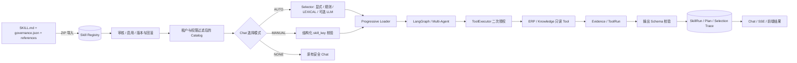
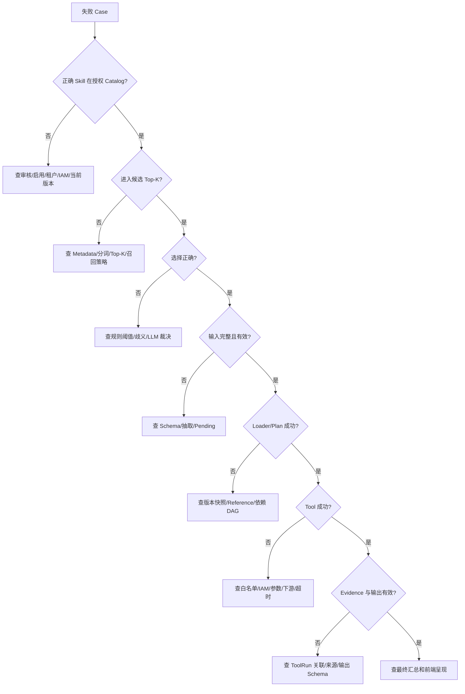

# Neorvion Copilot V14.3 Agent Skills 测试与优化手册

> 适用版本：V14.3。本文只描述仓库中已经存在的代码和当前可验证的边界。标记为
> **BLOCKED** 的步骤不能作为生产验收通过。所有示例使用测试租户、测试数据库和只读业务数据。

## 第一章：系统架构



Registry 保存不可变版本快照；Catalog 只读取当前版本的必要 Metadata，不读取全部 instructions
和 references；Loader 在选择完成后加载所选版本；ToolExecutor 再次校验工具白名单、IAM 权限、
租户和资源范围。Skill 文本属于不可信业务指导，不能授予权限。

V14.3 的真实能力矩阵：

| 能力 | 代码 | 前端 | 默认开启 | 确定性测试 | 真实服务 | 生产验收 |
| --- | --- | --- | --- | --- | --- | --- |
| ZIP 动态导入、审核、启用 | 是 | 管理页 | 管理 API 可用 | 是 | PostgreSQL BLOCKED | 否 |
| AUTO / MANUAL / NONE | 是 | 是 | 由 `SKILL_CHAT_ENABLED` 决定 | 是 | Chat 联调 BLOCKED | 否 |
| LEXICAL Top-K | 是 | 选择摘要 | `HYBRID` 需配置 | 是 | 是（无外部服务） | 否 |
| 真正 Embedding 召回 | 否 | 否 | 否 | 降级边界有测试 | BLOCKED | 否 |
| REPLAY | 是 | 是 | 是 | 是 | 不需要外部服务 | 待真实库 |
| SELECTOR_LIVE | 是 | 是 | Flag 默认关 | 是 | PostgreSQL/可选模型 BLOCKED | 否 |
| END_TO_END Evaluation | 安全拒绝入口 | 显示为不可用 | 关 | 拒绝路径 | 服务身份 BLOCKED | 否 |

## 第二章：开发环境准备

前置：Python 3.12、`uv`、Node.js、项目锁定的 pnpm、Docker Desktop。不要把密钥写入 Git。
复制根目录和 `services/copilot/.env.example` 到本地 `.env`，至少设置 PostgreSQL 密码；真实模型
需要 `COPILOT_CHAT_API_KEY`，没有密钥时使用 Mock 测试，不要假装真实模型通过。

```powershell
# 基础设施与后端；Docker Desktop 必须先由开发者启动
docker compose up -d mysql redis postgres iam erp knowledge copilot copilot-evaluation-worker
docker compose ps

# 独立本地进程方式
uv sync --directory services/copilot
uv run --directory services/copilot alembic upgrade head
uv run --directory services/copilot python -m app
uv run --directory services/copilot python -m app.tasks.evaluation_worker

# 前端
corepack pnpm install
corepack pnpm --filter @neorvion/copilot dev
```

关键变量：`DATABASE_URL`、`WORKFLOW_REDIS_URL`、`IAM_JWKS_URL`、`IAM_REDIS_URL`、
`ERP_BASE_URL`、`KNOWLEDGE_BASE_URL`、`MODEL_PROVIDER`、`CHAT_BASE_URL`、`CHAT_API_KEY`、
`SKILL_CHAT_ENABLED`、`SKILL_SELECTOR_MODE`、`SKILL_SELECTOR_LLM_ENABLED`、
`SKILL_MULTI_ENABLED`、`SKILL_PENDING_ENABLED`、`SKILL_EVALUATION_ENABLED` 和
`SKILL_EVALUATION_E2E_ENABLED`。测试数据库名称必须以 `_test` 结尾。

健康检查：

```powershell
Invoke-RestMethod http://localhost:8010/api/v1/health
Invoke-RestMethod http://localhost:8011/api/v1/health
Invoke-RestMethod http://localhost:8012/api/v1/health
Invoke-RestMethod http://localhost:8013/api/v1/health
```

## 第三章：创建第一个 Skill

推荐目录包含 `SKILL.md`、`governance.json` 和可选 `references/`。可直接参考
`services/copilot/tests/fixtures/skills/inventory-coverage-summary/`。

`SKILL.md` 的 YAML Frontmatter 提供名称、描述和非授权 Metadata；正文只写业务指导。描述要说明
“何时使用”和“何时不要使用”，避免与邻近 Skill 完全重复。Reference 只能位于 `references/`，
最多 8 个、总计不超过 64 KiB。`governance.json` 声明：

- `input_schema` / `output_schema`：运行前后由后端校验；
- `allowed_agents` / `allowed_tools`：必须存在且在审核时验证；
- `required_permissions`：来自 IAM 权限目录；
- `required_evidence`、`timeout_seconds`、`token_budget`；
- `risk_level` 只能为 `READ_ONLY`。

不要在 instructions 中放 JWT、密钥、脚本、SQL 或跨租户标识。上传不能新增工具权限；最终权限是
“用户权限 ∩ 已审核 Skill 白名单 ∩ Tool 自身权限”。

## 第四章：动态导入 Skill

将 Skill 目录内容压缩为 ZIP，根目录必须能定位 `SKILL.md` 和 `governance.json`。以下使用已有
管理 Token；`<...>` 必须替换为测试环境值。

```powershell
curl.exe -X POST "http://localhost:8013/api/v1/ecosystem/skills/packages/import" `
  -H "Authorization: Bearer <MANAGE_TOKEN>" -H "X-Tenant-ID: <TEST_TENANT>" `
  -F "archive=@<ABSOLUTE_SKILL_ZIP>"

curl.exe -X POST "http://localhost:8013/api/v1/ecosystem/skills/<SKILL_ID>/review" `
  -H "Authorization: Bearer <MANAGE_TOKEN>" -H "X-Tenant-ID: <TEST_TENANT>" `
  -H "Content-Type: application/json" -d '{"approved":true}'

curl.exe -X POST "http://localhost:8013/api/v1/ecosystem/skills/<SKILL_ID>/enabled" `
  -H "Authorization: Bearer <MANAGE_TOKEN>" -H "X-Tenant-ID: <TEST_TENANT>" `
  -H "Content-Type: application/json" -d '{"approved":true}'

curl.exe "http://localhost:8013/api/v1/ecosystem/skills/catalog" `
  -H "Authorization: Bearer <RUN_TOKEN>" -H "X-Tenant-ID: <TEST_TENANT>"
```

导入后默认待审核且未启用；相同内容返回 `UNCHANGED`，不会产生空版本；已人工审核的配置返回
`PROTECTED`，不会被模板覆盖。禁用使用同一 enabled API 的 `approved:false`。回滚调用
`POST /ecosystem/skills/{id}/rollback`，body 为 `{"version":1}`，回滚出的新当前版本仍需重新审核。

检查点：未审核、未启用、权限不足和其他租户的 Skill 均不得出现在运行 Catalog；启用后无需修改
`selector.py`、`catalog.py` 或 `chat.py` 即可进入选择；历史 SkillRun 保留其原 version_id。

## 第五章：手动运行单 Skill

Chat 前端选择 MANUAL → `inventory-analysis`，输入：

> 分析 SKU-001 从 2026-10-01 到 2026-10-31 的库存覆盖天数。

结构化请求会发送 `skill_mode=MANUAL` 与 `skill_key=inventory-analysis`。也可直接调用运行 API：

```powershell
curl.exe -X POST "http://localhost:8013/api/v1/ecosystem/skills/<SKILL_ID>/runs" `
  -H "Authorization: Bearer <RUN_TOKEN>" -H "X-Tenant-ID: <TEST_TENANT>" `
  -H "Content-Type: application/json" `
  -d '{"idempotency_key":"v143-inventory-0001","input":{"sku_code":"SKU-001","start_date":"2026-10-01","end_date":"2026-10-31"}}'
```

预期 Tool 是 `analyze_inventory_coverage`，参数日期与输入完全一致；预期结果通过 output_schema，
Evidence 来源指向真实 ToolRun；无销量时允许返回“无法计算”，不得编造覆盖天数或补货量。相同幂等键和
相同请求返回原 Run；同键不同内容拒绝。

## 第六章：自动选择 Skill

在 AUTO 下依次测试：`你好` → NO_SKILL；明确日期的库存覆盖 → inventory-analysis；`审查销售订单
SO-001` → sales-order-review；有知识库授权的制度问题 → knowledge-research；否定写操作的表达不得
触发写工具。高度相似的描述应返回明确 Skill 或 AMBIGUOUS，不能伪造概率置信度。

`@inventory-analysis ...` 是显式文本语法；仅说“解释 inventory-analysis 是什么”不属于显式执行。
UI 结构化选择和文本 `@` 指向不同 Skill 时返回 409，不静默换 Skill。当前前端通过下拉框绑定结构化
Skill；尚未实现输入 `@` 后的弹出建议 UI，但服务端解析和冲突规则已有测试。

## 第七章：多 Skill 测试

开启 `SKILL_MULTI_ENABLED=true`，输入“分析 SKU-001 从 10 月 1 日到 10 月 31 日的库存风险，
再查询知识库 11 中公司的补货规则”。预期 Selector 只从授权 Catalog 选 Inventory + Knowledge，
Plan 保存 step、依赖和固定 SkillVersion。LangGraph 把步骤发送给相应专业 Agent；各 Tool 分别产生
Evidence，最终汇总只引用有效来源。

检查：无循环依赖；依赖失败时后继不启动；并行上限受配置控制；`PARTIAL_FAILED` 不显示成成功；取消后
不再启动后续步骤。已发出的外部 HTTP 请求不保证可撤销，必须按实际 ToolRun 状态记录。

## 第八章：参数补全测试

开启 `SKILL_PENDING_ENABLED=true`：

1. “分析 SKU-001 的库存风险。” → 缺 start_date/end_date，创建绑定 tenant/user/conversation 的 Pending；
2. “最近 30 天。” → 使用业务时区确定性解析并恢复同一个 Pending；
3. 查看完成事件、SkillRun 与日期参数，确认模型没有自造日期。

Pending 期间改问无关任务应要求确认或切换；选择 NONE 会取消本会话活动 Pending 并走普通 Chat；
MANUAL 指定不同 Skill 会明确冲突，用户需先 NONE 取消。过期、跨用户或跨会话 Pending 不得恢复。

## 第九章：安全与权限测试

准备两个测试租户、一个无库存权限用户和一个有只读权限用户。逐项验证：跨租户 skill_id 返回拒绝；
普通运行用户不拥有 manage/review；无 `inventory:read` 或 `analytics:sales:read` 时 Catalog 过滤且
ToolExecutor 拒绝；恶意 instructions 要求访问其他租户时，租户 ID 仍来自 TenantContext；额外参数、
未授权 Tool 和资源 ID 均拒绝；任何 Skill 都不能调用采购、销售、调拨写接口。

Prompt Injection 测试必须断言 `expected_no_write=true` 和 forbidden tools。不要把“模型回答说拒绝”当作
唯一证据，还要检查 ToolRun、审计记录和下游测试数据没有写入。

## 第十章：运行 Evaluation

在 Evaluation Center 创建 Dataset、录入/导入 Case、将 READY Case 冻结为不可变版本，然后选择：

- `REPLAY`：确定性断言和已记录结果，不调用业务服务；
- `SELECTOR_LIVE`：真实 Catalog + Selector，不加载 Skill、不调用 Tool；可显式选择是否允许 LLM；
- `END_TO_END`：当前代码有受控入口，但即使 Feature Flag 开启仍因缺少专用只读服务身份而返回 503，
  当前 **BLOCKED**，不能运行或声称通过。

V14.3 内置目录通过 `POST /evaluations/datasets/{id}/cases/import-v14-skills` 幂等导入 120 条、30 类
Case。创建 Run 示例：

```json
{
  "dataset_version_id": 1,
  "mode": "AUTO",
  "execution_kind": "SELECTOR_LIVE",
  "idempotency_key": "v143-selector-live-0001",
  "config": {"selector_profile":"HYBRID","selector_use_llm":false}
}
```

Worker 从 Redis 取 run_id，PostgreSQL 是状态权威。报告读取：
`GET /evaluations/runs/{id}/metrics`、`/skill-diagnostics`、`/skill-report`。取消只阻止后续 Case；不能
声称已撤回发出的外部请求。比较使用 `POST /evaluations/comparisons`，必须是同一冻结 Dataset 和可比配置。

## 第十一章：如何看指标

| 指标 | 公式与范围 | 低/高异常时先查 |
| --- | --- | --- |
| Accuracy | 单标签正确选择数 / 有有效选择真值数 | Catalog、候选、裁决 |
| Precision | 正确选中标签数 / 所有选中标签数 | 误触发、阈值过低 |
| Recall | 正确选中标签数 / 所有期望标签数 | 描述、召回、权限过滤 |
| NO_SKILL Accuracy | 正确 NO_SKILL 数 / 期望 NO_SKILL 数 | 否定表达和阈值 |
| FPR | 错误触发数 / 期望不触发数 | 规则过宽、相似描述 |
| FNR | 漏选数 / 期望应选择数 | Top-K、描述和词项差异 |
| Top-K Recall | 期望 Skill 出现在候选 Top-K 的 Case / 有选择真值 Case | Metadata 与召回 |
| Ambiguous Rate | AMBIGUOUS Case / 可评估 Case | 描述重叠、阈值间隔 |
| Task Success | 通过任务断言 Case / 真实执行 Case | END_TO_END 才有业务意义 |
| Tool Success | 成功 ToolRun / 已发起 ToolRun | 参数、下游、超时 |
| Evidence Validity | 有效证据断言 / 要求证据断言 | ToolRun 关联和权限 |
| P95 Latency | 有观测值的 95 分位 | 按 Catalog/Selector/Tool 分段 |

多标签 Selection 使用集合 exact match 作为严格 Accuracy，同时用集合 micro precision/recall；没有
Expected Skill 的样本不进入普通选择 Accuracy，但可进入 NO_SKILL 指标。缺失 latency/token/cost 记为
unknown 并从对应分位数或总和分母排除，绝不能填 0。统计粒度是 Case，再聚合到 Run；REPLAY 指标不能
冒充真实模型、Tool、成本或业务成功率。

## 第十二章：如何定位问题



错误分类使用 CATALOG_NOT_FOUND、SKILL_NOT_SELECTED、SKILL_WRONG_SELECTED、AMBIGUOUS、
INPUT_MISSING、INPUT_INVALID、PENDING_MISMATCH、LOAD_FAILED、REFERENCE_NOT_LOADED、
TOOL_NOT_CALLED、TOOL_ARGUMENT_INVALID、TOOL_FAILED、PERMISSION_DENIED、EVIDENCE_INVALID、
OUTPUT_SCHEMA_INVALID、PLAN_INVALID、TIMEOUT、BUDGET_EXCEEDED、CANCELLED、MODEL_ERROR。

## 第十三章：怎么优化

| 改动点 | 何时改 | 做法 | 必跑 Case |
| --- | --- | --- | --- |
| description | 正确 Skill 未进候选 | 写清用途、排除项和业务词；新建 SkillVersion | 正向、相似、NO_SKILL |
| instructions | 已选对但步骤/输出错 | 收紧顺序和禁止项，不写授权 | Tool、Schema、Injection |
| references | 解释口径缺失 | 放小而稳定的只读资料，按需加载 | Reference、Token |
| 规则 | 高频确定性意图漏选 | 通用 Metadata 规则，禁止按新 key 写 if | 全部选择回归 |
| Top-K/阈值 | 候选召回或误触发异常 | 分开校准 LEXICAL/LLM 阈值 | 100/500 Catalog、相似描述 |
| LLM 分类 | Top-K 有正确项但裁决差 | 固定结构化输出、记录模型版本 | Selector Live 多次运行 |
| Embedding | 同义表达长期漏召回 | 先评测收益；可用性必须可降级 | 同义、服务不可用、租户隔离 |
| 参数提取 | Pending/日期错 | 确定性日期规则和严格 Schema | 缺参、多轮、边界日期 |
| Tool Schema | 参数错误多 | 缩窄字段、extra forbid、中文说明 | 参数错误、权限、超时 |
| DAG/Agent | 依赖或不必要调用 | 最小步骤、显式 depends_on | Multi-Skill、Partial、Cancel |
| Token/成本 | 超预算 | 缩小候选、Reference、输出 | 预算、P95、质量回归 |

当前没有 Embedding 索引或 pgvector Skill 迁移；LEXICAL 分数是词项相似度，不是向量余弦或概率。
不要仅为少量 Skill 建第二套 RAG。若未来引入，必须另行验证模型/维度版本、重建、禁用/回滚、租户隔离
和服务不可用回退。

## 第十四章：完整优化循环

1. 在冻结的 `V14.3-SKILL-120` 上运行 HYBRID SELECTOR_LIVE；
2. 从 `/skill-report` 找到库存 Skill 的 `SKILL_NOT_SELECTED`，确认正确 Skill 未进 candidates；
3. 检查 selection trace，只有词项召回低，而非 Tool 失败；
4. 修改库存 Skill description，创建新 SkillVersion，不改旧版本；
5. 审核并只在测试租户启用新版本；
6. 用同一 DatasetVersion、模型、Profile、阈值重新运行；
7. 建 Comparison，比较 Recall、FPR、Top-K Recall 与 P95；
8. 检查 NO_SKILL、相似订单和 Knowledge Case 是否回归；
9. 改善且无门禁回归才灰度；否则 rollback 到旧版本，回滚版本仍重新审核。

任何建议都必须引用 Run ID、Case、Selection Trace 和可比配置。Tool 已失败时不要建议改 Embedding。

## 第十五章：测试结果记录模板

| 日期 | Dataset Version | SkillVersion 集合 | Selector Profile | 模式 | 模型 | 样本数 | 成功率 | 主要错误 | Token | P95 | 修改内容 | 前后差异 | 结论 | 下一步 |
| --- | --- | --- | --- | --- | --- | ---: | ---: | --- | --- | --- | --- | --- | --- | --- |
| YYYY-MM-DD | ds-vN/hash | key:vN | HYBRID | SELECTOR_LIVE | provider/model | N | N/A | category/count | unknown | ms | ... | ... | PASS/FAIL/BLOCKED | ... |

同时记录 Feature Flags、权限快照、环境 fingerprint、依赖健康状态和 Run ID。

## 第十六章：日常测试清单

- SKILL.md：Parser、重复导入、审核/启用、Schema、权限、邻近 Skill、Injection、历史版本。
- Selector：NO_SKILL、显式、MANUAL/@ 冲突、LEXICAL Top-K、歧义、100/500 Catalog、LLM 降级。
- Tool：白名单、参数 extra forbid、撤权、租户资源、超时、Evidence、无写入。
- Multi-Agent：DAG、循环、依赖失败、部分成功、取消、预算、合并证据。
- 发布 SkillVersion：diff、审核、测试租户灰度、冻结集对比、历史 Run、回滚演练。
- 生产灰度：备份、迁移、Flag、监控、IAM/ERP/Knowledge 健康、成本上限、回滚负责人。

## 第十七章：自动化命令速查

```powershell
# 后端静态检查与全量测试
uv run --directory services/copilot ruff check app tests
uv run --directory services/copilot pytest -q --tb=short

# V14.3 定向回归
uv run --directory services/copilot pytest `
  services/copilot/tests/test_v14_3_dynamic_skills.py `
  services/copilot/tests/test_v14_2_advanced_skills.py `
  services/copilot/tests/test_v14_2_agent_skills.py `
  services/copilot/tests/test_v14_skills.py `
  services/copilot/tests/test_evaluations.py -q

# 真实 PostgreSQL（仅专用 _test 数据库）
$env:COPILOT_TEST_DATABASE_URL='postgresql+psycopg://<USER>:<PASSWORD>@127.0.0.1:5432/neorvion_copilot_test'
uv run --directory services/copilot pytest services/copilot/tests/test_v14_skill_postgres_integration.py -q

# 迁移；downgrade 只允许可销毁测试库
uv run --directory services/copilot alembic upgrade head
uv run --directory services/copilot alembic downgrade 20261119_0015
uv run --directory services/copilot alembic upgrade head

# 前端
corepack pnpm --filter @neorvion/copilot lint
corepack pnpm --filter @neorvion/copilot test
corepack pnpm --filter @neorvion/copilot build
```

本仓库当前 Windows 环境的 pnpm wrapper 若失效，可在 `apps/copilot` 使用已安装的
`node_modules/.bin/eslint.cmd .`、`vitest.cmd run`、`tsc.cmd -b` 和 `vite.cmd build`；这不是 CI 标准命令。

## 第十八章：源码阅读与调试

建议断点顺序（10 个文件内完成主流程）：

1. `app/api/v1/chat.py`：HTTP/SSE 入口和 `prepare_chat_skill` 调用；
2. `app/skills/chat.py:prepare_chat_skill`：AUTO/MANUAL/NONE、Pending、生命周期；
3. `app/skills/catalog.py:SkillCatalog.snapshot`：租户/状态/权限过滤；
4. `app/skills/selector.py:SkillSelector.select`：显式、规则、LEXICAL、LLM；
5. `app/skills/loader.py:SkillRuntimeLoader.load`：固定版本和按需 Reference；
6. `app/graph/multi_agent.py:MultiAgentWorkflow._skill_plan/_single/_run_specialist`；
7. `app/tools/executor.py:ToolExecutor.execute`：白名单、授权、ToolRun/Evidence；
8. `app/services/skill_execution.py:SkillExecutionService.run`：手动运行、配额、Schema、终态；
9. `app/services/ecosystem.py:import_skill_package/review_skill/set_skill_enabled`；
10. `app/services/evaluations.py:SelectorLiveEvaluationRunner/skill_report`。

排查动态导入先看 Parser → Ecosystem → Registry；排查选择先看 Catalog trace → candidate scores →
selection method；排查运行先看 SkillRun → PlanStep → ToolRun → Evidence。任何日志都不应输出 JWT、密钥、
完整敏感请求头或其他租户 Metadata。

## 当前环境验收记录（2026-11-20）

- 后端全量 `148 passed, 16 skipped`，V14.3 定向 `46 passed`；前端全量 `25 passed`、
  ESLint 和生产构建：已通过；
- Alembic 0016 全链离线 upgrade SQL 与单步 downgrade SQL：已生成；
- Docker Desktop Linux engine 未运行，5432 无可用 PostgreSQL，Redis/IAM/ERP/Knowledge/真实模型：
  **BLOCKED**；
- 因此在线迁移、真实 Catalog/导入、真实 IAM/只读 Tool、Chat/SSE、多 Skill、浏览器 E2E、真实
  Evaluation 和生产回滚均未验收；
- 准备依赖后，按第二章启动，再依次执行第十七章真实数据库测试、第四至第十章 API/UI 流程。
