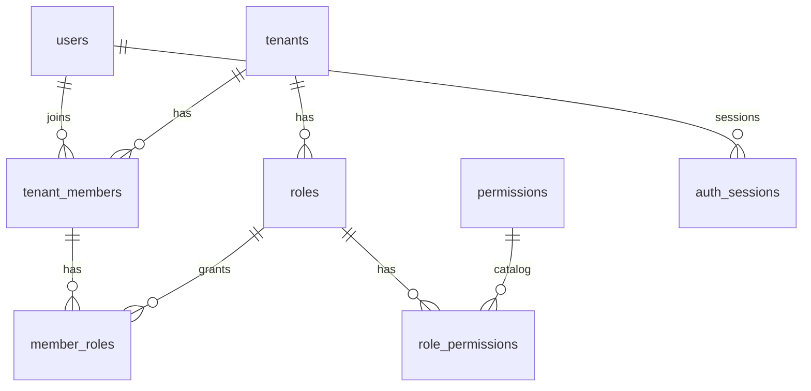
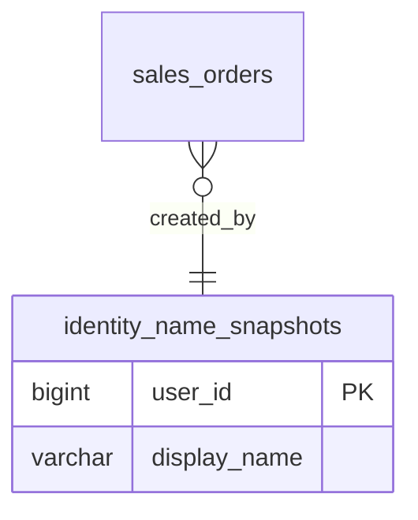
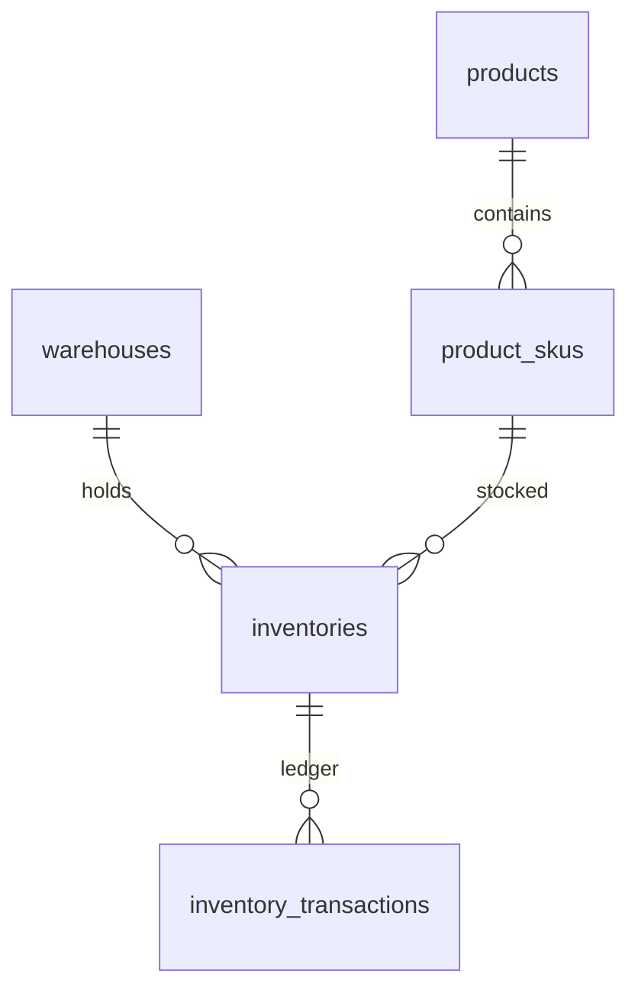
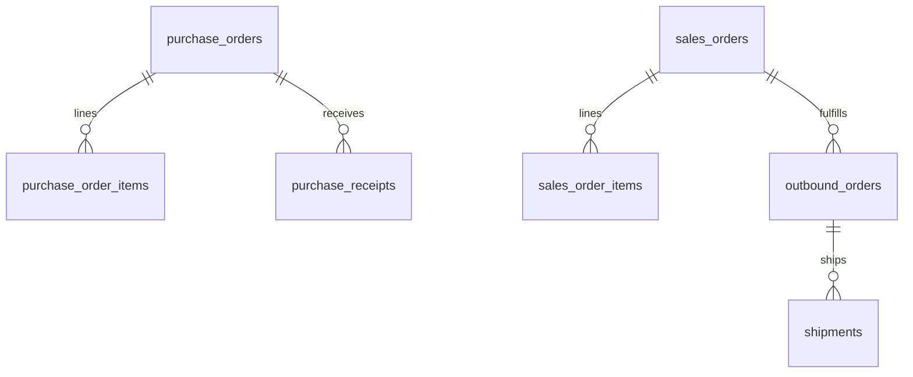
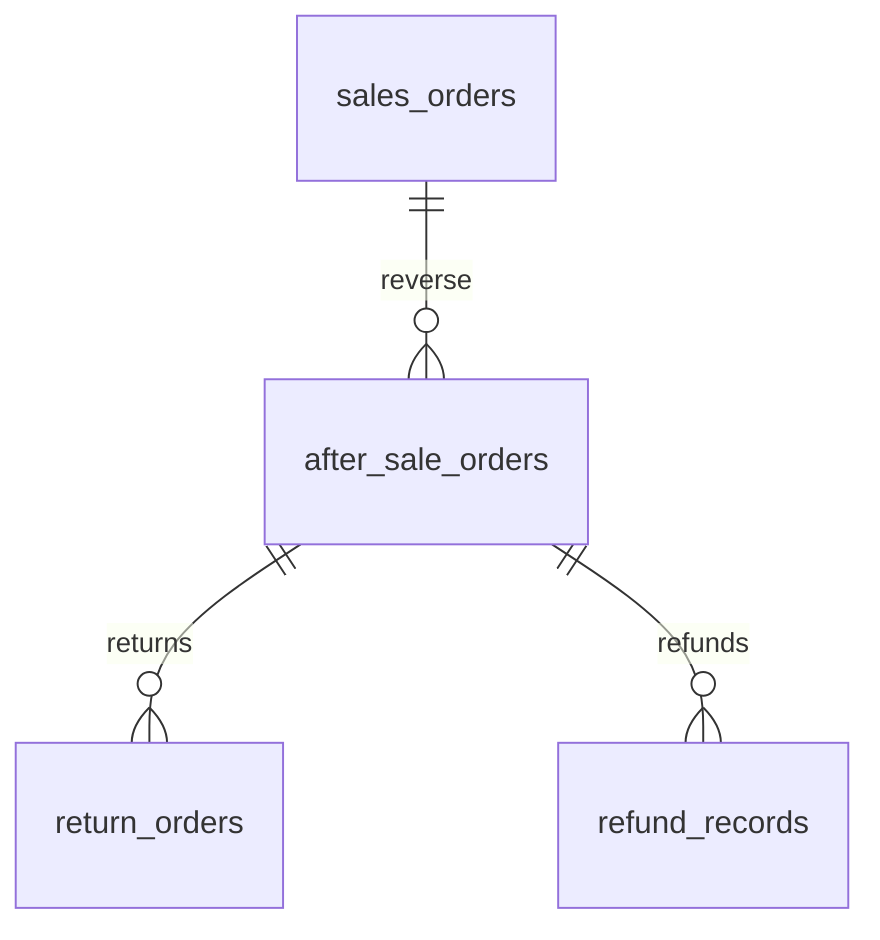
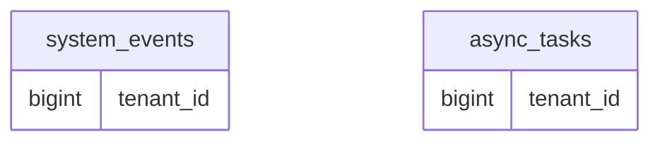

# 核心 ER（示意）

不是全库 45+ 张表。只帮助建立心智模型。

## IAM 身份 / RBAC（`neorvion_iam`）

ERP 不再持有这些表。跨服务只引用整数 ID。

## ERP 展示名快照（`neorvion_erp`）

`sales_orders.created_by` 等列**没有**外键，JOIN 快照只为展示。

## 商品 / 库存

## 采购 / 销售 / 履约

## 售后 / 事件

`system_events` / `async_tasks` 带 `tenant_id` 整数，不指向 IAM `tenants` 表。

