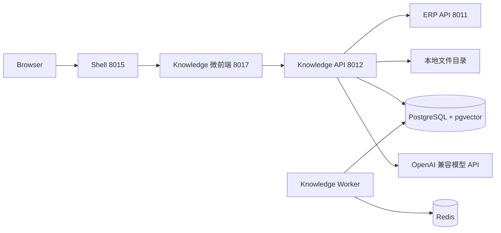

# Neorvion Knowledge V3

独立 AI 知识库：V1 知识库 CRUD → V2 文档解析与切片 → V3 RAG 检索与智能问答。身份、租户、RBAC 仍以 ERP MySQL 为权威来源。

## 与 ERP 的关系



- 登录、Refresh、租户切换仍由 Shell + ERP 负责。
- Knowledge 先验签 JWT，再调用 ERP `POST /api/v1/internal/identity/introspect`。
- 前端传入的 `X-Tenant-ID` 只是意愿，不能单独采信。
- 权限沿用 `knowledge:read/create/update/delete`。检索与问答需要 read；重建索引与模型连通测试需要 update。
- 模型密钥只在 Knowledge 服务端环境变量中，不返回前端，也不写入 Git。

## 信息架构

| 菜单 | 路由 | 说明 |
| --- | --- | --- |
| 工作台 | `/workbench` | 知识库/文档/切片数量、最近文档、待处理任务 |
| 智能搜索 | `/search` | 真实检索引擎：VECTOR / KEYWORD / HYBRID |
| 知识问答 | `/chat`、`/chat/:id` | 会话、SSE 流式回答、引用来源 |
| 知识库 | `/bases` | V1 CRUD |
| 知识库详情 | `/bases/:id` | 概览、文档、切片、向量索引状态与重建 |
| 文档详情 | `/bases/:id/documents/:docId` | 解析预览、切片编辑启停、任务与重试 |
| 检索测试 | `/retrieval-test` | 与问答共用检索引擎，展示排名与耗时 |
| 处理任务 | `/tasks` | PARSE / CHUNK / EMBED |
| 模型配置 | `/models` | 平台级 Chat / Embedding / Rerank（无密钥明文） |

未实现的知识空间文章、V4 评测集不展示空菜单。成员与角色仍在 ERP。

切租户后：`/bases/:id` 与文档详情回到工作台，`/chat/:id` 回到 `/chat`，任务详情回到 `/tasks`。Query Key 带 `tenantId`；页面 `epoch` 会卸掉局部状态并中止进行中的 SSE。前端取消的是浏览器请求，不会取消服务端已落库的解析/索引任务。

## 数据库

迁移：`20261013_0001`（V1）→ `20261013_0002`（V2）→ `20261013_0003`（V3：pgvector + 会话）。

V1/V2 表保持不变。V3 增量：

- `document_chunks.search_tsv`：`to_tsvector('simple', content)` 生成列 + GIN；另有 `gin_trgm_ops`。这不是 BM25。
- `chunk_embeddings`：一条切片一行向量。记录 `model_name`、`dimensions`、`content_hash`、`chunk_version`、`PENDING/READY/STALE/FAILED`。检索只使用当前模型、当前维度、`READY`、且 `chunk_version` 与文档 `active_chunk_version` 匹配的行。
- `model_profiles`：平台系统配置镜像（密钥只引用环境变量名）。
- `conversations` / `messages` / `message_citations`：会话、消息、引用来源。
- `retrieval_logs`：检索参数、阶段耗时与排名，供测试页解释。

复合外键始终带 `tenant_id`。索引失败不得破坏 V2 文档与切片。

向量列维度取自迁移时的 `EMBEDDING_DIMENSIONS`（默认 1024）。测试库使用 8 维。**更换维度必须重建迁移或新开库，并全量重建索引。**

## Embedding 与索引

- 供应商：`MODEL_PROVIDER=openai_compat`（兼容 DashScope / Qwen 等 OpenAI 协议）或测试用 `mock`。
- 默认建议：`text-embedding-v3`，维度 1024。查询与文档必须同一模型与维度。
- 批量大小 `EMBEDDING_BATCH_SIZE`（默认 16），后台任务 `TaskType.EMBED`，失败可重试。429 / 5xx 可重试，401 / 402 不盲目重试。
- Chunk 编辑会标记向量 `STALE` 并排队重建；禁用切片不删向量，但检索 SQL 排除 `enabled=false`；删除文档会使进行中 EMBED 失败。
- 当前数据规模走精确余弦 kNN（`cosine_distance`），**不建 HNSW**。小数据 + 多租户 `WHERE` 过滤时 HNSW 容易降低召回。

## 检索引擎

三种策略共用 `RetrievalService.search`，智能搜索 / 检索测试 / 问答不得分叉实现。

| 策略 | 实现 |
| --- | --- |
| VECTOR | Embedding 查询向量 + pgvector 余弦距离，相似度 = `1 - distance` |
| KEYWORD | PostgreSQL `simple` FTS + `pg_trgm` + 中文 `ILIKE`。**不是 BM25** |
| HYBRID | 两路召回后 RRF（`k=60`）融合，按 `chunk_id` 去重 |

可选 Rerank：模型不可用或抛错时降级到融合结果，并标记 `rerank_degraded`。

分数不要混用：向量相似度、关键词分、RRF、Rerank 各自独立，阈值只作用在对应一路。

**租户与授权过滤全部在 SQL `WHERE` 中完成**（`tenant_id`、知识库 ACTIVE、切片 ACTIVE+enabled、当前版本、指定知识库 ID）。禁止先全局召回再在 Python 里丢弃其他租户。

## 知识问答 / SSE

```text
问题 → 检索 → 可选 Rerank → 证据筛选 → 构造上下文 → LLM → SSE
```

- 无命中：明确拒答，不把猜测当知识库事实。
- 文档正文包在 `<untrusted_document>` 中，系统提示要求忽略其中的指令。
- 历史只保留最近 `CHAT_HISTORY_TURNS` 轮，证据字符上限 `CHAT_MAX_CONTEXT_CHARS`。
- LLM 调用期间不持有长事务：先落库用户/助手消息并 commit，再流式生成，最后再写结果与 citation。
- SSE 事件：`status` / `token` / `citation` / `done` / `error`。请求携带 JWT 与已校验的租户头。切租户必须 abort 旧 EventStream。

## 模型配置

平台级 Chat / Embedding / Rerank 来自环境变量。API 只返回 `has_api_key` 与 `api_key_env`，永不返回密钥。普通租户管理员不能覆盖平台密钥。连通测试需要 `knowledge:update`。

本地示例（密钥只写 `services/knowledge/.env`）：

```env
MODEL_PROVIDER=openai_compat
EMBEDDING_BASE_URL=https://dashscope.aliyuncs.com/compatible-mode/v1
EMBEDDING_MODEL=text-embedding-v3
EMBEDDING_DIMENSIONS=1024
CHAT_BASE_URL=https://dashscope.aliyuncs.com/compatible-mode/v1
CHAT_MODEL=qwen-plus
```

测试默认 `MODEL_PROVIDER=mock`，不产生计费。

## 解析与切片（V2，仍有效）

| 类型 | 库 | 说明 |
| --- | --- | --- |
| PDF | pypdf | 无文本视为扫描版，明确失败，不做 OCR |
| DOCX | python-docx | 保留 Heading 与段落 |
| Markdown | 文本 + 标题识别 | 保留 ATX 标题 |
| TXT | charset-normalizer | 常见编码 |

切片单位是 **字符**。`FIXED` / `RECURSIVE`。重新切片写入新 `version`，成功后再把旧 `ACTIVE` 标为 `SUPERSEDED`。

## 任务状态机

```text
QUEUED → RUNNING → SUCCESS
                 ↘ FAILED →（重试）QUEUED
```

`PARSE` / `CHUNK` 失败会影响文档状态；`EMBED` 失败不影响 V2 原文与切片。PostgreSQL 是真相；Redis List 只投递 `task_id`。`TASK_EXECUTOR=inline` 仅建议测试。

Worker：`uv run python -m app.tasks.worker`。

## 本地运行

```bash
cd services/knowledge
uv sync
uv run alembic upgrade head
uv run python -m app
# TASK_EXECUTOR=redis 时另开
uv run python -m app.tasks.worker
pnpm dev
```

前端 `apps/knowledge/.env`：`VITE_API_BASE_URL=http://localhost:8012`。访问 http://localhost:8015/knowledge 。Windows 请用 `uv run python -m app`。

可选真实模型联调：在 `services/knowledge/.env` 填入供应商 Key，保持 `MODEL_PROVIDER=openai_compat`，上传文档后看知识库「向量索引」变为就绪，再在检索测试页跑同一问题的三种策略。

## 测试

```bash
cd services/knowledge
uv run pytest -q --tb=short
pnpm --filter @neorvion/knowledge test
pnpm --filter @neorvion/shared test
pnpm --filter @neorvion/shell test
```

测试使用独立库 `neorvion_knowledge_test` 与 mock 模型客户端，不依赖真实 API 计费。

## 性能约束（面向 4 核 4GB）

- 不在服务器常驻本地大模型。
- Embedding 批量走任务，控制批次与 Worker 并发 1。
- 检索在 SQL 层过滤，不把整库 Chunk 载入 Python。
- SQLAlchemy 连接池 `pool_size=5, max_overflow=5`。
- 精确 kNN 适合当前小数据；上万切片后再评估 HNSW，并单独验证多租户过滤召回。

## 已知限制 / V4

- 无 OCR、无复杂表格还原。
- 关键词检索不是 BM25；中文主要靠 ILIKE + trigram。
- 无评测集、无 Recall@K / MRR / 批量评测（V4）。
- Rerank 依赖可选兼容 HTTP；未配置则降级。
- 更换 Embedding 维度需要重建向量列。
