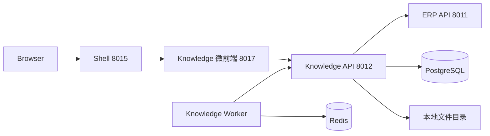

# Neorvion Knowledge V2

独立 AI 知识库：租户隔离的知识库 CRUD、文档上传、解析、切片与异步任务。V3 再接入 Embedding / pgvector / 问答。

## 与 ERP 的关系



- 登录、Refresh、租户切换仍由 Shell + ERP 负责。
- Knowledge 先验签 JWT，再调用 ERP `POST /api/v1/internal/identity/introspect`。
- 前端传入的 `X-Tenant-ID` 只是意愿，不能单独采信。
- 权限沿用 `knowledge:read/create/update/delete`。上传=create，解析/切片/编辑切片=update，删除=delete，列表/下载/预览=read。

## 信息架构（已实现）

| 菜单 | 路由 | 说明 |
| --- | --- | --- |
| 工作台 | `/workbench` | 知识库/文档/切片数量、成功失败、最近文档、待处理任务 |
| 知识库 | `/bases` | V1 CRUD |
| 知识库详情 | `/bases/:id` | 概览、文档列表、切片、上传抽屉 |
| 文档详情 | `/bases/:id/documents/:docId` | 解析预览、切片编辑启停、任务与重试 |
| 处理任务 | `/tasks` | 全租户任务列表 |

未实现的「知识空间文章 / 检索问答 / 评测 / 系统管理」不展示空菜单。成员与角色仍在 ERP。

切租户后：`/bases/:id` 与文档详情回到工作台，任务详情回到 `/tasks`。Query Key 带 `tenantId`；页面 `epoch` 会卸掉上传队列等局部状态。前端取消的是浏览器请求，不会取消服务端已落库的解析任务。

## 数据库

迁移：`20261013_0001`（V1）→ `20261013_0002`（V2）。

- `knowledge_bases`：软删除。
- `knowledge_documents`：SHA256、抽取文本、切片参数、`deleted_at`。同库未删除记录 `(tenant_id, knowledge_base_id, sha256)` 唯一。
- `document_chunks`：`version + chunk_index` 唯一。仅 `ACTIVE` 对 UI 可见。`enabled=false` 留给 V3 检索排除。
- `document_processing_tasks`：`QUEUED/RUNNING/SUCCESS/FAILED`。进行中的 `(tenant_id, document_id, task_type)` 唯一，避免并发重复处理同一文档。

复合外键始终带 `tenant_id`。

## 文件存储

原文件不进 PostgreSQL。相对键：

`{tenant_id}/{knowledge_base_id}/{document_id}/original.{ext}`

根目录 `STORAGE_ROOT`（默认 `services/knowledge/var/storage`）。解析路径必须落在根目录内，拒绝 `..` 与绝对路径。未来可把同一 `storage_key` 映射到对象存储。

限制：PDF / DOCX / TXT / Markdown；单文件 20MB；单次最多 10 个；魔数校验扩展名。

## 解析与切片

| 类型 | 库 | 说明 |
| --- | --- | --- |
| PDF | pypdf | 无文本视为扫描版，明确失败，不做 OCR |
| DOCX | python-docx | 保留 Heading 与段落 |
| Markdown | 文本 + 标题识别 | 保留 ATX 标题 |
| TXT | charset-normalizer | 常见编码 |

切片单位是 **字符**（`len`），不是 Token。

- `FIXED`：`CharacterTextSplitter`
- `RECURSIVE`：`RecursiveCharacterTextSplitter`，分隔符含中文标点与段落
- `chunk_size` 100–8000；`overlap >= chunk_size` 拒绝

重新切片：先在新 `version` 写入 `DRAFT`，成功后再把旧 `ACTIVE` 标为 `SUPERSEDED` 并发布新切片。失败则回滚，旧切片保留。

## 任务状态机

```text
QUEUED → RUNNING → SUCCESS
                 ↘ FAILED →（重试）QUEUED
```

PostgreSQL 是真相；Redis List 只投递 `task_id`。测试与不便起 Worker 时可设 `TASK_EXECUTOR=inline`。

Worker：`uv run python -m app.tasks.worker`。启动时把遗留 `RUNNING` 标失败（副作用无法确认），并把 `QUEUED` 重新入队。

删除文档：软删除、删磁盘文件、删切片；进行中任务标失败。任务行保留审计。删除知识库时同样清理下属文档文件。

## 本地运行

```bash
cd services/knowledge
uv sync
uv run alembic upgrade head
uv run python -m app
# 另开终端（TASK_EXECUTOR=redis 时必须）
uv run python -m app.tasks.worker
pnpm dev
```

前端还需 `apps/knowledge/.env`（从 `.env.example` 复制），`VITE_API_BASE_URL=http://localhost:8012`。

访问 http://localhost:8015/knowledge 。Windows 请用 `uv run python -m app`，不要直接 uvicorn（Selector 循环）。开发态 Vite HTML 必须是绝对资源地址，否则无界 iframe 会加载到 Shell 自己的脚本。

## 测试

```bash
cd services/knowledge
uv run pytest -q --tb=short
pnpm --filter @neorvion/knowledge test
pnpm --filter @neorvion/shell test
```

## 设计取舍

- 不引入 Celery。与 ERP 一样：DB 状态 + Redis 投递 + 独立 Worker。
- 不新增一套 Knowledge RBAC。
- 抽取文本进 PostgreSQL，便于预览；原文件进磁盘。
- 切片失败不丢旧数据，保证可重试。

## 已知限制

- 无 OCR、无复杂表格还原、无网页采集。
- 单 Worker 串行，适合小规格 Linux。
- 切片按字符，不是 Tokenizer。
- 无 Embedding / 向量检索 / 问答（V3）。
- 知识库软删后名称可复用；文档 SHA256 在软删后可重新上传。

## V3 建议复用

- `document_chunks` 中 `status=ACTIVE AND enabled=true` 作为 Embedding 语料。
- `page_no` / `heading` / `source_start` / `source_end` 做引用溯源。
- `storage_key` 回原文件。
- 检索 API 继续走用户 JWT + `X-Tenant-ID` + ERP 内省，不要让 Copilot 直连 PostgreSQL。
