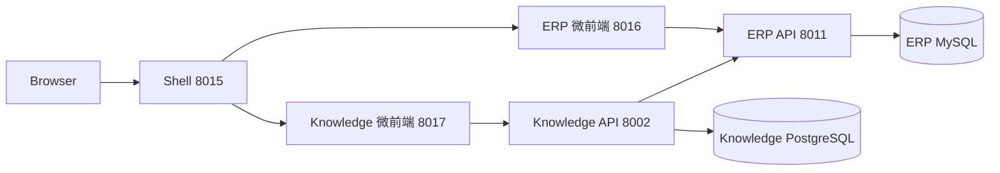

# Neorvion Knowledge V1

独立 AI 知识库系统。与 ERP 同级，不把 Knowledge Router 注册进 ERP FastAPI。

## 与 ERP 的关系



- 登录、Refresh、租户切换仍由 Shell + ERP 负责。
- Knowledge 前端通过 Wujie props 拿到 Access Token 和 `tenantId`，401 时调用 Shell 的 `refreshSession`。
- Knowledge 后端先验签 JWT，再调用 `POST /api/v1/internal/identity/introspect` 确认成员与权限。
- Knowledge 不读取 ERP 用户 / 角色 / 权限表。
- 未来 Copilot 应调用 Knowledge API（带用户 JWT + `X-Tenant-ID`），不要直连 PostgreSQL。

## 目录

```text
services/knowledge/        # 独立 FastAPI
  app/{api,core,db,models,schemas,repositories,services}
  alembic/
  tests/
  Dockerfile               # V1 仅准备，不要求部署
apps/knowledge/            # React 微前端
packages/shared/           # 权限码、Query Key、知识库类型
services/erp/              # 仅增加权限目录与内部身份内省
```

## 认证、权限和租户隔离

1. 浏览器把 ERP Access Token 和 `X-Tenant-ID` 发给 Knowledge。
2. Knowledge 用 `ERP_JWT_SECRET` 校验签名、过期和 `type=access`。只解码不验签会被拒绝。
3. Knowledge 用 `X-Internal-Service-Key` 调用 ERP 内省接口。ERP 再查 `tenant_members` 和角色权限。
4. 身份按 `(jti, tenant_id)` 缓存 30 秒。权限变更最多延迟一个 TTL。
5. 业务查询强制 `tenant_id`。跨租户 ID 访问返回 404，避免枚举。
6. 前端按钮按权限隐藏；后端 `require_permission` 才是授权边界。

权限编码：

| code | 含义 | OWNER | ADMIN | OPERATOR | WAREHOUSE | VIEWER |
| --- | --- | --- | --- | --- | --- | --- |
| `knowledge:read` | 查看 | 全部 | 全部 | 有 | 有 | 有 |
| `knowledge:create` | 创建 | 全部 | 全部 | 有 | 无 | 无 |
| `knowledge:update` | 编辑 | 全部 | 全部 | 有 | 无 | 无 |
| `knowledge:delete` | 删除 | 全部 | 全部 | 无 | 无 | 无 |

OWNER 仍按 ERP 规则动态拥有目录中全部已知权限。历史租户的系统角色由 Alembic `20261013_0020` 按模板只增不删。自定义角色不会自动获得新权限。

## 删除策略

采用**软删除**（`deleted_at`）。

知识库未来会关联文档、Chunk 和向量文件。硬删除或数据库级联会丢掉清理对象存储 / 向量索引的机会。V1 删除后列表不可见，名称可被重新使用；文档行保留，留给 V2 做资源回收。

禁用（`DISABLED`）不是删除。V1 仍可查看详情；普通检索（V3）不得使用禁用知识库。

## 数据库

PostgreSQL。核心表：

- `knowledge_bases`：租户知识库。`(tenant_id, name)` 在 `deleted_at IS NULL` 时唯一。
- `knowledge_documents`：文档元数据。复合外键 `(tenant_id, knowledge_base_id)` 防止跨租户关联。

V1 验证 pgvector 扩展可用性，但不依赖向量检索才能运行。

## API

| 方法 | 路径 | 权限 |
| --- | --- | --- |
| GET | `/api/v1/health` | 公开 |
| GET | `/api/v1/me/permissions` | 登录 + 租户 |
| GET | `/api/v1/knowledge-bases` | `knowledge:read` |
| POST | `/api/v1/knowledge-bases` | `knowledge:create` |
| GET | `/api/v1/knowledge-bases/{id}` | `knowledge:read` |
| PATCH | `/api/v1/knowledge-bases/{id}` | `knowledge:update` |
| DELETE | `/api/v1/knowledge-bases/{id}` | `knowledge:delete` |

分页 `page_size` 上限 100。创建/编辑禁止提交 `tenant_id`、`created_by`。

ERP 内部接口：

| 方法 | 路径 | 说明 |
| --- | --- | --- |
| POST | `/api/v1/internal/identity/introspect` | 需要用户 JWT + `X-Tenant-ID` + `X-Internal-Service-Key` |

## 本地运行

PostgreSQL：用户 `postgres`，Host `127.0.0.1`，Port `5432`。

```sql
CREATE DATABASE neorvion_knowledge;
CREATE DATABASE neorvion_knowledge_test;
CREATE EXTENSION IF NOT EXISTS vector; -- 可选
```

```bash
# ERP：写入 INTERNAL_SERVICE_KEY 后
cd services/erp
uv run alembic upgrade head
uv run python -m app.scripts.seed_permissions
uv run uvicorn app.main:app --reload --host 0.0.0.0 --port 8011

# Knowledge
cd services/knowledge
uv sync
uv run alembic upgrade head
uv run python -m app

# 前端
pnpm install
pnpm dev
```

访问 http://localhost:8015/knowledge 。

Windows 上 psycopg 异步驱动不能使用 uvicorn 默认的 `ProactorEventLoop`。请用 `uv run python -m app` 启动；该入口通过 `--loop app.core.event_loop:selector_loop_factory` 强制 Selector 循环。

## 测试

```bash
cd services/knowledge
uv run pytest -q --tb=short
cd services/erp
uv run pytest tests/test_internal_identity.py -q --tb=short
pnpm --filter @neorvion/knowledge test
```

Knowledge 测试使用 `neorvion_knowledge_test`，并用假身份客户端代替真实 ERP，但仍校验 JWT 签名、租户隔离和权限码。

## 联调注意

- `services/erp/.env` 增加 `INTERNAL_SERVICE_KEY` 后必须重启 ERP，进程内 Settings 不会热更新该项。
- Knowledge 调用 ERP 时 `httpx` 使用 `trust_env=False`，避免本机 HTTP 代理剥掉 `X-Internal-Service-Key`。
- `ERP_JWT_SECRET` 必须与 ERP `SECRET_KEY` 一致；权限仍以后端内省为准，不能只靠共享 Secret。

## V2 / V3

V2：文档上传、对象存储、解析状态机、失败重试、删除时清理文件。

V3：Chunk、pgvector 检索、给 Copilot 的检索 API。Copilot 只通过 Knowledge API + 当前用户凭证访问，继续走租户隔离与 RBAC。
