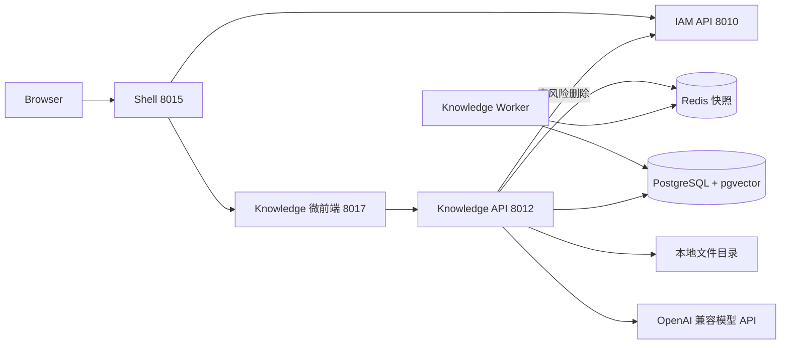

# Neorvion Knowledge V5

独立 AI 知识库：V1 知识库 CRUD → V2 文档解析与切片 → V3 RAG 检索与智能问答 → V4 RAG 评测与召回调优 → V5 企业级管理与评测初始化。身份、租户、功能 RBAC 以 **IAM** 为权威来源。

## 与 IAM / ERP 的关系



- 登录、Refresh、租户切换由 Shell + IAM 负责。
- Knowledge 本地校验 IAM RS256 JWT，读 Redis 授权快照。删除知识库回源 IAM `internal/authorize`。
- 前端传入的 `X-Tenant-ID` 只是意愿，不能单独采信。
- 功能权限沿用 `knowledge:read/create/update/delete`。检索与问答需要 read；重建索引与模型连通测试需要 update。文档共享 ACL 由本服务检查。
- 模型密钥只在 Knowledge 服务端环境变量中，不返回前端，也不写入 Git。

## 信息架构

| 菜单 | 路由 | 说明 |
| --- | --- | --- |
| 工作台 | `/workbench` | 知识库/文档/切片数量、最近文档、待处理任务 |
| 智能搜索 | `/search` | 真实检索引擎：VECTOR / KEYWORD / HYBRID |
| 知识问答 | `/chat`、`/chat/:id` | 会话、SSE 流式回答、引用来源 |
| 知识库 | `/bases` | V1 CRUD |
| 知识库详情 | `/bases/:id` | 概览、文档、切片、向量索引、授权 |
| 文档详情 | `/bases/:id/documents/:docId` | 解析预览、版本历史、切片编辑启停、任务与重试 |
| 召回调优 | `/retrieval-test` | 与问答共用检索引擎；对比 VECTOR/KEYWORD/HYBRID 与 Rerank 前后 |
| 处理任务 | `/tasks` | PARSE / CHUNK / EMBED |
| 模型配置 | `/models` | 平台级 Chat / Embedding / Rerank（无密钥明文） |
| 评测数据集 | `/datasets`、`/datasets/:id` | 数据集 CRUD、导入导出、问题标注 |
| 检索评测 | `/experiments` | 实验列表展示最近运行状态、Recall/MRR/nDCG/Hit/P95；展开看完整参数；可选 2–3 个成功实验进入对比 |
| 实验对比 | `/experiments/compare` | 多 run 指标、参数差异、低分问题；支持 `?run_ids=` |
| 使用统计 | `/stats` | 来自 retrieval_logs / messages 的真实用量 |
| 回收站 | `/recycle` | 软删除恢复与彻底清理 |
| API Key | `/api-keys` | 外部检索密钥，明文只显示一次 |
| 操作日志 | `/audit` | 知识库/文档/授权/Key 审计 |

成员与角色仍在 ERP。评测任务落在 PostgreSQL，切页面或切租户不会删除已排队的评测。

切租户后：`/bases/:id` 与文档详情回到工作台，`/chat/:id` 回到 `/chat`，任务详情回到 `/tasks`，`/datasets/:id` 回到 `/datasets`，`/experiments/:id` 回到 `/experiments`。Query Key 带 `tenantId`；页面 `epoch` 会卸掉局部状态并中止进行中的 SSE。前端取消的是浏览器请求，不会取消服务端已落库的解析/索引/评测任务。

## 数据库

迁移：`20261013_0001`（V1）→ `20261013_0002`（V2）→ `20261013_0003`（V3：pgvector + 会话）→ `20261014_0004`（V4 评测）→ `20261014_0005`（V5：版本/授权/API Key/审计 + 评测幂等键）→ `20261014_0006`（V5 时间戳默认值）→ `20261019_0007`（评测 PAUSED / 租约 / 阶段 checkpoint / Run 预算）。评测题说明见 [evaluation/README.md](./evaluation/README.md)。

V1/V2 表保持不变。V3 增量：

- `document_chunks.search_tsv`：`to_tsvector('simple', content)` 生成列 + GIN；另有 `gin_trgm_ops`。这不是 BM25。
- `chunk_embeddings`：一条切片一行向量。记录 `model_name`、`dimensions`、`content_hash`、`chunk_version`、`PENDING/READY/STALE/FAILED`。检索只使用当前模型、当前维度、`READY`、且 `chunk_version` 与文档 `active_chunk_version` 匹配的行。
- `model_profiles`：平台系统配置镜像（密钥只引用环境变量名）。
- `conversations` / `messages` / `message_citations`：会话、消息、引用来源。
- `retrieval_logs`：检索参数、阶段耗时与排名，供测试页解释。

复合外键始终带 `tenant_id`。索引失败不得破坏 V2 文档与切片。

向量列维度取自迁移时的 `EMBEDDING_DIMENSIONS`（默认 1024）。测试库使用 8 维。**更换维度必须重建迁移或新开库，并全量重建索引。**

## Embedding 与索引

- 供应商按能力拆分：`CHAT_PROVIDER` / `EMBEDDING_PROVIDER` / `RERANK_PROVIDER`。`MODEL_PROVIDER=mock` 仅测试，会覆盖三者。
- 默认 Chat：DeepSeek `deepseek-flash`（`https://api.deepseek.com`，OpenAI 兼容 `/chat/completions`）。
- 默认 Embedding：百炼 `text-embedding-v4`，1024 维，走工作空间 OpenAI 兼容 `/embeddings`。查询与文档必须同一模型与维度；更换模型后旧向量不参与检索，需重建索引。
- 默认 Rerank：百炼 `qwen3-rerank`，DashScope 原生 `.../services/rerank/text-rerank/text-rerank`，**不是** Chat Completions。Base URL 留空时从 Embedding 工作空间 host 推导，不臆造地域。
- 批量大小 `EMBEDDING_BATCH_SIZE`（默认 16），后台任务 `TaskType.EMBED`，失败可重试。429 / 5xx 可重试，401 / 402 不盲目重试。
- Chunk 编辑会标记向量 `STALE` 并排队重建；禁用切片不删向量，但检索 SQL 排除 `enabled=false`；删除文档会使进行中 EMBED 失败。
- 当前数据规模走精确余弦 kNN（`cosine_distance`），**不建 HNSW**。小数据 + 多租户 `WHERE` 过滤时 HNSW 容易降低召回。

## 检索引擎

三种策略共用 `RetrievalService.search`，智能搜索 / 检索测试 / 问答不得分叉实现。

| 策略 | 实现 |
| --- | --- |
| VECTOR | Embedding 查询向量 + pgvector 余弦距离，相似度 = `1 - distance` |
| KEYWORD | PostgreSQL `simple` FTS + `pg_trgm` + 中文 `ILIKE`。**不是 BM25** |
| HYBRID | 两路召回后 RRF（`k=60`）融合，按 `chunk_id` 去重 |

可选 Rerank：模型不可用或抛错时降级到融合结果，并标记 `rerank_degraded`。

分数不要混用：向量相似度、关键词分、RRF、Rerank 各自独立，阈值只作用在对应一路。

**租户与授权过滤全部在 SQL `WHERE` 中完成**（`tenant_id`、知识库 ACTIVE、切片 ACTIVE+enabled、当前版本、指定知识库 ID）。禁止先全局召回再在 Python 里丢弃其他租户。

## 知识问答 / SSE

```text
问题 → 检索 → 可选 Rerank → 证据筛选 → 构造上下文 → LLM → SSE
```

- 无命中：明确拒答，不把猜测当知识库事实。
- 文档正文包在 `<untrusted_document>` 中，系统提示要求忽略其中的指令。
- 历史只保留最近 `CHAT_HISTORY_TURNS` 轮，证据字符上限 `CHAT_MAX_CONTEXT_CHARS`。
- LLM 调用期间不持有长事务：先落库用户/助手消息并 commit，再流式生成，最后再写结果与 citation。
- SSE 事件：`status` / `token` / `citation` / `done` / `error`。请求携带 JWT 与已校验的租户头。切租户必须 abort 旧 EventStream。

## 模型配置

平台级 Chat / Embedding / Rerank 来自环境变量。API 只返回 `has_api_key` 与 `api_key_env`，永不返回密钥。普通租户管理员不能覆盖平台密钥。连通测试需要 `knowledge:update`。

本地示例（密钥只写 `services/knowledge/.env`，完整变量见 `services/knowledge/.env.example`）：

```env
CHAT_PROVIDER=openai_compat
CHAT_BASE_URL=https://api.deepseek.com
CHAT_MODEL=deepseek-flash
EMBEDDING_PROVIDER=openai_compat
EMBEDDING_MODEL=text-embedding-v4
EMBEDDING_DIMENSIONS=1024
RERANK_PROVIDER=dashscope
RERANK_MODEL=qwen3-rerank
```

`CHAT_API_KEY` 可回退 `DEEPSEEK_API_KEY`；`EMBEDDING_API_KEY` / `RERANK_API_KEY` 可回退 `DASHSCOPE_API_KEY`。测试默认 `MODEL_PROVIDER=mock`，不产生计费。

连通测试在「模型配置」页分别打 Chat / Embedding / Rerank。失败原因会区分密钥缺失、URL 错误、模型不存在、余额不足、维度不一致。摘要不含密钥。

## 解析与切片（V2，仍有效）

| 类型 | 库 | 说明 |
| --- | --- | --- |
| PDF | pypdf | 无文本视为扫描版，明确失败，不做 OCR |
| DOCX | python-docx | 保留 Heading 与段落 |
| Markdown | 文本 + 标题识别 | 保留 ATX 标题 |
| TXT | charset-normalizer | 常见编码 |

切片单位是 **字符**。`FIXED` / `RECURSIVE`。重新切片写入新 `version`，成功后再把旧 `ACTIVE` 标为 `SUPERSEDED`。

## 任务状态机

```text
QUEUED → RUNNING → SUCCESS
                 ↘ PAUSED →（继续运行 / 重试失败题）QUEUED
                 ↘ FAILED →（重试失败题）QUEUED
                 ↘ CANCELLED
```

`PARSE` / `CHUNK` 失败会影响文档状态；`EMBED` 失败不影响 V2 原文与切片。PostgreSQL 是真相；Redis List 只投递 `task_id` 或 `eval:{run_id}`。`TASK_EXECUTOR=inline` 仅建议测试。

Worker：`uv run python -m app.tasks.worker`。评测运行与文档任务共用同一队列，前缀 `eval:` 区分。文档 RUNNING 重启后标失败；评测 RUNNING 在租约过期后改为 QUEUED，保留已落库题目并从中断阶段续跑。同一 Run 通过 `lease_owner` / `lease_until` 保证同一时刻只有一个 Worker 执行。

## 本地运行

```bash
cd services/knowledge
uv sync
uv run alembic upgrade head
uv run python -m app
# TASK_EXECUTOR=redis 时另开
uv run python -m app.tasks.worker
pnpm dev
```

前端 `apps/knowledge/.env`：`VITE_API_BASE_URL=http://localhost:8012`。访问 http://localhost:8015/knowledge 。Windows 请用 `uv run python -m app`。

可选真实模型联调：在 `services/knowledge/.env` 填入供应商 Key，保持 `MODEL_PROVIDER=openai_compat`，上传文档后看知识库「向量索引」变为就绪，再在检索测试页跑同一问题的三种策略。

## 测试

```bash
cd services/knowledge
uv run pytest -q --tb=short
pnpm --filter @neorvion/knowledge test
pnpm --filter @neorvion/shared test
pnpm --filter @neorvion/shell test
```

测试使用独立库 `neorvion_knowledge_test` 与 mock 模型客户端，不依赖真实 API 计费。

## 性能约束（面向 4 核 4GB）

- 不在服务器常驻本地大模型。
- Embedding 批量走任务，控制批次与 Worker 并发 1。
- 检索在 SQL 层过滤，不把整库 Chunk 载入 Python。
- SQLAlchemy 连接池 `pool_size=5, max_overflow=5`。
- 精确 kNN 适合当前小数据；上万切片后再评估 HNSW，并单独验证多租户过滤召回。

## V4 评测系统

评测不改线上 Chunk / 向量索引。实验只调用 `RetrievalService.search(..., persist_log=False)`，参数快照写入 `evaluation_runs.config_snapshot`。

```text
数据集 → 标注 Chunk（0–3）→ 冻结版本快照 → 创建实验参数方案
→ evaluation_runs QUEUED → Worker 批量检索（可选生成+Judge）
→ 代码计算 Hit/Recall/Precision/MRR/nDCG → 对比 / 调参
```

### 数据集 Schema 与标注

| 表 | 作用 |
| --- | --- |
| `evaluation_datasets` | 数据集元数据、关联知识库、当前冻结版本 |
| `evaluation_dataset_versions` | JSONB 快照：问题、标准答案、标注、`source_key` |
| `evaluation_cases` | 问题。`PENDING` 待标注 / `LABELED` 已标但无有效相关 / `READY` 可正式评测 |
| `evaluation_judgments` | 多 Chunk 标注。`stale=true` 表示切片版本或正文哈希已变 |
| `evaluation_experiments` | 可复用参数方案 |
| `evaluation_runs` | 一次异步执行；PostgreSQL 是状态真相 |
| `evaluation_results` | 单题召回快照、指标、Judge 原始输出 |

`is_unanswerable=true` 是显式无答案题，状态可直接 `READY`，不能当成缺少标注。有监督检索只使用非 stale 且 `relevance>=1` 的 Chunk。

稳定来源键：`kb:{kb_id}:doc:{doc_id}:sha:{sha256}:v:{chunk_version}:i:{chunk_index}`。文档更新导致 Chunk ID 变化时，按哈希/版本把旧标注标 stale，提示人工重确认，禁止悄悄当作有效相关。

导入：CSV / JSONL / 简易 xlsx。中文表头别名：问题、标准答案、类型、难度、标签、无答案。错误行返回 `{row, message}`，成功行写入待标注（无答案题除外）。

### 指标定义（Chunk 粒度，代码计算）

相关集合 R = `{id | relevance >= 1}`。K 是实验配置的最终 Top-K，不是实际返回条数。

| 指标 | 定义 | 例：排名 `[10,99,20]`，相关 `{10:3,20:1,30:2}`，K=3 |
| --- | --- | --- |
| Hit Rate@K | Top-K 是否至少命中一个相关 | 1 |
| Recall@K | \|Top-K ∩ R\| / \|R\| | 2/3 |
| Precision@K | \|Top-K ∩ R\| / K | 2/3 |
| MRR | 第一个相关结果排名的倒数，未命中为 0 | 1 |
| nDCG@K | 增益 `2^rel-1`，折损 `log2(rank+1)` | DCG/IDCG |

Document 粒度单独计算并标记 `granularity=document`，不得与 Chunk 指标混用。无答案题不计算 Recall（分母为零），改为 `false_recall` / `empty_ok` / 拒答率。

`METRIC_VERSION=v4-chunk-ndcg-exp`。

### 生成质量与 Judge 选型

未引入 Ragas：依赖重、与当前 FastAPI/mock 测试栈不契合，且检索指标必须由代码保证数学正确。也未强制 LangSmith。

可选 LLM-as-a-Judge（默认关闭）：Faithfulness / Answer Relevancy / Answer Correctness。无标准答案时 `answer_correctness` 必须为 null。Judge 输出非法 JSON 或越界分数时 **不伪造分数**，只记 `judge_error`。知识库摘录包在 `<untrusted_document>` 中。记录 `judge_model` 与 `judge_prompt_version=v4-judge-1`。结果具有主观性与波动，界面会标明。支持人工 `human_override`。

### 实验列表

`GET /evaluation/experiments` 一次返回参数方案和 `latest_run`（该实验最近一次运行摘要），避免前端再逐条拉详情。`latest_run` 为 `null` 表示尚未运行。指标只在最近运行 `SUCCESS` 时从已落库的 `metrics` / `usage` 读取；未执行、运行中、失败、无有效监督题时字段为 `null`，**不用 0 冒充缺失**。`supervised_count` 是实际参与宏平均的有效题目数。

支持 `status`（含 `NEVER_RUN`）、`strategy`、`sort_by=id|created_at|recall|mrr|ndcg|hit_rate|latency_p95`。Vector/Keyword Top-K、RRF、候选召回、阈值、模型版本等放在展开行，不挤占默认列。对比入口携带 `?run_ids=` 复用现有 compare API；数据集或 Embedding/索引版本不同时列表与对比页都会提示不可严格比较。

### 运行记录列表

`GET /evaluation/runs` 返回每次运行自己的 `config_snapshot`、`metrics`、`usage`。页面下方运行表只读这份快照，不回填实验当前配置。启动评测时会把当时的 Embedding/Chat/Rerank/指标版本写入快照；历史记录缺 key 显示「未记录」，不用系统默认值冒充。未完成运行的指标为 `null`。支持按 `status` / `strategy` 筛选，按 Recall/MRR/nDCG/Hit/P95 排序。

### 实验可复现

每次运行冻结当前数据集版本。`config_snapshot` 含策略、Top-K、RRF、Rerank、Embedding 模型与维度、Chat/Rerank 模型、Prompt/指标版本。对比时若数据集版本或 Embedding/维度不同，标记 **非严格可比**，不给出误导性提升结论。Chunk Size / Overlap 变化必须通过独立索引版本对比，评测不得改写线上切片。

### 任务与限额

- 单任务最大题量 `EVAL_MAX_CASES`（默认 200）
- Token 预算 `EVAL_TOKEN_BUDGET`，可在实验配置或「继续运行」时上调；累计值来自已落库 `evaluation_results.usage`，恢复不会从 0 重算
- 费用预算可选；`EVAL_PROMPT_TOKEN_USD` / `EVAL_COMPLETION_TOKEN_USD` 为 0 时不估算，不用假账单。供应商未返回精确 Token 时标记 `token_estimated`
- Worker 并发 `WORKER_CONCURRENCY`；评测另有 `EVAL_LEASE_SECONDS` 租约
- 同一实验同时只能有一个 QUEUED / RUNNING / PAUSED
- 暂停：QUEUED 立即 PAUSED；RUNNING 设 `pause_requested`，下一题前退出。继续运行仍是同一个 Run，不新建实验
- 取消：QUEUED / PAUSED 立即 CANCELLED；RUNNING 设 `cancel_requested`，下一题前退出
- 重试失败题：保留 SUCCESS 结果，只重置失败/未完成阶段（Judge 失败时复用已生成回答）
- 单题失败默认继续其余题目（`EVAL_CONTINUE_ON_ERROR`）；上下文超限不无限重试；429/超时有限指数退避。超时请求可能已产生费用，恢复不能保证绝对不重复计费
- 阶段 checkpoint：`RETRIEVE` / `RERANK` / `GENERATE` / `JUDGE` / `METRICS`。Rerank 不是第二次检索，状态来自同一次 `search()`

### 检索调优

召回调优页对比 VECTOR / KEYWORD / HYBRID、调整 Vector/Keyword/最终 Top-K 与 RRF k、对比 Rerank 前后排名与阶段耗时。与问答共用 `RetrievalService.search`。

### 本地评测步骤

1. `uv run alembic upgrade head`
2. 上传文档并等待 EMBED 完成
3. 创建数据集 → 新增问题 → 标注相关 Chunk → 冻结（首次运行会自动冻结，之后复用该版本直到再次冻结）
4. 创建实验（先关闭生成评测）→ 运行 → 查看 Recall/nDCG
5. 复制实验、改策略或 Top-K 再跑 → 实验对比
6. 可选打开生成评测（会产生模型费用；测试用 `MODEL_PROVIDER=mock`）

## 已知限制

- 无 OCR、无复杂表格还原。
- 关键词检索不是 BM25；中文主要靠 ILIKE + trigram。
- Rerank 依赖可选兼容 HTTP；未配置则降级。
- 更换 Embedding 维度需要重建向量列。
- LLM Judge 不稳定，不能替代有监督检索指标。
- xlsx 导入只支持简单共享字符串表，复杂 Excel 请改 CSV/JSONL。
- 评测不会为对比自动创建独立向量索引；切片策略变化需另建知识库或重建后再评。
- 模型请求超时后供应商可能已经计费；续跑不会保证绝对不重复扣费。Token 预算是单次 Run 级预留，不是租户钱包。
- 评测 Worker 崩溃后需等待租约过期（默认 45 秒）才会被其他进程收回；心跳按题目刷新。

## V5 已实现

企业级管理（增量表，不改 V1–V4 主数据）：

| 能力 | 说明 |
| --- | --- |
| 文档版本 | `document_revisions` 快照原文件。更新/恢复先 PARSE，新切片发布前旧 ACTIVE 仍可检索 |
| 回收站 | 知识库/文档软删除；支持批量恢复、批量彻底删除、二次确认清空。切片表不加 `deleted_at`，业务列表/统计/检索通过父文档与知识库 `deleted_at` 过滤 |

### 删除与恢复生命周期

只在 `knowledge_bases.deleted_at` 与 `knowledge_documents.deleted_at` 上做软删除，不为 Chunk / Embedding 增加 `deleted_at`。

| 操作 | 立刻从列表/统计/检索消失 | 物理数据 | 恢复规则 |
| --- | --- | --- | --- |
| 软删除文档 | 该文档的 Chunk、Embedding、解析预览、索引统计、RAG/问答/评测新请求 | 文件、切片、向量保留，供还原 | 若当前版本切片与向量仍匹配则重用，否则进入待重新索引 |
| 软删除知识库 | 库及其**当时仍有效**的文档、下属切片与向量 | 同上 | 只恢复删除库时一并盖戳的文档。删除库之前就已单独删除的文档保持删除 |
| 彻底删除 | 数据库行、向量、存储文件 | 先提交数据库再删文件；文件失败写入 `*.purge_files_pending` 审计，可重试 | 不可恢复 |
| 历史任务 / 评测 / 引用快照 / 审计 | 保留 | 不级联删除 | 任务列表用 `document_available` 表示文档是否仍可打开，不新增“文档已删除”状态列 |

PARSE / CHUNK / EMBED 在软删除时取消；Worker 写入 DRAFT→ACTIVE 或向量前会再次检查文档与知识库是否仍有效。覆盖该库的排队/运行中评测会 `cancel_requested`。已启动的短请求以检索当时的 SQL 过滤为准，不会把已删除内容作为新证据。

回收站接口：`GET /api/v1/recycle`、`POST /api/v1/recycle/restore-batch`、`POST /api/v1/recycle/purge-batch`、`POST /api/v1/recycle/empty`（必须 `confirm=true` 且 `expected_count` 与当前条数一致）。知识库删除后，其下属文档不再作为独立回收站行出现，避免与库级联重复。

检索/切片默认值以 `GET /api/v1/retrieval/defaults` 为准，前端帮助文案不得写死冒充系统配置。评测列表的 Vector/Keyword Top-K、RRF k 等列读取实验 `config` 快照；缺 key 显示「未记录」。
| 知识库授权 | `knowledge_base_grants`。无记录回退租户 `knowledge:*`；有记录即白名单。OWNER 绕过。不另建租户体系 |
| API Key | `nk_` 前缀，服务端只存 SHA256。明文仅创建时返回一次。scopes：search/chat/stats。租户绑定在 Key 上，改 `X-Tenant-ID` 不能跨租户。支持过期、撤销、限流 |
| 审计 | `knowledge_audit_logs`，敏感字段脱敏 |
| 任务监控 | 沿用处理任务页：PARSE/CHUNK/EMBED 状态、失败原因、重试 |
| 评测初始化 | 租户 3 幂等导入 100 题（`external_key`）。AI 生成答案一律 `needs_human_review`。脚本只自动 probe 3 题 |

初始化：`uv run python -m app.scripts.seed_eval_v5`（密码只读 `KNOWLEDGE_SEED_PASSWORD`）。题目与操作说明见 [evaluation/](./evaluation/README.md)。

### 后续建议

- 可选 BM25 / 真正的中文分词检索。
- 评测用独立索引版本（按 chunk_size 建影子库）做切片策略 A/B。
- 人工标注工作台：检索候选一键标注、仲裁、一致性检查。
- 可选对接 LangSmith / Ragas，作为旁路而不是核心依赖。
- Token 单价按模型拆分、费用预警。
- 大规模时评估 HNSW，并单独验证多租户 SQL 过滤召回。
